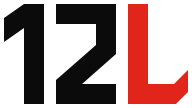

<p align="center">
  <picture>
    <source media="(prefers-color-scheme: dark)" srcset="docs/design-system/assets/logo-dark.svg">
    
  </picture>
</p>

# 12L

[](LICENSE)
[](https://angular.dev)
[](https://dotnet.microsoft.com)
[](CONTRIBUTING.md)
[](CODE_OF_CONDUCT.md)

12L is an open marketplace for new and used men's clothing in two sizes only: **size 12 shoes** and **size large (L) clothing**. Anyone can join, list what they no longer wear, and buy from people who wear the same size.

The name says it all: **12** for the shoes, **L** for the clothes.

12L is a full-stack, responsive web application with an [Angular](https://angular.dev) frontend and a [.NET](https://dotnet.microsoft.com) backend.

## Table of contents

- [Why 12L](#why-12l)
- [How it works](#how-it-works)
- [What you can sell](#what-you-can-sell)
- [Features](#features)
- [Architecture](#architecture)
- [Getting started](#getting-started)
  - [Prerequisites](#prerequisites)
  - [Load demo data](#load-demo-data)
- [Project structure](#project-structure)
- [Documentation](#documentation)
- [Contributing](#contributing)
- [Code of conduct](#code-of-conduct)
- [Security](#security)
- [Support](#support)
- [License](#license)

## Why 12L

General marketplaces make you filter through thousands of listings that will never fit. 12L removes the guesswork. Every listing on 12L is either a size 12 shoe or a size large garment, so every item a buyer sees is one they can wear.

## How it works

1. **Join.** Anyone can create an account. There is no seller approval step.
2. **List.** Sellers photograph an item, describe its condition, and set a price.
3. **Browse.** Buyers browse a catalog where everything is already in their size.
4. **Buy.** Buyers purchase the item and the seller ships it.
5. **Complete.** The buyer confirms receipt and the seller is paid. (Reviews between buyers and sellers are deferred; see `docs/adr/`.)

## What you can sell

| Category | Accepted size | Condition |
| --- | --- | --- |
| Shoes (sneakers, boots, dress shoes, sandals) | Men's US 12 | New or used |
| Tops (shirts, t-shirts, sweaters, hoodies) | Men's L | New or used |
| Outerwear (jackets, coats) | Men's L | New or used |
| Bottoms (pants, shorts) | Men's L | New or used |

Listings in any other size are out of scope for 12L and are not accepted.

## Features

- **Open to everyone.** Any member can buy and sell.
- **Size-locked catalog.** Only men's size 12 shoes and size large clothing can be listed.
- **New and used.** Sellers mark each item as new, new with tags, or used, with a condition grade.
- **Seller profiles.** Each seller has a public profile with their listings and ratings.
- **Search and filters.** Filter by category, brand, condition and price.
- **Responsive.** One web app that works on phones, tablets and desktops.

## Architecture

| Layer | Technology | Responsibility |
| --- | --- | --- |
| Frontend | Angular (TypeScript) | Responsive single-page app for browsing, listing, buying and managing an account |
| Backend | .NET (C#, ASP.NET Core Web API) | REST API for members, listings, orders and reviews, and enforcement of the size rules |

The Angular app calls the ASP.NET Core API over HTTPS. The backend is the source of truth for the size rules: it rejects any listing that is not a men's size 12 shoe or a men's size large garment, whatever the client sends.

## Getting started

### Prerequisites

- [Git](https://git-scm.com)
- [.NET SDK 10](https://dotnet.microsoft.com/download) (pinned in `src/backend/global.json`)
- [Node.js 22 LTS](https://nodejs.org) and npm

No database, Docker or other service is needed: the tests fake every external system.

### Clone, install and verify

```bash
git clone https://github.com/QuinntyneBrown/12l.git
cd 12l/src/frontend
npm ci
npx playwright install chromium
npm run verify
```

`npm run verify` restores, format-checks, builds and tests the backend solution, then
lints both Prettier and ESLint, builds every Angular library and the application, and runs
the Playwright tests. It stops at the first failure. CI runs the same command.

### Run the apps

```bash
# from src/frontend
npm start                                   # Angular app on http://localhost:4200
dotnet run --project ../backend/TwelveL.Api # API; GET /api/health returns 200
```

### Load demo data

`TwelveL.Cli` resets a local database and fills it with 8 demo members and 48 listings with
real product photos in every category, so `/`, `/shoes`, `/tops`, `/outerwear`, `/bottoms`
and the listing pages look real. It is for your own machine only; see
[its README](src/backend/TwelveL.Cli/README.md) for the demo accounts and password.

```bash
# from src/backend, with SQL Server LocalDB (or any SQL Server you own)
export ConnectionStrings__TwelveL="Server=(localdb)\MSSQLLocalDB;Database=TwelveL;Trusted_Connection=True;TrustServerCertificate=True"
export DOTNET_ENVIRONMENT=Development   # reset refuses to run otherwise, unless --force
dotnet build TwelveL.Cli
dotnet TwelveL.Cli/bin/Debug/net10.0/TwelveL.Cli.dll seed --reset
```

Start the API with the same `ConnectionStrings__TwelveL` so it reads the seeded database.
On Windows on Arm, LocalDB is x64 only: build with the normal SDK, then run the built DLL
with the x64 host, `"C:\Program Files\dotnet\x64\dotnet.exe" TwelveL.Cli\bin\Debug\net10.0\TwelveL.Cli.dll seed --reset`
(the arm64 host fails with error 193). Run the API the same way.

### Individual checks

| Command (from `src/frontend`) | Does |
|---|---|
| `npm run backend:verify` | Backend restore, format check, build, tests |
| `npm run lint` | Prettier check and ESLint |
| `npm run build:all` | Every library, then the application |
| `npm run test:e2e` | Playwright (Chromium) against the production build |

## Project structure

```text
12l/
├── .agents/skills/        Agent skills (shared, tool-agnostic copy)
├── .claude/skills/        Agent skills for Claude Code
├── .github/               Issue templates, pull request template, Copilot instructions
├── docs/                  Journeys, specs, mocks, design system, designs, estimates, ADRs
├── src/backend/           .NET solution (TwelveL.Api, Application, Domain, Infrastructure, Worker, Migrator, Cli)
├── src/frontend/          Angular workspace (projects/twelvel plus api, components and feature libraries)
├── tests/                 xUnit test project per backend project
├── AGENTS.md              Working agreement for coding agents
├── CLAUDE.md              Instructions for Claude Code
├── GEMINI.md              Instructions for Gemini
├── CHANGELOG.md           Release history
├── CODE_OF_CONDUCT.md     Contributor Covenant
├── CONTRIBUTING.md        How to contribute
├── LICENSE                MIT License
├── SECURITY.md            Security policy
└── SUPPORT.md             How to get help
```

## Documentation

- [docs/specs/L1.md](docs/specs/L1.md) and [docs/specs/L2.md](docs/specs/L2.md) are the high-level and detailed requirements, with acceptance criteria.
- [CONTRIBUTING.md](CONTRIBUTING.md) explains how to propose changes.
- [AGENTS.md](AGENTS.md) is the working agreement for AI coding agents.
- [CHANGELOG.md](CHANGELOG.md) records notable changes.

## Contributing

Contributions are welcome. Please read [CONTRIBUTING.md](CONTRIBUTING.md) before opening an issue or a pull request.

## Code of conduct

This project has adopted the [Contributor Covenant](CODE_OF_CONDUCT.md). By participating you are expected to uphold it.

## Security

Please do not report security vulnerabilities through public issues. See [SECURITY.md](SECURITY.md) for how to report them privately.

## Support

See [SUPPORT.md](SUPPORT.md) for how to file issues and get help.

## License

12L is licensed under the [MIT License](LICENSE). The demo photos in
`src/backend/TwelveL.Cli/SeedPhotos/` are not: they keep their CC BY 2.0 licence, with authors
and sources in [ATTRIBUTION.md](src/backend/TwelveL.Cli/SeedPhotos/ATTRIBUTION.md).
