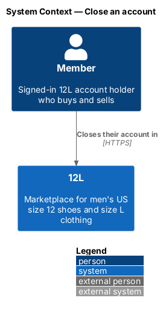
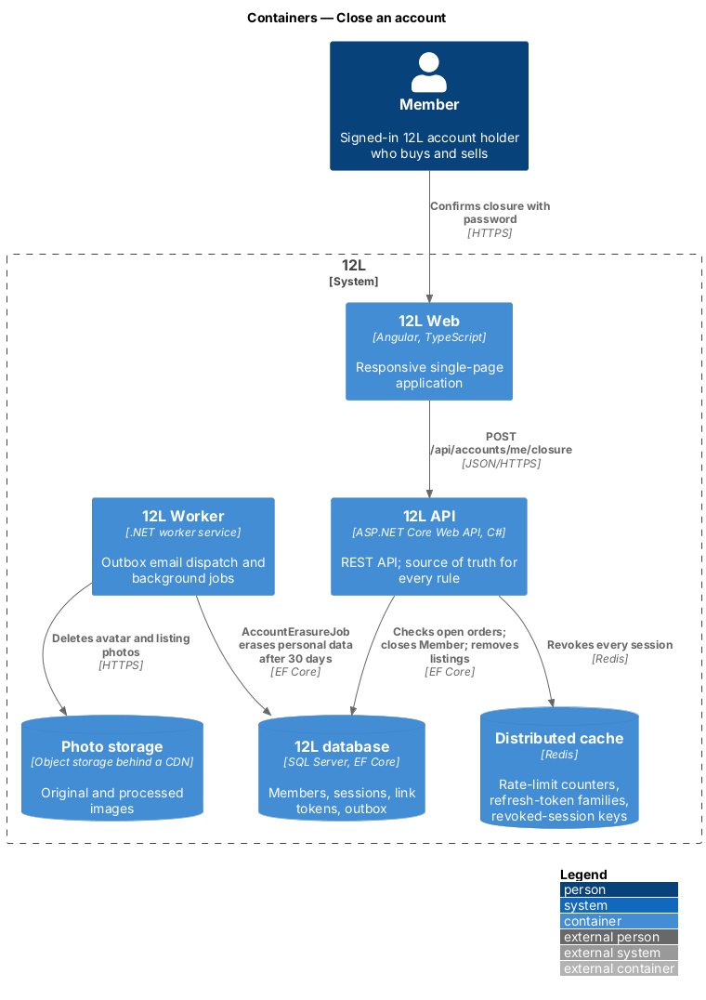
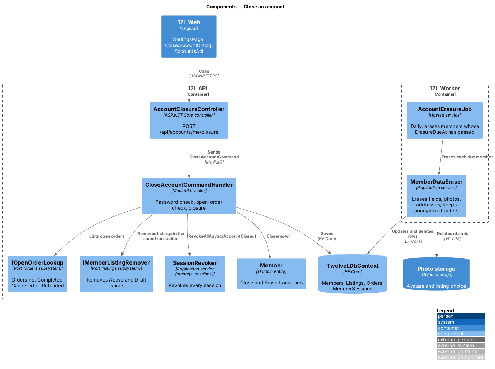
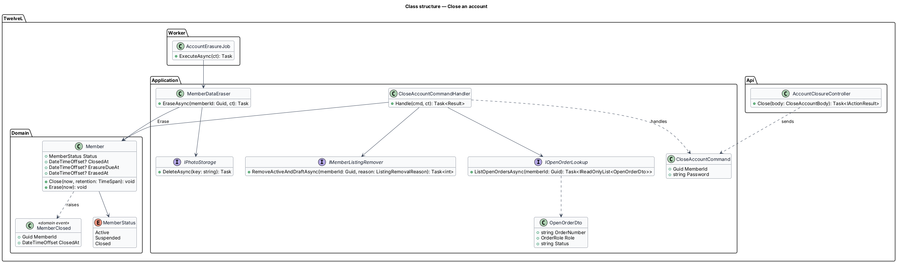
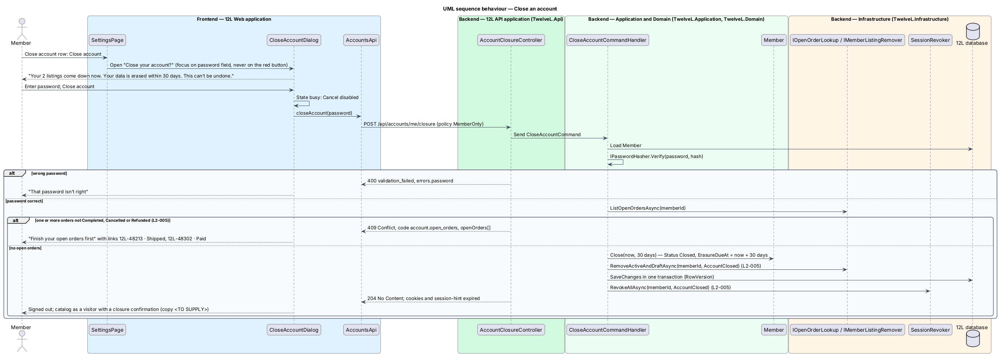
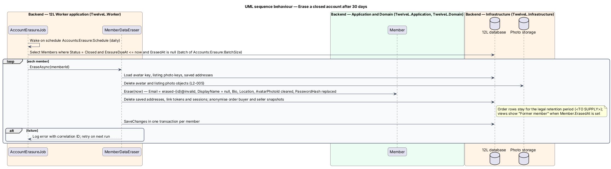

# Close an account

## Overview

A member may leave 12L at any time by closing their account. Closing is immediate for
what other people see: the member's active and draft listings come down, every session
ends, and the account can no longer sign in. Personal data is then erased within 30
days. Order records that the law requires 12L to keep remain, but in anonymised form, so
the other party's history still makes sense and shows the closed member as "Former
member".

Closure is refused while the member is still part of an order that is not finished,
because the buyer or seller on the other side depends on them. An order is finished when
its status is Completed, Cancelled or Refunded. The member sees the open orders and can
close the account once they are finished.

The feature has two halves: the closure request, which runs in `12L API` when the member
confirms with their password, and the erasure job, which runs in `12L Worker` 30 days
later.

Terms used in this document:

- **closure** — transition of a member to status `Closed`, after which the account cannot sign in or act
- **open order** — order in which the member is buyer or seller and whose status is not Completed, Cancelled or Refunded
- **erasure** — irreversible removal or replacement of a closed member's personal data
- **erasure due date** — instant 30 days after closure by which erasure runs
- **anonymised order record** — order row kept for legal retention with no link to the member's personal data

## Description

Mocks: `docs/mocks/dialogs/close-account/` (`default`, `invalid`, `busy`, `blocked`),
reached from the "Close account" row of `docs/mocks/pages/settings/`.

### Frontend (`src/frontend/src/app/accounts/close-account/`)

- **`CloseAccountDialog`** — opened from `SettingsPage` ([manage-sessions](../manage-sessions/README.md)). Danger icon, title "Close your account?", description "Your {n} listings come down now. Your data is erased within 30 days. This can’t be undone." The listing count comes from the settings overview. Password field "Enter your password to confirm"; buttons "Cancel" and "Close account" (danger style). Initial focus is the password field, never the danger button. States:
  - `invalid` — inline "That password isn’t right".
  - `busy` — Cancel disabled, button busy.
  - `blocked` — warning alert "Finish your open orders first", "You can close your account once these are completed, cancelled or refunded.", a list of order links "{order number} · {status}" (buyer orders to `/orders/{id}`, sales to `/sales/{id}`), single button "Close".
- **After closure** — `SessionStore.clear()`, navigation to `/` as a visitor, and a confirmation toast whose copy is `<TO SUPPLY>` (no mock).
- **`AccountsApi.closeAccount(password)`**.

### API (`TwelveL.Api`)

- **`AccountClosureController`** — `POST /api/accounts/me/closure`, policy `MemberOnly`, body `{ password }`.
  - `204 No Content` — account closed; session, refresh and hint cookies cleared.
  - `400 validation_failed` — `errors.password` with sub-code `account.password_incorrect`.
  - `409 Conflict` — code `account.open_orders`, extension `openOrders: [{ orderId, orderNumber, role, status }]` (`L2-005` criterion 2).
  - A suspended member may close their account under the same rules; open orders still block closure.

### Application and domain

- **`CloseAccountCommand` / `CloseAccountCommandHandler`** —
  1. Loads the member and verifies the password with `IPasswordHasher.Verify`. Wrong passwords count towards the sign-in failure counter of [sign-in](../sign-in/README.md), so the dialog cannot be used to guess a password.
  2. Calls `IOpenOrderLookup.ListOpenOrdersAsync(memberId)`, implemented by the orders subsystem as a query over `Orders` where `BuyerId` or `SellerId` is the member and `Status NOT IN (Completed, Cancelled, Refunded)`. A non-empty list returns `account.open_orders`.
  3. Calls `Member.Close(now, 30 days)`.
  4. Calls `IMemberListingRemover.RemoveActiveAndDraftAsync(memberId, AccountClosed)`, implemented by the listings subsystem, in the same unit of work. The catalog stops showing the listings once the transaction commits (`L2-005` criterion 1).
  5. Saves with the `RowVersion` check; a concurrent order creation is prevented because checkout requires the `TradingMember` policy, which a closed member fails.
  6. After commit calls `ISessionRevoker.RevokeAllAsync(memberId, AccountClosed)` (criterion 1).
- **`Member.Close(now, retention)`** — allowed from `Active` and `Suspended`; sets `Status = Closed`, `ClosedAt = now`, `ErasureDueAt = now + retention`; raises `MemberClosed`. Closing a closed member fails.
- **`Member.Erase(now)`** — allowed only when `Status = Closed` and `ErasureDueAt <= now`; sets `ErasedAt`.
- **Sign-in after closure** — [sign-in](../sign-in/README.md) treats `Status = Closed` exactly like a wrong password (`L2-005` criterion 4).
- **Status after closure** — `MemberStatus` transitions are `Active ⇄ Suspended` (moderation) and `Active | Suspended → Closed` (this feature). `Closed` is terminal; reopening a closed account has no requirement and is not supported.
- **Email and display-name reuse** — between closure and erasure the normalized email and display name stay reserved by the closed row. Whether a new account may reuse them earlier is `<TO SUPPLY>`.

### Worker (`TwelveL.Worker`)

- **`AccountErasureJob`** — hosted service on the schedule `Accounts:Erasure:Schedule` (daily; time `<TO SUPPLY>`). It selects members with `Status = Closed`, `ErasureDueAt <= now` and `ErasedAt IS NULL` in batches of `Accounts:Erasure:BatchSize`, and calls `MemberDataEraser` for each one in its own transaction. A failure is logged with the member ID and correlation ID and retried on the next run.
- **`MemberDataEraser`** — erases what `L2-005` criterion 3 lists:
  - email → `erased-{memberId}@invalid` (keeps the unique index valid); `NormalizedEmail` likewise.
  - display name and normalized display name → `NULL`.
  - bio, city, region, avatar → `NULL`; avatar objects deleted through `IPhotoStorage`.
  - photos of the member's listings → objects deleted; listing rows keep only what order records reference.
  - saved shipping addresses → deleted through the orders subsystem's `IMemberAddressEraser`.
  - `PasswordHash` → replaced by a random unusable hash; `EmailLinkTokens` and `MemberSessions` rows deleted; notification preferences deleted ([notifications/manage-notification-preferences](../../notifications/manage-notification-preferences/README.md)).
  - order records → kept; buyer and seller name and address snapshots on each order are anonymised by the orders subsystem's `IOrderAnonymiser`. Order views show "Former member" when `Members.ErasedAt` is set. The legal retention period for those records is `<TO SUPPLY>`.
  - audit entries that name the member follow [moderation/audit-log-and-admin-sign-in](../../moderation/audit-log-and-admin-sign-in/README.md), where the interaction with erasure is `<TO SUPPLY>`.
- **Backups** — erased data remains in backups until they expire under `L2-067`; the backup retention is defined in [platform/keep-available-and-recoverable](../../platform/keep-available-and-recoverable/README.md).

### Data

- **`Members` columns** — `ClosedAt datetimeoffset NULL`, `ErasureDueAt datetimeoffset NULL` with filtered index `IX_Members_ErasureDue` (`WHERE Status = Closed AND ErasedAt IS NULL`), `ErasedAt datetimeoffset NULL`.
- **Configuration** — `Accounts:Erasure:RetentionDays` (`30`), `Accounts:Erasure:Schedule`, `Accounts:Erasure:BatchSize` (`<TO SUPPLY>`).

## Requirements

The feature realizes the following level-2 (L2) requirement. It refines a level-1 (L1)
requirement, cited by identifier.

| L2 ID | Refines (L1) | Requirement |
|-------|--------------|-------------|
| `L2-005` | `L1-001` | A member shall be able to close their account. Closure shall be refused while the member has an order that is not Completed, Cancelled or Refunded. On closure, the member's active and draft listings shall be removed, they shall be signed out everywhere, and their personal data shall be erased within 30 days, except order records the law requires 12L to keep, which shall be kept in anonymised form. |

## Diagrams

### System context

The member closes their account in 12L; no external system takes part.

### Containers

`12L API` checks open orders, closes the member, removes listings and revokes sessions in
Redis. `12L Worker` later erases personal data in the `12L database` and photo storage.

### Components

`CloseAccountCommandHandler` uses ports from the orders and listings subsystems and the
session revoker. `AccountErasureJob` drives `MemberDataEraser` in the worker.

### Class structure

`Member` owns the `Close` and `Erase` transitions and raises `MemberClosed`. The handler
and the eraser depend on ports, not on other subsystems' tables.

### Behaviour — close an account

A wrong password returns 400 and open orders return 409 with the list. Otherwise the
member is closed, listings are removed and every session is revoked (`L2-005`).

### Behaviour — erase a closed account after 30 days

The daily job finds members past their erasure due date and erases each one in its own
transaction, keeping anonymised order records (`L2-005`).

