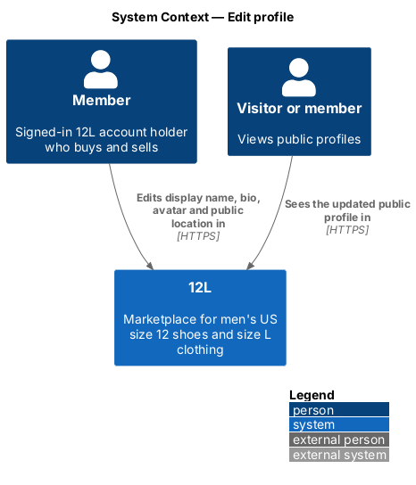
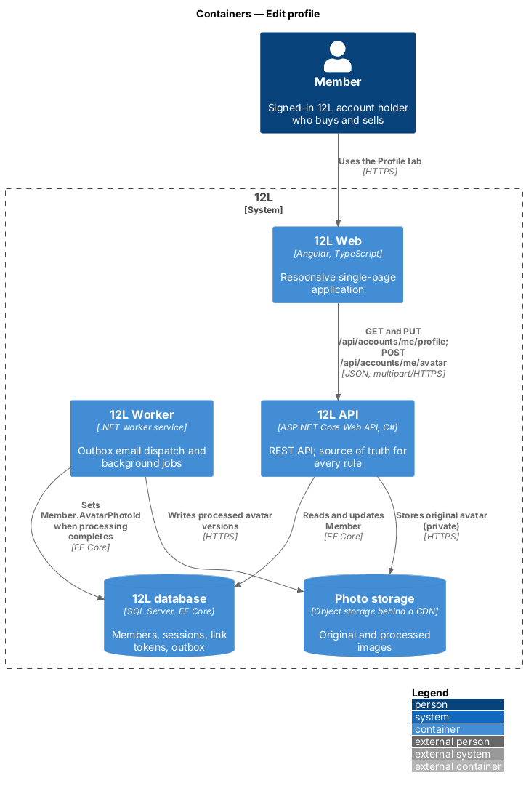
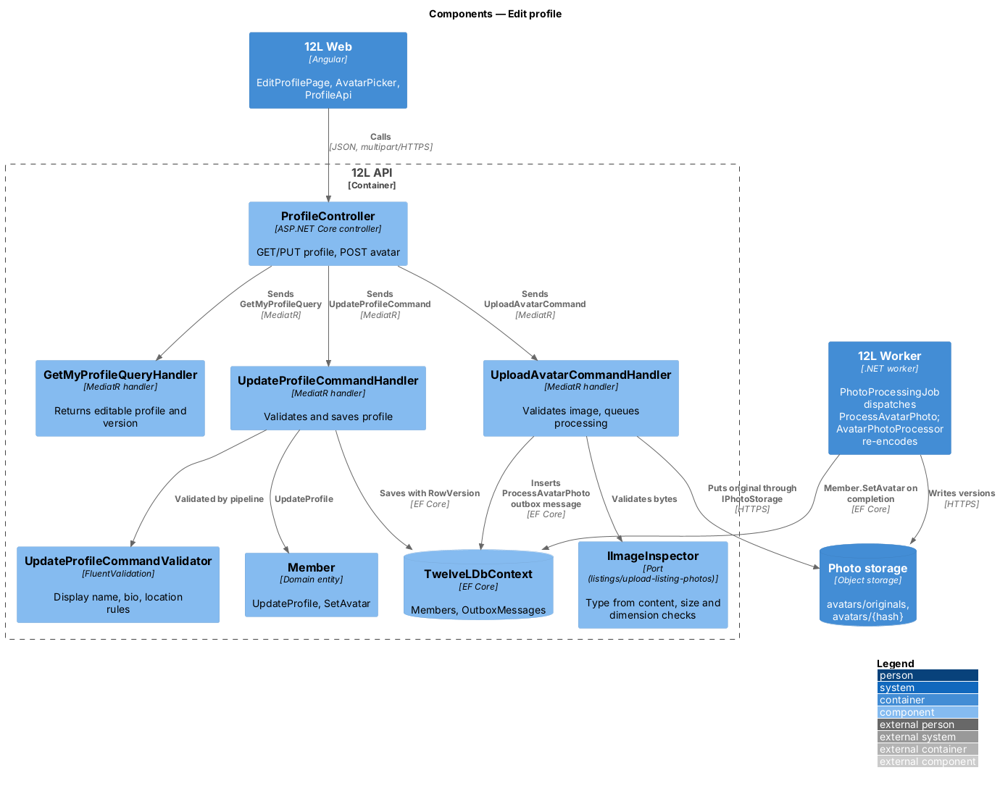
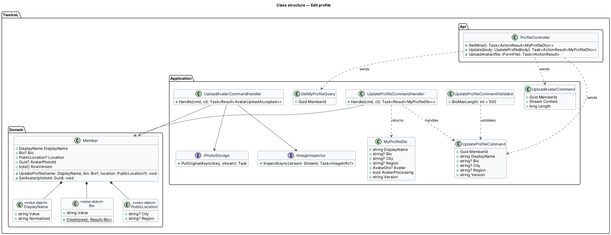
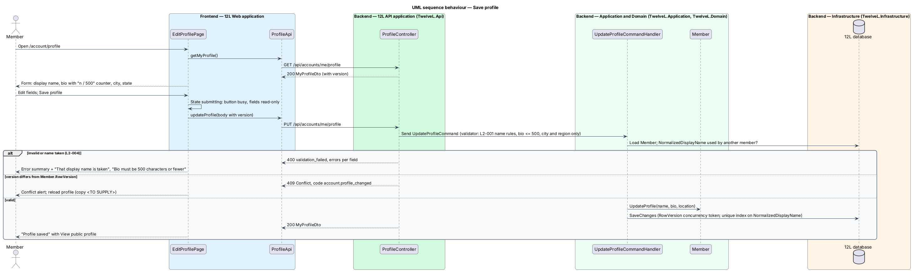
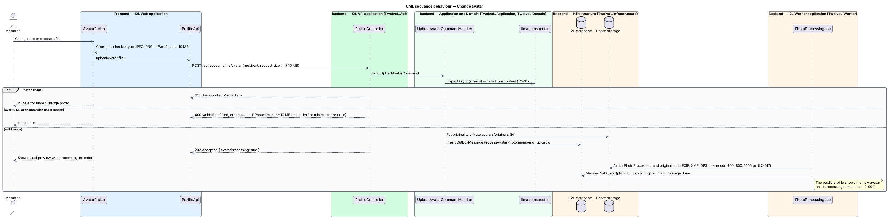

# Edit profile

## Overview

Every 12L member has a public profile that buyers and sellers look at before trading:
the display name, an avatar, a short bio and a public location. This feature lets the
member edit those four things from the Profile tab of their account. The public profile
page itself, with ratings, listings and reviews, is designed in
[reviews/view-member-profile](../../reviews/view-member-profile/README.md).

Two rules shape the slice. A changed display name follows the same rules as at
registration: 3 to 30 letters, digits, underscores or hyphens, unique ignoring case. The
public location is deliberately coarse: only a city and a state or region are stored for
display, and the form offers no street address field, so a member's home is never
exposed.

An avatar is processed exactly like a listing photo. The server checks the file type
from its content, enforces size limits, strips all metadata including GPS location,
re-encodes the image and produces resized versions.

Terms used in this document:

- **public profile** — page at `/members/{displayName}` visible to everyone
- **bio** — optional free text of up to 500 characters shown on the public profile
- **public location** — optional city plus state or region shown on the public profile
- **avatar** — member's profile image, processed under the listing-photo rules of `L2-017`
- **profile version** — opaque value derived from `Members.RowVersion` that detects concurrent edits

## Description

Mocks: `docs/mocks/pages/edit-profile/` (`default`, `loading`, `error`, `invalid`,
`submitting`, `success`).

### Frontend (`src/frontend/src/app/accounts/edit-profile/`)

- **`EditProfilePage`** — route `/account/profile` inside `AccountLayout`, guarded by `authGuard`. Heading "Profile". A typed reactive form:
  - `AvatarPicker` — current avatar (extra large), button "Change photo", help "JPEG, PNG or WebP, up to 10 MB."
  - `displayName` — label "Display name".
  - `bio` — optional textarea with a live counter "{n} / 500".
  - Fieldset "Public location": `city` (optional) and `region` (label "State", optional select), help "Only city and state are shown." No street address field exists (`L2-004` criterion 5).
  - Buttons "Save profile" (primary) and "View public profile" (ghost, to `/members/{displayName}`).
- **Page states**:
  - `loading` — skeleton avatar and fields.
  - `error` — "Couldn’t load your profile", reference, "Try again".
  - `invalid` — error summary plus inline errors, for example "That display name is taken" and "Bio must be 500 characters or fewer".
  - `submitting` — button busy, fields read-only.
  - `success` — success alert "Profile saved" with link "View public profile" (`role="status"`).
  - `conflict` — HTTP 409 when the profile changed elsewhere; the form reloads the latest values. No mock exists, so the copy is `<TO SUPPLY>`.
- **`AvatarPicker`** — standalone component that opens a file input (`accept="image/jpeg,image/png,image/webp"`), pre-checks type and 10 MB on the client, uploads with progress, and shows the local preview with a processing indicator until the server version is ready. Inline errors come from the API.
- **Region list** — the mock shows US states. Whether regions outside the United States are allowed is `<TO SUPPLY>`; the design ships a static list of US states and the District of Columbia shared by the client and the server validator.
- **`ProfileApi`** — `getMyProfile()`, `updateProfile(body)`, `uploadAvatar(file)` (reports upload progress). After a successful save it updates `SessionStore.member.displayName`.

### API (`TwelveL.Api`)

- **`ProfileController`** (policy `MemberOnly`; a suspended member may still edit their profile, because `L2-046` restricts only listing, buying, reviewing and reporting)
  - `GET /api/accounts/me/profile` — `200 MyProfileDto { displayName, bio, city, region, avatar { small, medium, large } | null, avatarProcessing, version }`.
  - `PUT /api/accounts/me/profile` — body `{ displayName, bio, city, region, version }`. `200 MyProfileDto`; `400 validation_failed` with `errors.displayName` (`account.display_name_invalid`, `account.display_name_taken`), `errors.bio` (`account.bio_too_long`), `errors.city`, `errors.region`; `409 Conflict` code `account.profile_changed` when `version` is stale.
  - `POST /api/accounts/me/avatar` — `multipart/form-data`, one file, request size limit 10 MB plus multipart overhead. `202 Accepted { avatarProcessing: true }`; `415 Unsupported Media Type` when the content is not JPEG, PNG or WebP; `400 validation_failed` with `errors.avatar` for "Photos must be 10 MB or smaller" or the minimum-size error (`L2-017`).

### Application and domain

- **`GetMyProfileQuery` / handler** — reads the member and the avatar's public URLs.
- **`UpdateProfileCommand` / `UpdateProfileCommandValidator`** —
  - display name: the `L2-001` rules shared with [register-account](../register-account/README.md).
  - bio: optional, at most 500 characters after trimming (`L2-004` criteria 1 and 2). Line breaks are kept; HTML is encoded on output (`L2-049`).
  - city: optional, at most `<TO SUPPLY>` characters, letters, spaces, hyphens, apostrophes and periods only, so a street address with house numbers is rejected.
  - region: optional, a value from the region list.
- **`UpdateProfileCommandHandler`** — loads the member, compares `version` with `RowVersion`, checks `NormalizedDisplayName` uniqueness against other members (`L2-004` criterion 3), calls `Member.UpdateProfile`, and saves. A unique-index violation from a concurrent rename maps to `account.display_name_taken`. A changed display name raises `MemberDisplayNameChanged`, which the catalog and reviews subsystems use to evict cached cards and profile pages.
- **`UploadAvatarCommand` / handler** — inspects the stream with `IImageInspector` (type from content, dimensions; shortest side at least 800 px), stores the original privately through `IPhotoStorage` at `avatars/originals/{uploadId}`, and writes a `ProcessAvatarPhoto` outbox message in the same transaction. Both ports come from [listings/upload-listing-photos](../../listings/upload-listing-photos/README.md).
- **`Member`** — profile fields `Bio` (value object, at most 500 characters), `Location` (value object `PublicLocation { City, Region }`), `AvatarPhotoId`. Methods `UpdateProfile(name, bio, location)` and `SetAvatar(photoId)`.

### Worker and infrastructure

- **`PhotoProcessingJob`** (12L Worker, listings) — also dispatches `ProcessAvatarPhoto` messages to `AvatarPhotoProcessor`. The processor reuses `ImageSharpPhotoProcessor`: it strips EXIF, XMP and GPS metadata, re-encodes, writes 400, 800 and 1600 px versions to public content-addressed keys `avatars/{hash}-{size}`, calls `Member.SetAvatar`, deletes the previous avatar's objects and the original (`L2-004` criterion 4).
- **`Members` columns** — `Bio nvarchar(500) NULL`, `City nvarchar(<TO SUPPLY>) NULL`, `Region nvarchar(64) NULL`, `AvatarPhotoId uniqueidentifier NULL`, `RowVersion rowversion` (concurrency token).
- **Public API exposure** — public profile responses carry only display name, bio, city, region and avatar URLs; never email (`L2-054`).

## Requirements

The feature realizes the following level-2 (L2) requirement. It refines a level-1 (L1)
requirement, cited by identifier.

| L2 ID | Refines (L1) | Requirement |
|-------|--------------|-------------|
| `L2-004` | `L1-001` | A member shall be able to edit their display name, bio (up to 500 characters), avatar image and public location. The public location shall be limited to a city and state or region. The display name rules of L2-001 apply to changes. |

## Diagrams

### System context

The member edits their profile in 12L; visitors and members then see the public profile.

### Containers

`12L API` updates the member in the `12L database` and stores the original avatar in
photo storage. `12L Worker` writes the processed versions and links them to the member.

### Components

`ProfileController` dispatches the query and the two commands. The avatar path reuses
the listings image inspector, photo storage and processing job.

### Class structure

`Member` composes the `DisplayName`, `Bio` and `PublicLocation` value objects. The upload
handler depends on `IImageInspector` and `IPhotoStorage`.

### Behaviour — save profile

The validator applies the `L2-001` name rules and the 500-character bio limit. A stale
version returns 409; a valid edit saves under the row-version check (`L2-004`).

### Behaviour — change avatar

The API checks the file's real type and dimensions, stores the original and queues
processing. The worker strips metadata and produces 3 sizes before the avatar appears
publicly.

