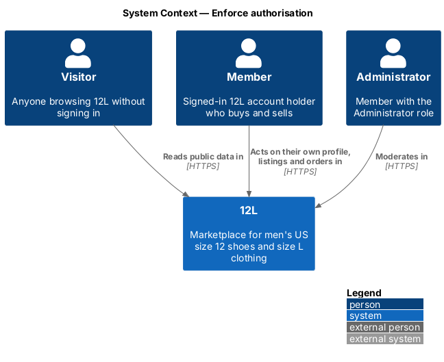
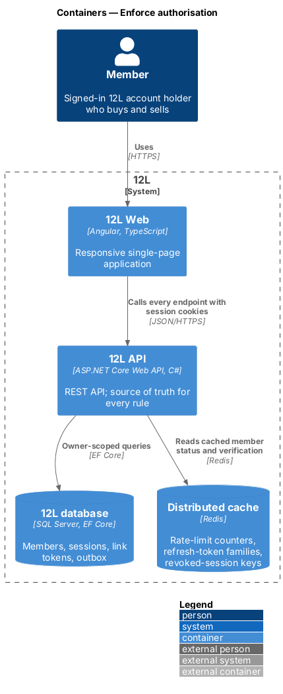
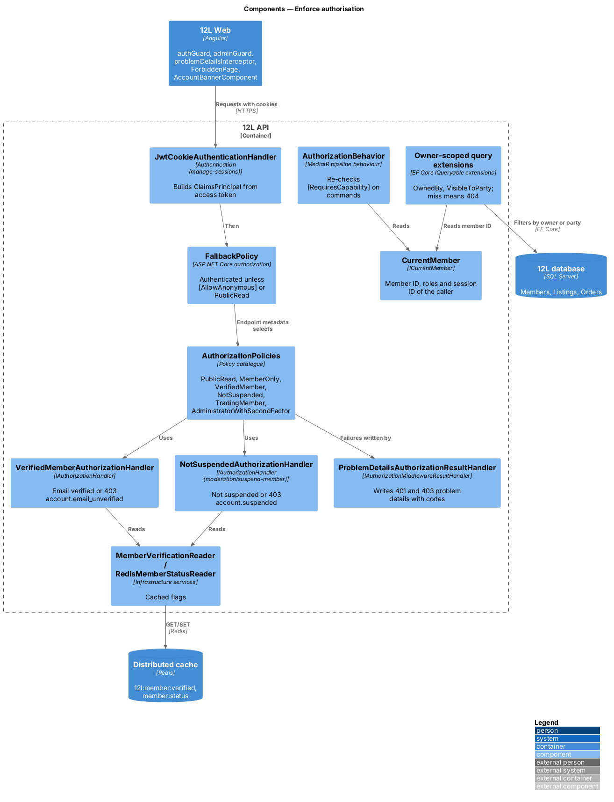
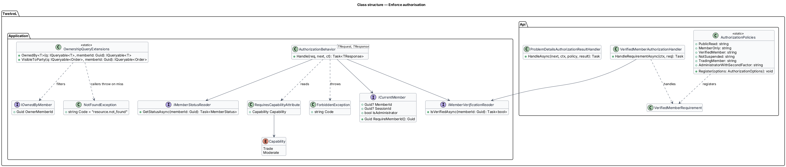
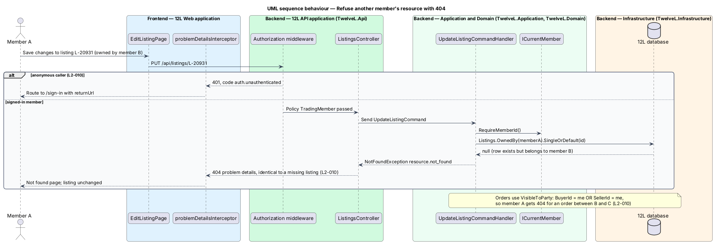
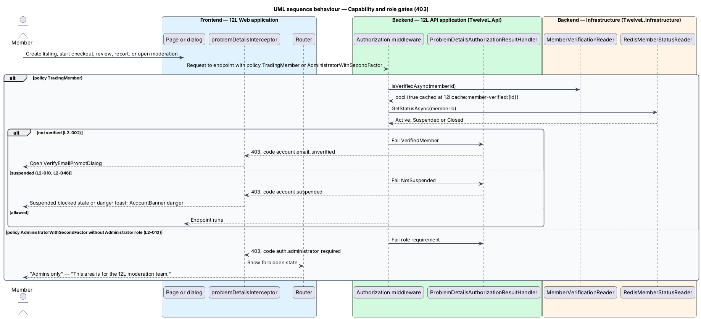

# Enforce authorisation

## Overview

Authentication tells 12L *who* is calling; authorisation decides *what* that caller may
do. This feature defines the authorisation rules every `12L API` endpoint follows, and
the shared parts that other subsystems use to apply them. It contains no screen of its
own beyond the forbidden page and the suspension states of the account banner and
overview; its value is that each endpoint in listings, orders, reviews, moderation and
privacy enforces the same rules in the same way.

The rules come from `L2-010`:

- A member changes only their own profile and listings, and sees only orders in which they are the buyer or the seller.
- A resource the caller may not see answers HTTP 404, exactly as if it did not exist, so its existence is not revealed.
- Moderation endpoints require the Administrator role; a member without it receives HTTP 403.
- An anonymous caller who tries to change data receives HTTP 401.
- A suspended member who tries to create a listing, buy, review or report receives HTTP 403.

The unverified-member gate of `L2-002` uses the same mechanism and is described here,
while its prompts and copy live in [verify-email](../verify-email/README.md). The
suspension rule itself is defined in
[moderation/suspend-member](../../moderation/suspend-member/README.md); this feature
composes it rather than redefining it.

Terms used in this document:

- **policy** — named ASP.NET Core authorisation rule attached to an endpoint
- **capability gate** — policy that depends on the member's state (verified, not suspended) rather than on a resource
- **owner-scoped query** — database query that includes the caller's member ID in its filter, so a resource of another member is never loaded
- **party** — buyer or seller of an order
- **trading member** — verified member whose status is `Active`

## Description

Mocks: `docs/mocks/pages/forbidden/` (`default`), the `forbidden` state of
`docs/mocks/pages/moderation-queue/`, the `danger` state of
`docs/mocks/notifications/account-banner/`, the `suspended` states of
`docs/mocks/pages/account/` and `docs/mocks/pages/sell/`, and
`docs/mocks/pages/not-found/` for the 404 answer.

### Policy catalogue (`TwelveL.Api/Authorization/AuthorizationPolicies.cs`)

| Policy | Rule | Failure | Owner |
|--------|------|---------|-------|
| fallback | authenticated member; applied to every endpoint without explicit metadata | `401 auth.unauthenticated` | this feature |
| `PublicRead` | anonymous allowed; `GET` only | — | this feature |
| `MemberOnly` | authenticated, session not revoked, status not `Closed` | `401 auth.unauthenticated` | this feature |
| `VerifiedMember` | `MemberOnly` and email verified | `403 account.email_unverified` | this feature |
| `NotSuspended` | status not `Suspended` | `403 account.suspended` | [moderation/suspend-member](../../moderation/suspend-member/README.md) |
| `TradingMember` | `VerifiedMember` and `NotSuspended` | first failing requirement | this feature |
| `AdministratorWithSecondFactor` | role `Administrator` and `amr` contains `otp` | `403 auth.administrator_required` | [moderation/audit-log-and-admin-sign-in](../../moderation/audit-log-and-admin-sign-in/README.md) |

- `TradingMember` is the policy for creating or publishing a listing, starting checkout or paying, submitting a review or reply, and submitting a report (`L2-002` criterion 4, `L2-010` criterion 5). Designs in other subsystems apply this policy by name to these endpoints.
- The fallback policy makes "anonymous cannot change data" the default (`L2-010` criterion 4). An endpoint opens to visitors only through `PublicRead` or an explicit `[AllowAnonymous]` (sign-in, registration, verification, password reset, refresh, payment webhook).
- An architecture test fails when an endpoint has no policy metadata, or when a non-`GET` endpoint carries `PublicRead`.

### API (`TwelveL.Api`)

- **`VerifiedMemberRequirement` / `VerifiedMemberAuthorizationHandler`** — succeeds when `IMemberVerificationReader.IsVerifiedAsync(memberId)` is `true`.
- **`NotSuspendedAuthorizationHandler`** — from moderation; reads `IMemberStatusReader` (`RedisMemberStatusReader`, key `member:status:{memberId}`, 5-minute expiry, evicted on suspend and reinstate).
- **`MemberOnly` handler** — reuses `IMemberStatusReader` to refuse a `Closed` member whose access token is still within its 15 minutes.
- **`ProblemDetailsAuthorizationResultHandler`** — `IAuthorizationMiddlewareResultHandler` that turns a challenge into `401` and a forbid into `403`, writing RFC 9457 problem details with the code of the first failed requirement and the correlation ID (`L2-068`). A plain ASP.NET Core forbid without a code becomes `403 auth.forbidden`.
- **404 for hidden resources** — controllers never return 403 for a resource owned by someone else. Handlers throw `NotFoundException`, which the platform error middleware maps to `404` code `resource.not_found` with the same body as a genuinely missing row (`L2-010` criteria 1 and 2).

### Application (`TwelveL.Application`)

- **`ICurrentMember`** — scoped service built from the `ClaimsPrincipal`: `MemberId`, `SessionId`, `IsAdministrator`, `RequireMemberId()` (throws when anonymous).
- **`OwnershipQueryExtensions`** —
  - `OwnedBy<T>(this IQueryable<T> q, Guid memberId) where T : IOwnedByMember` — filters on `OwnerMemberId`; `Listing` implements `IOwnedByMember` through `SellerId`, and `Member` through its own `Id`.
  - `VisibleToParty(this IQueryable<Order> q, Guid memberId)` — `BuyerId == memberId || SellerId == memberId`.
  - Every command that changes a listing and every order query in other subsystems loads through these extensions and throws `NotFoundException` on a miss. Profile commands act only on `/me` routes, so no member ID is accepted from the client for them.
- **`RequiresCapabilityAttribute` and `AuthorizationBehavior<TRequest, TResponse>`** — MediatR pipeline behaviour, defence in depth behind the endpoint policies. A command marked `[RequiresCapability(Capability.Trade)]` is re-checked against `IMemberVerificationReader` and `IMemberStatusReader`, so a handler reached from a background job or a mis-configured endpoint still refuses. It throws `ForbiddenException` with `account.email_unverified` or `account.suspended`.
- **`IMemberVerificationReader`** — described in [verify-email](../verify-email/README.md); caches only `true` at `12l:cache:member-verified:{memberId}`.
- **Mass assignment** — owner, status and price fields are never bound from request bodies (`L2-049`); the owner of a new resource is always `ICurrentMember.MemberId`.

### Frontend (`src/frontend/src/app/core/`)

- **`authGuard`** (`CanMatchFn`) — for `/account/**`, `/sell`, `/orders/**`, `/sales/**`; when `SessionStore.isSignedIn()` is false it redirects to `/sign-in?returnUrl=…`.
- **`guestGuard`** — keeps signed-in members away from `/sign-in`, `/join`, `/forgot-password`.
- **`adminGuard`** — for `/admin/**` except `/admin/verify`; a member without the Administrator role sees the moderation queue's `forbidden` state: "Admins only", "This area is for the 12L moderation team.", "Back to shop".
- **`problemDetailsInterceptor`** — maps API answers:
  - `401 auth.unauthenticated` — clears the store and routes to `/sign-in?returnUrl=…`; `auth.token_expired` is left to `authRefreshInterceptor` ([manage-sessions](../manage-sessions/README.md)).
  - `403 account.email_unverified` — opens `VerifyEmailPromptDialog`.
  - `403 account.suspended` — shows a danger toast; pages that pre-check `SessionStore.isSuspended()` show their blocked state instead, such as the Sell page's "Selling is paused on your account", "You can still manage open orders.", "View your sales", "Marketplace rules".
  - `403 auth.administrator_required` — the forbidden state above.
  - `403 auth.forbidden` — routes to `ForbiddenPage`.
  - `404` — routes to the not-found page ([platform/report-errors-and-observe](../../platform/report-errors-and-observe/)).
- **`ForbiddenPage`** — route `/403`. Large "403", heading "You can’t open this", text "It belongs to another member’s account.", button "Go to your account". It appears only for a `403 auth.forbidden` answer, because resources of another member answer 404.
- **Suspension states** — `AccountBannerComponent` `danger` state on every page while suspended: "Your account is suspended. You can still ship open orders." with "Details" to `/account`, not dismissible. `AccountOverviewPage` `suspended` state: danger alert "Your account is suspended", "You can still ship and track open orders. We emailed you the reason.", link "Marketplace rules", stat tiles for sales and purchases only, no "Sell an item".
- **UI gating** — buttons that need `canTrade` stay visible and lead to the prompt or blocked state, so the member learns why; the API remains the authority.

### Data

No table is introduced. The rules read `Members.EmailVerifiedAt`, `Members.Status`,
`MemberRoles`, `Listings.SellerId`, `Orders.BuyerId` and `Orders.SellerId`. Indexes on
`Listings.SellerId`, `Orders.BuyerId` and `Orders.SellerId` are defined by the listings
and orders designs.

### Tests

An acceptance test per `L2-010` criterion runs against the API: another member's listing
update and delete (404, row unchanged), a third party's order (404), a moderation
endpoint without the role (403), every state-changing endpoint without a session (401,
generated from the endpoint table), and the 4 trading actions as a suspended member
(403).

## Requirements

The feature realizes the following level-2 (L2) requirement. It refines a level-1 (L1)
requirement, cited by identifier.

| L2 ID | Refines (L1) | Requirement |
|-------|--------------|-------------|
| `L2-010` | `L1-002` | Every API endpoint shall check that the caller is allowed to act on the resource. A member shall only change their own profile and listings, and shall only see orders they are the buyer or seller of. Moderation endpoints shall require the Administrator role. Requests for resources the caller is not allowed to see shall return HTTP 404 so their existence is not revealed. |

## Diagrams

### System context

Visitors, members and administrators all reach 12L; what each may do is decided inside
12L.

### Containers

`12L API` reads cached member flags from Redis and filters data by owner or party in the
`12L database`.

### Components

Authentication builds the principal, the fallback policy and the policy catalogue decide
at the endpoint, the result handler writes problem details, and owner-scoped queries plus
the MediatR behaviour enforce the rules again inside the application.

### Class structure

`AuthorizationPolicies` registers the requirements. `AuthorizationBehavior` reads
`RequiresCapabilityAttribute`, and `OwnershipQueryExtensions` filter any
`IOwnedByMember` entity.

### Behaviour — refuse another member's resource with 404

An anonymous write gets 401. A signed-in member's request for another member's listing
finds no row through the owner-scoped query and gets the same 404 as a missing listing
(`L2-010`).

### Behaviour — capability and role gates

`TradingMember` refuses unverified and suspended members with distinct 403 codes that
the frontend turns into the verify prompt or the suspension state.
`AdministratorWithSecondFactor` refuses non-administrators with 403 (`L2-010`).

