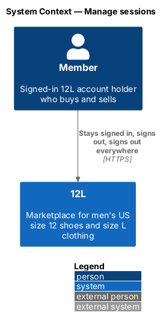
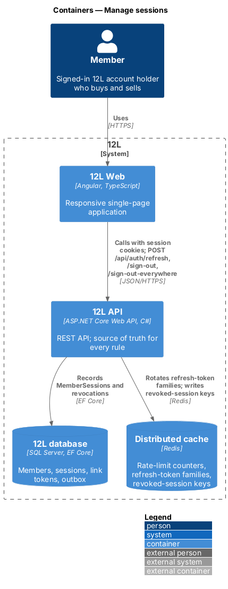
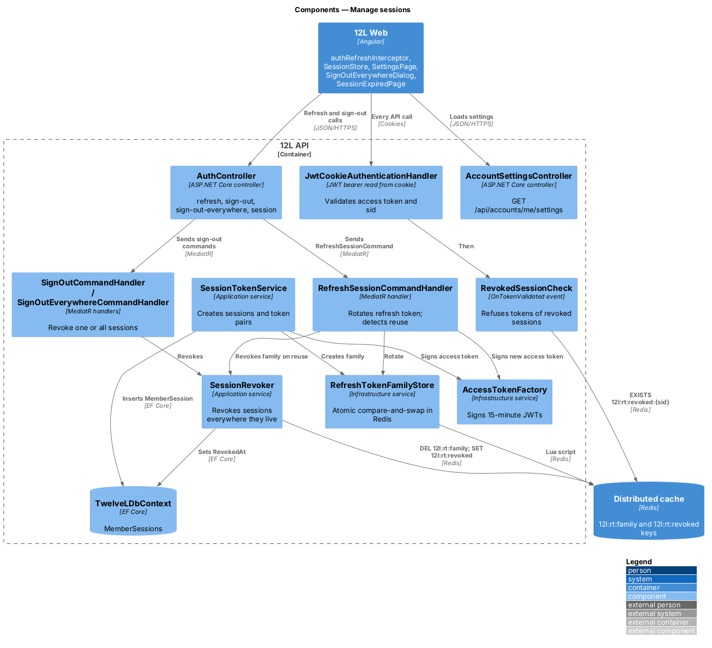
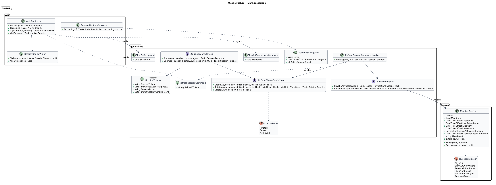
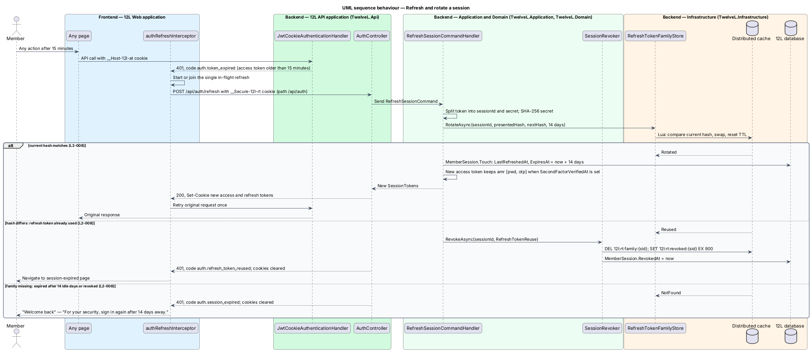
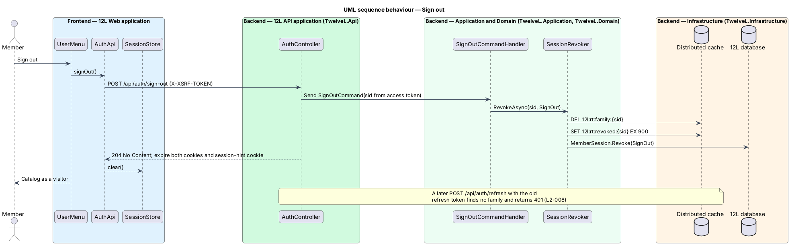
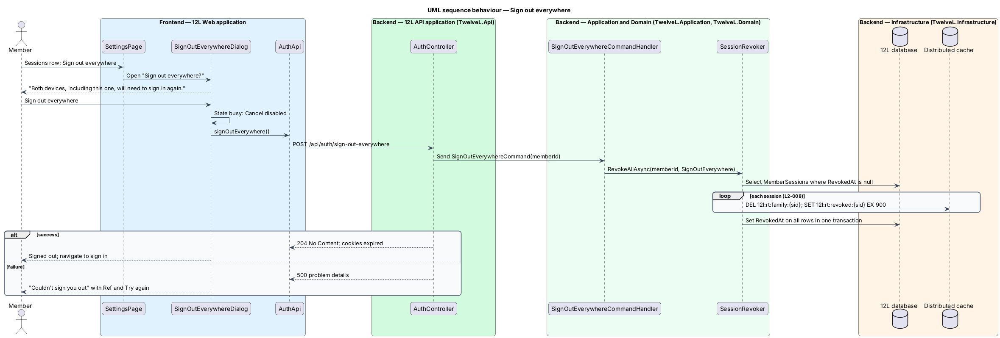
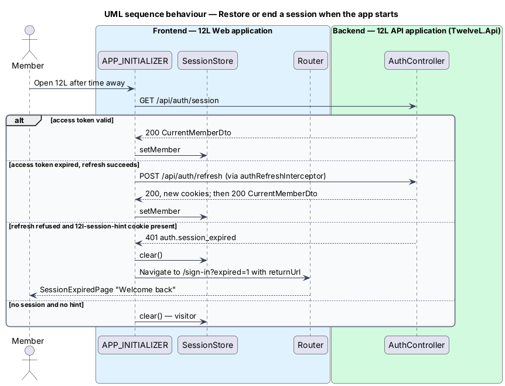

# Manage sessions

## Overview

A *session* is what keeps a member signed in to 12L between requests. This feature
defines how a session is created, kept alive, ended on one device and ended on every
device. Every other accounts feature that signs a member in or out calls into it.

12L uses two tokens per session. An *access token* proves the caller's identity on each
API request and lives 15 minutes. A *refresh token* lives 14 days and obtains a new pair
of tokens when the access token expires. Each refresh *rotates* the refresh token: the
old one stops working and a new one replaces it. If an old refresh token is ever
presented again, it has probably been stolen, so 12L ends the whole session. Both tokens
travel only in `HttpOnly`, `Secure`, `SameSite=Strict` cookies; the browser application
never sees them and never writes them to web storage.

Members end sessions in three ways: "Sign out" on the current device, "Sign out
everywhere" from Settings, and staying away for 14 days, after which the
"Welcome back" page asks them to sign in again. The feature also owns the Settings page
that lists these account controls.

Terms used in this document:

- **session** — server-side record of one signed-in device, identified by a session ID (`sid`)
- **access token** — signed JWT valid for 15 minutes carrying the member ID, `sid`, roles and authentication methods (`amr`)
- **refresh token** — opaque value `{sid}.{secret}` valid for 14 days from its last use
- **token family** — the chain of refresh tokens issued for one session; only the newest member of the family is valid
- **rotation** — replacement of the refresh token on every refresh
- **reuse** — presentation of a refresh token that is no longer the newest in its family
- **session hint** — non-secret cookie that tells the application a member was signed in on this browser

## Description

Mocks: `docs/mocks/pages/session-expired/` (`default`), `docs/mocks/pages/settings/`
(`default`, `loading`, `error`), `docs/mocks/dialogs/sign-out-everywhere/` (`default`,
`busy`, `failed`).

### Frontend

- **`SessionStore`** (`core/auth/session.store.ts`) — root signal store: `member: Signal<CurrentMember | null>`, computed `isSignedIn`, `emailVerified`, `isSuspended`, `isAdministrator`, `canTrade`. Methods `setMember`, `markVerified`, `clear`. It holds no token.
- **`sessionInitializer`** — `APP_INITIALIZER` that calls `GET /api/auth/session`. On `401` it lets `authRefreshInterceptor` try one refresh. When the refresh fails and the `12l-session-hint` cookie is present, it clears the store and navigates to `/sign-in?expired=1&returnUrl=…`.
- **`authRefreshInterceptor`** — functional `HttpInterceptorFn`. On `401` with code `auth.token_expired` it starts one shared refresh (`shareReplay` single flight, so parallel requests never present the same refresh token twice), then replays the original request once. When refresh returns `401`, it clears `SessionStore` and routes to the session-expired page. It never intercepts `/api/auth/refresh` itself.
- **`SessionExpiredPage`** — rendered at `/sign-in?expired=1`. Heading "Welcome back", text "For your security, sign in again after 14 days away.", button "Sign in" that opens the sign-in form with the preserved `returnUrl`.
- **`UserMenu`** "Sign out" item — calls `AuthApi.signOut()`, clears `SessionStore` and navigates to `/`.
- **`SettingsPage`** — `/account/settings` child of `AccountLayout`, guarded by `authGuard`. A settings list with 6 rows:
  - "Email" — the member's email.
  - "Password" — "Changed {date}", button "Change" opening `ChangePasswordDialog` ([reset-password](../reset-password/README.md)).
  - "Sessions" — "Signed in on {n} devices", button "Sign out everywhere".
  - "Your data" — "Download a copy as JSON", button "Request download" ([privacy/export-personal-data](../../privacy/export-personal-data/README.md)).
  - "Cookies" — current consent, button "Cookie settings" ([privacy/manage-cookie-consent](../../privacy/manage-cookie-consent/README.md)).
  - "Close account" — "Removes your listings and erases your data within 30 days", button "Close account" ([close-account](../close-account/README.md)).
  - States `loading` (5 skeleton rows) and `error` ("Couldn’t load settings", reference, "Try again").
- **`SignOutEverywhereDialog`** — title "Sign out everywhere?", description "Both devices, including this one, will need to sign in again." (the device count comes from the settings response), buttons "Cancel" and "Sign out everywhere". `busy`: Cancel disabled, primary `aria-busy`. `failed`: danger alert "Couldn’t sign you out", "Try again." with reference, primary becomes "Try again". On success the store clears and the router opens `/sign-in`.
- **`AuthApi`** — `getSession()`, `refresh()`, `signOut()`, `signOutEverywhere()`; **`AccountsApi.getSettings()`**.

### API (`TwelveL.Api`)

- **`JwtCookieAuthenticationHandler`** — JWT bearer authentication configured to read the token from the `__Host-12l-at` cookie in `OnMessageReceived`. Validates issuer, audience, lifetime (clock skew 30 s) and signature. The signing key comes from the secret store (`L2-052`); key name and rotation schedule are `<TO SUPPLY>`. An expired token produces `401` code `auth.token_expired`.
- **`RevokedSessionCheck`** — `OnTokenValidated` handler. It rejects a token whose `sid` has a `12l:rt:revoked:{sid}` key in Redis, so a sign-out takes effect at once on every instance rather than after up to 15 minutes (`L2-008`, `L2-060`).
- **`SessionCookieWriter`** — writes and clears the cookies:

  | Cookie | Content | Attributes | Lifetime |
  |--------|---------|------------|----------|
  | `__Host-12l-at` | access token | `HttpOnly; Secure; SameSite=Strict; Path=/` | 15 minutes |
  | `__Secure-12l-rt` | refresh token | `HttpOnly; Secure; SameSite=Strict; Path=/api/auth` | 14 days |
  | `12l-session-hint` | `1` (no secret) | `Secure; SameSite=Strict; Path=/` | 1 year, so it outlives an idle session; cleared on sign-out |

- **`AuthController`**
  - `GET /api/auth/session` — `200 CurrentMemberDto` or `401`.
  - `POST /api/auth/refresh` — `[AllowAnonymous]`, reads `__Secure-12l-rt`. `200` with new cookies and `CurrentMemberDto`; `401` code `auth.refresh_token_reused` (family revoked) or `auth.session_expired` (no family); cookies cleared on every `401`.
  - `POST /api/auth/sign-out` — `204`; clears the 3 cookies. Idempotent.
  - `POST /api/auth/sign-out-everywhere` — policy `MemberOnly`; `204`; clears cookies.
- **`AccountSettingsController`** — `GET /api/accounts/me/settings`, policy `MemberOnly`, `200 AccountSettingsDto { email, passwordChangedAt, activeSessionCount }`. The cookie and export rows read their own endpoints from the privacy subsystem.

### Application and domain

- **`ISessionTokenService` / `SessionTokenService`** — used by sign-in, registration and the administrator second-factor step.
  - `StartAsync(member, ip, userAgent)` — creates a `MemberSession`, a refresh secret of 32 random bytes and a family in Redis, and signs an access token with `sub`, `sid`, `role`, `amr: ["pwd"]`.
  - `UpgradeToSecondFactorAsync(sessionId)` — sets `MemberSession.SecondFactorVerifiedAt` and re-issues the pair with `amr: ["pwd","otp"]`. It is called by [moderation/audit-log-and-admin-sign-in](../../moderation/audit-log-and-admin-sign-in/README.md).
- **`RefreshSessionCommand` / `RefreshSessionCommandHandler`** — splits the token into `sid` and secret, hashes the secret with SHA-256, generates the next secret, and calls `IRefreshTokenFamilyStore.RotateAsync`:
  - `Rotated` — calls `MemberSession.Touch(now, 14 days)` and signs a new access token. The `amr` claim keeps `otp` while `SecondFactorVerifiedAt` is set. The new 14-day expiry slides with each use, so 14 days without activity ends the session (`L2-008` criteria 2 and 6).
  - `Reused` — calls `ISessionRevoker.RevokeAsync(sid, RefreshTokenReuse)` and returns `auth.refresh_token_reused` (criterion 3).
  - `NotFound` — returns `auth.session_expired` (criteria 4 and 6).
  - The member's current status is re-read on each refresh; a `Closed` member is refused and the session revoked.
- **`SignOutCommand` / handler** — `ISessionRevoker.RevokeAsync(sid, SignOut)` (criterion 4).
- **`SignOutEverywhereCommand` / handler** — `ISessionRevoker.RevokeAllAsync(memberId, SignOutEverywhere)` (criterion 5).
- **`ISessionRevoker` / `SessionRevoker`** — for each session: deletes `12l:rt:family:{sid}`, sets `12l:rt:revoked:{sid}` with a 15-minute expiry (the access-token lifetime), and sets `MemberSession.RevokedAt` and `RevokedReason`, saving the rows in one transaction. `RevokeAllAsync` takes an optional session to keep, used by the change-password dialog. Callers: sign-out, sign-out everywhere, password reset and change, account closure.
- **`MemberSession`** — `Id` (= `sid` = family ID), `MemberId`, `CreatedAt`, `LastRefreshedAt`, `ExpiresAt`, `RevokedAt`, `RevokedReason` (`SignOut`, `SignOutEverywhere`, `RefreshTokenReuse`, `PasswordReset`, `PasswordChanged`, `AccountClosed`), `SecondFactorVerifiedAt`, `UserAgent` (first 200 characters), `RowVersion`. Transitions: `Active → Revoked` through `Revoke`; `Active → Expired` implicitly when `ExpiresAt` passes.
- **`AccountSettingsQuery`** — counts `MemberSessions` with `RevokedAt IS NULL AND ExpiresAt > now`.

### Infrastructure and data

- **`RefreshTokenFamilyStore : IRefreshTokenFamilyStore`** — Redis hash `12l:rt:family:{sid}` holding `memberId` and `currentHash`, expiring after 14 days. `RotateAsync` runs one Lua script that compares `currentHash` with the presented hash and, when equal, writes the next hash and resets the expiry. The script is atomic, so two instances never both rotate the same token (`L2-060`). The key pattern is the one registered in [platform/meet-performance-and-scale](../../platform/meet-performance-and-scale/README.md). When Redis loses the family, the member signs in again.
- **`AccessTokenFactory`** — signs JWTs with HMAC-SHA256 and the key from the secret store; issuer and audience from `Accounts:Sessions:Issuer` and `Accounts:Sessions:Audience`.
- **`MemberSessions`** table — PK `Id`; FK `MemberId`; index `IX_MemberSessions_MemberId_RevokedAt` for "sign out everywhere" and the device count; `RowVersion rowversion`. Revoked and expired rows are deleted after a retention period that is `<TO SUPPLY>`.
- **Configuration** — `Accounts:Sessions:AccessTokenLifetime` (`00:15:00`), `Accounts:Sessions:RefreshTokenLifetime` (`14.00:00:00`), `Accounts:Sessions:Issuer`, `Accounts:Sessions:Audience`, signing key `Accounts--Sessions--SigningKey` in the secret store.
- **Web storage** — a lint rule and an acceptance test assert that no code path writes to `localStorage` or `sessionStorage` (`L2-008` criterion 1).

## Requirements

The feature realizes the following level-2 (L2) requirement. It refines a level-1 (L1)
requirement, cited by identifier.

| L2 ID | Refines (L1) | Requirement |
|-------|--------------|-------------|
| `L2-008` | `L1-002` | Sessions shall use a short-lived access token (15 minutes) and a rotating refresh token (14 days) held in `HttpOnly`, `Secure`, `SameSite=Strict` cookies. Tokens shall never be stored in `localStorage` or `sessionStorage`. Signing out shall revoke the session on the server. |

## Diagrams

### System context

The member uses 12L across one or more devices; no external system takes part in session
management.

### Containers

`12L Web` sends the cookies with every call. `12L API` rotates token families in Redis
and records sessions in the `12L database`.

### Components

Authentication reads the access token from its cookie and checks the revoked-session key.
`AuthController` dispatches refresh and sign-out commands; `SessionRevoker` and
`RefreshTokenFamilyStore` keep Redis and the database in step.

### Class structure

`MemberSession` records each device's session and its revocation reason.
`ISessionTokenService`, `ISessionRevoker` and `IRefreshTokenFamilyStore` are the ports
other features call.

### Behaviour — refresh and rotate a session

An expired access token triggers one shared refresh. A matching refresh token rotates; a
stale one revokes the family; a missing family means the session has ended (`L2-008`).

### Behaviour — sign out

Sign-out deletes the family, marks the session revoked and clears the cookies, so the old
refresh token later returns 401.

### Behaviour — sign out everywhere

The dialog confirms the action, and the handler revokes every active session of the
member in one pass.

### Behaviour — restore or end a session when the app starts

At start-up the application restores the member, refreshes silently, or shows "Welcome
back" when a previously signed-in browser can no longer refresh.

