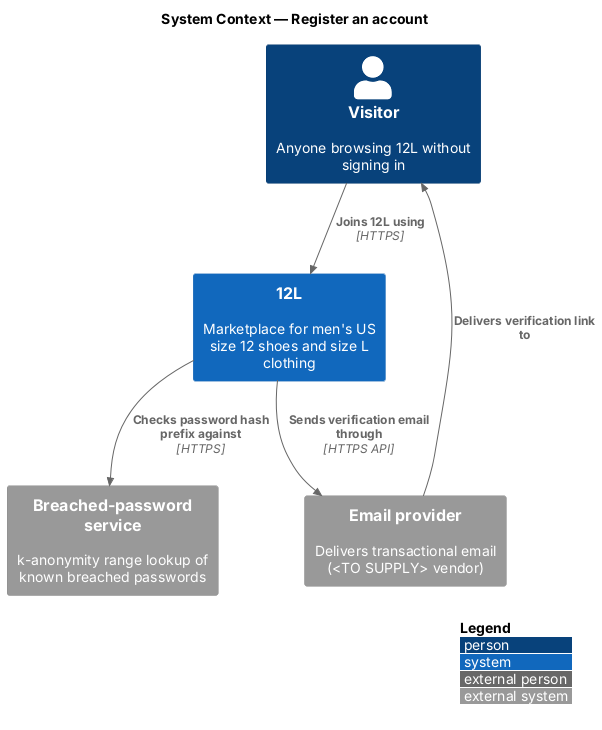
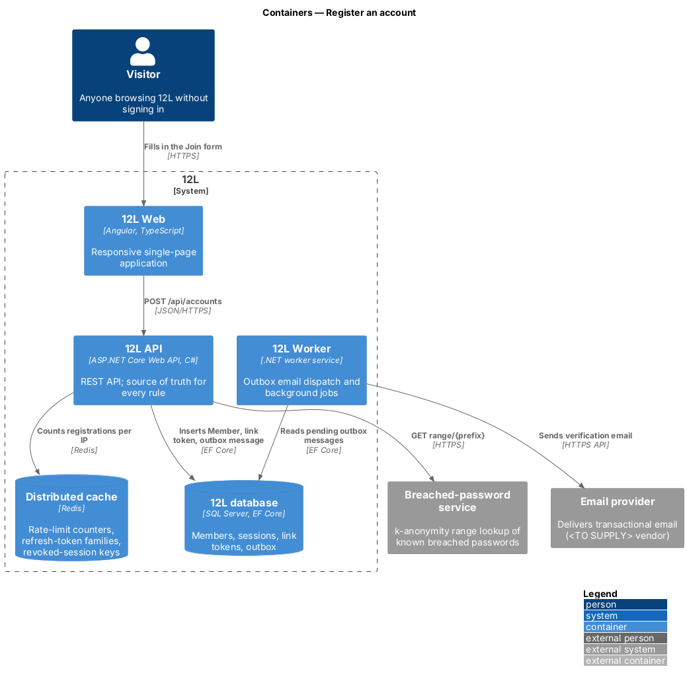
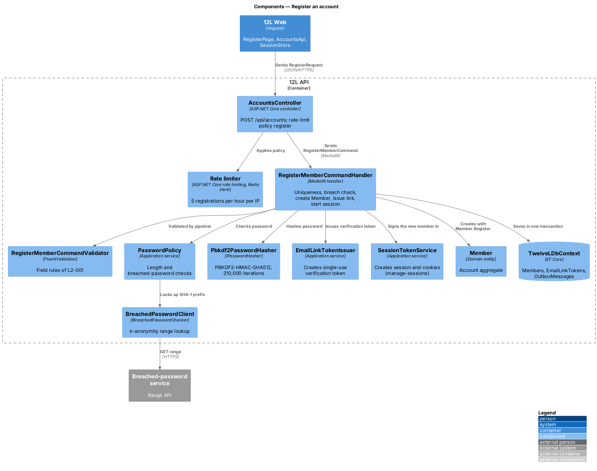
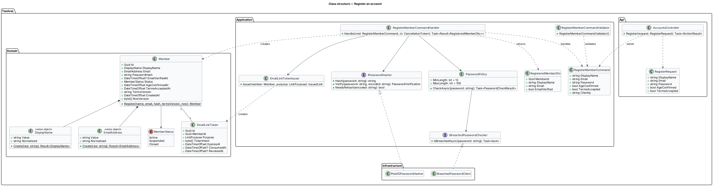
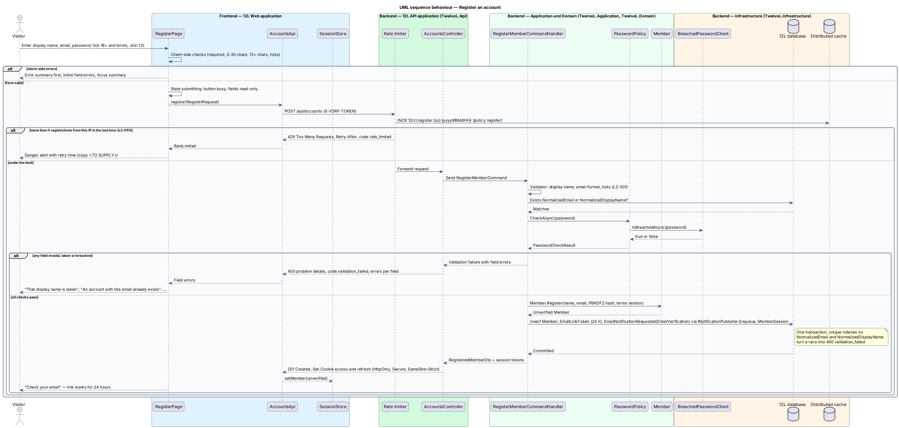
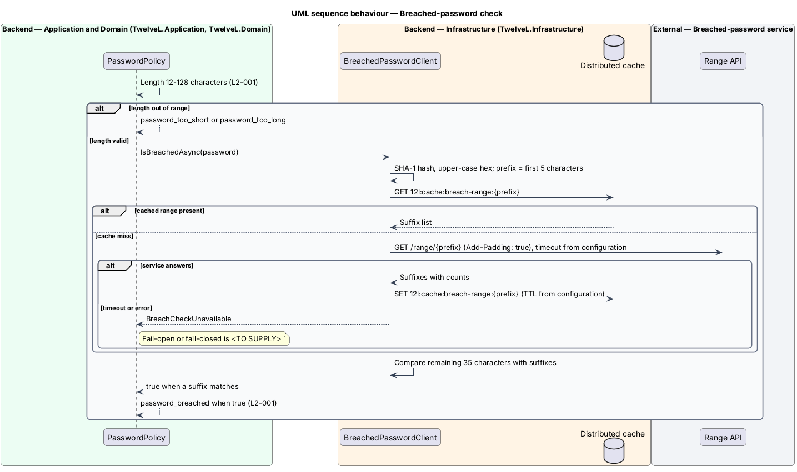

# Register an account

## Overview

12L is a marketplace for men's US size 12 shoes and men's size L clothing. Every
person who buys or sells on 12L holds one account, with no separate seller account
(`L2-003`). This feature is the front door to that account: a visitor joins 12L with a
display name, an email address and a password, confirms being 18 or older and accepts
the terms of service.

Registration creates an *unverified* account and sends a verification email. The
member can browse at once, but buying and selling stay closed until the email is
verified. Verification is designed in [verify-email](../verify-email/README.md).
Registration also signs the new member in, so the persistent verification banner and the
"Resend email" action on the success screen know whose account to act on.

Three protections sit inside the slice. Passwords are checked against a list of known
breached passwords before they are accepted. Passwords are stored only as salted,
deliberately slow hashes (`L2-052`). Registrations from one IP address are rate-limited
to stop bulk account creation (`L2-051`).

Terms used in this document:

- **visitor** — person using 12L without a session
- **member** — holder of a 12L account
- **unverified account** — account whose email address has not yet been confirmed through the emailed link
- **display name** — public handle of a member, shown on listings, reviews and the profile page
- **normalized value** — lower-case, trimmed form of an email address or display name used for case-insensitive uniqueness
- **breached-password list** — corpus of passwords exposed in known data breaches, queried through the external breached-password service
- **k-anonymity range lookup** — query that sends only the first 5 hexadecimal characters of a password's SHA-1 hash and compares the returned suffixes locally, so the password never leaves 12L

## Description

The slice runs from the Join page in `12L Web` through `12L API` to the `12L database`,
with an outbound call to the breached-password service and an email queued through the
notifications outbox. The mock is `docs/mocks/pages/register/` (states `default`,
`invalid`, `submitting`, `success`, `error`).

### Frontend (`src/frontend/src/app/accounts/register/`)

- **`RegisterPage`** — standalone route component at `/join`, lazy-loaded from
  `accounts.routes.ts` and guarded by `guestGuard` (a signed-in member is redirected to
  `/account`). It renders a typed reactive form:
  - `displayName` — label "Display name", help "3–30 letters, numbers, _ or -. Shown publicly.", `autocomplete="username"`, focused on load.
  - `email` — label "Email", `type="email"`, `autocomplete="email"`.
  - `password` — label "Password", help "At least 12 characters.", `autocomplete="new-password"`.
  - `ageConfirmed` — checkbox "I’m 18 or older".
  - `termsAccepted` — checkbox "I accept the terms and marketplace rules", linking `/terms` and `/rules`.
  - Submit button "Join 12L"; footer "Already a member? Sign in".
- **Page states**, held in a `signal<RegisterState>`:
  - `default` — empty form.
  - `invalid` — an error summary at the top lists every error and receives focus; each field shows its inline message with `aria-invalid` and `aria-describedby`. Messages: "That display name is taken", "An account with this email already exists", "Password must be at least 12 characters", "This password has appeared in a data breach. Choose another.", a display name format error, "Confirm you’re 18 or older", "Accept the terms to continue".
  - `submitting` — button `aria-busy="true"`, fields read-only.
  - `success` — heading "Check your email", text "We sent a link to {email}. It works for 24 hours.", primary "Browse while you wait" (to `/`) and link button "Resend email" (calls the resend endpoint from [verify-email](../verify-email/README.md)).
  - `error` — danger alert "Couldn’t create your account", "Try again in a moment." and the correlation reference; input is kept.
  - `rate-limited` — HTTP 429 shown as a danger alert with the wait time from `Retry-After`. The mocks have no state for this case, so the copy is `<TO SUPPLY>`.
- **Client-side validation** mirrors the server rules for fast feedback only: required fields, display name pattern `^[A-Za-z0-9_-]{3,30}$`, password length 12 to 128, both checkboxes ticked. The server remains the authority (`L2-049`).
- **`AccountsApi`** — typed `HttpClient` service. `register(request: RegisterRequest): Observable<CurrentMember>` posts to the API with credentials; the platform `AntiforgeryInterceptor` adds `X-XSRF-TOKEN`.
- **`SessionStore`** — root signal store (defined in [manage-sessions](../manage-sessions/README.md)). On `201` it receives the new `CurrentMember` with `emailVerified: false`, which turns on the persistent warning banner from [verify-email](../verify-email/README.md).
- **`FormErrorMapper`** — shared helper that maps the problem details `errors` map (field → messages) onto form controls and builds the error summary.

### API (`TwelveL.Api`)

- **`AccountsController`** — `POST /api/accounts`, `[AllowAnonymous]`, rate-limit policy `register` (5 per hour per IP, Redis key `12l:rl:register:{ip}:{yyyyMMddHH}`, defined in [platform/harden-http-and-api](../../platform/harden-http-and-api/README.md)).
  - `201 Created` — body `CurrentMemberDto`; `Set-Cookie` for the access and refresh tokens written by `SessionCookieWriter` ([manage-sessions](../manage-sessions/README.md)); `Location: /api/accounts/me`.
  - `400 Bad Request` — code `validation_failed`, `errors` map keyed `displayName`, `email`, `password`, `ageConfirmed`, `termsAccepted`, each with a stable sub-code: `account.display_name_invalid`, `account.display_name_taken`, `account.email_invalid`, `account.email_taken`, `account.password_too_short`, `account.password_too_long`, `account.password_breached`, `account.age_not_confirmed`, `account.terms_not_accepted`.
  - `400` — code `antiforgery_invalid` when the anti-forgery token is missing (`L2-050`).
  - `429 Too Many Requests` — code `rate_limited`, `Retry-After` in seconds (`L2-051`).
  - `500` — problem details with a correlation ID and no internal detail (`L2-068`).
- **`RegisterRequest`** — `DisplayName`, `Email`, `Password`, `AgeConfirmed`, `TermsAccepted`. Unknown properties are ignored (`L2-049`).

### Application and domain (`TwelveL.Application`, `TwelveL.Domain`)

- **`RegisterMemberCommand`** — the request fields plus `ClientIp` and `UserAgent`.
- **`RegisterMemberCommandValidator`** (FluentValidation, run by the platform `ValidationBehavior`) —
  - display name: required, 3 to 30 characters, pattern `^[A-Za-z0-9_-]+$` (no spaces) (`L2-001`). Whether "letters" includes non-ASCII letters is `<TO SUPPLY>`; the design assumes ASCII, matching the mock help text.
  - email: required, at most 254 characters, parsed by `EmailAddress.Create` (single `@`, non-empty local part, domain with a dot).
  - password: required; length and breach rules are delegated to `PasswordPolicy`.
  - `AgeConfirmed` and `TermsAccepted` shall both be `true`.
- **`RegisterMemberCommandHandler`** —
  1. Queries `Members` for a row with the same `NormalizedEmail` or `NormalizedDisplayName` and adds `account.email_taken` or `account.display_name_taken` to the field errors (`L2-001` criteria 2 and 3).
  2. Calls `PasswordPolicy.CheckAsync`.
  3. Returns all field errors together, so the page can show every error at once (mock state `invalid`).
  4. On success hashes the password with `IPasswordHasher.Hash`, calls `Member.Register`, issues a verification token through `EmailLinkTokenIssuer` (24 hours), enqueues the `EmailVerification` email through `INotificationPublisher.Enqueue`, and starts a session through `ISessionTokenService.StartAsync`.
  5. Saves everything in one `TwelveLDbContext` transaction. A unique-index violation caused by a concurrent registration is caught and mapped to the same field error.
- **`PasswordPolicy`** — shared by this feature and [reset-password](../reset-password/README.md). It returns `account.password_too_short` below 12 characters, `account.password_too_long` above 128, and `account.password_breached` when `IBreachedPasswordChecker` reports a match (`L2-001` criteria 4 and 5).
- **`IBreachedPasswordChecker`** — port with `IsBreachedAsync(string password)`.
- **`IPasswordHasher`** — port defined by [platform/protect-credentials-and-supply-chain](../../platform/protect-credentials-and-supply-chain/README.md): PBKDF2-HMAC-SHA512, 210,000 iterations by default, 16-byte salt, encoded as `pbkdf2-sha512$<iterations>$<salt>$<key>` (`L2-052`).
- **`EmailLinkTokenIssuer`** — creates 32 random bytes from `RandomNumberGenerator`, returns them base64url-encoded to the caller and stores only their SHA-256 hash in `EmailLinkToken.TokenHash`.
- **`Member`** (aggregate root, owned by the accounts subsystem) — fields set by this feature:
  `Id` (`Guid`), `DisplayName` (value object with `Value` and `Normalized`), `Email` (value object with `Value` and `Normalized`), `PasswordHash`, `EmailVerifiedAt = null`, `Status = Active`, `Roles = []`, `AgeConfirmedAt`, `TermsAcceptedAt`, `TermsVersion`, `CreatedAt`, `RowVersion`. `Member.Register(...)` is the only constructor path and raises the `MemberRegistered` domain event.
- **`MemberStatus`** — `Active`, `Suspended`, `Closed`. "Unverified" is not a status: it is `EmailVerifiedAt = null`, so a suspension and an unverified email are independent facts.
- **`CurrentMemberDto`** — `Id`, `DisplayName`, `EmailVerified`, `Status`, `Roles`. The email address is not included (`L2-054`).

### Infrastructure (`TwelveL.Infrastructure`)

- **`BreachedPasswordClient : IBreachedPasswordChecker`** — typed `HttpClient` with base address `Accounts:BreachedPasswords:BaseUrl`. It computes the upper-case SHA-1 hex digest, calls `GET /range/{first 5 characters}` with the `Add-Padding: true` header, and compares the remaining 35 characters with the returned suffixes. Responses are cached through `IDistributedCache` at `12l:cache:breach-range:{prefix}` for `Accounts:BreachedPasswords:CacheMinutes`. Timeout is `Accounts:BreachedPasswords:TimeoutSeconds`. Whether registration fails open or fails closed when the service is unreachable is `<TO SUPPLY>`; each failure is logged and counted as a metric (`L2-069`).
- **`Pbkdf2PasswordHasher`** — platform implementation of `IPasswordHasher`.
- **`MemberConfiguration`** (EF Core) — maps `Members`.
- **Logging** — the `password` property is redacted by the platform logging policy, and no plain-text password is stored or logged.

### Data (`12L database`)

- **`Members`** — `Id uniqueidentifier` PK; `DisplayName nvarchar(30) NULL` (null after erasure); `NormalizedDisplayName nvarchar(30) NULL` with a filtered unique index `UX_Members_NormalizedDisplayName`; `Email nvarchar(254)`; `NormalizedEmail nvarchar(254)` with unique index `UX_Members_NormalizedEmail`; `PasswordHash nvarchar(200)`; `EmailVerifiedAt datetimeoffset NULL`; `Status tinyint`; `AgeConfirmedAt`, `TermsAcceptedAt datetimeoffset`; `TermsVersion nvarchar(20)`; profile, closure and erasure columns described in [edit-profile](../edit-profile/README.md) and [close-account](../close-account/README.md); `CreatedAt datetimeoffset`; `RowVersion rowversion` (concurrency token).
- **`MemberRoles`** — `MemberId`, `Role` (`Administrator`); composite PK. Role assignment has no mock or requirement and is `<TO SUPPLY>`.
- **`EmailLinkTokens`** — `Id` PK; `MemberId` FK; `Purpose tinyint` (`EmailVerification`, `PasswordReset`); `TokenHash binary(32)` with unique index; `CreatedAt`, `ExpiresAt`, `ConsumedAt NULL`, `RevokedAt NULL`; index `IX_EmailLinkTokens_MemberId_Purpose`.
- **`OutboxMessages`** — shared table; this feature writes one `EmailNotificationRequested` row of type `EmailVerification` ([notifications/send-email-notifications](../../notifications/send-email-notifications/README.md)).

### Configuration

| Key | Value |
|-----|-------|
| `Accounts:BreachedPasswords:BaseUrl` | `<TO SUPPLY>` |
| `Accounts:BreachedPasswords:TimeoutSeconds` | `<TO SUPPLY>` |
| `Accounts:BreachedPasswords:CacheMinutes` | `<TO SUPPLY>` |
| `Accounts:Terms:CurrentVersion` | `<TO SUPPLY>` |
| `Accounts:EmailVerification:LinkLifetime` | `24:00:00` |
| `Security:PasswordHashing:Iterations` | `210000` (platform) |

## Requirements

The feature realizes the following level-2 (L2) requirements. Each L2 requirement
refines a level-1 (L1) requirement, cited by identifier.

| L2 ID | Refines (L1) | Requirement |
|-------|--------------|-------------|
| `L2-001` | `L1-001` | A visitor shall be able to register with a display name, an email address and a password. The display name shall be 3 to 30 characters of letters, digits, underscores or hyphens and unique ignoring case. The email address shall be a valid address unique ignoring case. The password shall be 12 to 128 characters and shall not appear in a list of known breached passwords. The visitor shall confirm they are 18 or older and accept the terms of service. |
| `L2-051` | `L1-013` | The API shall limit requests to 120 per minute per IP address for anonymous callers and 300 per minute per member, with stricter limits for sign-in (L2-007), registration (5 per hour per IP) and listing creation (20 per day per member). Callers over a limit shall receive HTTP 429 with a `Retry-After` header. |
| `L2-052` | `L1-013` | Passwords shall be stored only as salted hashes using Argon2id or PBKDF2-HMAC-SHA512 with at least 210,000 iterations. Secrets (connection strings, API keys, signing keys) shall not be stored in source control and shall be loaded from a secret store at runtime. |

This feature applies the registration limit of `L2-051` and the password-storage rule of
`L2-052`; the generic limiter and the hasher belong to the platform subsystem.

## Diagrams

### System context

A visitor joins 12L. 12L checks the password against the breached-password service and
sends the verification email through the email provider.

### Containers

`12L Web` posts the form to `12L API`, which counts the attempt in Redis, checks the
breached-password service and writes the member, link token and outbox message to the
`12L database`. `12L Worker` sends the email.

### Components

`AccountsController` applies the `register` rate-limit policy and sends
`RegisterMemberCommand`. The handler uses `PasswordPolicy`, the hasher, the link-token
issuer and the session service, and saves in one transaction.

### Class structure

`Member` composes the `DisplayName` and `EmailAddress` value objects and owns its
`EmailLinkToken` rows. The handler depends on ports that infrastructure implements.

### Behaviour — register an account

Client-side checks run first. The API then applies the IP limit, the field rules,
uniqueness and the breach check, and returns every field error together. A valid request
creates the unverified member, its verification token, the email and a session in one
transaction (`L2-001`, `L2-051`).

### Behaviour — breached-password check

The password policy checks the length, then `BreachedPasswordClient` sends only the
5-character hash prefix and compares suffixes locally. Cached ranges avoid repeat
lookups. The failure policy for an unreachable service is `<TO SUPPLY>`.

