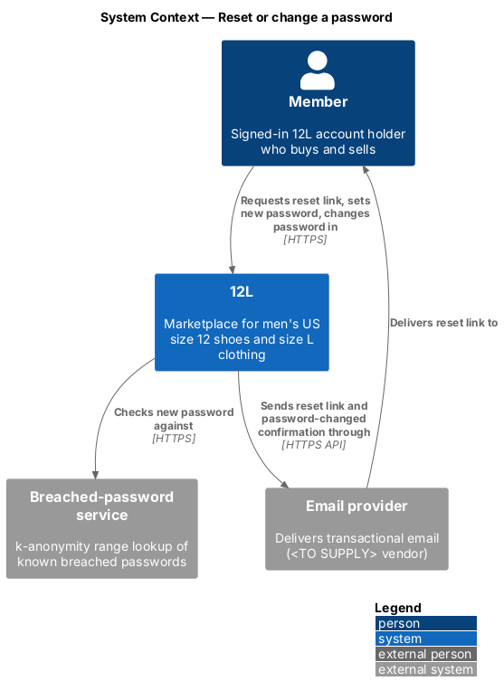
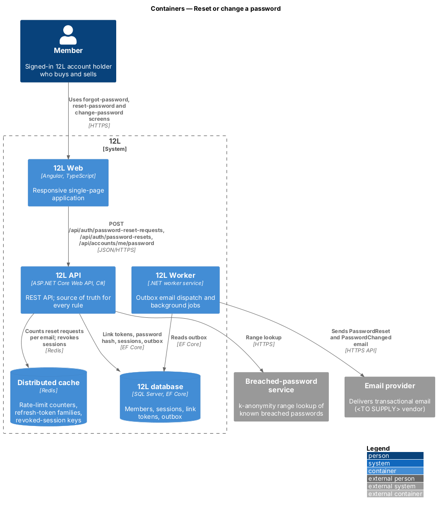
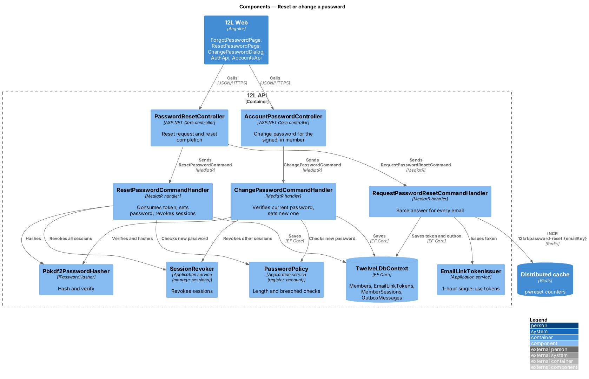
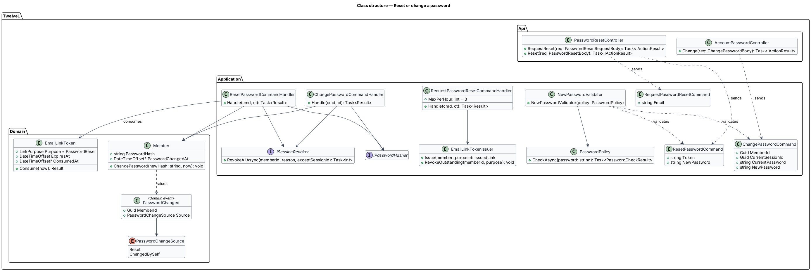
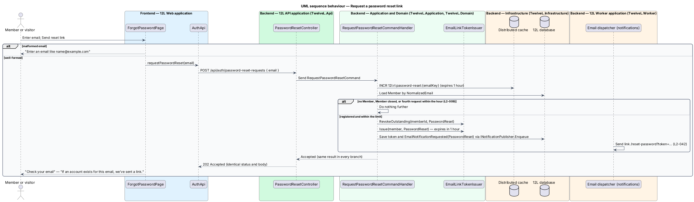
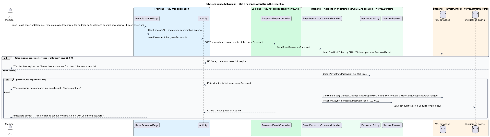
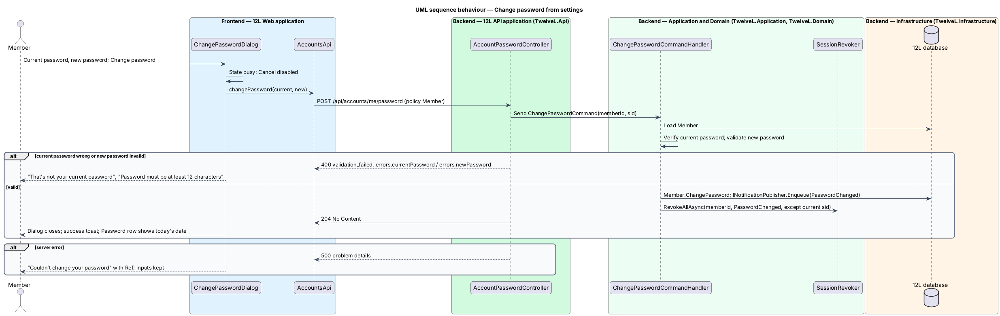

# Reset or change a password

## Overview

Members who forget their password recover access through a reset link sent to their
email address. The link works once and for 1 hour. Setting a new password through it
signs the member out on every device and sends a confirmation email, so a member whose
account was taken over regains sole control.

The request step is built so that it reveals nothing. Whether or not the email belongs
to an account, 12L shows the same page, "If an account exists for this email, we’ve sent
a link.", with the same HTTP status. To stop mailbox flooding, no more than 3 reset
emails go to one address per hour; further requests receive the same answer but send
nothing.

The feature also covers the "Change password" dialog on the Settings page, used by a
signed-in member who knows their current password. It applies the same password rules
as registration and signs out the member's other devices.

Terms used in this document:

- **reset link** — URL `/reset-password?token=…` carrying a single-use token with purpose `PasswordReset`
- **reset request** — submission of an email address on the "Reset your password" page
- **password rules** — the `L2-001` rules: 12 to 128 characters and absent from the breached-password list
- **current session** — session of the device that changes the password from Settings

## Description

Mocks: `docs/mocks/pages/forgot-password/` (`default`, `invalid`, `submitting`,
`success`, `error`), `docs/mocks/pages/reset-password/` (`default`, `invalid`,
`submitting`, `success`, `expired`, `error`), `docs/mocks/dialogs/change-password/`
(`default`, `invalid`, `busy`, `failed`).

### Frontend (`src/frontend/src/app/accounts/`)

- **`ForgotPasswordPage`** — route `/forgot-password`. Heading "Reset your password", lead "We’ll email you a link that works for 1 hour.", field "Email", button "Send reset link", link "Back to sign in". States:
  - `invalid` — inline "Enter an email like name@example.com".
  - `submitting` — button busy.
  - `success` — "Check your email", "If an account exists for this email, we’ve sent a link.", button "Back to sign in".
  - `error` — danger alert "Couldn’t send the link", reference; email kept.
- **`ResetPasswordPage`** — route `/reset-password`. It reads `token` from the query string and removes it from the address bar with `Location.replaceState`. Heading "Choose a new password", lead "You’ll be signed out on every device.", fields "New password" (help "At least 12 characters.") and "Confirm password", button "Save password". The token is checked on submit, so the page has no loading state. States:
  - `invalid` — inline error on "New password", for example "This password has appeared in a data breach. Choose another."; a mismatch shows a client-side error on "Confirm password" (copy `<TO SUPPLY>`).
  - `submitting` — button busy.
  - `success` — "Password saved", "You’re signed out everywhere. Sign in with your new password.", button "Sign in".
  - `expired` — "This link has expired", "Reset links work once, for 1 hour.", button "Request a new link" (to `/forgot-password`).
  - `error` — danger alert "Couldn’t save your password", reference.
- **`ChangePasswordDialog`** — opened from the "Password" row of `SettingsPage`. Title "Change password", description "Other devices will be signed out.", fields "Current password" and "New password" (help "At least 12 characters."), buttons "Cancel" and "Change password". States:
  - `invalid` — "That’s not your current password", "Password must be at least 12 characters".
  - `busy` — Cancel disabled.
  - `failed` — danger alert "Couldn’t change your password", "Try again." with reference; inputs kept.
  - On success the dialog closes, a success toast appears (copy `<TO SUPPLY>`; the mocks have no success state) and the settings row refreshes its "Changed {date}" text.
- **`AuthApi`** — `requestPasswordReset(email)`, `resetPassword(token, newPassword)`; **`AccountsApi.changePassword(current, next)`**.

### API (`TwelveL.Api`)

- **`PasswordResetController`**
  - `POST /api/auth/password-reset-requests` — `[AllowAnonymous]`, body `{ email }`. Always `202 Accepted` with an empty body for a well-formed email (`L2-009` criteria 1, 2 and 5); `400 validation_failed` for a malformed one. Default `anonymous` rate limit applies.
  - `POST /api/auth/password-resets` — `[AllowAnonymous]`, body `{ token, newPassword }`. `204` with cookies cleared; `410 Gone` code `auth.reset_link_expired` for an unknown, consumed, revoked or expired token (criterion 4); `400 validation_failed` with `errors.newPassword` for a rule failure.
- **`AccountPasswordController`** — `POST /api/accounts/me/password`, policy `MemberOnly`, body `{ currentPassword, newPassword }`. `204`; `400 validation_failed` with `errors.currentPassword` (sub-code `account.current_password_incorrect`) or `errors.newPassword`.

### Application and domain

- **`RequestPasswordResetCommand` / handler** —
  1. Increments `12l:rl:password-reset:{emailKey}` (1-hour expiry from the first request).
  2. Loads the member by `NormalizedEmail`.
  3. Stops without sending when no member exists, the member is `Closed`, or the count exceeds 3 (criteria 2 and 5).
  4. Otherwise revokes earlier reset tokens, issues a token with a 1-hour expiry, enqueues `NotificationType.PasswordReset` through `INotificationPublisher.Enqueue`, and saves in one transaction (criterion 1).
  5. Returns the same `Accepted` result in every branch. The handler does the same database and Redis work in each branch, so response time does not reveal the outcome.
- **`ResetPasswordCommand` / handler** —
  1. Loads the `EmailLinkToken` by hash with purpose `PasswordReset`; any state other than `Usable` returns `auth.reset_link_expired` (criterion 4).
  2. Validates the new password through `NewPasswordValidator` (`PasswordPolicy` from [register-account](../register-account/README.md)).
  3. Consumes the token, calls `Member.ChangePassword(hash, now)`, enqueues `NotificationType.PasswordChanged`, and saves in one transaction.
  4. Calls `ISessionRevoker.RevokeAllAsync(memberId, PasswordReset)` (criterion 3).
  The failure counter and lock of [sign-in](../sign-in/README.md) are left untouched.
- **`ChangePasswordCommand` / handler** — verifies the current password with `IPasswordHasher.Verify`, validates the new one, calls `Member.ChangePassword`, and revokes every session except the current `sid` with reason `PasswordChanged`. Whether this path also sends the `PasswordChanged` email is `<TO SUPPLY>`; the design assumes it does, because the email category is account security.
- **`Member.ChangePassword(newHash, now)`** — replaces `PasswordHash`, sets `PasswordChangedAt` and raises `PasswordChanged { MemberId, Source }` with `Source` `Reset` or `ChangedBySelf`.
- **`NewPasswordValidator`** — FluentValidation rule set shared by both commands; it calls `PasswordPolicy.CheckAsync`.

### Infrastructure and data

- **Tables** — `EmailLinkTokens` (purpose `PasswordReset`, `ExpiresAt = CreatedAt + 1 hour`), `Members.PasswordHash` and `Members.PasswordChangedAt datetimeoffset NULL`, `MemberSessions`, `OutboxMessages`.
- **Email** — the `PasswordReset` template links to `/reset-password?token=…`; the `PasswordChanged` template links to `/account/settings` ([notifications/send-email-notifications](../../notifications/send-email-notifications/README.md)). Neither contains a password (`L2-042`).
- **Configuration** — `Accounts:PasswordReset:LinkLifetime` (`01:00:00`), `Accounts:PasswordReset:MaxEmailsPerHour` (`3`).

## Requirements

The feature realizes the following level-2 (L2) requirement. It refines a level-1 (L1)
requirement, cited by identifier.

| L2 ID | Refines (L1) | Requirement |
|-------|--------------|-------------|
| `L2-009` | `L1-002` | A member shall be able to reset a forgotten password through a single-use emailed link that expires after 1 hour. The response to a reset request shall not reveal whether the email is registered. Resetting the password shall revoke all of the member's sessions. |

The new password follows the rules of `L2-001`, applied by the shared `PasswordPolicy`
from [register-account](../register-account/README.md).

## Diagrams

### System context

The member requests a link and sets a new password in 12L. 12L checks the new password
against the breached-password service and sends the link and the confirmation through
the email provider.

### Containers

`12L API` counts requests in Redis, writes tokens, password hashes and outbox messages to
the `12L database`, and revokes sessions. `12L Worker` sends the emails.

### Components

`PasswordResetController` serves the two anonymous steps; `AccountPasswordController`
serves the signed-in change. Both change paths use `PasswordPolicy`, the hasher and
`SessionRevoker`.

### Class structure

The three commands share `NewPasswordValidator`. `Member.ChangePassword` raises
`PasswordChanged` with its source.

### Behaviour — request a reset link

Every branch returns 202 with the same message. A link is sent only for a registered,
open account under the hourly limit (`L2-009`).

### Behaviour — set a new password from the link

An unusable token returns 410. A valid password is saved with the token consumed, and
every session is revoked (`L2-009`).

### Behaviour — change password from settings

The dialog verifies the current password, saves the new one and signs out the member's
other devices.

