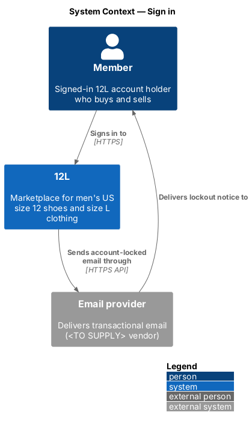
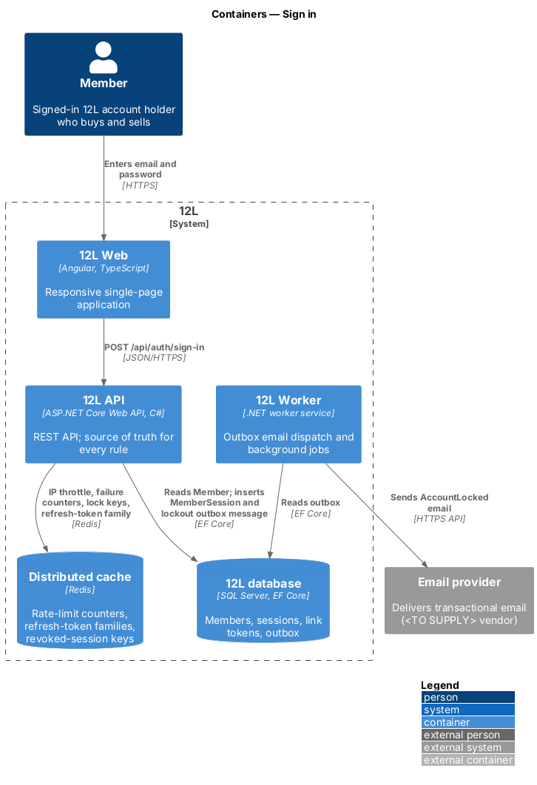
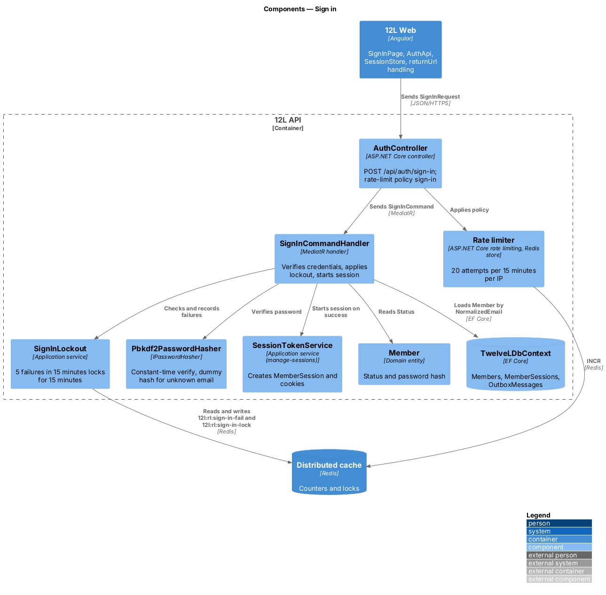
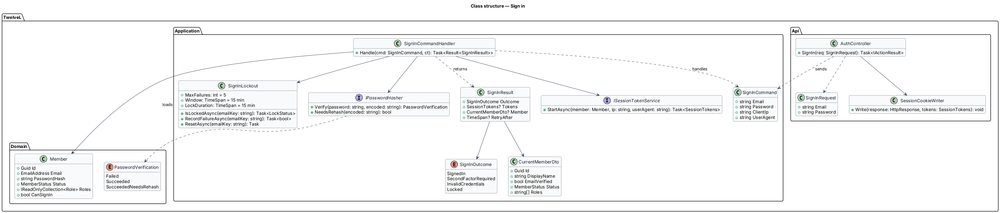
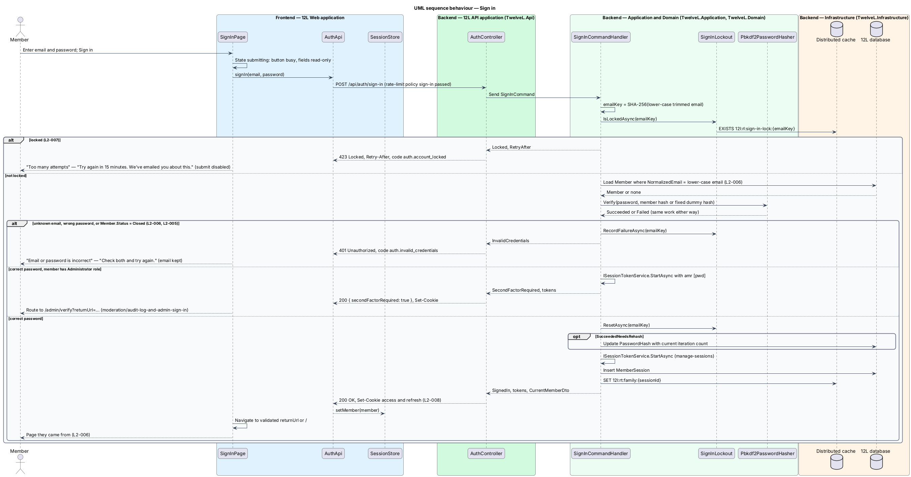
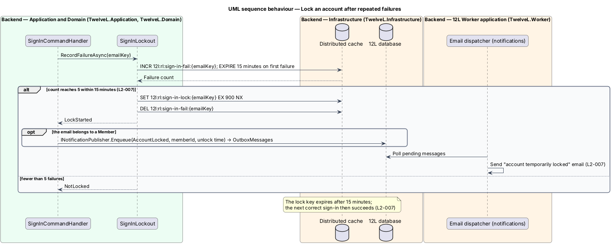
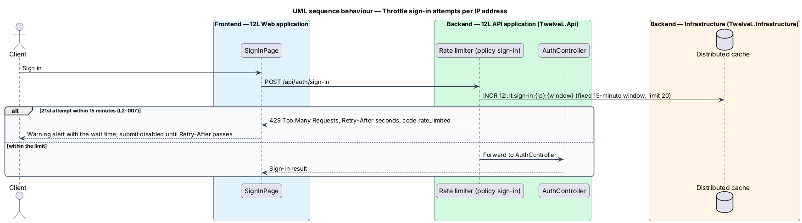

# Sign in

## Overview

Members sign in to 12L with the email address and password they registered with. A
successful sign-in starts a session and returns the member to the page they came from,
for example back to a listing after choosing "Buy now" as a visitor.

The feature is built so that sign-in reveals nothing about which email addresses hold
accounts. An unknown email, a wrong password and a closed account all produce the same
message, "Email or password is incorrect", with the same HTTP status and comparable
response time. Two brute-force defences sit on top of that. After 5 failed attempts for
one account within 15 minutes the account is locked for 15 minutes and the member is
emailed. Independently, one IP address may make at most 20 sign-in attempts per 15
minutes.

Session cookies, refresh and sign-out are designed in
[manage-sessions](../manage-sessions/README.md). Administrators complete a second step,
a TOTP code, designed in
[moderation/audit-log-and-admin-sign-in](../../moderation/audit-log-and-admin-sign-in/README.md);
this feature hands over to it.

Terms used in this document:

- **failed attempt** — sign-in request whose password does not verify against the email given, including an unknown or closed account
- **email key** — SHA-256 hash of the normalized email, used to key failure counters without storing the email in Redis
- **lockout** — 15-minute period in which every sign-in for one email key is refused, whatever the password
- **return URL** — relative path inside 12L the member is sent back to after sign-in
- **dummy hash** — fixed PBKDF2 hash verified against when no member matches, so an unknown email costs the same work as a known one

## Description

Mocks: `docs/mocks/pages/sign-in/` (`default`, `return`, `invalid`, `submitting`,
`locked`, `error`).

### Frontend (`src/frontend/src/app/accounts/sign-in/`)

- **`SignInPage`** — route `/sign-in`, guarded by `guestGuard`. Fields "Email" (`autocomplete="email"`, autofocus) and "Password" (`autocomplete="current-password"`), link "Forgot password?" to `/forgot-password`, submit "Sign in", footer "New to 12L? Join". Query parameters:
  - `returnUrl` — kept through sign-in. `ReturnUrlValidator` accepts only a path that starts with a single `/`, has no scheme or host, and does not start with `//` or `/\`; anything else falls back to `/`.
  - `returnUrl=/items/{reference}`, as sent by "Buy now" in [catalog/view-listing-detail](../../catalog/view-listing-detail/README.md) — mock state `return`: heading "Sign in to buy", lead "You’ll go straight back to the {listing title}." The title is read from the catalog cache when present; otherwise the lead is omitted.
  - `expired=1` — renders `SessionExpiredPage` instead ([manage-sessions](../manage-sessions/README.md)).
- **Page states**:
  - `invalid` — danger alert "Email or password is incorrect", "Check both and try again."; the email is kept, the password cleared, focus moves to the alert.
  - `submitting` — button busy, fields read-only.
  - `locked` — warning alert with lock icon, "Too many attempts", "Try again in 15 minutes. We’ve emailed you about this."; submit disabled until the `Retry-After` time passes.
  - `throttled` — HTTP 429 from the IP limit, shown in the same warning alert with the time from `Retry-After`; no mock exists, so the exact copy is `<TO SUPPLY>`.
  - `error` — danger alert "Something went wrong", "Try again in a moment." and the correlation reference; email kept.
- **`AuthApi.signIn(email, password)`** — `POST` with credentials; returns `SignInResponse`.
- **After success** — `SessionStore.setMember(member)`, `AntiforgeryTokenService` refreshes its token (platform), and the router navigates to the validated return URL. When the response carries `secondFactorRequired: true`, the router navigates to `/admin/verify?returnUrl=…` instead.

### API (`TwelveL.Api`)

- **`AuthController`** — `POST /api/auth/sign-in`, `[AllowAnonymous]`, rate-limit policy `sign-in`.
  - `200 OK` — body `{ member: CurrentMemberDto, secondFactorRequired: bool }` and `Set-Cookie` for the session (`L2-008`).
  - `401 Unauthorized` — code `auth.invalid_credentials`, detail "Email or password is incorrect", for an unknown email, a wrong password and a closed account alike (`L2-006` criteria 2 and 3, `L2-005` criterion 4).
  - `423 Locked` — code `auth.account_locked`, `Retry-After` in seconds (`L2-007` criterion 1).
  - `429 Too Many Requests` — code `rate_limited`, `Retry-After` (`L2-007` criterion 3).
  - `400` — `validation_failed` for an empty or over-long field; `antiforgery_invalid` without the token.
- **Rate-limit policy `sign-in`** — owned by this feature and registered in the platform `RateLimitPolicies` catalogue: limit 20, partition client IP, fixed 15-minute window, Redis key `12l:rl:sign-in:{ip}:{window}`. It applies in addition to the default `anonymous` policy.

### Application and domain

- **`SignInCommand`** — `Email`, `Password`, `ClientIp`, `UserAgent`.
- **`SignInCommandValidator`** — email required, at most 254 characters; password required, at most 128 characters. No format error is returned for the email, so a malformed address receives the same generic error as a wrong one.
- **`SignInCommandHandler`** —
  1. Computes the email key from the trimmed, lower-cased email (`L2-006` criterion 4).
  2. Asks `SignInLockout.IsLockedAsync`; when locked, returns `Locked` with the remaining time and does not verify the password (`L2-007` criterion 1).
  3. Loads `Member` by `NormalizedEmail`.
  4. Calls `IPasswordHasher.Verify(password, encoded)` with the member's hash, or with the dummy hash when there is no member, so both paths do the same work.
  5. Treats `Failed`, no member, and `Status = Closed` as a failed attempt: records it through `SignInLockout.RecordFailureAsync` and returns `InvalidCredentials`.
  6. On success resets the failure counter. On `SucceededNeedsRehash` it re-hashes the password and saves it ([platform/protect-credentials-and-supply-chain](../../platform/protect-credentials-and-supply-chain/README.md)).
  7. Starts a session with `ISessionTokenService.StartAsync` (access token `amr: ["pwd"]`).
  8. Returns `SecondFactorRequired` when the member holds the `Administrator` role, otherwise `SignedIn`.
- **Suspended and unverified members** sign in normally. A suspended member keeps access to their orders (`L2-046`); the capability gates in [enforce-authorisation](../enforce-authorisation/README.md) restrict what they can do.
- **`SignInLockout`** — Redis-backed, keyed by email key so that unknown emails lock exactly like known ones and the lock reveals nothing:
  - `RecordFailureAsync` — `INCR 12l:rl:sign-in-fail:{emailKey}`, `EXPIRE 900` on the first increment. At the 5th failure it sets `12l:rl:sign-in-lock:{emailKey}` with `EX 900 NX`, deletes the counter and reports `LockStarted`.
  - `IsLockedAsync` — `PTTL` of the lock key; the remaining time becomes `Retry-After`.
  - `ResetAsync` — deletes the counter after a successful sign-in.
  - A lock expires by itself after 15 minutes, after which a correct password succeeds (`L2-007` criterion 2).
- **Lockout email** — when `LockStarted` and a member exists for the email, the handler calls `INotificationPublisher.Enqueue(NotificationType.AccountLocked, memberId, { unlockAt })` and saves (`L2-007` criterion 4). The template links to `/forgot-password` ([notifications/send-email-notifications](../../notifications/send-email-notifications/README.md)).
- **`SignInResult`** — `Outcome` (`SignedIn`, `SecondFactorRequired`, `InvalidCredentials`, `Locked`), `Tokens`, `Member`, `RetryAfter`.

### Infrastructure and data

- **Dummy hash** — computed once at start-up from a random password with the configured iteration count and held in memory.
- **Redis keys** — `12l:rl:sign-in:{ip}:{window}`, `12l:rl:sign-in-fail:{emailKey}`, `12l:rl:sign-in-lock:{emailKey}`. When Redis is unreachable the platform rate limiter's outage behaviour applies; the lockout check follows the same rule (`<TO SUPPLY>` in the platform design).
- **Tables** — reads `Members` through `UX_Members_NormalizedEmail`; writes `MemberSessions` ([manage-sessions](../manage-sessions/README.md)) and `OutboxMessages`.
- **Logging** — each failed attempt is logged as a security event with the email key, client IP and correlation ID, never the password or the plain email (`L2-069`).
- **Configuration** — `Accounts:SignIn:MaxFailures` (`5`), `Accounts:SignIn:FailureWindow` (`00:15:00`), `Accounts:SignIn:LockDuration` (`00:15:00`), `Accounts:SignIn:IpLimit` (`20`), `Accounts:SignIn:IpWindow` (`00:15:00`).

## Requirements

The feature realizes the following level-2 (L2) requirements. Each L2 requirement
refines a level-1 (L1) requirement, cited by identifier.

| L2 ID | Refines (L1) | Requirement |
|-------|--------------|-------------|
| `L2-006` | `L1-002` | A member shall be able to sign in with their email and password. The error shown for an unknown email and for a wrong password shall be identical. |
| `L2-007` | `L1-002` | After 5 failed sign-in attempts for one account within 15 minutes, the account shall be locked for 15 minutes. Sign-in attempts from one IP address shall be limited to 20 per 15 minutes. |

## Diagrams

### System context

The member signs in to 12L. 12L sends the account-locked email through the email
provider.

### Containers

`12L Web` posts the credentials to `12L API`. The API keeps throttles, failure counters
and lock keys in Redis, reads the member from the `12L database` and starts the session.
`12L Worker` sends the lockout email.

### Components

`AuthController` applies the `sign-in` policy and sends `SignInCommand`.
`SignInCommandHandler` consults `SignInLockout`, verifies the password and starts the
session through `SessionTokenService`.

### Class structure

The handler returns a `SignInResult` whose `SignInOutcome` drives the HTTP status. It
depends on the hasher and session ports.

### Behaviour — sign in

A locked email key is refused before the password check. Unknown email, wrong password
and closed account share one 401 response. Administrators continue to the TOTP step;
other members return to their page (`L2-006`).

### Behaviour — lock an account after repeated failures

The 5th failure within 15 minutes sets a 15-minute lock key and, when the account exists,
queues the lockout email (`L2-007`).

### Behaviour — throttle sign-in attempts per IP address

The 21st attempt from one IP address within the window returns 429 with `Retry-After`
before the controller runs (`L2-007`).

