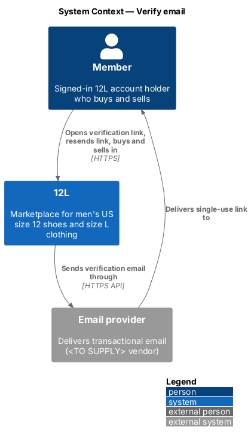
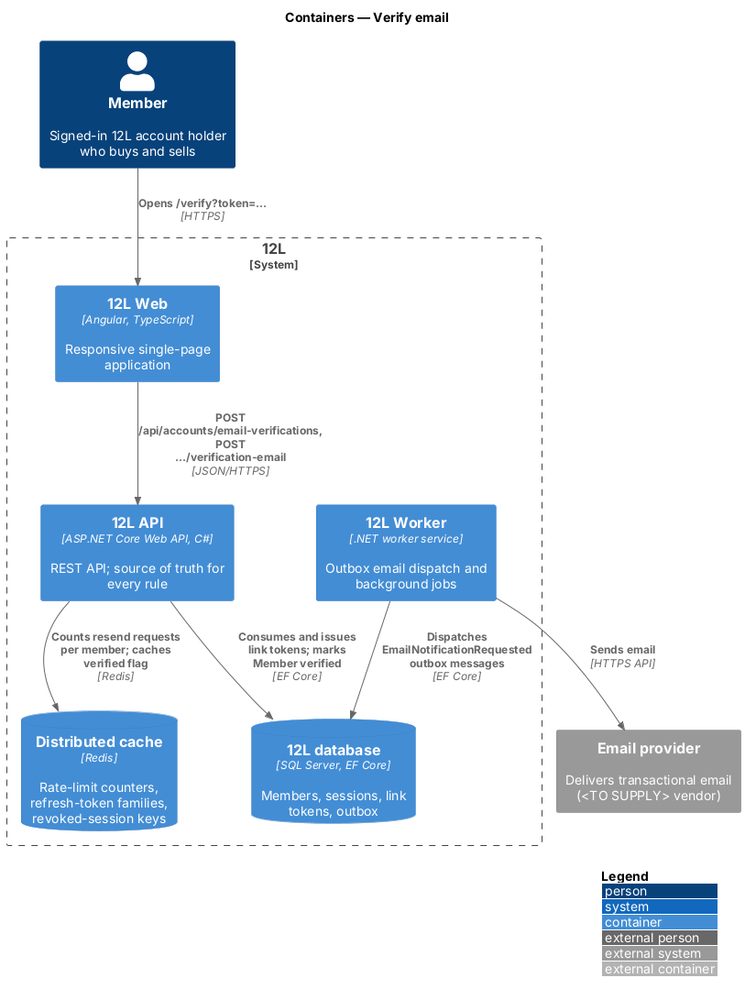
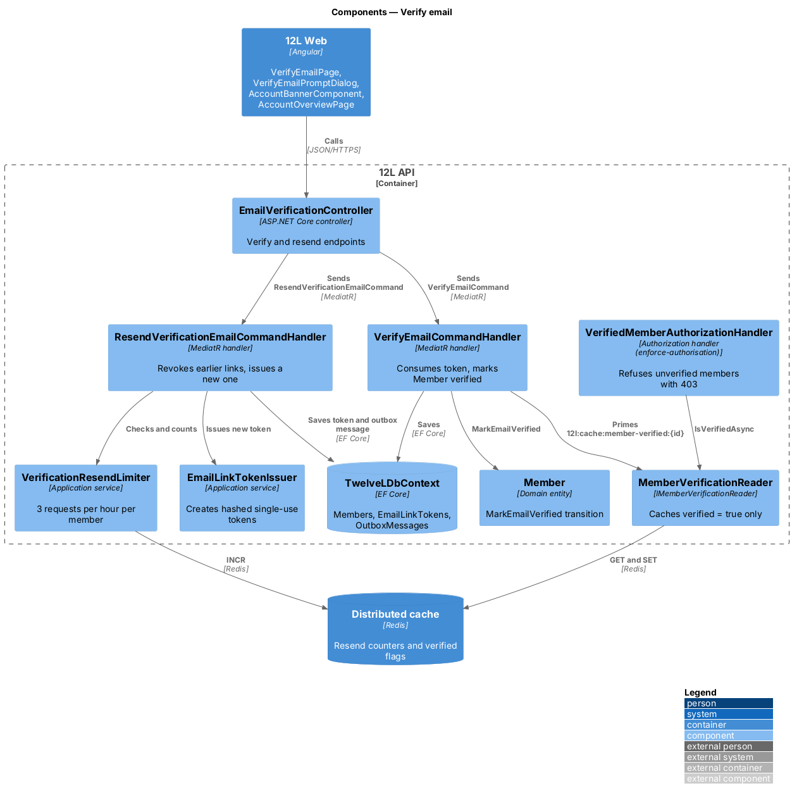
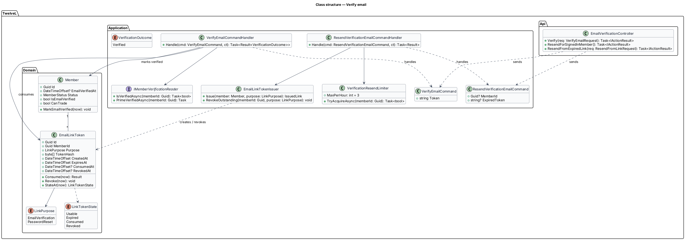
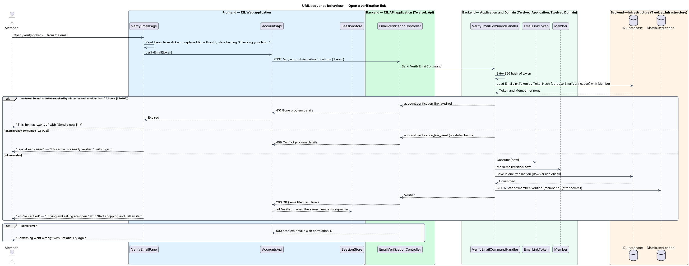
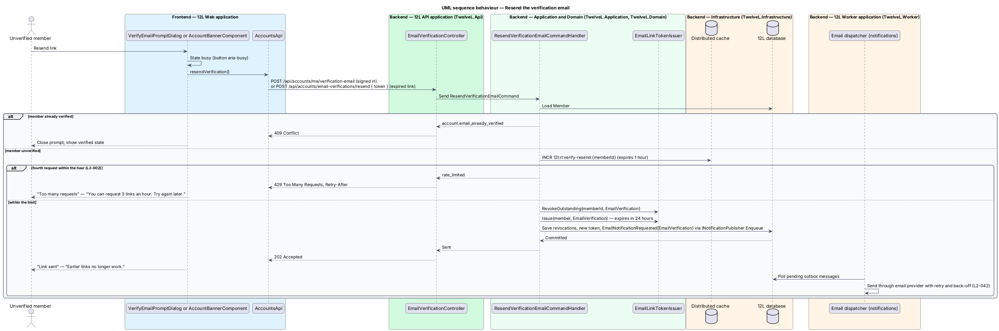
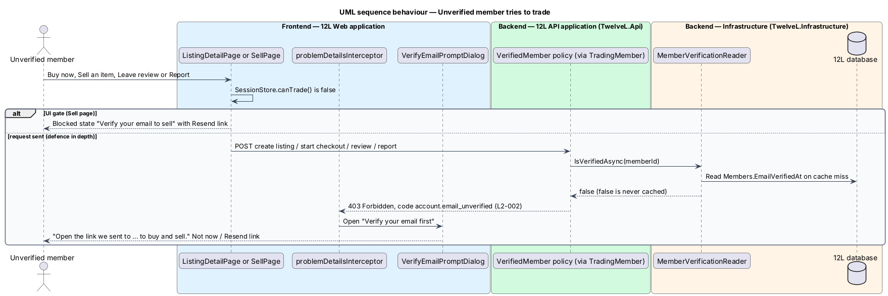

# Verify email

## Overview

A new 12L account starts *unverified*. This feature proves that the member controls the
email address they registered with, and it is the switch that opens buying and selling.
12L sends a single-use link by email; opening it within 24 hours marks the account
verified. Until then the member can browse the catalog but cannot create a listing, start
checkout, leave a review or report anything.

Verification is also the only gate between a new member and trading. 12L has no seller
application, approval step or separate seller account: once verified, and while not
suspended, a member can both buy and sell (`L2-003`). The account overview page and the
site-wide account banner tell the member which of these states applies.

The feature covers the verification page, resending a link, the "Verify your email first"
prompt shown when an unverified member tries to trade, the account banner states for
verification, and the account overview page. The 403 enforcement itself is a policy
defined in [enforce-authorisation](../enforce-authorisation/README.md).

Terms used in this document:

- **verification link** — URL `/verify?token=…` carrying a single-use token, emailed to the member
- **link token** — 32 random bytes, sent only inside the link and stored only as a SHA-256 hash
- **verified member** — member whose `EmailVerifiedAt` is set
- **trading member** — verified member whose status is `Active`, allowed to list, buy, review and report
- **resend** — request for a new verification link, which revokes every earlier link for the account

## Description

Mocks: `docs/mocks/pages/verify-email/` (`default`, `loading`, `expired`, `used`,
`error`), `docs/mocks/dialogs/verify-email-prompt/` (`default`, `busy`, `sent`,
`limited`), `docs/mocks/notifications/account-banner/` (`info`, `success`, `warning`),
`docs/mocks/pages/account/` (`default`, `loading`, `empty`, `error`, `unverified`) and the
`unverified` state of `docs/mocks/pages/sell/`.

### Frontend (`src/frontend/src/app/accounts/`)

- **`VerifyEmailPage`** — route `/verify`, open to visitors and members. On init it reads `token` from the query string, removes it from the address bar with `Location.replaceState`, and posts it. States:
  - `loading` — spinner, "Checking your link…".
  - `verified` (mock `default`) — "You’re verified", "Buying and selling are open.", buttons "Start shopping" (`/`) and "Sell an item" (`/sell`).
  - `expired` — "This link has expired", "Links work for 24 hours. A new one replaces it.", button "Send a new link" (resend from the expired link).
  - `used` — "Link already used", "This email is already verified.", button "Sign in".
  - `error` — "Something went wrong", "We couldn’t check your link.", correlation reference, "Try again".
- **`VerifyEmailPromptDialog`** — modal opened by `problemDetailsInterceptor` on HTTP 403 with code `account.email_unverified`, and directly by pages whose `SessionStore.canTrade()` is false (for example "Buy now" on a listing). Title "Verify your email first"; description "Open the link we sent to {email} to buy and sell."; buttons "Not now" and "Resend link" (autofocus). States `busy`, `sent` ("Link sent", "Earlier links no longer work.", button "Done") and `limited` ("Too many requests", "You can request 3 links an hour. Try again later."). Focus is trapped and returns to the trigger on close (`L2-065`).
- **`AccountBannerComponent`** — shell-level banner below the top bar, driven by `SessionStore`:
  - `info` — after registration: "We sent a verification link to {email}." with "Resend".
  - `warning` — on every page while unverified, not dismissible: "Verify your email to buy and sell." with "Resend link".
  - `success` — once after verification: "Email verified. Buying and selling are open."
  - `danger` — suspension, designed in [enforce-authorisation](../enforce-authorisation/README.md).
- **`AccountLayout`** — route `/account` shell with tabs Overview, Profile (`/account/profile`), Emails (`/account/emails`, [notifications/manage-notification-preferences](../../notifications/manage-notification-preferences/README.md)) and Settings (`/account/settings`). Guarded by `authGuard`.
- **`AccountOverviewPage`** — `/account` default child. Heading "Hi, {displayName}", subtitle "Member since {date}", primary "Sell an item". States:
  - `default` — 3 stat tiles: "Active listings", "To ship by {date}", "On the way", linking to `/account/listings`, `/account/sales` and `/account/purchases`.
  - `loading` — 3 skeleton tiles.
  - `empty` — "Nothing here yet", "List something you no longer wear, or find something that fits.", buttons "Sell an item" and "Browse".
  - `error` — "Couldn’t load your account" with reference and "Try again"; tabs keep working.
  - `unverified` — warning alert "Verify your email to buy and sell", "We sent a link to {email}." with "Resend link"; no stat tiles and no "Sell an item".
  - `suspended` — designed in [enforce-authorisation](../enforce-authorisation/README.md).
- **`AccountsApi`** — `verifyEmail(token)`, `resendVerification()`, `resendVerificationFromLink(token)`, `getOverview()`.
- **`SessionStore`** — exposes `emailVerified`, `canTrade = emailVerified && status === 'Active'`; `markVerified()` updates the signal after a successful verification in the same browser.

### API (`TwelveL.Api`)

- **`EmailVerificationController`**
  - `POST /api/accounts/email-verifications` — `[AllowAnonymous]`, body `{ token }`. `200` `{ emailVerified: true }`; `410 Gone` code `account.verification_link_expired` for an expired, revoked or unknown token; `409 Conflict` code `account.verification_link_used` for a consumed token (no state change); `400 validation_failed` for a malformed token.
  - `POST /api/accounts/me/verification-email` — policy `MemberOnly`. `202 Accepted`; `409` code `account.email_already_verified`; `429` code `rate_limited` with `Retry-After`.
  - `POST /api/accounts/email-verifications/resend` — `[AllowAnonymous]`, body `{ token }`, used by the expired page when the browser has no session. It resolves the member from the expired token's hash and follows the same rules as the signed-in resend. A consumed or unknown token returns `202` without sending, so the endpoint reveals nothing.
- **`AccountOverviewController`** — `GET /api/accounts/me/overview`, policy `MemberOnly`, `200` `{ displayName, memberSince, emailVerified, status, activeListings, salesToShip, nextShipBy, purchasesInTransit }`. The counts come from read ports implemented by the listings and orders subsystems (`IMemberListingCounts`, `IMemberOrderCounts`).

### Application and domain

- **`VerifyEmailCommand` / `VerifyEmailCommandHandler`** — hashes the token, loads the `EmailLinkToken` with purpose `EmailVerification` and its `Member`, evaluates `EmailLinkToken.StateAt(now)`, and then:
  - `Expired` or `Revoked` — returns `account.verification_link_expired` (`L2-002` criterion 2).
  - `Consumed` — returns `account.verification_link_used`; nothing changes (criterion 3).
  - `Usable` — calls `token.Consume(now)` and `member.MarkEmailVerified(now)`, saves in one transaction with the `RowVersion` check, and after commit primes `12l:cache:member-verified:{memberId}` (criterion 1).
- **`ResendVerificationEmailCommand` / handler** — loads the member; refuses when already verified; acquires a slot from `VerificationResendLimiter`; calls `EmailLinkTokenIssuer.RevokeOutstanding(memberId, EmailVerification)` and `Issue(...)`; enqueues the `EmailVerification` email through `INotificationPublisher.Enqueue`; saves in one transaction (`L2-002` criterion 5).
- **`VerificationResendLimiter`** — Redis counter `12l:rl:verify-resend:{memberId}`, `INCR` with a 1-hour expiry set on the first increment; a 4th request within the hour is refused with HTTP 429 (`L2-002` criterion 6). The registration email does not count towards the 3.
- **`EmailLinkToken`** — `Id`, `MemberId`, `Purpose`, `TokenHash`, `CreatedAt`, `ExpiresAt = CreatedAt + 24 hours`, `ConsumedAt`, `RevokedAt`. `StateAt(now)` returns `Consumed`, `Revoked`, `Expired` or `Usable`, in that order of precedence. `Consume(now)` fails unless the state is `Usable`.
- **`Member.MarkEmailVerified(now)`** — sets `EmailVerifiedAt` once; a second call is a no-op. Verification never reverts.
- **`Member.CanTrade`** — `EmailVerifiedAt != null && Status == Active`. This single rule realises `L2-003`: no seller flag, approval state or seller entity exists anywhere in the model.
- **`IMemberVerificationReader` / `MemberVerificationReader`** — used by the `VerifiedMember` policy. It caches only `true` values at `12l:cache:member-verified:{memberId}` (no expiry needed, because verification never reverts) and always reads `Members.EmailVerifiedAt` on a miss, so a stale `false` never blocks a verified member.

### Infrastructure and data

- **`EmailLinkTokens`** table — described in [register-account](../register-account/README.md). The unique index on `TokenHash` serves the lookup.
- **Outbox** — `EmailNotificationRequested` of type `EmailVerification`; the deep link `/verify?token=…` and the email template belong to [notifications/send-email-notifications](../../notifications/send-email-notifications/README.md).
- **Configuration** — `Accounts:EmailVerification:LinkLifetime` (`24:00:00`), `Accounts:EmailVerification:ResendPerHour` (`3`).

## Requirements

The feature realizes the following level-2 (L2) requirements. Each L2 requirement
refines a level-1 (L1) requirement, cited by identifier.

| L2 ID | Refines (L1) | Requirement |
|-------|--------------|-------------|
| `L2-002` | `L1-001` | A new account shall be verified by a single-use link emailed to the member. The link shall expire 24 hours after it is sent. Unverified members shall be able to browse but not list, buy, review or report. |
| `L2-003` | `L1-001` | Every verified, non-suspended member shall be able to both buy and sell. There shall be no seller application, approval or separate seller account. |

## Diagrams

### System context

The member receives the verification link from the email provider and opens it in 12L.

### Containers

`12L Web` posts the token to `12L API`, which updates the `12L database` and the Redis
counters. `12L Worker` sends the verification email.

### Components

`EmailVerificationController` dispatches the verify and resend commands. The
`VerifiedMemberAuthorizationHandler` from enforce-authorisation reads the verified flag
through `MemberVerificationReader`.

### Class structure

`EmailLinkToken` holds a hashed token, an expiry and the consumed and revoked marks.
`Member.MarkEmailVerified` is the only verification transition.

### Behaviour — open a verification link

An expired or revoked token returns 410, a consumed token returns 409 without change, and
a usable token marks the member verified in one transaction (`L2-002`).

### Behaviour — resend the verification email

A resend revokes every earlier link and issues a new one. The 4th request in an hour
returns 429.

### Behaviour — unverified member tries to trade

The UI blocks the action when `canTrade` is false. Any request that still reaches the API
receives 403 `account.email_unverified`, which opens the verify prompt.

