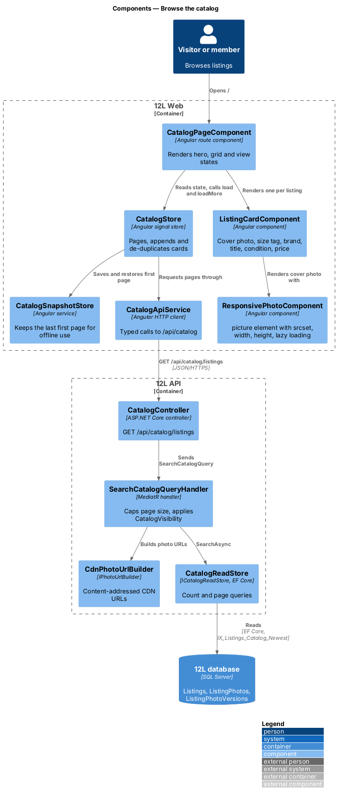
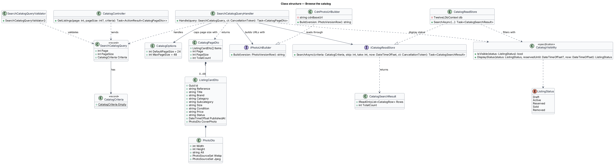
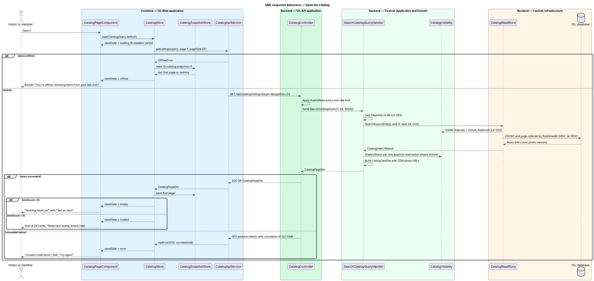
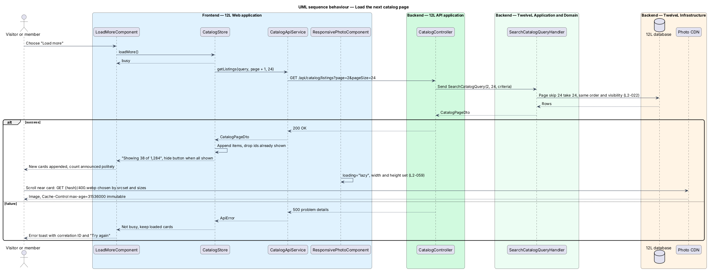

# Browse the catalog

## Overview

12L is a marketplace for men's US 12 shoes and men's L clothing. The *catalog* is the public grid of items that are currently for sale, and it is the home page of 12L (`/`). This feature covers browsing that grid: loading the first page of listing cards, loading further pages, and showing the right state when there is nothing to show, when the request fails, or when the device is offline.

A *listing* is one item a seller offers for sale. A listing has a status, and only two statuses are visible in the catalog:

> **Active listing** — published listing that a buyer may start checkout for

> **Reserved listing** — Active listing held for one buyer's checkout for 10 minutes (`L2-028`)

Draft, Sold and Removed listings never appear in the catalog. A *listing card* is the compact summary of one listing in the grid: cover photo, size tag, brand, title, condition and price. A Reserved card carries a "Reserved" stamp so a visitor knows the item is in someone's checkout.

Anonymous visitors browse the same catalog as members; no account is needed. The catalog is paged 24 cards at a time, newest first, and a "Load more" control appends the next page. Photos are delivered from the CDN at the size each card needs, so a phone fetches a 400 px thumbnail rather than the 1600 px original (`L2-059`). The grid shows 2 columns on extra-small and small viewports, 3 on medium and 4 on large and extra-large (`L2-061`).

Keyword search, filters and sort run through the same endpoint and page component; they are described in [search-and-filter-catalog](../search-and-filter-catalog/README.md). Opening a card leads to [view-listing-detail](../view-listing-detail/README.md). The `Listing` entity itself, its photos and its status transitions belong to the [listings](../../listings/) subsystem; this feature only reads them.

## Description

The slice runs from the catalog page in `12L Web` through `12L API` to the `12L database`, with photos fetched from `Photo storage` through the CDN. The screens and copy come from `docs/mocks/pages/catalog/` (states `default`, `guest`, `loading`, `empty`, `error`, `offline`).

### Frontend — `12L Web`, feature area `src/frontend/src/app/catalog/`

- **`CATALOG_ROUTES`** — lazy-loaded route set. The empty path `''` maps to `CatalogPageComponent`; the route has no guard, so anonymous visitors reach it. Selling, checkout and administration code is not imported by this route (lazy routes are a workspace convention, see `AGENTS.md`).
- **`CatalogPageComponent`** — route component for `/`. It renders the hero ("Size 12. Size L. *Nothing else.*" with the lead "Every listing fits. Men’s US 12 shoes and men’s L clothing, new and used."), the filter sidebar slot, the toolbar and the grid. It reads all state from `CatalogStore` and renders exactly one of these view states:
  - `loading` — 8 skeleton cards in the final grid shape (`aria-busy="true"`, label "Loading listings"); the toolbar count shows a text skeleton.
  - `loaded` — the listing grid, the count "1,284 items" (formatted with thousands separators) and the load-more bar.
  - `empty` — the catalog has no Active or Reserved listing at all: title "Nothing listed yet", text "Be the first to list a pair of 12s or something in L.", primary action "Sell an item" linking to `/sell`; the count reads "0 items".
  - `error` — the request failed with a server error: title "Couldn’t load items", text "Something went wrong on our side." followed by "Ref {correlationId}", primary action "Try again" that repeats the last request. The sidebar and toolbar stay rendered.
  - `offline` — the browser reports no connection: a warning banner "You’re offline. Showing items from your last visit." without a dismiss control, the grid built from the saved snapshot, and the count "{n} saved items".
- **`CatalogStore`** — signal-based store provided at the route level. It holds `items: Signal<ListingCardDto[]>`, `totalCount`, `page`, `viewState` and `correlationId`. `load(query)` fetches page 1 and replaces the items; `loadMore()` fetches page `page + 1` and appends items, dropping any card whose `id` is already present (offset paging can repeat a card when newer listings are published between requests). It writes the last successful first page to `CatalogSnapshotStore`.
- **`CatalogSnapshotStore`** — wraps `localStorage` key `12l.catalog.snapshot.v1` holding the last successful first page (public listing data only, no personal data). Read and write failures are ignored, so a private window or blocked storage only disables the offline view.
- **`CatalogApiService`** — typed HTTP client for `CatalogController`. `getListings(query: CatalogQuery, page: number, pageSize = 24): Observable<CatalogPageDto>` calls `GET /api/catalog/listings`. Problem details responses are mapped by the `core` error interceptor into `ApiError { status, code, correlationId }`; a `status 0` failure while `navigator.onLine` is `false` is mapped to `OfflineError`.
- **`ListingGridComponent`** — renders `<ul class="listing-grid" role="list">` of `ListingCardComponent`. The grid uses CSS grid with `grid-template-columns: repeat(2, 1fr)` below 768 px, `repeat(3, 1fr)` from 768 px and `repeat(4, 1fr)` from 992 px (`L2-061`). Input `eagerCount` (default 4) sets the number of leading cards treated as above the first screen.
- **`ListingCardComponent`** — one `<li>` containing a link to `/items/{reference}`. It shows the cover photo through `ResponsivePhotoComponent`, the size tag ("US **12**" or "**L**", `aria-label="Size US 12"`), brand, title, condition and price (`$85`, whole dollars without cents, cents shown when non-zero). When `status` is `Reserved` it overlays the "Reserved" stamp. All text is bound as text, never as HTML (`L2-015`).
- **`ResponsivePhotoComponent`** (in `shared`, used by every listing photo) — renders a `<picture>` with a `type="image/webp"` `<source>` and a JPEG `` fallback. Each `srcset` lists the 400 w, 800 w and 1600 w versions; the card uses `sizes="(min-width: 1200px) 270px, (min-width: 992px) 23vw, (min-width: 768px) 31vw, 50vw"`, so a 375 px viewport selects the 400 w version (`L2-059`). The `` always carries `width` and `height` from the photo's stored dimensions. Input `priority: boolean` sets `loading="eager"` and `fetchpriority="high"`; otherwise `loading="lazy"` and `decoding="async"`.
- **`LoadMoreComponent`** — shows "Showing {shown} of {total}" and a "Load more" button described by the hidden note "Loads the next 24 items". The button shows a busy state during `loadMore()` and is hidden when `shown >= total`. After loading, focus stays on the button and the new count is announced through the toolbar's `aria-live="polite"` region. When a next-page request fails, the loaded cards stay in place and a danger toast from `docs/mocks/notifications/toast/` shows the correlation ID with a "Try again" action.
- **`OfflineBannerComponent`** (from `shared`) — the warning banner; `CatalogPageComponent` shows it when `viewState` is `offline`.

### API — `TwelveL.Api`

- **`CatalogController`** — `[AllowAnonymous]` controller under `/api/catalog`, policy `PublicRead` (anonymous rate limit of 120 requests per minute per IP from `L2-060`).
  - `GET /api/catalog/listings?page={n}&pageSize={n}` plus the search, filter and sort parameters defined in search-and-filter-catalog.
    - `200 OK` with `CatalogPageDto`.
    - `400 Bad Request` problem details, code `VALIDATION_FAILED`, when `page < 1` or `pageSize < 1`.
    - `429 Too Many Requests`, code `RATE_LIMITED`, from the rate-limit middleware.
    - `500` problem details with correlation ID and no stack trace (`L2-068`).
  - The response carries `Cache-Control: no-store` for now; HTTP caching of anonymous catalog pages is `<TO SUPPLY>`.
- A `pageSize` above 48 is not an error: the binder passes it through and the handler caps it at 48 (`L2-022` acceptance criterion 5). A missing `pageSize` defaults to 24.

### Application and domain — `TwelveL.Application`, `TwelveL.Domain`

- **`SearchCatalogQuery`** — record `(int Page, int PageSize, CatalogCriteria Criteria)`. For browsing, `Criteria` is `CatalogCriteria.Empty` (no keyword, no filters, sort `Newest`).
- **`SearchCatalogQueryValidator`** — FluentValidation rules: `Page >= 1`, `PageSize >= 1`. Criteria rules are listed in search-and-filter-catalog.
- **`SearchCatalogQueryHandler`** — caps `PageSize` with `Math.Min(PageSize, CatalogOptions.MaxPageSize)`, calls `ICatalogReadStore.SearchAsync`, maps each row to `ListingCardDto` through `IPhotoUrlBuilder`, and returns `CatalogPageDto`.
- **`ICatalogReadStore`** — read port: `Task<CatalogSearchResult> SearchAsync(CatalogCriteria criteria, int skip, int take, DateTimeOffset now, CancellationToken ct)`.
- **`CatalogPageDto`** — `{ items: ListingCardDto[], page: int, pageSize: int, totalCount: int }`.
- **`ListingCardDto`** — `{ id: Guid, reference: string, title: string, brand: string, category: string, subcategory: string, size: string, condition: string, price: string, status: "Active" | "Reserved", publishedAt: DateTimeOffset, coverPhoto: PhotoDto }`. `price` is a decimal string with two places (`"85.00"`) so no floating-point value crosses the wire (`L2-018`).
- **`PhotoDto`** — `{ width: int, height: int, alt: string, webp: PhotoSourceSet, jpeg: PhotoSourceSet }`, where `PhotoSourceSet` is `{ w400: string, w800: string, w1600: string }`. `alt` is "Photo 1 of {brand} {title}".
- **`IPhotoUrlBuilder`** / **`CdnPhotoUrlBuilder`** — builds content-addressed CDN URLs of the form `{Photos:CdnBaseUrl}/{contentHash}/{width}.{webp|jpg}` from the hash stored with each photo version. The photo versions, their hashes and the one-year `Cache-Control: public, max-age=31536000, immutable` header are produced by `listings/upload-listing-photos`; this feature only builds URLs to them (`L2-059`).
- **`CatalogVisibility`** (domain specification in `TwelveL.Domain.Catalog`) — the single definition of what the catalog shows: `Status == Active`, or `Status == Reserved`. A Reserved listing whose `ReservedUntil` is in the past is reported as `Active` in the DTO, so a card does not stay stamped "Reserved" while `12L Worker` has yet to run the reservation-expiry job (`L2-028`).
- **`ListingStatus`** (domain enumeration owned by listings) — `Draft`, `Active`, `Reserved`, `Sold`, `Removed` (`L2-019`).
- **`CatalogOptions`** — bound from configuration section `Catalog`: `DefaultPageSize = 24`, `MaxPageSize = 48`.

### Infrastructure and data — `TwelveL.Infrastructure`, `12L database`

- **`CatalogReadStore`** — EF Core implementation of `ICatalogReadStore` over `TwelveLDbContext`. It uses `AsNoTracking()` projections and two round trips: a `COUNT` over the filtered set and a page query ordered by `PublishedAt DESC, Id DESC` with `Skip`/`Take`. The cover photo is the `ListingPhotos` row with `Position = 0`, joined to its `ListingPhotoVersions`.
- **Tables read** (owned by listings): `Listings` (`Id`, `Reference`, `SellerId`, `Title`, `Brand`, `Category`, `Subcategory`, `Size`, `Condition`, `Price decimal(9,2)`, `Status`, `PublishedAt`, `ReservedUntil`, `RowVersion`), `ListingPhotos` (`ListingId`, `Position`, `Width`, `Height`), `ListingPhotoVersions` (`PhotoId`, `Width`, `Format`, `ContentHash`).
- **Index introduced by this feature** — `IX_Listings_Catalog_Newest` on `Listings (PublishedAt DESC, Id DESC)` with `INCLUDE (Reference, Title, Brand, Category, Subcategory, Size, Condition, Price, Status, ReservedUntil)` and a filter that keeps only the Active and Reserved status values. It serves the default first page and the count as index-only reads, which keeps catalog reads index-only as the catalog grows.
- **Configuration** — `Catalog:DefaultPageSize` (24), `Catalog:MaxPageSize` (48), `Photos:CdnBaseUrl` (`<TO SUPPLY>`, depends on the hosting platform).

### Error codes

| Code | HTTP | Raised when |
|------|------|-------------|
| `VALIDATION_FAILED` | 400 | `page` or `pageSize` is below 1 |
| `RATE_LIMITED` | 429 | the anonymous rate limit is exceeded |
| `INTERNAL_ERROR` | 500 | an unhandled exception; body holds the correlation ID only |

## Requirements

The feature realizes the following level-2 (L2) requirements. Each L2 requirement refines a level-1 (L1) requirement, cited by identifier.

| L2 ID | Refines (L1) | Requirement |
|-------|--------------|-------------|
| `L2-022` | `L1-005` | The catalog shall show Active and Reserved listings only, as cards with cover photo, title, brand, size, condition and price, sorted newest first by default and paged 24 at a time. Reserved listings shall be marked "Reserved". Anonymous visitors shall be able to browse the catalog. |
| `L2-059` | `L1-015` | Photos shall be served from a CDN in WebP with a JPEG fallback, sized to the space they fill using `srcset`, with explicit width and height to avoid layout shift. Photos below the first screen shall be lazy loaded. Photo URLs shall be content-addressed and cached for at least one year. |
| `L2-061` | `L1-016` | Every page and dialog shall render without horizontal scrolling from 320px wide upwards. The layout shall adapt at these breakpoints: extra small (<576px), small (>=576px), medium (>=768px), large (>=992px) and extra large (>=1200px). |

## Diagrams

### System context

Visitors and members browse 12L; 12L serves listing photos through the CDN in front of photo storage. No other external system takes part in browsing.

### Containers

The Angular application calls `12L API` for listing data and loads photos directly from the CDN. `12L API` reads the `12L database`; `12L Worker` returns expired reservations to Active, which changes what the catalog shows.

### Components

Inside `12L Web`, `CatalogPageComponent` reads `CatalogStore`, which calls `CatalogApiService`. Inside `12L API`, `CatalogController` sends `SearchCatalogQuery` to its handler, which reads through `ICatalogReadStore` and builds photo URLs with `IPhotoUrlBuilder`.

### Class structure

`SearchCatalogQueryHandler` handles `SearchCatalogQuery`, depends on `ICatalogReadStore` and `IPhotoUrlBuilder`, and returns a `CatalogPageDto` of `ListingCardDto` items. `CatalogVisibility` is the one rule for which `ListingStatus` values are shown.

### Behaviour — open the catalog

The page shows skeleton cards, requests page 1, and renders the grid, the empty state, the error state with its correlation ID, or the offline snapshot. The handler caps the page size at 48 and applies `CatalogVisibility` (`L2-022`).

### Behaviour — load the next page

"Load more" requests the next page of 24, appends new cards and skips any card already shown. Photos below the first screen load lazily from the CDN at the width the card needs (`L2-059`).

