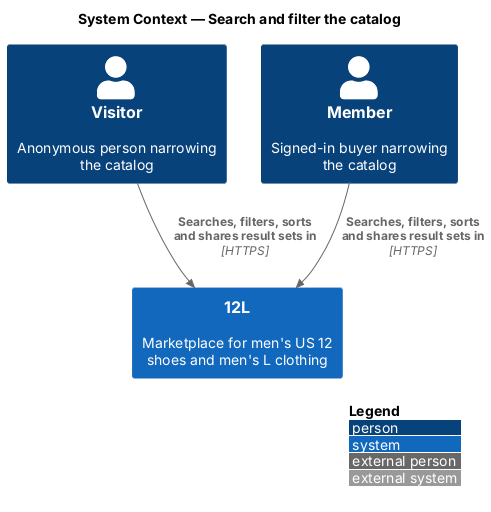
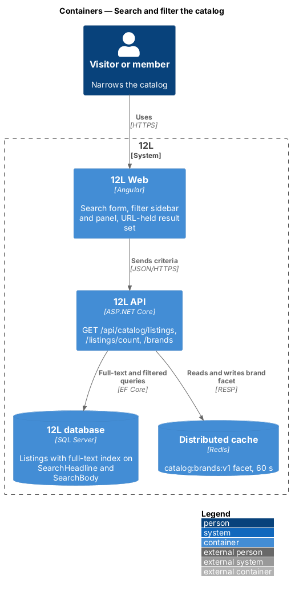
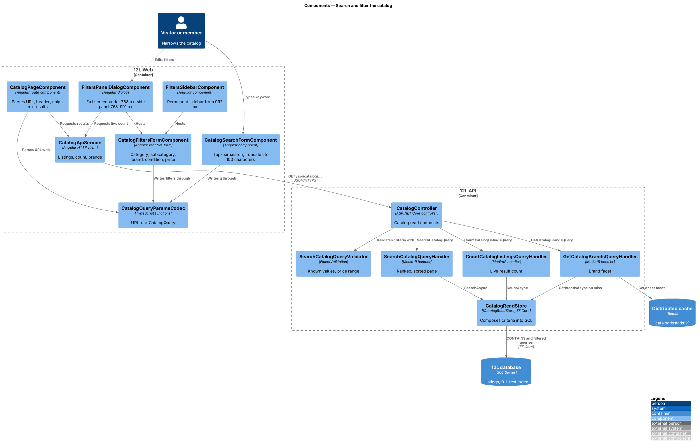
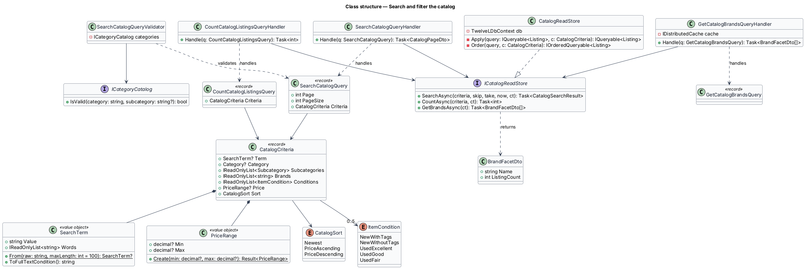
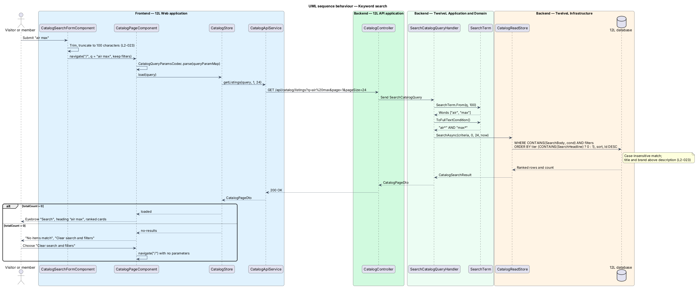
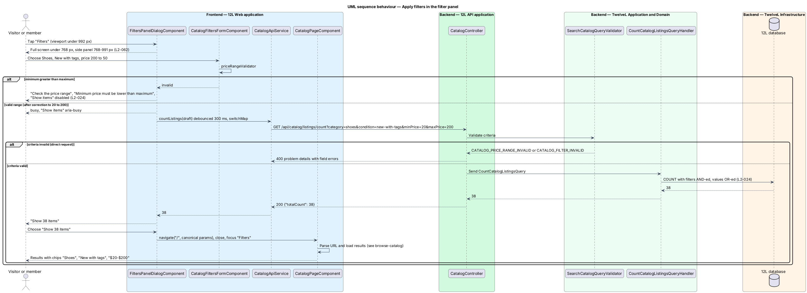
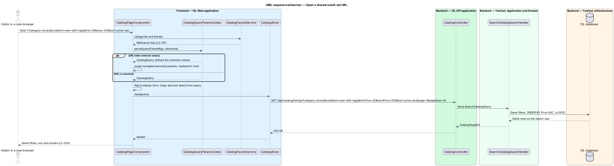

# Search and filter the catalog

## Overview

The 12L catalog lists every Active and Reserved listing, newest first (see [browse-catalog](../browse-catalog/README.md)). With 100,000 listings in view, a visitor needs to narrow that set. This feature adds three ways to do so, all on the same catalog page and the same API endpoint:

> **keyword search** — free-text match of a visitor's words against listing title, brand and description

> **filter** — restriction of the result set to listings whose category, subcategory, brand, condition or price meets a chosen value

> **sort order** — ordering of the result set by newest, price low to high, or price high to low

Filters combine with each other and with the keyword using AND; two or more values chosen inside one filter (for example brands "Nike" and "Adidas") combine with OR. A *result set* is the listings a given keyword, filter and sort combination returns. The whole combination lives in the page URL, so a result set can be bookmarked, shared or reopened in another browser and returns the same listings in the same order (`L2-024`).

Search ranks a listing whose title or brand matches above a listing that matches only in its description, and ignores letter case (`L2-023`). Terms longer than 100 characters are truncated before searching.

Filters appear in three layouts depending on the viewport (`L2-062`): a full-screen *filter panel* under 768 px, a side panel from 768 px to 991 px, and a permanent *filter sidebar* beside the results from 992 px. The panel offers "Clear" and an apply button that shows the live result count; the sidebar applies each change directly.

The categories, subcategories and conditions offered come from the server-held category list (`L2-011`) and condition list (`L2-016`), owned by the [listings](../../listings/) subsystem.

## Description

The slice extends the catalog page and `GET /api/catalog/listings` from browse-catalog, and adds two small read endpoints. Screens and copy come from `docs/mocks/pages/catalog/` (states `search`, `category`, `filtered`, `no-results`) and `docs/mocks/dialogs/filters/` (states `default`, `busy`, `invalid`).

### URL contract

The page URL is the single source of truth for a result set. `CatalogQueryParamsCodec` reads and writes these query parameters on `/`:

| Parameter | Values | Example |
|-----------|--------|---------|
| `q` | keyword, trimmed, at most 100 characters | `q=air%20max` |
| `category` | `shoes`, `tops`, `outerwear`, `bottoms` | `category=shoes` |
| `subcategory` | repeatable slug from the chosen category, such as `sneakers`, `dress-shoes`, `t-shirts` | `subcategory=boots` |
| `brand` | repeatable brand name | `brand=Nike&brand=Adidas` |
| `condition` | repeatable `new-with-tags`, `new-without-tags`, `used-excellent`, `used-good`, `used-fair` | `condition=new-with-tags` |
| `min`, `max` | price in dollars, up to two decimal places | `min=20&max=200` |
| `sort` | `newest` (default, omitted), `price-asc`, `price-desc` | `sort=price-asc` |

The mock example `/?category=shoes&condition=new-with-tags&min=20&max=200&sort=price-asc` is a valid URL under this contract. The codec writes parameters in the fixed order above and omits defaults, so one result set has one canonical URL. A `subcategory` is only valid with its parent `category`. Values the codec does not recognise are dropped and the URL is replaced (`replaceUrl: true`) with its canonical form. Paging is not held in the URL; reopening a URL shows its first page.

### Frontend — `12L Web`, feature area `src/frontend/src/app/catalog/`

- **`CatalogQuery`** — immutable TypeScript type `{ q?: string; category?: CategorySlug; subcategories: string[]; brands: string[]; conditions: ConditionSlug[]; minPrice?: string; maxPrice?: string; sort: 'newest' | 'price-asc' | 'price-desc' }`.
- **`CatalogQueryParamsCodec`** — pure functions `parse(params: ParamMap, reference: CategoryList): CatalogQuery` and `toParams(query): Params`. Unit-tested for round-trip equality.
- **`CatalogPageComponent`** (from browse-catalog) — subscribes to `ActivatedRoute.queryParamMap`, parses it, and calls `CatalogStore.load(query)` on every change, so the back button, a bookmark and a shared link all go through one path. It chooses the page header from the query:
  - keyword present: eyebrow "Search" and heading “{q}” (for example “nike”);
  - only a category: heading with the category name and its size tag ("Shoes" with "US 12"), plus subcategory chips "All shoes", "Sneakers", "Boots", "Dress shoes", "Sandals" (`aria-pressed`);
  - other filters without a keyword: heading "Shop";
  - nothing: the hero from browse-catalog.
- **`CatalogSearchFormComponent`** — `role="search"` form hosted in the shell top bar, label "Search 12L" (visually hidden), placeholder "Search brands and items". On submit it trims the term, truncates it to 100 characters (`L2-023`), and navigates to `/` with `q` set and all other filters kept. On viewports under 768 px the top bar shows a search icon button that opens the same form.
- **`CatalogToolbarComponent`** — the "Filters" button (shown below 992 px; opens `FiltersPanelDialogComponent`), the result count in an `aria-live="polite"` region ("2 items", "0 items"), the active-filter chips and the "Sort" select with options "Newest", "Price: low to high", "Price: high to low". Changing the sort navigates with the new `sort` value.
- **`ActiveFilterChipsComponent`** — one chip per active filter value ("Shoes", "New with tags", "$20–$200"), each with a remove button labelled "Remove filter {label}", plus a "Clear all" link button that removes every filter and the keyword.
- **`CatalogFiltersFormComponent`** — the shared reactive form used by both layouts. Field groups: "Category" (radio: All, Shoes, Tops, Outerwear, Bottoms), a subcategory group headed by the chosen category (checkboxes), "Brand" (checkboxes for the top 6 brands with an "All {n} brands" link that expands the full list), "Condition" (checkboxes for the 5 conditions) and "Price" (two `$`-prefixed inputs labelled "Minimum price in dollars" and "Maximum price in dollars", `inputmode="decimal"`). Validator `priceRangeValidator` sets the error "Minimum price must be lower than maximum" when both are set and minimum exceeds maximum (equal values are allowed); the inputs then carry `aria-invalid="true"` and `aria-describedby` pointing at the message (`L2-024`).
- **`FiltersSidebarComponent`** — `<aside aria-label="Filters">` shown from 992 px without any tap (`L2-062`). Checkbox and radio changes navigate immediately; price inputs navigate 400 ms after the last keystroke and only when the range is valid.
- **`FiltersPanelDialogComponent`** — modal dialog (`role="dialog"`, `aria-modal="true"`, title "Filters", close button "Close filters", Escape closes) opened from the "Filters" button. Below 768 px it fills the screen; from 768 px to 991 px it opens as a side panel. It edits a draft copy of the query and states:
  - `default` — footer "Clear" and primary "Show {n} items" with the live count;
  - `busy` — while the count is refreshing the primary button carries `aria-busy="true"` and reads "Show items"; the form stays usable;
  - `invalid` — an error summary "Check the price range" linking to the minimum price field, the inline field error, and a disabled "Show items" button.
  The count request is debounced by 300 ms and the previous request is cancelled with `switchMap`. "Clear" resets the draft without closing. Apply closes the panel, navigates with the draft, and returns focus to the "Filters" button.
- **`CatalogFacetsService`** — loads `GET /api/categories` (listings subsystem, `L2-011`) and `GET /api/catalog/brands` once per session and exposes them as signals.
- **No-results state** — when a keyword or filter is set and `totalCount` is 0, `CatalogPageComponent` shows title "No items match", text "Try fewer filters or a different word." and primary action "Clear search and filters", which navigates to `/`. Filters and chips stay visible (`L2-023`).

### API — `TwelveL.Api`

All endpoints are on `CatalogController`, anonymous, policy `PublicRead`.

- `GET /api/catalog/listings` — the browse endpoint gains `q`, `category`, `subcategory[]`, `brand[]`, `condition[]`, `minPrice`, `maxPrice`, `sort` (same values as the URL contract; the frontend maps `min`/`max` to `minPrice`/`maxPrice`).
  - `200 OK` `CatalogPageDto`.
  - `400 Bad Request`, code `CATALOG_PRICE_RANGE_INVALID`, when `minPrice > maxPrice`; the `errors` member names `minPrice`.
  - `400 Bad Request`, code `CATALOG_FILTER_INVALID`, when a category, subcategory, condition or sort value is unknown, a subcategory does not belong to the category, or a price is negative or has more than two decimal places.
- `GET /api/catalog/listings/count` — same filter parameters, no paging. `200 OK` `{ "totalCount": 38 }`; same `400` codes. Used by the filter panel's "Show {n} items".
- `GET /api/catalog/brands` — `200 OK` `[{ "name": "Nike", "listingCount": 212 }, …]`, brands of Active and Reserved listings ordered by `listingCount` descending then name. The panel shows the first 6 and "All {n} brands".

### Application and domain — `TwelveL.Application`, `TwelveL.Domain`

- **`CatalogCriteria`** (record) — `SearchTerm? Term`, `Category?`, `IReadOnlyList<Subcategory> Subcategories`, `IReadOnlyList<string> Brands`, `IReadOnlyList<ItemCondition> Conditions`, `PriceRange? Price`, `CatalogSort Sort`.
- **`SearchTerm`** (value object, `TwelveL.Domain.Catalog`) — created by `SearchTerm.From(string raw)`: trims, collapses internal whitespace, truncates to `Catalog:MaxSearchTermLength` (100) characters (`L2-023` acceptance criterion 5), and returns `null` when nothing is left. `Words` splits on whitespace and removes full-text operator characters (`"`, `*`, `(`, `)`, `&`, `|`, `!`, `~`, `,`).
- **`PriceRange`** (value object) — `decimal? Min`, `decimal? Max`; the factory rejects `Min > Max`. Bounds are inclusive, so `$20` to `$50` keeps `$20.00` and `$50.00` (`L2-024` acceptance criterion 2).
- **`CatalogSort`** — enumeration `Newest`, `PriceAscending`, `PriceDescending`.
- **`SearchCatalogQueryValidator`** — adds rules for criteria: known category, subcategory within category (checked against `ICategoryCatalog` from listings), known condition and sort, prices of 0 or more with at most two decimals, and `Min <= Max` (error code `CATALOG_PRICE_RANGE_INVALID`).
- **`CountCatalogListingsQuery`** / **`CountCatalogListingsQueryHandler`** — `(CatalogCriteria Criteria)` → `int`, through `ICatalogReadStore.CountAsync`.
- **`GetCatalogBrandsQuery`** / **`GetCatalogBrandsQueryHandler`** — reads `ICatalogReadStore.GetBrandsAsync` through `IDistributedCache` key `catalog:brands:v1` with a 60-second absolute expiry (`Catalog:BrandFacetCacheSeconds`).
- **Ordering rule** — with no keyword, results follow `Sort`, each with `Id DESC` as the final tie-breaker so paging is stable. With a keyword, the primary key is the *match tier* — 0 when the title or brand matches, 1 when only the description matches (`L2-023` acceptance criterion 3) — and `Sort` orders listings within each tier. Whether an explicitly chosen price sort shall override the match tier is `<TO SUPPLY>`.

### Infrastructure and data — `TwelveL.Infrastructure`, `12L database`

- **`CatalogReadStore`** (from browse-catalog) — builds one `IQueryable<Listing>` from `CatalogCriteria` by appending `Where` clauses: `Category ==`, `Subcategory IN`, `Brand IN` (brand comparison uses the database's case-insensitive collation), `Condition IN`, `Price >= Min`, `Price <= Max`. Every clause is AND-ed; values inside one list are OR-ed through `IN` (`L2-024`). All values are bound as parameters (`L2-049`).
- **Full-text search** — the migration adds two persisted computed columns to `Listings`: `SearchHeadline = Title + ' ' + Brand` and `SearchBody = Title + ' ' + Brand + ' ' + Description`, and a full-text index on both with `KEY INDEX PK_Listings`, `CHANGE_TRACKING AUTO` and `STOPLIST = OFF` (so short words such as "90" still match). The handler turns `SearchTerm.Words` into a prefix condition such as `"air*" AND "max*"`. The store filters with `EF.Functions.Contains(l.SearchBody, condition)` and computes the tier as `EF.Functions.Contains(l.SearchHeadline, condition) ? 0 : 1`. Full-text matching ignores case (`L2-023`). Whether full-text change tracking keeps a newly published listing searchable within the 5 seconds of `L2-019` under load is `<TO SUPPLY>` and shall be verified in the load test of `L2-057`.
- **Indexes introduced** — `IX_Listings_Catalog_Price` on `(Price, Id)` and `IX_Listings_Catalog_Category` on `(Category, Subcategory, PublishedAt DESC, Id DESC)`, both filtered to the Active and Reserved status values and including the card columns; `IX_Listings_Catalog_Brand` on `(Brand)` with the same filter for the brands facet.
- **Configuration** — `Catalog:MaxSearchTermLength` (100), `Catalog:BrandFacetCacheSeconds` (60), `Catalog:BrandFacetTopCount` (6).

### Error codes

| Code | HTTP | Raised when |
|------|------|-------------|
| `CATALOG_PRICE_RANGE_INVALID` | 400 | `minPrice` is greater than `maxPrice` |
| `CATALOG_FILTER_INVALID` | 400 | an unknown category, subcategory, condition or sort, a subcategory outside its category, or a malformed price |
| `RATE_LIMITED` | 429 | the anonymous rate limit is exceeded |

## Requirements

The feature realizes the following level-2 (L2) requirements. Each L2 requirement refines a level-1 (L1) requirement, cited by identifier.

| L2 ID | Refines (L1) | Requirement |
|-------|--------------|-------------|
| `L2-023` | `L1-005` | Visitors shall be able to search by keyword. Search shall match title, brand and description, ignore case, and rank title and brand matches above description matches. |
| `L2-024` | `L1-005` | Visitors shall be able to filter by category, subcategory, brand (multiple), condition (multiple) and price range, and sort by newest, price low to high, or price high to low. Filters combine with each other and with the keyword using AND. Filters and sort shall be held in the page URL so a result set can be bookmarked and shared. |
| `L2-062` | `L1-016` | On XS and SM viewports, the main navigation shall collapse into a menu button and the catalog filters shall open in a full-screen panel. On MD, filters shall open in a side panel. On LG and XL, the navigation shall be shown in full and filters shall be a permanent sidebar. |

The navigation half of `L2-062` (menu button, `docs/mocks/dialogs/nav-menu/`) belongs to the platform shell; this feature realizes the filter half.

## Diagrams

### System context

Visitors and members search and filter the catalog inside 12L. No external system takes part.

### Containers

`12L Web` holds the result set in the URL and calls `12L API`. `12L API` queries the full-text index in the `12L database` and caches the brands facet in the distributed cache.

### Components

The filter form feeds the URL; `CatalogPageComponent` turns the URL into a `CatalogQuery`. On the API side, three handlers share `ICatalogReadStore`, which composes the criteria into one SQL query.

### Class structure

`CatalogCriteria` aggregates the `SearchTerm`, `PriceRange` and `CatalogSort` value types. The search, count and brand handlers each depend on `ICatalogReadStore`.

### Behaviour — keyword search

The search form truncates the term to 100 characters and navigates; the API builds a prefix full-text condition, ranks title and brand matches first, and the page shows results or "No items match" (`L2-023`).

### Behaviour — apply filters in the filter panel

The panel refreshes the live count as the visitor edits, refuses an inverted price range, and on apply writes the canonical URL that drives the results (`L2-024`, `L2-062`).

### Behaviour — open a shared result-set URL

A bookmarked or shared URL is parsed into the same `CatalogQuery`, so a new browser shows the same filters, sort and results (`L2-024` acceptance criterion 5).

