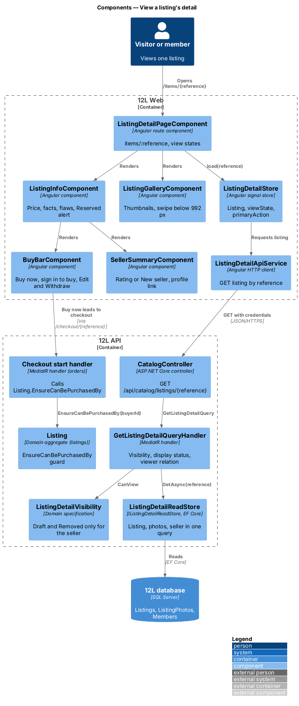
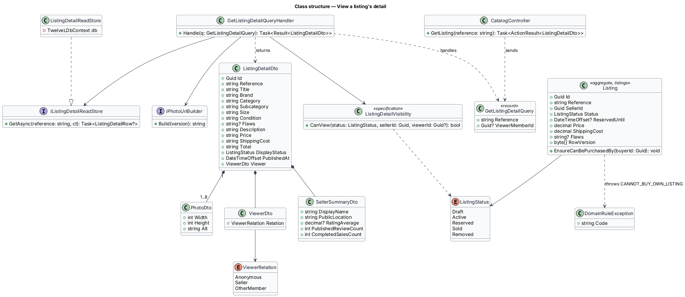
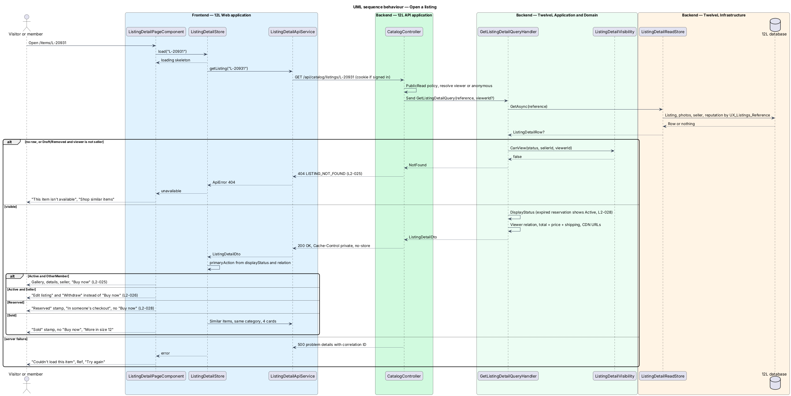
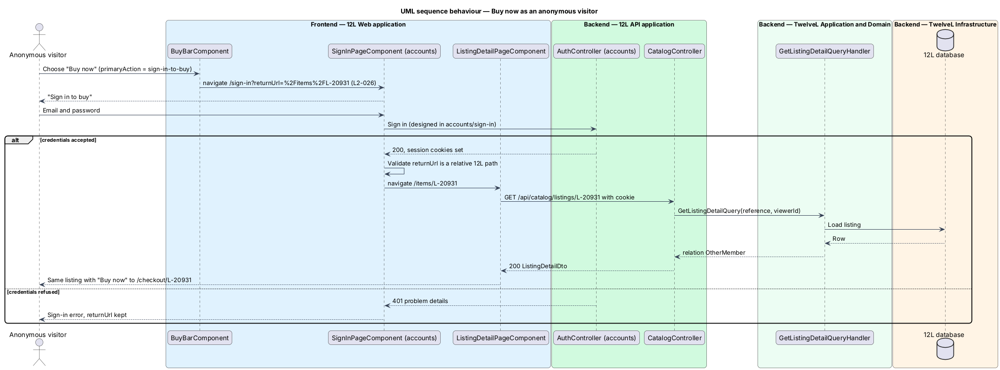
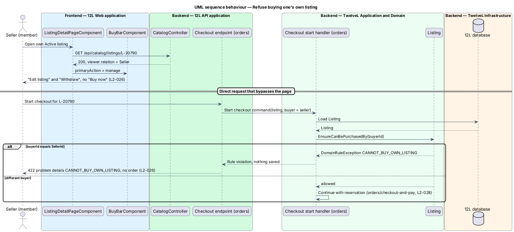

# View a listing's detail

## Overview

Every item for sale on 12L has its own *listing detail page*, reached from a catalog card, a member profile, an email or a shared link. The page gives a would-be buyer everything needed to decide: photos, title, price, shipping cost, total, size, category, brand, condition, description, date listed and the seller's reputation (`L2-025`). It is also where the purchase starts, through the "Buy now" action that leads to checkout.

Each listing has a stable, shareable URL of the form `/items/{reference}`, where the *listing reference* is the short public identifier the listings subsystem assigns at creation (for example `L-20931`). The URL keeps working for the life of the listing, including after the item is sold.

The page shows the same listing differently depending on its status and on who views it:

> **viewer relation** — relationship between the person viewing and the listing: anonymous visitor, the listing's seller, or another member

> **seller reputation** — public summary of a seller's track record: average rating, review count and number of completed sales

- An Active listing seen by another member shows "Buy now".
- An anonymous visitor also sees "Buy now"; choosing it sends the visitor to sign in and back to the listing (`L2-026`).
- The seller viewing their own Active listing sees "Edit listing" and "Withdraw" instead of "Buy now", and the API refuses any attempt by a member to buy their own listing (`L2-026`).
- A Reserved listing, held for another buyer's checkout for 10 minutes, shows a "Reserved" label and no "Buy now" (`L2-028`).
- A Sold listing keeps its URL, shows a "Sold" label, no "Buy now", and similar items.
- A Draft or Removed listing opened by anyone other than its seller shows "This item isn't available" with HTTP 404.

A seller with no completed sales shows "New seller" in place of a rating. A Used - Fair listing shows its flaws (`L2-016`). On viewports narrower than 992 px the page uses one column with a swipeable gallery and a "Buy now" bar fixed to the bottom of the screen; from 992 px it uses two columns with the gallery on the left (`L2-063`).

The `Listing` entity, editing and withdrawing belong to the [listings](../../listings/) subsystem; checkout and the reservation itself belong to [orders](../../orders/); reporting a listing belongs to [moderation](../../moderation/). This feature reads the listing, decides what the page shows, and supplies the domain guard that stops a member from buying their own listing.

## Description

Screens and copy come from `docs/mocks/pages/listing-detail/` (states `default`, `guest`, `own`, `new-seller`, `reserved`, `sold`, `loading`, `error`, `unavailable`). The "Report this listing" link opens `docs/mocks/dialogs/report-listing/`, and the guest return flow ends on `docs/mocks/pages/sign-in/return.html`.

### Frontend — `12L Web`, feature area `src/frontend/src/app/catalog/`

- **Route** — `items/:reference` in `CATALOG_ROUTES`, no guard, component `ListingDetailPageComponent`. The route resolver is not used, so the skeleton paints at once.
- **`ListingDetailPageComponent`** — reads `reference` from the route, calls `ListingDetailStore.load(reference)`, sets the document title to "{title} · {brand} · 12L", and renders one view state:
  - `loading` — skeleton matching the gallery and info columns (`aria-busy="true"`, label "Loading listing", visually hidden heading "Loading listing").
  - `loaded` — breadcrumb "Shop › {category} › {subcategory}", `ListingGalleryComponent`, `ListingInfoComponent`, and for a Sold listing the section "More in size 12" with 4 cards.
  - `unavailable` — API returned 404: "404" graphic, heading "This item isn’t available", text "It may have been sold or taken down.", primary action "Shop similar items" to `/`.
  - `error` — any other failure: heading "Couldn’t load this item", text "It’s us, not you. Try again in a moment.", "Ref {correlationId}", actions "Try again" and "Back to shop".
- **`ListingDetailStore`** — signal store: `listing: Signal<ListingDetailDto | null>`, `viewState`, `correlationId`, and the computed `primaryAction: 'buy' | 'sign-in-to-buy' | 'manage' | 'none'`, derived from `ListingDetailDto.viewer` and `displayStatus`:

  | `displayStatus` | `viewer.relation` | `primaryAction` |
  |-----------------|-------------------|-----------------|
  | `Active` | `OtherMember` | `buy` |
  | `Active` | `Anonymous` | `sign-in-to-buy` |
  | `Active` | `Seller` | `manage` |
  | `Reserved`, `Sold`, `Draft`, `Removed` | any | `none` |

- **`ListingGalleryComponent`** — main photo through `ResponsivePhotoComponent` with `priority = true` and `sizes="(min-width: 992px) 50vw, 100vw"`, a row of thumbnail buttons labelled "Show photo {i} of {n}" with `aria-current` on the selected one, and dot indicators. Selecting a thumbnail shows that photo in the main view (`L2-025` acceptance criterion 4). Below 992 px the main view is a horizontal CSS scroll-snap track that changes photo on swipe; an `IntersectionObserver` keeps the selected index in step (`L2-063`). Arrow keys move between thumbnails.
- **`ListingInfoComponent`** — status stamp ("Reserved" or "Sold") when applicable; brand eyebrow; title as `<h1>`; size tag and condition; price ("$85") and the line "{shipping} · {total} total before tax", where shipping reads "$9 shipping" or "Free shipping" when 0 (`L2-018`); the flaws block "Flaws: {flaws}" for Used - Fair; the description as plain text; the facts list "Size", "Category" ("Shoes · Sneakers"), "Condition", "Listed" (relative time inside `<time datetime>`); `SellerSummaryComponent`; and the "Report this listing" link. For Reserved listings it shows the warning alert "In someone’s checkout" with "If they don’t finish within 10 minutes, it’s back on sale." All listing text is bound as text and never as HTML (`L2-015`).
- **`SellerSummaryComponent`** — avatar, display name linking to `/members/{displayName}`, "{n} sales · {city}" (the sales part omitted when 0), and either the rating summary "4.9 (128 reviews)" or the badge "New seller" when `completedSalesCount` is 0 (`L2-025` acceptance criterion 5).
- **`BuyBarComponent`** — the total with caption "incl. shipping" and the actions for `primaryAction`:
  - `buy` — primary "Buy now" linking to `/checkout/{reference}` (orders subsystem).
  - `sign-in-to-buy` — primary "Buy now" linking to `/sign-in?returnUrl=%2Fitems%2F{reference}`. The accounts sign-in page shows "Sign in to buy" and, after sign-in, navigates to the validated relative `returnUrl`, so the member lands back on the listing (`L2-026` acceptance criterion 3).
  - `manage` — primary "Edit listing" linking to `/items/{reference}/edit` and secondary "Withdraw" opening `WithdrawListingDialogComponent` (listings subsystem). On success the store reloads and the page shows the Removed listing to its seller.
  - `none` — the bar is not rendered.
  Below 992 px the bar is `position: sticky; bottom: 0` with safe-area padding, so "Buy now" stays visible while scrolling (`L2-063`). Every control in the bar and gallery is at least 44 × 44 CSS px below 992 px.
- **Report entry point** — "Report this listing" is shown only when `viewer.relation` is `OtherMember` and the listing is not Sold. It opens `ReportListingDialogComponent` from the moderation feature area with the listing ID; the dialog, its states and its endpoint are designed in `moderation/report-listing-or-member`.
- **Similar items** — for a Sold listing the store calls `CatalogApiService.getListings({ category, sort: 'newest' }, 1, 4)` from browse-catalog and renders the cards under "More in size 12".
- **`ListingDetailApiService`** — `getListing(reference): Observable<ListingDetailDto>` calling `GET /api/catalog/listings/{reference}` with credentials, so a signed-in viewer is recognised.
- **Layout** — `.detail` uses one column below 992 px (gallery above the info) and `grid-template-columns: minmax(0, 1fr) minmax(0, 1fr)` from 992 px with the gallery on the left (`L2-063`).

### API — `TwelveL.Api`

- `GET /api/catalog/listings/{reference}` on `CatalogController`, `[AllowAnonymous]`, policy `PublicRead`. The access-token cookie is read when present, so the handler knows the viewer; an expired or missing token is treated as anonymous rather than as 401.
  - `200 OK` `ListingDetailDto` with `Cache-Control: private, no-store` (the body depends on the viewer).
  - `404 Not Found`, code `LISTING_NOT_FOUND`, when no listing has that reference, or when the listing is Draft or Removed and the viewer is not its seller (`L2-025` acceptance criterion 3, `L2-010`). Both cases return the identical body so a hidden listing cannot be told apart from a missing one.
  - `500` problem details with correlation ID (`L2-068`).
- The SPA document for `/items/{reference}` is served by the static host with status 200; returning HTTP 404 on the document itself for an unavailable listing needs server-side rendering or an edge function and is `<TO SUPPLY>`.

### Application and domain — `TwelveL.Application`, `TwelveL.Domain`

- **`GetListingDetailQuery`** — record `(string Reference, Guid? ViewerMemberId)`; the controller fills `ViewerMemberId` from `ICurrentMember`.
- **`GetListingDetailQueryHandler`** — loads the row through `IListingDetailReadStore.GetAsync(reference)`, applies `ListingDetailVisibility`, computes `DisplayStatus` with `CatalogVisibility.DisplayStatus` (an expired reservation shows as Active, `L2-028`), computes the viewer relation, maps photos with `IPhotoUrlBuilder`, and returns `ListingDetailDto` or `NotFound`.
- **`ListingDetailVisibility`** (domain specification) — `CanView(status, sellerId, viewerId)`: true for Active, Reserved and Sold; true for Draft and Removed only when `viewerId == sellerId`.
- **`ListingDetailDto`** — `{ id, reference, title, brand, category, subcategory, size, condition, flaws?, description, price, shippingCost, total, displayStatus, publishedAt, photos: PhotoDto[] (ordered, cover first), seller: SellerSummaryDto, viewer: { relation: "Anonymous" | "Seller" | "OtherMember" } }`. Money values are decimal strings (`"85.00"`, `"9.00"`, `"94.00"`); `total = price + shippingCost` computed in C# `decimal`. No email address, phone number, real name or street address is present (`L2-054`).
- **`SellerSummaryDto`** — `{ displayName, avatar?: PhotoDto, publicLocation, ratingAverage?: decimal (one place), publishedReviewCount: int, completedSalesCount: int }`. The rating figures follow `L2-040` and are read, not computed, here.
- **`Listing.EnsureCanBePurchasedBy(Guid buyerId)`** — domain guard added by this feature to the `Listing` aggregate. It throws `DomainRuleException("CANNOT_BUY_OWN_LISTING")` when `buyerId == SellerId`. The checkout-start handler in `orders/checkout-and-pay` calls it before any reservation is written, and the API problem-details middleware maps the code to HTTP 422, so no order and no reservation is created (`L2-026` acceptance criterion 2). The Reserved conflict (HTTP 409, `L2-028`) is raised by the same handler and designed there.

### Infrastructure and data — `TwelveL.Infrastructure`, `12L database`

- **`ListingDetailReadStore`** — EF Core `AsNoTracking()` projection by `Reference`, joining `Listings`, `ListingPhotos` (all positions, ordered), `ListingPhotoVersions`, `Members` (`DisplayName`, `PublicLocation`, `AvatarPhotoId`) and the seller reputation figures (`RatingAverage`, `PublishedReviewCount`, `CompletedSalesCount`). Where the reputation figures are stored is decided by `reviews/view-member-profile` and `orders/complete-order`; this store reads them through the `MemberReputation` view `<TO SUPPLY>` until those designs fix the column names.
- **Index used** — unique index `UX_Listings_Reference` on `Listings (Reference)`, introduced by `listings/create-listing`.
- **Query count** — one round trip for the listing, photos and seller (split query disabled), which supports the 300 ms 95th-percentile read target (`L2-057`).

### Error codes

| Code | HTTP | Raised when |
|------|------|-------------|
| `LISTING_NOT_FOUND` | 404 | the reference is unknown, or the listing is Draft or Removed and the viewer is not its seller |
| `CANNOT_BUY_OWN_LISTING` | 422 | a member's checkout-start request names their own listing |
| `RATE_LIMITED` | 429 | the anonymous rate limit is exceeded |

### Open questions

- What the buyer who holds the reservation sees on the detail page during their own checkout (for example a "Continue checkout" action) is not mocked and is `<TO SUPPLY>`; the design shows them the Reserved view.
- What the seller sees on their own Reserved, Sold, Draft or Removed listing beyond the status stamp is not mocked; the design shows no actions, consistent with `L2-020`.

## Requirements

The feature realizes the following level-2 (L2) requirements. Each L2 requirement refines a level-1 (L1) requirement, cited by identifier.

| L2 ID | Refines (L1) | Requirement |
|-------|--------------|-------------|
| `L2-025` | `L1-006` | The listing detail page shall show a photo gallery, title, price, shipping cost, total, size, category, brand, condition (with flaws when Used - Fair), description, date listed, and the seller's display name, rating, number of completed sales and a link to their profile. Each listing shall have a stable, shareable URL. |
| `L2-026` | `L1-006` | A member shall not be able to buy their own listing. An anonymous visitor who chooses "Buy now" shall be sent to sign in and then returned to the listing. |
| `L2-063` | `L1-016` | On XS, SM and MD viewports, the listing detail page shall use one column with a swipeable photo gallery and a "Buy now" bar fixed to the bottom of the screen. On LG and XL, it shall use two columns with the gallery on the left. Forms shall use one column on XS and SM. Touch targets shall be at least 44 by 44 CSS pixels on XS, SM and MD. |
| `L2-028` | `L1-007` | When a buyer starts checkout, the listing shall become Reserved for that buyer for 10 minutes. While Reserved, no other member shall be able to start checkout for it. If payment does not succeed within 10 minutes, the listing shall return to Active. |

This feature realizes the display side of `L2-028` (the "Reserved" label and the absence of "Buy now"); the reservation, its 409 conflict and its expiry are designed in `orders/checkout-and-pay`. The form rule of `L2-063` belongs to the listing form in the listings subsystem.

## Diagrams

### System context

Visitors and members view listings in 12L and load the photos from the CDN. Buying leaves this feature for checkout, which talks to the payment provider.

### Containers

`12L Web` requests the listing from `12L API`, sending the session cookie when one exists. `12L API` reads the listing, photos and seller reputation from the `12L database`.

### Components

`ListingDetailPageComponent` composes the gallery, info, seller summary and buy bar from `ListingDetailStore`. `GetListingDetailQueryHandler` applies `ListingDetailVisibility` and the viewer relation; the checkout handler from orders calls `Listing.EnsureCanBePurchasedBy`.

### Class structure

`ListingDetailDto` composes the photos and `SellerSummaryDto`; `GetListingDetailQueryHandler` depends on `IListingDetailReadStore`, `ListingDetailVisibility` and `IPhotoUrlBuilder`. `Listing` carries the purchase guard.

### Behaviour — open a listing

The handler hides Draft and Removed listings from everyone except the seller with HTTP 404, reports an expired reservation as Active, and returns the viewer relation from which the page chooses "Buy now", "Edit listing" and "Withdraw", or no action (`L2-025`, `L2-028`).

### Behaviour — Buy now as an anonymous visitor

"Buy now" sends the visitor to sign in with the listing as the return URL; after sign-in the member lands back on the same listing and sees the member view (`L2-026`).

### Behaviour — refuse buying one's own listing

The page never offers "Buy now" to the seller; a direct checkout request is still refused by the domain guard with HTTP 422 and nothing is written (`L2-026`).

