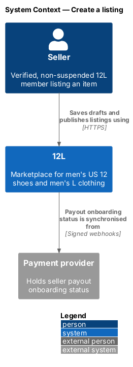
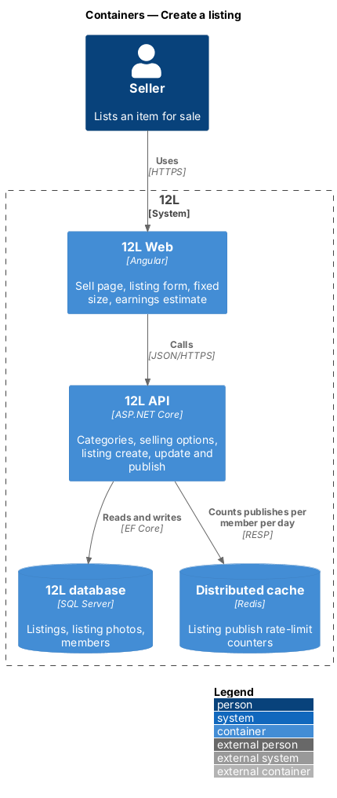
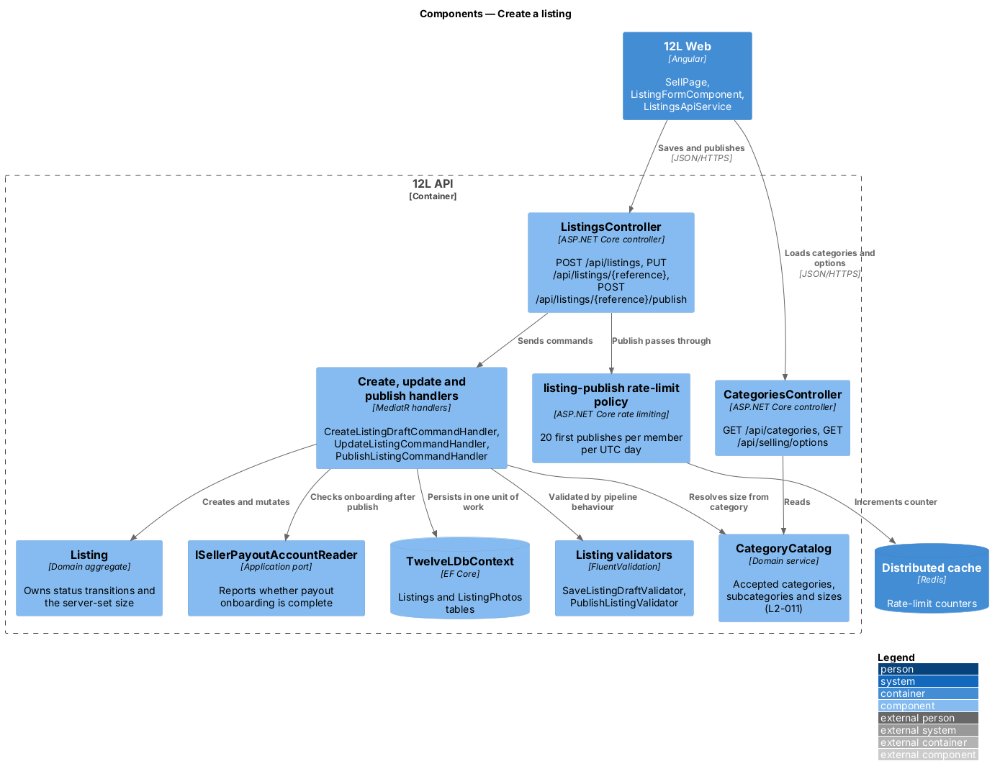
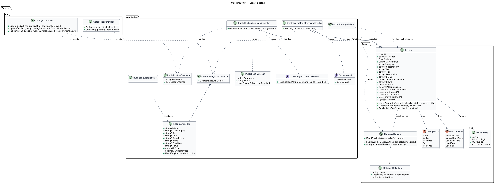
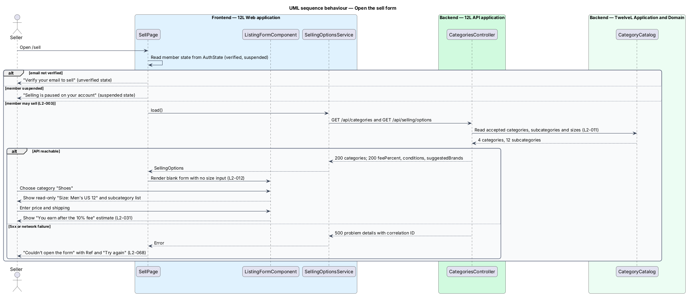
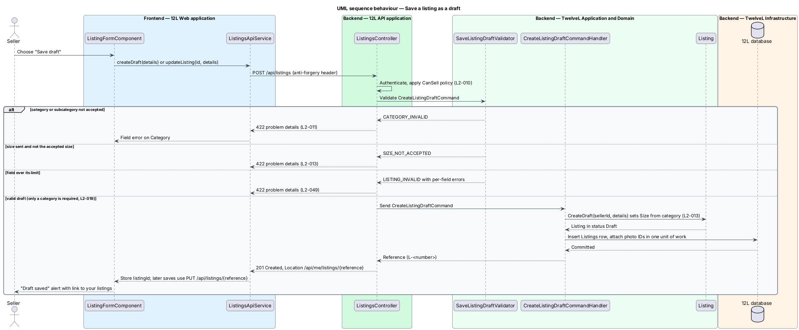
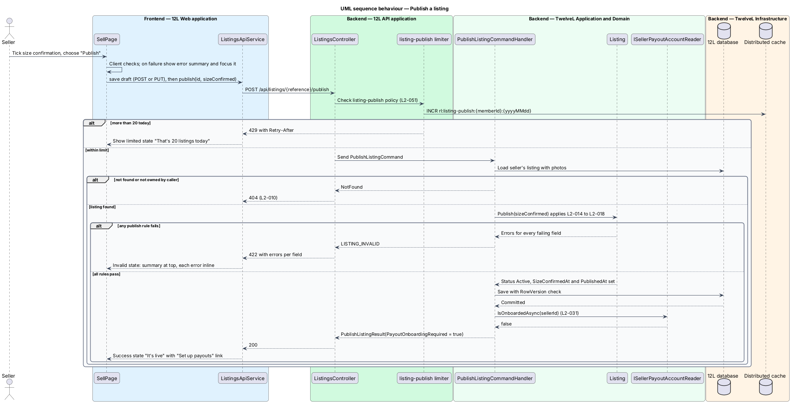

# Create a listing

## Overview

12L is a marketplace for men's US size 12 shoes and men's size L clothing. Any verified, non-suspended member may sell; there is no seller application or separate seller account (`L2-003`). This feature covers the first half of the listing lifecycle: a seller opens the sell form, describes an item, saves it as a draft, and publishes it to the catalog.

The feature sits in the listings subsystem (`L1-003`, `L1-004`). Photo upload and processing belong to the sibling feature [upload-listing-photos](../upload-listing-photos/README.md); later changes and withdrawal belong to [edit-and-withdraw-listing](../edit-and-withdraw-listing/README.md); the seller's list of listings belongs to [manage-my-listings](../manage-my-listings/README.md).

Terms used in this design:

- **listing** — record of one item offered for sale by one seller, with its details, photos, price and status
- **listing status** — lifecycle state of a listing: `Draft`, `Active`, `Reserved`, `Sold` or `Removed` (`L2-019`)
- **draft** — listing saved before it is complete, visible only to its seller and absent from the catalog
- **publish** — transition of a draft from `Draft` to `Active`, after which the listing appears in the catalog
- **accepted size** — single size 12L accepts for a category: `Men's US 12` for Shoes, `Men's L` for Tops, Outerwear and Bottoms (`L2-011`)
- **size confirmation** — seller's explicit statement that the item's label shows the accepted size, stored as a timestamp (`L2-014`)
- **platform fee** — configurable percentage 12L keeps from item price plus shipping when an order completes (`L2-031`)
- **listing reference** — public identifier of a listing in the form `L-<number>` (for example `L-20931`), used in routes and API paths instead of the internal `Guid`
- **estimated earnings** — item price plus shipping cost less the platform fee, shown on the form before publishing

The size rule is the reason 12L exists, so the server, not the browser, owns it. The form never offers a size input. The API sets the stored size from the category and rejects any request that sends a different size (`L2-013`).

## Description

The slice runs from the Angular sell page through `12L API` to the `Listings` table in `12L database`. Screens, states and copy come from the mocks in `docs/mocks/pages/sell/`, `docs/mocks/notifications/toast/` and `docs/mocks/pages/rules/`.

### Frontend (`12L Web`, `src/frontend/src/app/listings/`)

- **`SellPage`** — routed standalone component at `/sell` (new listing) and `/sell/:reference` (continue a draft). It reads `AuthState` from `core` and renders one of these states:
  - `unverified` — "Verify your email to sell" with "Resend link" (opens the `verify-email-prompt` dialog) and "Back to shop".
  - `suspended` — "Selling is paused on your account", "You can still manage open orders.", with "View your sales" and "Marketplace rules".
  - `error` — "Couldn't open the form" with the correlation ID ("Ref …") and "Try again", when categories or options fail to load (`L2-068`).
  - `default` / `filled` — the listing form.
  - `invalid` — error summary at the top, each error inline, focus moved to the summary and announced in a live region.
  - `submitting` — "Publish" shows `aria-busy="true"`, "Save draft" is disabled, layout does not shift.
  - `draft-saved` — success alert "Draft saved", "Finish it any time from your listings." with a link to `/account/listings`.
  - `success` — "It's live" panel with the listing row, "Set up payouts so you're paid when it sells." (only when `payoutOnboardingRequired` is true), and the actions "View listing" and "Sell another".
  - `limited` — "That's 20 listings today", "You can list more tomorrow. Drafts still save.", action "Your listings", shown on HTTP 429.
- **`ListingFormComponent`** — reusable typed reactive form (`FormGroup<ListingForm>`) shared with `EditListingPage` through an `@Input() mode: 'new' | 'edit'`. Sections and controls:
  - Photos — hosts `PhotoUploaderComponent` from [upload-listing-photos](../upload-listing-photos/README.md); help text "JPEG, PNG or WebP up to 10 MB. Drag to reorder; the first is the cover."
  - Item — `Category` select ("Choose a category"), `Type` select ("Choose a type", disabled until a category is chosen), `FixedSizeComponent`, `Title` with a "n / 80" counter, `Brand` input bound to a `<datalist>` of suggested brands (free text allowed), `Condition` segmented radio group with exactly 5 options, `Describe the flaws` textarea shown only for `Used - Fair` with help "Shown on the listing. At least 10 characters.", `Description` with a "n / 2,000" counter.
  - Price — `Price` and `Shipping` money inputs (`inputmode="decimal"`, `$` addon), shipping help "Flat rate. $0 shows as free shipping.", and `EarningsEstimateComponent`.
  - Size confirmation — checkbox whose label follows the category: "This item is labelled men's US 12" (Shoes), "This item is labelled men's L" (other categories), "The label shows men's US 12 (shoes) or men's L (clothing)" (no category yet).
  - Actions — sticky bar with "Save draft" and "Publish" (`new` mode) or "Cancel" and "Save changes" (`edit` mode).
- **`FixedSizeComponent`** — read-only display of the size tag plus "Size: Men's US 12" or "Size: Men's L" and the caption "Set by category". No size input exists (`L2-012`). It updates when the category changes.
- **`EarningsEstimateComponent`** — shows "You earn after the {feePercent}% fee" and the amount `(price + shipping) × (1 − feePercent / 100)` rounded to the cent, or "—" while the price is empty or invalid (`L2-031`). The estimate is display-only; the authoritative fee is computed by the seller-payouts feature when an order completes. The midpoint rounding rule is `<TO SUPPLY>`.
- **`ErrorSummaryComponent`** (from `shared`) — lists each error as a link to its field. Client messages match the server messages: "Add at least one photo", "Photos must be 10 MB or smaller", "Title must be 5 to 80 characters", "Describe the item's flaws", "Enter a price from $1.00 to $5,000.00", "Confirm the label shows men's US 12" (or "men's L").
- **`SellingOptionsService`** — loads and caches, for the session, `GET /api/categories` and `GET /api/selling/options` as a signal.
- **`ListingsApiService`** — typed client for `POST /api/listings`, `PUT /api/listings/{reference}`, `POST /api/listings/{reference}/publish` and `GET /api/me/listings/{reference}`. It maps problem details to field errors by the `errors` keys. The `core` HTTP interceptor adds the anti-forgery header (`L2-050`) and maps HTTP 429 to a typed `RateLimited` result.
- **`ToastService`** (from `shared`) — raises "Listing published" with "{title} is live." and a "View listing" action after a publish from a context other than the sell page, and the danger toast "Couldn't save your draft", "Check your connection.", "Try again" when a draft save fails offline. Danger toasts never auto-dismiss; others dismiss after 8 s and pause on hover and focus.
- **Rules link** — the `suspended` state links to `RulesPage` at `/rules`, which renders the same category table served by `GET /api/categories`.

Client validation mirrors the server rules for fast feedback. It is never trusted.

### API (`TwelveL.Api`)

- **`CategoriesController`**
  - `GET /api/categories` — anonymous. Returns `200` with the 4 categories and 12 subcategories of `L2-011`, each category with its `acceptedSize` and a display label. Sends `Cache-Control: public, max-age=3600` (`<TO SUPPLY>`: confirm the max-age).
  - `GET /api/selling/options` — anonymous. Returns `200` with `feePercent` (from configuration), `conditions` (the 5 values of `L2-016` with display labels), `suggestedBrands` and `maxPhotos` (8).
- **`ListingsController`** — every action requires an authenticated member and the `CanSell` policy (email verified, not suspended). The policy returns `401` for anonymous callers and `403` with code `EMAIL_NOT_VERIFIED` or `MEMBER_SUSPENDED` otherwise (`L2-010`).
  - `POST /api/listings` — creates a draft. Body `ListingDetailsDto`. Returns `201 Created` with `Location: /api/me/listings/{reference}` (the new `L-<number>` reference) and the `MyListingDetailDto`; `422` for validation failures; `403`; `401`.
  - `PUT /api/listings/{reference}` — replaces the editable fields of the caller's `Draft` listing (draft rules) or `Active` listing (publish rules, see [edit-and-withdraw-listing](../edit-and-withdraw-listing/README.md)). Returns `200`, `404`, `409`, `422`.
  - `POST /api/listings/{reference}/publish` — body `{ "sizeConfirmed": true }`. Returns `200` with `PublishListingResult`, `404` (missing or not owned), `409` with `LISTING_NOT_DRAFT` when the listing is not a draft, `422` with per-field errors, `429` with `Retry-After`.
- **`listing-publish` rate-limit policy** — fixed window per member per UTC day, 20 permits, counter key `rl:listing-publish:{memberId}:{yyyyMMdd}` in `Distributed cache`, `Retry-After` set to the seconds until 00:00 UTC (`L2-051`). The mock state `limited` states "Drafts still save", so the limit counts first publishes, not draft saves. `<TO SUPPLY>`: confirm this reading of "listing creation" in `L2-051`.
- **Request limits** — JSON bodies over 1 MB return `413` (`L2-049`). `System.Text.Json` ignores unknown members, and `ListingDetailsDto` has no `sellerId`, `status`, `sizeConfirmedAt` or timestamp members, so a client cannot set them (mass assignment, `L2-049`).

### Application and domain (`TwelveL.Application`, `TwelveL.Domain`)

- **`ListingDetailsDto`** — `category`, `subcategory?`, `size?`, `title?`, `description?`, `brand?`, `condition?`, `flaws?`, `price?` (decimal), `shippingCost?` (decimal), `photoIds` (ordered list; position 0 is the cover).
- **`CreateListingDraftCommand`** / **`CreateListingDraftCommandHandler`** — creates a `Listing` through `Listing.CreateDraft`, attaches the referenced photos in order (rules in [upload-listing-photos](../upload-listing-photos/README.md)) and saves in one unit of work.
- **`UpdateListingCommand`** / **`UpdateListingCommandHandler`** — shared with [edit-and-withdraw-listing](../edit-and-withdraw-listing/README.md). For a `Draft` it applies draft rules only.
- **`PublishListingCommand`** / **`PublishListingCommandHandler`** — loads the caller's listing (`404` when the seller differs), calls `Listing.Publish(sizeConfirmed, clock)`, saves with the `RowVersion` check, then calls `ISellerPayoutAccountReader.IsOnboardedAsync(sellerId)` and returns `PublishListingResult { reference, status, payoutOnboardingRequired }` (`L2-031`). Publishing never waits for onboarding.
- **`SaveListingDraftValidator`** (FluentValidation, draft rules, `L2-019`) — category required and accepted; subcategory, when present, accepted for the category (`CATEGORY_INVALID`); size, when present, equal to the accepted size (`SIZE_NOT_ACCEPTED`); every present field within its maximum length and range; condition, when present, one of the 5 values (`CONDITION_INVALID`); at most 8 photo IDs (`PHOTO_LIMIT`).
- **Publish rules** (`Listing.Publish` plus `PublishListingValidator`, `L2-014` to `L2-018`) — all draft rules plus:
  - subcategory required; title 5 to 80 characters (`TITLE_LENGTH`); description 20 to 2,000 characters (`DESCRIPTION_LENGTH`); brand 1 to 50 characters (`BRAND_LENGTH`); condition required.
  - `Used - Fair` requires flaws of at least 10 characters (`FLAWS_REQUIRED`, message "Describe the item's flaws"). Maximum flaws length is `<TO SUPPLY>`.
  - 1 to 8 photos, each in status `Ready` (`PHOTOS_REQUIRED`, message "Add at least one photo"; `PHOTOS_PROCESSING` while any photo is still processing).
  - price from 1.00 to 5,000.00 inclusive with at most 2 decimal places (`PRICE_OUT_OF_RANGE`, message "Enter a price from $1.00 to $5,000.00").
  - shipping cost from 0.00 to 100.00 inclusive with at most 2 decimal places (`SHIPPING_OUT_OF_RANGE`).
  - `sizeConfirmed` equal to `true` (`SIZE_CONFIRMATION_REQUIRED`).
  - All failing fields are reported together, so every missing field is identified (`L2-015`).
- **Text handling** — the domain trims title, description, brand and flaws and stores them as plain text. Angular interpolation encodes them on output, so `` shows literally (`L2-015`, `L2-049`).
- **`CategoryCatalog`** — domain service holding the `L2-011` table as `CategoryDefinition { Name, Subcategories, AcceptedSize }` records. It is code, not configuration, because the size rule is the product's premise. `AcceptedSizeFor("Shoes")` returns `Men's US 12`; every other accepted category returns `Men's L`.
- **`Listing`** aggregate (`TwelveL.Domain`) — fields `Id`, `Reference`, `SellerId`, `Status`, `Category`, `Subcategory`, `Size`, `Title`, `Description`, `Brand`, `Condition`, `Flaws`, `Price`, `ShippingCost`, `SizeConfirmedAt`, `CreatedAt`, `UpdatedAt`, `PublishedAt`, `RemovedAt`, `DraftReminderSentAt`, `RowVersion`, and the ordered `Photos` collection. `ReservedUntil` belongs to the reservation logic of the orders subsystem and is not written here. `Size` has no public setter; `CreateDraft` and `UpdateDetails` set it from `CategoryCatalog` (`L2-013`).
- **Status transitions owned by this feature** — `(new) → Draft` on create; `Draft → Active` on publish (sets `PublishedAt`, `SizeConfirmedAt`). Transitions `Active → Reserved → Sold` belong to the orders subsystem; `Active → Removed` and `Removed → Active` belong to [edit-and-withdraw-listing](../edit-and-withdraw-listing/README.md).
- **`ItemCondition`** enum — `NewWithTags`, `NewWithoutTags`, `UsedExcellent`, `UsedGood`, `UsedFair`, serialised as the display strings "New with tags", "New without tags", "Used - Excellent", "Used - Good", "Used - Fair".
- **`ISellerPayoutAccountReader`** — application port implemented by the seller-payouts feature in the orders subsystem.

### Error codes

All errors are RFC 9457 problem details with `code`, `title`, `correlationId` and, for `422`, an `errors` object keyed by field name, each entry holding `code` and `message` (`L2-068`). When the category or size rule fails, the top-level `code` is `CATEGORY_INVALID` or `SIZE_NOT_ACCEPTED` and no listing is created. Other validation failures use the top-level code `LISTING_INVALID`.

| Code | HTTP | Raised when |
|------|-----:|-------------|
| `CATEGORY_INVALID` | 422 | Category or subcategory outside the `L2-011` table, or subcategory not in its category |
| `SIZE_NOT_ACCEPTED` | 422 | A `size` value differs from the category's accepted size |
| `LISTING_INVALID` | 422 | Any other field rule fails; `errors` lists each field |
| `CONDITION_INVALID` | 422 | Condition outside the 5 values (`L2-016`) |
| `SIZE_CONFIRMATION_REQUIRED` | 422 | Publish without `sizeConfirmed: true` (`L2-014`) |
| `PHOTOS_PROCESSING` | 422 | Publish while a photo is not yet `Ready` |
| `LISTING_NOT_DRAFT` | 409 | Publish of a listing that is not a draft |
| `EMAIL_NOT_VERIFIED` | 403 | Unverified member calls a selling endpoint |
| `MEMBER_SUSPENDED` | 403 | Suspended member calls a selling endpoint |
| `RATE_LIMITED` | 429 | More than 20 publishes in one UTC day |

### Infrastructure and data (`TwelveL.Infrastructure`)

- **`Listings` table** (`ListingConfiguration`):
  - `Id uniqueidentifier` PK; `Reference nvarchar(16)` with unique index `UX_Listings_Reference`, assigned on draft creation as `L-` plus the next value of the SQL Server sequence `ListingReferenceNumbers` (start value `<TO SUPPLY>`); `SellerId uniqueidentifier` FK to `Members`; `Status nvarchar(16)` (string conversion); `Category nvarchar(16)`; `Subcategory nvarchar(24) null`; `Size nvarchar(16)`; `Title nvarchar(80) null`; `Description nvarchar(2000) null`; `Brand nvarchar(50) null`; `Condition nvarchar(20) null`; `Flaws nvarchar(<TO SUPPLY>) null`; `Price decimal(7,2) null`; `ShippingCost decimal(5,2) null`; `SizeConfirmedAt datetime2 null`; `CreatedAt`, `UpdatedAt datetime2`; `PublishedAt`, `RemovedAt`, `DraftReminderSentAt datetime2 null`; `ReservedUntil datetime2 null` (written by the orders subsystem); `RowVersion rowversion` concurrency token (shared with the reservation logic of `L2-029`).
  - Prices are `decimal` in C# and SQL Server, never floating point (`L2-018`).
  - Check constraints: `CK_Listings_Size` (`Size = 'Men''s US 12'` when `Category = 'Shoes'`, else `Size = 'Men''s L'`) as defence in depth for `L2-013`; `CK_Listings_Price` (`Price IS NULL OR Price BETWEEN 1 AND 5000`); `CK_Listings_ShippingCost` (`ShippingCost IS NULL OR ShippingCost BETWEEN 0 AND 100`).
  - Indexes: `IX_Listings_SellerId_CreatedAt` and `IX_Listings_SellerId_Status_CreatedAt` (used by [manage-my-listings](../manage-my-listings/README.md)); `IX_Listings_Status_PublishedAt` for the catalog.
- **Shared schema** — the catalog subsystem reads `Reference`, `SellerId`, `Title`, `Brand`, `Category`, `Subcategory`, `Size`, `Condition`, `Price`, `Status`, `PublishedAt`, `ReservedUntil` and `RowVersion`, and adds its full-text columns and indexes to `Listings` in its own migration. Photos use the `ListingPhotos` and `ListingPhotoVersions` tables of [upload-listing-photos](../upload-listing-photos/README.md).
- **Catalog visibility** — only `Active` and `Reserved` listings appear in the catalog (`L2-019`). The browse-catalog design in the catalog subsystem reads `Listings` filtered by status, and any catalog cache it introduces shall expire within 5 s so a published listing appears within 5 s. The catalog's `GET /api/listings/{reference}` returns `404` for a `Draft` to anyone other than its seller.
- **Queries** — EF Core LINQ only, so all SQL is parameterised (`L2-049`).

### Configuration

| Key | Value | Notes |
|-----|-------|-------|
| `Fees:PlatformFeePercent` | `<TO SUPPLY>` | Mocks show 10; read by `GET /api/selling/options` and the seller-payouts feature |
| `RateLimiting:ListingPublish:PermitLimit` | 20 | Per member per UTC day (`L2-051`) |
| `Selling:SuggestedBrands` | `<TO SUPPLY>` | Mocks list Nike, Adidas, New Balance, Red Wing, Allen Edmonds, Birkenstock, Patagonia, Champion, Carhartt, Barbour, Arc'teryx, Uniqlo, Everlane |

## Requirements

The feature realises the following level-2 (L2) requirements. Each refines the level-1 (L1) requirement cited.

| L2 ID | Refines (L1) | Requirement |
|-------|--------------|-------------|
| `L2-003` | `L1-001` | Every verified, non-suspended member shall be able to both buy and sell. There shall be no seller application, approval or separate seller account. |
| `L2-011` | `L1-003` | 12L shall accept only the categories and sizes in this table. The list is held on the server and served to the client. |
| `L2-012` | `L1-003` | The listing form shall not offer a size choice. Once the seller picks a category, the form shall show the accepted size for that category as fixed, read-only text. |
| `L2-013` | `L1-003` | The API shall be the source of truth for the size rule. It shall reject any listing create or update request whose size does not match the accepted size for its category, whatever the client sends. The stored size shall always be set by the server from the category. |
| `L2-014` | `L1-003` | Before publishing, the seller shall confirm that the item's label shows the accepted size (men's US 12 for shoes, men's L for clothing). A listing shall not be published without this confirmation. |
| `L2-015` | `L1-004` | A listing shall have a title (5 to 80 characters), a description (20 to 2,000 characters), a category and subcategory (L2-011), a brand (1 to 50 characters, chosen from a suggested list or typed freely), a condition (L2-016), 1 to 8 photos (L2-017), a price and a shipping cost (L2-018). All text shall be trimmed and stored as plain text. |
| `L2-016` | `L1-004` | The seller shall choose one condition: New with tags, New without tags, Used - Excellent, Used - Good, or Used - Fair. A Used - Fair listing shall include a description of its flaws of at least 10 characters. |
| `L2-018` | `L1-004` | The item price shall be between $1.00 and $5,000.00 inclusive, with at most two decimal places. The seller shall set a flat shipping cost between $0.00 and $100.00 inclusive. 12L shall operate in the United States only, in US dollars. |
| `L2-019` | `L1-004` | A listing shall have one of these statuses: Draft, Active, Reserved, Sold or Removed. A seller shall be able to save an incomplete listing as a Draft and publish it later. Only Active and Reserved listings appear in the catalog. Validation rules L2-014 to L2-018 apply when publishing; drafts only need a category. |
| `L2-031` | `L1-007` | Before their first sale is paid out, a seller shall complete payout onboarding with the payment provider. The sale amount less the 12L fee shall be released to the seller when the order is Completed. The fee percentage shall be configurable and shown to the seller before they publish a listing. |
| `L2-051` | `L1-013` | The API shall limit requests to 120 per minute per IP address for anonymous callers and 300 per minute per member, with stricter limits for sign-in (L2-007), registration (5 per hour per IP) and listing creation (20 per day per member). Callers over a limit shall receive HTTP 429 with a `Retry-After` header. |

`L2-031` and `L2-051` are supporting requirements here: this feature shows the fee and estimated earnings, prompts for payout onboarding after publishing, and applies the listing creation limit. Payout release and the general request limits belong to the orders and platform subsystems.

## Diagrams

### System context

The seller lists items through 12L. 12L reads the seller's payout onboarding status, which the payment provider maintains, to decide whether to prompt for payout setup after publishing.

### Containers

`12L Web` calls `12L API`, which stores listings in `12L database` and counts publishes in `Distributed cache`.

### Components

`ListingsController` passes publishes through the `listing-publish` rate-limit policy and sends commands to the handlers. The handlers resolve the size through `CategoryCatalog`, mutate the `Listing` aggregate and persist through `TwelveLDbContext`.

### Class structure

`Listing` owns its status and server-set size and references up to 8 `ListingPhoto` records. `CategoryCatalog` holds the 4 `CategoryDefinition` records. The handlers depend on the commands, the aggregate and the `ISellerPayoutAccountReader` port.

### Behaviour — open the sell form

`SellPage` first decides whether the member may sell, then loads categories and options. It renders the form with no size input, shows the fixed size once a category is chosen, and shows estimated earnings once a price is entered.

### Behaviour — save a draft

A draft needs only an accepted category. The handler sets the size from the category and stores the listing as `Draft`. Category, size and field-limit failures return `422`.

### Behaviour — publish a listing

The rate-limit policy runs first. The handler then applies the `L2-014` to `L2-018` rules on the aggregate, reports every failing field together, commits the `Draft → Active` transition and reports whether payout onboarding is still required.

