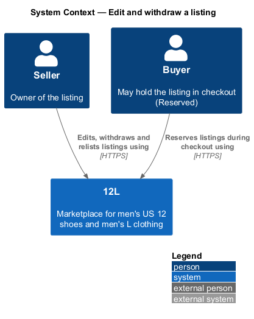
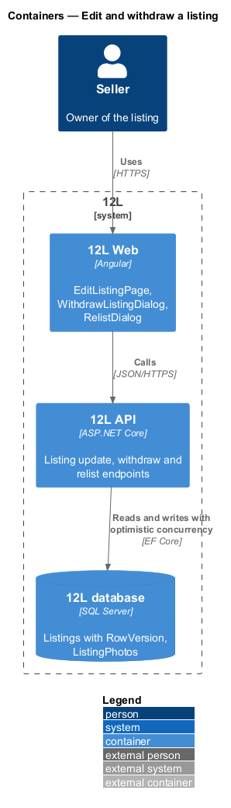
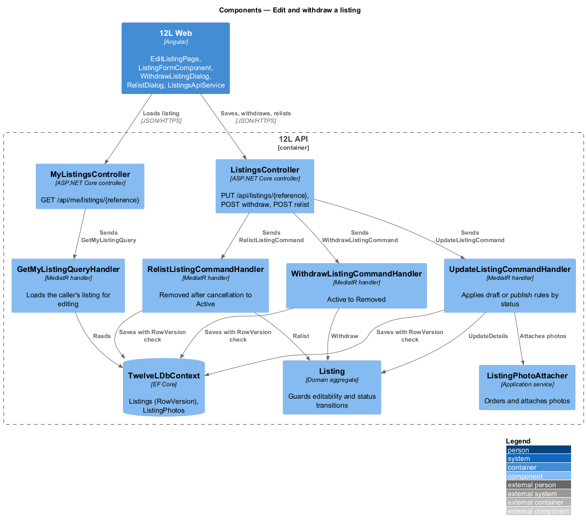
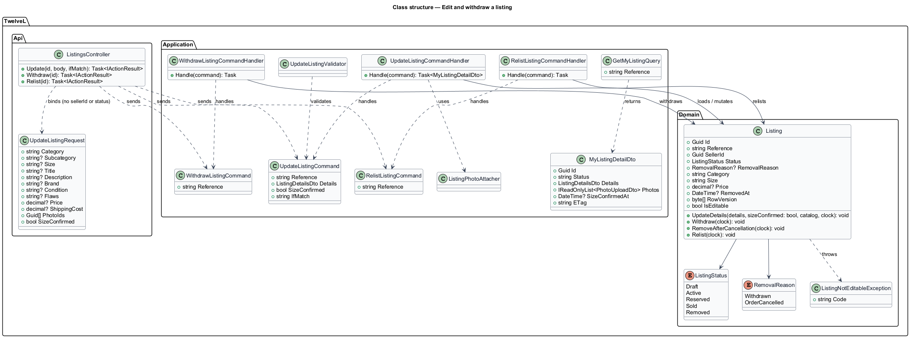
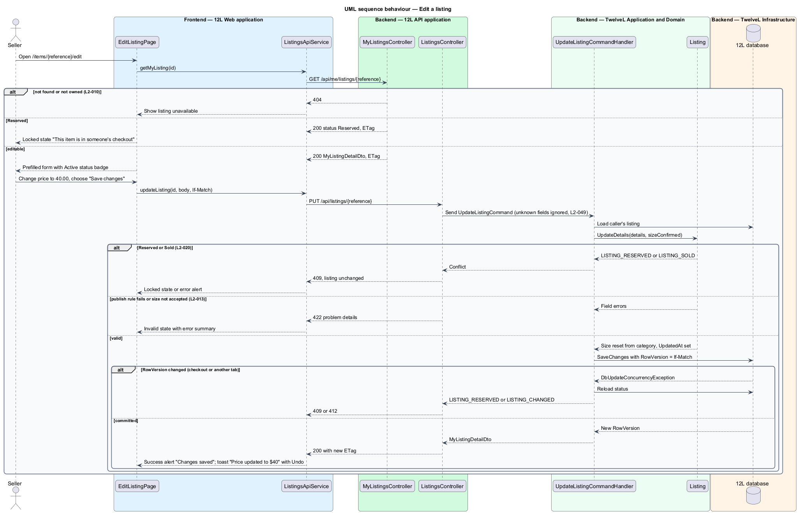
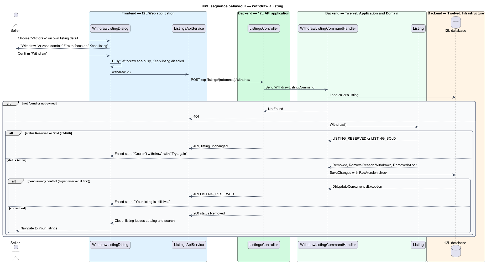
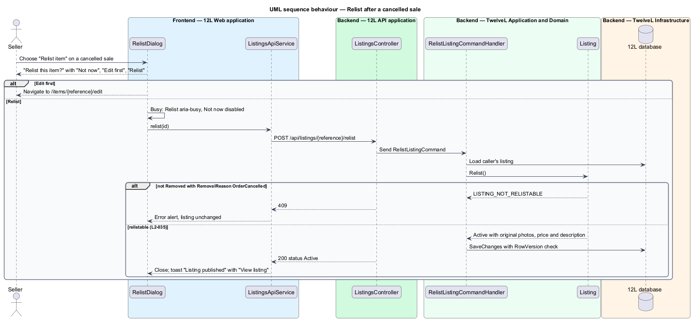

# Edit and withdraw a listing

## Overview

After a listing is published, a seller often corrects a detail, changes the price, or takes the item off sale. This feature lets the seller edit an `Active` listing, withdraw it, and relist an item whose sale was cancelled. It also guarantees that a listing a buyer is paying for, or has bought, cannot change under that buyer (`L2-020`).

The feature sits in the listings subsystem (`L1-003`, `L1-004`). It reuses the listing form, validators and photo handling of [create-listing](../create-listing/README.md) and [upload-listing-photos](../upload-listing-photos/README.md). The `Reserved` and `Sold` statuses are set by the checkout and payment features of the orders subsystem; this feature only reads them to refuse changes.

Terms used in this design:

- **editable listing** — listing in status `Draft` or `Active`, or `Removed` after a cancelled sale; only these accept an update
- **reserved listing** — listing held for 10 minutes for one buyer in checkout (`L2-028`), neither editable nor withdrawable
- **withdraw** — seller action that moves an `Active` listing to `Removed` and takes it out of the catalog and search; it cannot be undone
- **removal reason** — recorded cause of a `Removed` status: `Withdrawn` or `OrderCancelled`
- **relist** — seller action that returns a listing removed after a cancelled order to `Active` with its original details (`L2-035`)
- **ETag** — opaque version of a listing, derived from its `RowVersion`, that the client sends back in `If-Match` so a stale form cannot overwrite newer data

## Description

Screens, states and copy come from `docs/mocks/pages/edit-listing/`, `docs/mocks/dialogs/withdraw-listing/`, `docs/mocks/dialogs/relist/`, `docs/mocks/notifications/toast/` (`with-action`, `success`) and the `own` state of `docs/mocks/pages/listing-detail/`.

### Frontend (`12L Web`, `src/frontend/src/app/listings/`)

- **`EditListingPage`** — routed standalone component at `/items/:reference/edit`. Its header shows the listing title as a link back to the listing, the heading "Edit listing" and a `ListingStatusBadge`. It hosts `ListingFormComponent` in `edit` mode, with actions "Cancel" (back to the listing) and "Save changes". States:
  - `loading` — skeleton for 3 photo tiles and 4 fields, `aria-busy="true"`, no layout shift.
  - `error` — "Couldn't load this listing", "Your listing is safe. Try again in a moment.", the correlation reference, "Try again" and "Your listings" (`L2-068`).
  - `default` — every field prefilled, including flaws for `Used - Fair`, photos and the ticked size confirmation.
  - `invalid` — error summary plus inline errors, for example "Describe the item's flaws" and "Enter a price from $1.00 to $5,000.00".
  - `submitting` — "Save changes" shows `aria-busy="true"`.
  - `success` — success alert "Changes saved" with a "View listing" link.
  - `locked` — shown when the listing is `Reserved` on load or on save: "This item is in someone's checkout", "You can edit it again if they don't finish within 10 minutes.", action "Back to listing" (`L2-020`).
  - A `Sold` listing on this route shows a not-editable state that links to the sale; its copy is `<TO SUPPLY>` because no mock exists.
- **Undo toast** — when a save changes only the price, `ToastService` also raises "Price updated to $40" with the listing title and an "Undo" action. Undo sends a second `PUT /api/listings/{reference}` with the previous price and the new ETag.
- **`WithdrawListingDialog`** — opened by "Withdraw" on the seller's own listing detail page (catalog subsystem, `listing-detail` state `own`). Title "Withdraw “{title}”?", description "It leaves the shop right away. This can't be undone.", buttons "Keep listing" (autofocus) and "Withdraw" (danger). States:
  - `busy` — "Withdraw" shows `aria-busy="true"`, "Keep listing" is disabled.
  - `failed` — danger alert "Couldn't withdraw", "Your listing is still live.", primary button "Try again".
  On success the dialog closes and the app navigates to `/account/listings`.
- **`RelistDialog`** — opened by "Relist item" on a cancelled sale (orders subsystem, `sale-detail` state `cancelled`). Title "Relist this item?", the listing row with price and shipping, description "It goes back in the catalog with its original photos, price and description.", buttons "Not now", "Edit first" (navigates to `/items/:reference/edit`) and "Relist" (autofocus). The `busy` state shows "Relist" busy and "Not now" disabled. On success it closes and raises the toast "Listing published" with "View listing".
- **`ListingsApiService`** — adds `getMyListing(id)`, `updateListing(id, body, etag)`, `withdraw(id)` and `relist(id)`. It stores the `ETag` response header and sends it as `If-Match`.

### API (`TwelveL.Api`)

Every action requires an authenticated member and the anti-forgery token on state changes (`L2-050`). A listing owned by another member returns `404` (`L2-010`).

- **`MyListingsController`**
  - `GET /api/me/listings/{reference}` — returns `200` with `MyListingDetailDto` and an `ETag` header for any status, including `Draft`; `404` otherwise.
- **`ListingsController`**
  - `PUT /api/listings/{reference}` — body `UpdateListingRequest`, header `If-Match`. Returns `200` with `MyListingDetailDto` and a new `ETag`. Error responses: `404`; `409` `LISTING_RESERVED` ("This item is in someone's checkout"), `LISTING_SOLD` or `LISTING_NOT_EDITABLE`, with the listing unchanged; `412` `LISTING_CHANGED` when `If-Match` is stale; `422` with field errors, `CATEGORY_INVALID` or `SIZE_NOT_ACCEPTED`; `428` when `If-Match` is missing.
  - `POST /api/listings/{reference}/withdraw` — returns `200` with status `Removed`. Error responses: `404`; `409` `LISTING_RESERVED` or `LISTING_SOLD`. A repeat call on a listing already withdrawn returns `200`.
  - `POST /api/listings/{reference}/relist` — returns `200` with status `Active`, `404`, or `409` `LISTING_NOT_RELISTABLE`.
  - `PUT /api/listings/{reference}` is the same endpoint [create-listing](../create-listing/README.md) uses for drafts; this feature adds the `Active` and relist rules.
- **Mass assignment** (`L2-049`) — `UpdateListingRequest` holds only editable fields (`category`, `subcategory`, `size`, `title`, `description`, `brand`, `condition`, `flaws`, `price`, `shippingCost`, `photoIds`, `sizeConfirmed`). Unknown members such as `"sellerId"` or `"status": "Sold"` are ignored by `System.Text.Json` and cannot reach the entity.

### Application and domain (`TwelveL.Application`, `TwelveL.Domain`)

- **`GetMyListingQuery`** / **`GetMyListingQueryHandler`** — loads the listing with photos and versions where `SellerId` equals the caller and returns `MyListingDetailDto { id, status, details, photos, sizeConfirmedAt, etag }`.
- **`UpdateListingCommand`** / **`UpdateListingCommandHandler`** — loads the caller's listing and compares `If-Match` with `RowVersion`. It then calls `ListingPhotoAttacher` and `Listing.UpdateDetails`, and saves with the original `RowVersion` as the concurrency token.
  - On `DbUpdateConcurrencyException` it reloads the status. It returns `LISTING_RESERVED` when a checkout reserved the listing meanwhile, otherwise `LISTING_CHANGED`.
- **`UpdateListingValidator`** — applies draft rules to a `Draft` and the full publish rules of [create-listing](../create-listing/README.md) (`L2-014` to `L2-018`) to an `Active` listing or a relistable `Removed` listing.
- **`Listing.UpdateDetails(details, sizeConfirmed, catalog, clock)`**:
  - throws `ListingNotEditableException` with `LISTING_RESERVED` for `Reserved`, `LISTING_SOLD` for `Sold`, and `LISTING_NOT_EDITABLE` for `Removed` unless the removal reason is `OrderCancelled` (`L2-020`);
  - rejects a supplied size that differs from the accepted size (`SIZE_NOT_ACCEPTED`) and always resets `Size` from the category, so changing a Tops listing to Shoes stores `Men's US 12` (`L2-013`);
  - for a non-draft listing, requires `sizeConfirmed` to be `true` and refreshes `SizeConfirmedAt` when the category changes (`L2-014`);
  - trims text and sets `UpdatedAt`.
- **`WithdrawListingCommand`** / **`WithdrawListingCommandHandler`** — calls `Listing.Withdraw(clock)`, which allows only `Active → Removed`, sets `RemovalReason = Withdrawn` and `RemovedAt`, and saves with the `RowVersion` check. A `Draft` cannot be withdrawn (`409` `LISTING_NOT_EDITABLE`); draft deletion is not in the specs and is `<TO SUPPLY>`.
- **`RelistListingCommand`** / **`RelistListingCommandHandler`** — calls `Listing.Relist(clock)`, which allows `Removed → Active` only when `RemovalReason = OrderCancelled` (`L2-035`). It keeps the original photos, price and description, clears `RemovalReason` and `RemovedAt`, and sets `PublishedAt`. A withdrawn listing is not relistable, matching the dialog copy "This can't be undone."
- **`Listing.RemoveAfterCancellation(clock)`** — domain method `Sold → Removed` with `RemovalReason = OrderCancelled`, called by the cancel-order handler in the orders subsystem when an order is cancelled before shipping. `<TO SUPPLY>`: confirm that the cancel-order design uses this transition.
- **Status transitions owned or guarded here**:

| From | To | Trigger | Guard |
|------|----|---------|-------|
| `Active` | `Active` | Update | Publish rules pass |
| `Draft` | `Draft` | Update | Draft rules pass |
| `Active` | `Removed` | Withdraw | None beyond status |
| `Removed` (`OrderCancelled`) | `Active` | Relist | None beyond status and reason |
| `Reserved`, `Sold` | — | Update or withdraw | Refused with `409` |

### Infrastructure and data (`TwelveL.Infrastructure`)

- **`Listings` table** — adds `RemovalReason nvarchar(16) null` to the columns of [create-listing](../create-listing/README.md). The `RowVersion rowversion` column is the concurrency token for edit, withdraw, relist and reservation. A checkout and an edit racing on the same listing therefore cannot both succeed (`L2-029`).
- **ETag format** — `W/"{base64(RowVersion)}"`.
- **Catalog freshness** — the catalog and search read `Listings` filtered to `Active` and `Reserved`. A price change appears in the catalog and on the detail page, and a withdrawn listing leaves search, as soon as any catalog cache expires. The cache lifetime belongs to the catalog subsystem.

### Error codes

| Code | HTTP | Raised when |
|------|-----:|-------------|
| `LISTING_RESERVED` | 409 | Update or withdraw of a `Reserved` listing; message "This item is in someone's checkout" |
| `LISTING_SOLD` | 409 | Update or withdraw of a `Sold` listing |
| `LISTING_NOT_EDITABLE` | 409 | Update of a withdrawn listing, or withdraw of a draft |
| `LISTING_NOT_RELISTABLE` | 409 | Relist of a listing that was not removed after a cancelled order |
| `LISTING_CHANGED` | 412 | `If-Match` does not match the current version |
| `PRECONDITION_REQUIRED` | 428 | `PUT` without `If-Match` |
| `CATEGORY_INVALID`, `SIZE_NOT_ACCEPTED`, `LISTING_INVALID` | 422 | As in [create-listing](../create-listing/README.md) |

## Requirements

The feature realises the following level-2 (L2) requirements. Each refines the level-1 (L1) requirement cited.

| L2 ID | Refines (L1) | Requirement |
|-------|--------------|-------------|
| `L2-020` | `L1-004` | A seller shall be able to edit or withdraw an Active listing. A Reserved or Sold listing shall not be editable or withdrawable. A withdrawn listing shall become Removed and leave the catalog. |
| `L2-013` | `L1-003` | The API shall be the source of truth for the size rule. It shall reject any listing create or update request whose size does not match the accepted size for its category, whatever the client sends. The stored size shall always be set by the server from the category. |
| `L2-049` | `L1-013` | The API shall validate every input on the server for type, length, range and format, whatever the client checks. Database access shall use parameterised queries only. User content shall be encoded on output. Unknown fields in a request body shall be ignored and shall never change protected fields such as owner, status or price paid (mass assignment). |
| `L2-035` | `L1-008` | Before an order is Shipped, the seller shall be able to cancel it, and the buyer shall be able to ask the seller to cancel it. A cancelled order shall be refunded in full and its listing shall not return to the catalog unless the seller relists it. |

`L2-013` is enforced here on update; its create path is in [create-listing](../create-listing/README.md). `L2-035` is a supporting requirement: this feature provides the listing-side relist transition and the `RelistDialog`, while order cancellation and refund belong to the orders subsystem.

## Diagrams

### System context

The seller edits, withdraws and relists listings in 12L. A buyer in checkout can hold the same listing, which is why edits are refused while it is reserved.

### Containers

`12L Web` calls `12L API`, which writes `Listings` in `12L database` under optimistic concurrency.

### Components

`MyListingsController` loads the listing for the form. `ListingsController` sends the update, withdraw and relist commands. Each handler mutates the `Listing` aggregate and saves with a `RowVersion` check.

### Class structure

`Listing` holds `ListingStatus` and `RemovalReason` and guards every transition. The API binds `UpdateListingRequest`, which has no owner or status members, and the handlers translate it into commands.

### Behaviour — edit a listing

The page loads the listing with its ETag and shows the locked state for a reserved listing. The handler refuses `Reserved` and `Sold` listings with `409`, applies the size and publish rules, and turns a concurrent checkout into `409` rather than a lost update.

### Behaviour — withdraw a listing

The dialog confirms with the safe action focused. The handler allows only `Active → Removed`. A reserved or sold listing, or a concurrent reservation, leaves the listing unchanged and shows "Couldn't withdraw".

### Behaviour — relist after a cancelled sale

From a cancelled sale, the seller either edits first or relists at once. Only a listing removed because its order was cancelled returns to `Active`, with its original details.

