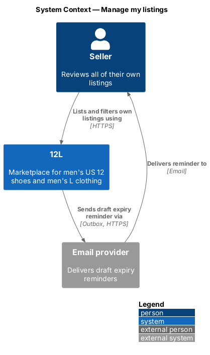
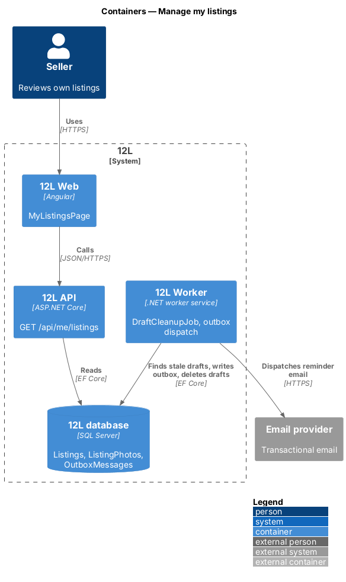
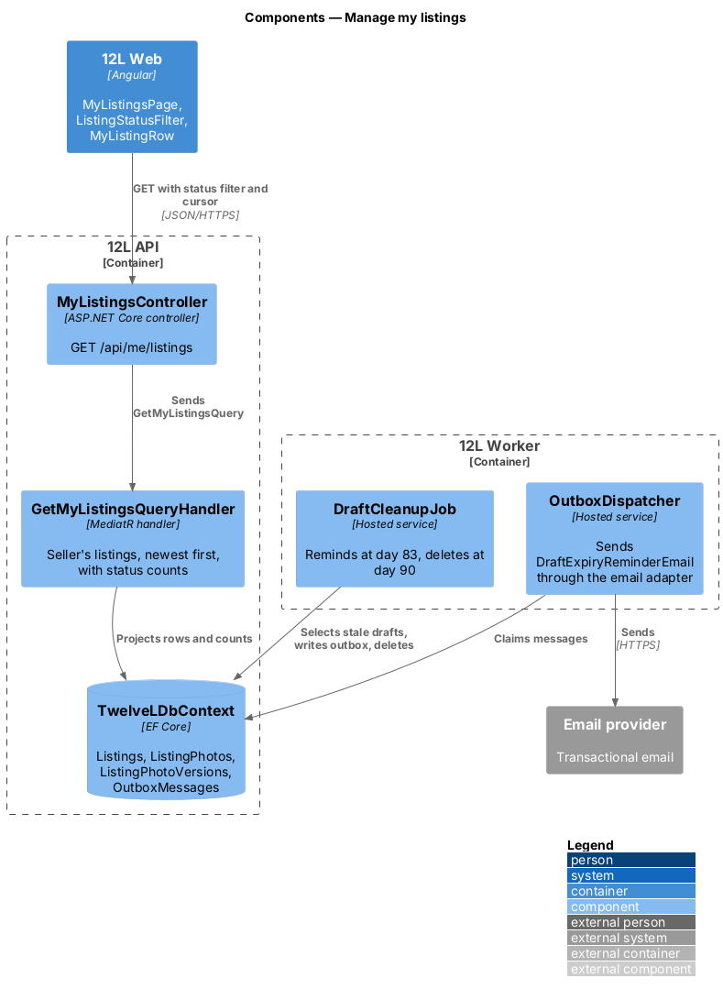
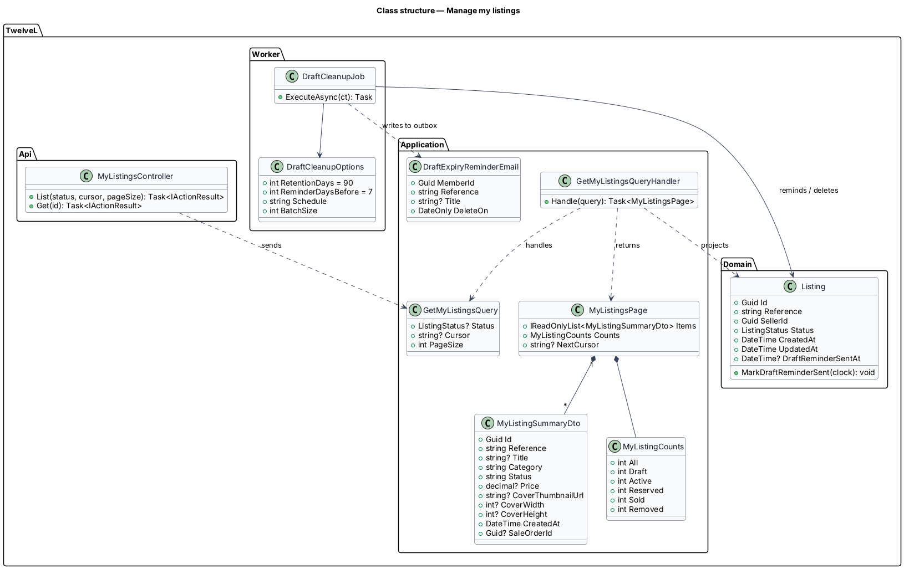
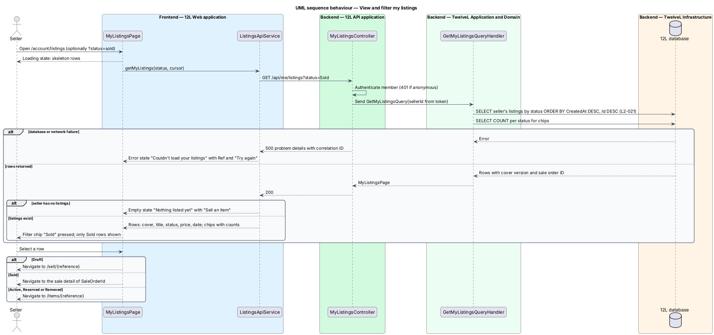
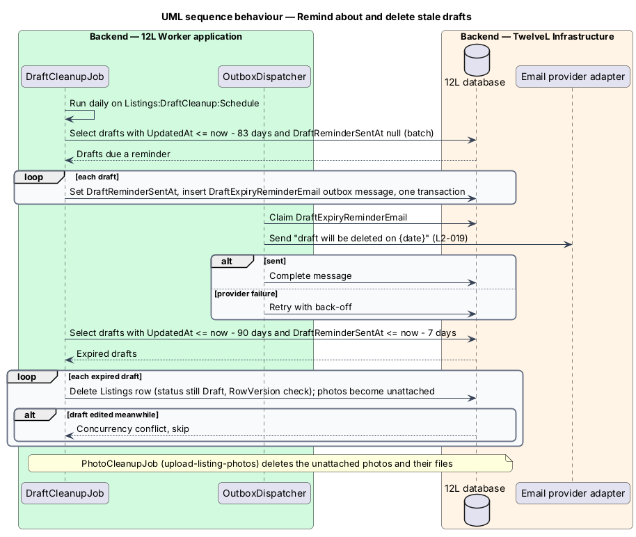

# Manage my listings

## Overview

A 12L seller may have drafts in progress, live listings, items in a buyer's checkout, sold items and withdrawn ones. This feature gives the seller one page, "Your listings", that shows every listing they own in each status. The seller can filter the page by status and open any listing from it (`L2-021`). The feature also enforces the draft lifecycle: a draft not edited for 90 days is deleted together with its photos, and the seller is emailed 7 days before (`L2-019`).

The feature sits in the listings subsystem (`L1-004`). It reads the `Listings` table written by [create-listing](../create-listing/README.md) and [edit-and-withdraw-listing](../edit-and-withdraw-listing/README.md), and photo versions produced by [upload-listing-photos](../upload-listing-photos/README.md). The page also hosts the payout banner of the seller-payouts feature in the orders subsystem.

Terms used in this design:

- **"Your listings" page** — account page at `/account/listings` that lists every listing the signed-in member owns, newest first; "My listings" in the specs
- **status filter** — chip group that limits the list to one listing status, with the count of listings in each status
- **listing reference** — public identifier of a listing in the form `L-<number>`, used in routes
- **stale draft** — draft whose `UpdatedAt` is more than 90 days in the past
- **draft expiry reminder** — transactional email sent 7 days before a stale draft is deleted

## Description

Screens, states and copy come from `docs/mocks/pages/my-listings/`, `docs/mocks/notifications/toast/` (`info`) and `docs/mocks/notifications/payout-banner/`.

### Frontend (`12L Web`, `src/frontend/src/app/listings/`)

- **`MyListingsPage`** — routed standalone component at `/account/listings`, inside the account shell, for signed-in members only (the `core` auth guard redirects anonymous visitors to sign-in). The header shows "Your listings", a subtitle such as "5 listings · 1 active", and a primary "Sell an item" button with a plus icon that links to `/sell`. States:
  - `loading` — the filter chips plus 4 skeleton rows matching thumbnail, title and price, `aria-busy="true"`, `aria-label="Loading listings"`; no subtitle.
  - `default` — all listings, newest first.
  - `filtered` — one chip pressed, for example "Sold", with only the matching rows.
  - `empty` — tag icon, "Nothing listed yet", "List a pair of 12s or something in L." and a primary "Sell an item" action (`L2-021`).
  - `error` — refresh icon, "Couldn't load your listings", "Try again in a moment." with the correlation reference ("Ref …") and a "Try again" button (`L2-068`).
  - A filter that matches nothing has no mock; its copy is `<TO SUPPLY>`.
- **`ListingStatusFilterComponent`** — `role="group"` with `aria-label="Filter by status"`. It holds 6 toggle chips ("All", "Draft", "Active", "Reserved", "Sold", "Removed"), each with its count and `aria-pressed`. The chosen status is kept in the URL query (`?status=sold`), so the filter survives reload and back navigation.
- **`MyListingRowComponent`** — one row per listing with:
  - the cover's 400 px WebP version, with explicit `width` and `height`, or a placeholder image icon when the listing has no photo;
  - the title, or "Untitled draft · {Category}" for a draft without one;
  - a `ListingStatusBadge`;
  - the price as whole dollars when the cents are zero (for example "$60"), or "—" when no price is set;
  - the date as "Today", "Yesterday" or "Sat 24 Oct".
  The row links by status: `Draft` to `/sell/{reference}`; `Sold` to the sale detail page of `saleOrderId` (orders subsystem); `Active`, `Reserved` and `Removed` to `/items/{reference}`.
- **Draft clean-up notice** — when the list contains at least one draft, `ToastService` shows the info toast "Drafts older than 90 days are deleted" with "We'll email you a week before." once per browser. A `localStorage` flag records that the toast was shown, inside `try/catch` so that blocked storage only repeats the notice.
- **Payout banner slot** — `PayoutBannerComponent` from the seller-payouts feature renders above the list. Its states and data belong to that feature (`L2-031`): `info` (payout on its way), `success` (setup finished), `warning` ("Finish payout setup to receive $…" with "Set up payouts", not dismissible) and `danger` (payout returned by the bank).
- **`ListingsApiService.getMyListings(status?, cursor?)`** — typed call to `GET /api/me/listings`.

### API (`TwelveL.Api`)

- **`MyListingsController`** — requires an authenticated member; anonymous calls return `401`. Suspended members may still read their own listings.
  - `GET /api/me/listings?status={Draft|Active|Reserved|Sold|Removed}&cursor={opaque}&pageSize={1..100}` — returns `200` with `MyListingsPage { items, counts, nextCursor }`. Errors: `400` for an unknown status or bad cursor; `401`.
  - `pageSize` defaults to 50. The mocks show no pagination control; behaviour beyond the first page ("Load more" or infinite scroll) is `<TO SUPPLY>`.
  - `GET /api/me/listings/{reference}` serves the edit form and is described in [edit-and-withdraw-listing](../edit-and-withdraw-listing/README.md).

### Application and domain (`TwelveL.Application`, `TwelveL.Domain`)

- **`GetMyListingsQuery`** / **`GetMyListingsQueryHandler`** — reads the seller ID from the authenticated principal, never from the request (`L2-010`). It runs 2 queries:
  1. a projection of `Listings` where `SellerId` equals the caller, optionally filtered by `Status`, ordered by `CreatedAt DESC, Id DESC`, using keyset pagination on (`CreatedAt`, `Id`) encoded in the cursor;
  2. a grouped count by `Status` for the chips.
  The projection joins the cover photo (`ListingPhotos.Position = 0`) and its 400 px WebP row in `ListingPhotoVersions`. It also joins the order of a `Sold` listing (orders subsystem) to fill `saleOrderId`.
- **`MyListingSummaryDto`** — `id`, `reference`, `title?`, `category`, `status`, `price?`, `coverThumbnailUrl?`, `coverWidth?`, `coverHeight?`, `createdAt`, `saleOrderId?`.
- **`MyListingCounts`** — `all`, `draft`, `active`, `reserved`, `sold`, `removed`.
- **Sort order** — "newest first" means by `CreatedAt`, the date the listing was first saved. The row shows the same date.
- **Draft reminder reset** — `Listing.UpdateDetails` clears `DraftReminderSentAt` whenever a draft is saved, so an edited draft restarts its 90-day period and earns a fresh reminder.

### Worker and infrastructure (`TwelveL.Worker`, `TwelveL.Infrastructure`)

- **`DraftCleanupJob`** — hosted service that runs once a day on `Listings:DraftCleanup:Schedule`, in batches of `Listings:DraftCleanup:BatchSize`. Each run:
  1. **reminds** — selects drafts with `UpdatedAt` at or before now − (`RetentionDays` − `ReminderDaysBefore`), that is 83 days, and `DraftReminderSentAt` null. For each draft, one transaction sets `DraftReminderSentAt` and inserts a `DraftExpiryReminderEmail { memberId, reference, title, deleteOn }` outbox message;
  2. **deletes** — selects drafts with `UpdatedAt` at or before now − 90 days and `DraftReminderSentAt` at or before now − 7 days. It deletes each `Listings` row with a `RowVersion` check and skips a draft edited meanwhile. `ListingPhotos.ListingId` is set to null by the foreign key, so `PhotoCleanupJob` of [upload-listing-photos](../upload-listing-photos/README.md) deletes the photos and their stored files.
  The second condition guarantees that the email was sent at least 7 days before deletion, even after a missed run (`L2-019`).
- **`OutboxDispatcher`** (shared, baseline) — sends `DraftExpiryReminderEmail` through the email provider adapter with retry and back-off (`L2-042`). The email template and its copy belong to the notifications subsystem and are `<TO SUPPLY>`. The reminder is transactional, so marketing preferences do not suppress it (`<TO SUPPLY>`: confirm with notification preferences, `L2-043`).
- **Indexes on `Listings`** — `IX_Listings_SellerId_CreatedAt` (`SellerId`, `CreatedAt DESC`, `Id DESC`) including `Status`, `Title`, `Price`, `Category`, `Reference`; `IX_Listings_SellerId_Status_CreatedAt` (`SellerId`, `Status`, `CreatedAt DESC`, `Id DESC`) with the same included columns; and the filtered index `IX_Listings_Draft_UpdatedAt` (`UpdatedAt`) `WHERE Status = 'Draft'` for the clean-up job.
- **Query safety** — EF Core LINQ only, so filter values are parameterised (`L2-049`).

### Configuration

| Key | Value | Notes |
|-----|-------|-------|
| `Listings:DraftCleanup:RetentionDays` | 90 | `L2-019` |
| `Listings:DraftCleanup:ReminderDaysBefore` | 7 | `L2-019` |
| `Listings:DraftCleanup:Schedule` | `<TO SUPPLY>` | Daily cron expression |
| `Listings:DraftCleanup:BatchSize` | `<TO SUPPLY>` | Rows per batch |
| `Listings:MyListings:DefaultPageSize` | 50 | Maximum 100 |

## Requirements

The feature realises the following level-2 (L2) requirements. Each refines the level-1 (L1) requirement cited.

| L2 ID | Refines (L1) | Requirement |
|-------|--------------|-------------|
| `L2-021` | `L1-004` | A seller shall have a "My listings" page showing all of their listings with cover photo, title, price, status and date, filterable by status and sorted newest first. |
| `L2-019` | `L1-004` | A listing shall have one of these statuses: Draft, Active, Reserved, Sold or Removed. A seller shall be able to save an incomplete listing as a Draft and publish it later. Only Active and Reserved listings appear in the catalog. Validation rules L2-014 to L2-018 apply when publishing; drafts only need a category. |

This feature covers the parts of `L2-019` that concern seeing drafts by status and the 90-day draft clean-up. Saving and publishing drafts belong to [create-listing](../create-listing/README.md).

## Diagrams

### System context

The seller reviews their listings in 12L. 12L emails the seller through the email provider before a stale draft is deleted.

### Containers

`12L Web` reads the list from `12L API`. `12L Worker` finds stale drafts in `12L database`, writes reminder emails to the outbox and deletes expired drafts.

### Components

`MyListingsController` sends `GetMyListingsQuery` to its handler, which projects rows and counts through `TwelveLDbContext`. In the worker, `DraftCleanupJob` writes reminders that `OutboxDispatcher` delivers.

### Class structure

`GetMyListingsQueryHandler` returns a `MyListingsPage` of `MyListingSummaryDto` rows with `MyListingCounts`. `DraftCleanupJob` reads `DraftCleanupOptions`, updates `Listing` and writes `DraftExpiryReminderEmail` messages.

### Behaviour — view and filter my listings

The page shows skeleton rows, then the seller's listings newest first with per-status counts. It shows the empty state when the seller has none and the error state with a reference on failure. Each row opens the place that fits its status.

### Behaviour — remind about and delete stale drafts

The daily job first records and queues reminders for drafts 83 days old. It then deletes drafts at least 90 days old whose reminder is at least 7 days old, which leaves their photos to the photo clean-up job.

