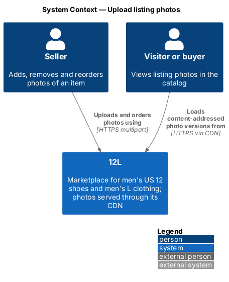
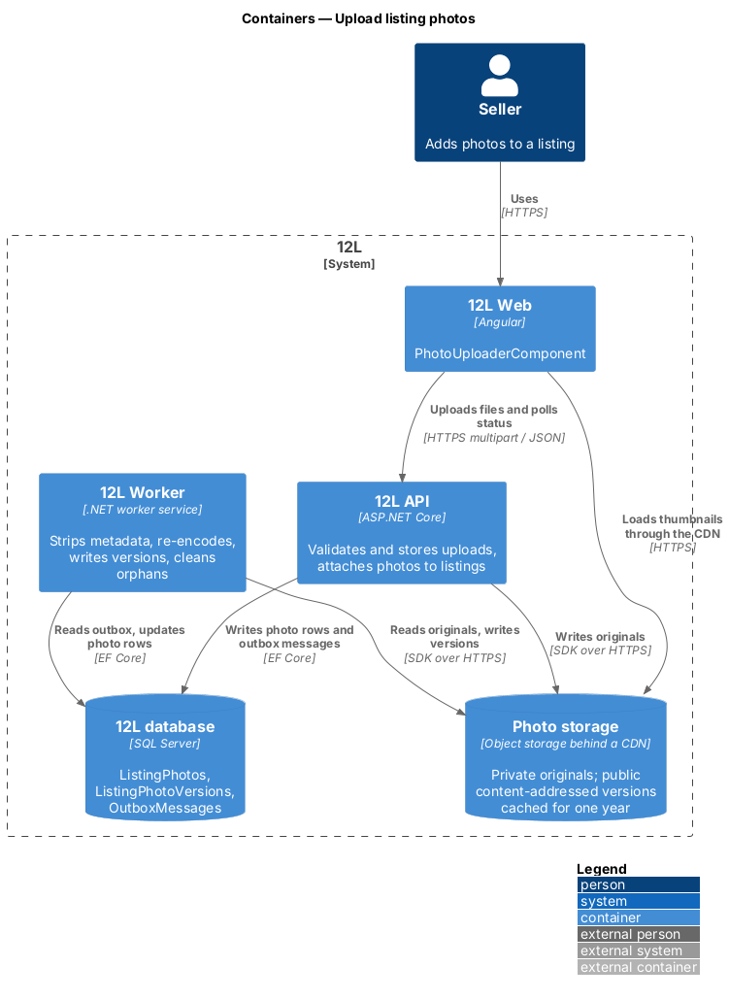
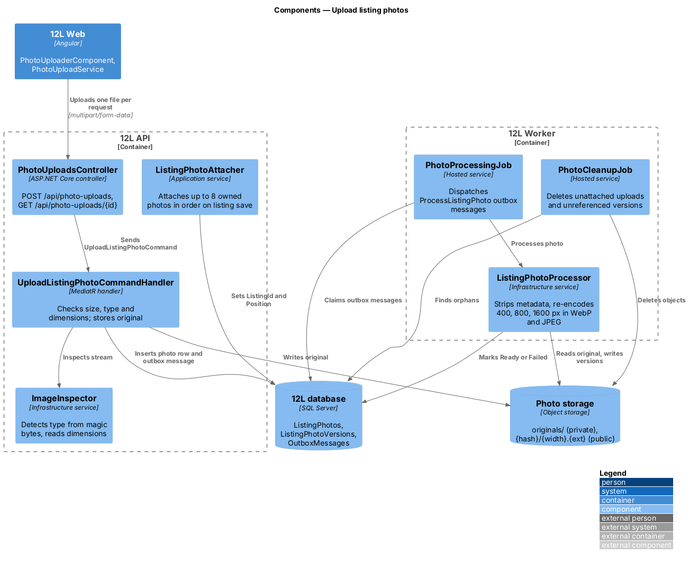
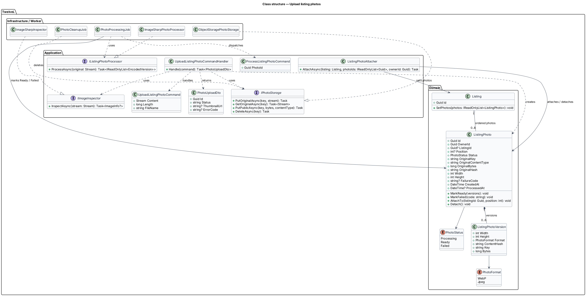
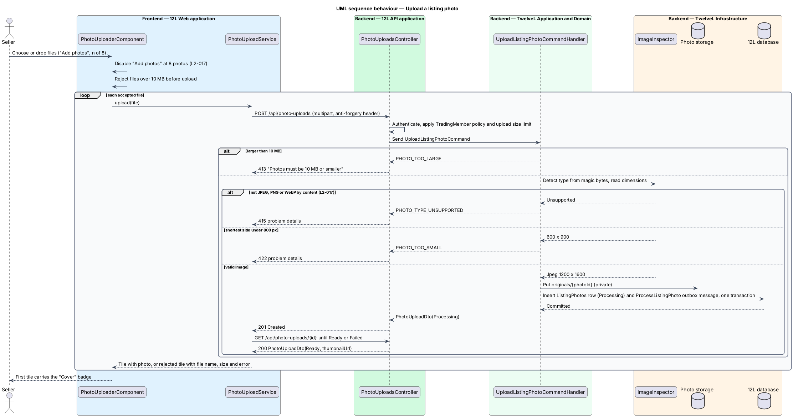
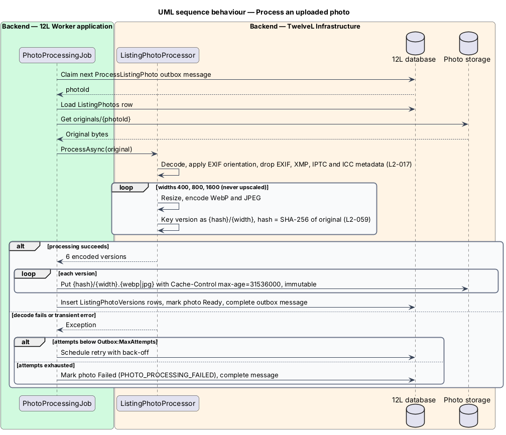
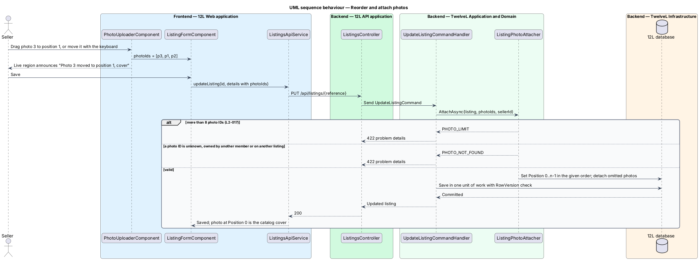
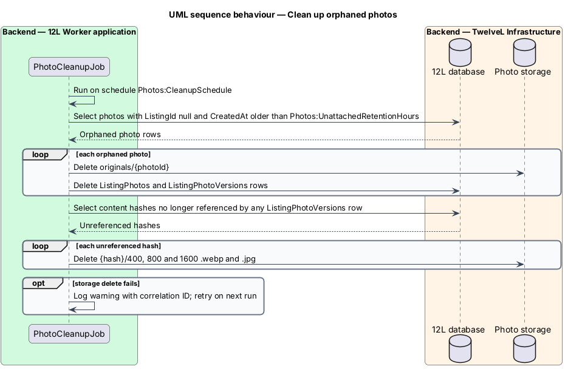

# Upload listing photos

## Overview

Every 12L listing shows between 1 and 8 photos of the actual item (`L2-015`, `L2-017`). Buyers judge used shoes and clothing almost entirely from photos, and phone cameras embed location and device data in every file. This feature lets a seller add, remove and reorder photos on the listing form. It also makes every stored photo safe to publish and fast to deliver.

The feature sits in the listings subsystem (`L1-004`). The listing form that hosts the uploader belongs to [create-listing](../create-listing/README.md) and [edit-and-withdraw-listing](../edit-and-withdraw-listing/README.md). Catalog pages consume the processed versions through `srcset`; that delivery markup belongs to the catalog subsystem, and this feature produces the versions it needs (`L2-059`).

Terms used in this design:

- **photo upload** — one image file sent by a seller and stored as a `ListingPhoto` record before or after it is attached to a listing
- **original** — uploaded file exactly as received, kept in private storage and never served to visitors
- **photo version** — re-encoded, metadata-free copy of a photo at one width (400, 800 or 1600 px) in one format (WebP or JPEG)
- **content-addressed key** — storage key `{hash}/{width}.{ext}` derived from the SHA-256 hash of the uploaded original, so a key never changes meaning and can be cached for one year
- **cover** — photo at position 0 of a listing, shown on catalog cards and the "My listings" page
- **unattached photo** — photo upload not yet referenced by any listing save
- **content sniffing** — detection of the file type from the first bytes of the file (magic bytes) rather than from its name or declared content type

Photos upload independently of the listing. The seller can therefore add photos before choosing a category, which is all a draft needs. The listing save then references the uploaded photo IDs in display order.

## Description

Screens, states and copy come from `docs/mocks/pages/sell/` (`default`, `filled`, `invalid`) and `docs/mocks/pages/edit-listing/`.

### Frontend (`12L Web`, `src/frontend/src/app/listings/photos/`)

- **`PhotoUploaderComponent`** — standalone component inside the Photos section of `ListingFormComponent`. It exposes a `ControlValueAccessor` whose value is the ordered `photoIds` array. It renders:
  - a tile per photo with the image (400 px WebP version), alt text "Photo {n}", and a remove button labelled "Remove photo {n}";
  - the "Cover" badge on the first tile;
  - a rejected tile for a refused file showing the file name, its size (for example "IMG_4471.jpg", "11.4 MB") and a remove button "Remove {file name}";
  - a processing tile with a spinner while the photo status is `Processing`;
  - the add tile "Add photos" with the caption "{n} of 8", backed by `<input type="file" accept="image/jpeg,image/png,image/webp" multiple>`. The add tile is disabled at 8 photos (`L2-017`);
  - the help text "JPEG, PNG or WebP up to 10 MB. Drag to reorder; the first is the cover." and, when invalid, an inline error linked by `aria-describedby` (for example "Add at least one photo. Photos must be 10 MB or smaller.").
- **Reordering** — tiles reorder by drag and drop through the Angular CDK `DragDropModule`. A keyboard alternative moves a focused tile one position at a time, and a polite live region announces the new position (`L2-065`). The mocks show drag only; the exact keyboard affordance is `<TO SUPPLY>`.
- **Client checks** — before sending, the component rejects files over 10 MB with "Photos must be 10 MB or smaller" and limits a multi-file selection to the remaining slots. The server repeats every check.
- **`PhotoUploadService`** — typed client. `upload(file)` posts one file per request with progress events, at most 3 in parallel (`<TO SUPPLY>`: confirm the concurrency). It then polls `GET /api/photo-uploads/{id}` every 1 s until the status is `Ready` or `Failed`, for at most 60 s (`<TO SUPPLY>`: confirm the timeout). It maps `413`, `415` and `422` problem details to tile errors.

### API (`TwelveL.Api`)

- **`PhotoUploadsController`** — requires an authenticated member and the `TradingMember` policy (`L2-010`); state-changing requests require the anti-forgery token (`L2-050`).
  - `POST /api/photo-uploads` — `multipart/form-data` with one `file` part. `[RequestSizeLimit]` is `Photos:MaxBytes` plus 64 KB for multipart overhead; this endpoint is the exception to the 1 MB JSON body limit of `L2-049`. Returns `201 Created` with `PhotoUploadDto { id, status: "Processing" }` and `Location: /api/photo-uploads/{id}`; `413` `PHOTO_TOO_LARGE`; `415` `PHOTO_TYPE_UNSUPPORTED`; `422` `PHOTO_TOO_SMALL`; `401`; `403`.
  - `GET /api/photo-uploads/{id}` — returns `200` with `PhotoUploadDto { id, status, thumbnailUrl?, errorCode? }`; `404` when the photo belongs to another member (`L2-010`).
- **Attaching** happens in the listing endpoints of [create-listing](../create-listing/README.md) and [edit-and-withdraw-listing](../edit-and-withdraw-listing/README.md): `POST /api/listings` and `PUT /api/listings/{reference}` carry `photoIds` in display order.

### Application and domain (`TwelveL.Application`, `TwelveL.Domain`)

- **`UploadListingPhotoCommand`** / **`UploadListingPhotoCommandHandler`** — in order:
  1. rejects content longer than `Photos:MaxBytes` with `PHOTO_TOO_LARGE`, message "Photos must be 10 MB or smaller";
  2. calls `IImageInspector.InspectAsync`, which reads magic bytes and the image header only. A file that is not JPEG, PNG or WebP by content is rejected with `PHOTO_TYPE_UNSUPPORTED` and HTTP 415, whatever its name (for example a text file named `photo.jpg`);
  3. rejects an image whose shortest side is under `Photos:MinShortSidePx` (800) with `PHOTO_TOO_SMALL`, message "Photos must be at least 800 pixels on the shortest side";
  4. writes the original to `originals/{photoId}` in private storage;
  5. inserts the `ListingPhoto` row in status `Processing` with `OwnerId`, dimensions, size and the SHA-256 `OriginalHash` of the bytes, plus a `ProcessListingPhoto { photoId }` outbox message, in one transaction.
- **`ListingPhotoAttacher`** — application service called by the create and update handlers. It loads the referenced photos and enforces these rules:
  - at most 8 IDs (`PHOTO_LIMIT`, `422`), so a ninth photo is refused by the API even when the client control is bypassed (`L2-017`);
  - every photo is owned by the caller and is unattached or already on this listing (`PHOTO_NOT_FOUND`, `422`);
  - no `Failed` photo is attached (`PHOTO_PROCESSING_FAILED`, `422`).
  It then sets `ListingId` and `Position` (0 to n − 1) in the given order and detaches photos the request omits. Detached photos become unattached and are deleted by `PhotoCleanupJob`.
- **Publish rule** — publishing requires 1 to 8 attached photos, all `Ready` (`PHOTOS_REQUIRED` "Add at least one photo", `PHOTOS_PROCESSING`), enforced in [create-listing](../create-listing/README.md).
- **`ListingPhoto`** entity — `Id`, `OwnerId`, `ListingId?`, `Position?`, `Status` (`Processing → Ready` or `Processing → Failed`), `OriginalKey`, `OriginalContentType` (sniffed), `OriginalBytes`, `OriginalHash`, `Width`, `Height`, `FailureCode?`, `CreatedAt`, `ProcessedAt?`, and the owned `Versions` collection.
- **`ListingPhotoVersion`** value object — `Width`, `Height`, `Format` (`WebP`, `Jpeg`), `ContentHash` (lower-case hex SHA-256 of the uploaded original, the same for all 6 versions of a photo), `Key` (`{hash}/{width}.webp` or `{hash}/{width}.jpg`), `Bytes`.
- **Ports** — `IImageInspector`, `IListingPhotoProcessor`, `IPhotoStorage`.

### Worker and infrastructure (`TwelveL.Worker`, `TwelveL.Infrastructure`)

- **`PhotoProcessingJob`** — hosted service that claims `ProcessListingPhoto` outbox messages and calls `ListingPhotoProcessor`. It retries with back-off up to `Outbox:MaxAttempts` and then marks the photo `Failed` with `PHOTO_PROCESSING_FAILED`.
- **`ListingPhotoProcessor`** (`ImageSharpPhotoProcessor`) — implementation on SixLabors ImageSharp (`<TO SUPPLY>`: confirm the library and its licence). Steps:
  1. decode the original;
  2. apply the EXIF orientation to the pixels;
  3. remove all EXIF, XMP, IPTC and GPS metadata, and embedded ICC profiles after conversion to sRGB (`L2-017`);
  4. resize to widths 400, 800 and 1600 px, preserving aspect ratio and never upscaling. An original narrower than a target width yields that version at the original width. Width rather than longest edge is the resize basis because `srcset` selects by width (`L2-059`);
  5. encode each width as WebP and as JPEG (quality `<TO SUPPLY>`), giving 6 versions;
  6. key each version as `{hash}/{width}.{ext}`, where `hash` is the SHA-256 of the original computed at upload. Encoder settings are fixed, so the same original always yields the same bytes under the same key.
- **`ObjectStoragePhotoStorage`** (`IPhotoStorage`) — writes originals under `originals/` in a private container and versions under `{hash}/` in the public container behind the CDN. Versions carry `Cache-Control: public, max-age=31536000, immutable` and the content type of their format (`L2-059`). An identical original produces the same keys, so a re-upload of the same image reuses the existing objects.
- **`ImageSharpInspector`** (`IImageInspector`) — identifies the format from magic bytes (`FF D8 FF` JPEG, `89 50 4E 47` PNG, `RIFF....WEBP` WebP) and reads dimensions without decoding the full image. It also rejects images whose pixel count exceeds `Photos:MaxPixels` (`<TO SUPPLY>`) as a decompression-bomb guard.
- **`PhotoCleanupJob`** — hosted service run on `Photos:CleanupSchedule`. It deletes photos that are unattached and older than `Photos:UnattachedRetentionHours`, with their originals. It also deletes public objects whose hash no longer appears in any `ListingPhotoVersions` row. Photos of drafts deleted by the draft clean-up job of [manage-my-listings](../manage-my-listings/README.md) reach this job as unattached photos.
- **Tables**:
  - `ListingPhotos` — `Id uniqueidentifier` PK, `OwnerId` FK to `Members`, `ListingId` FK to `Listings` (nullable, `ON DELETE SET NULL`), `Position tinyint null`, `Status nvarchar(16)`, `OriginalKey nvarchar(200)`, `OriginalContentType nvarchar(32)`, `OriginalBytes bigint`, `OriginalHash char(64)`, `Width int`, `Height int`, `FailureCode nvarchar(40) null`, `CreatedAt`, `ProcessedAt`. Unique filtered index `UX_ListingPhotos_ListingId_Position` (`WHERE ListingId IS NOT NULL`), check `CK_ListingPhotos_Position` (`Position BETWEEN 0 AND 7`), index `IX_ListingPhotos_ListingId_CreatedAt` for clean-up.
  - `ListingPhotoVersions` — `PhotoId` FK (cascade delete), `Width`, `Format`, `Height`, `ContentHash char(64)`, `Key nvarchar(80)`, `Bytes`; PK (`PhotoId`, `Width`, `Format`); index `IX_ListingPhotoVersions_ContentHash`.
- **Delivery URL** — `{Photos:CdnBaseUrl}/{hash}/{width}.{ext}`. DTOs return URLs built from this base; `thumbnailUrl` is the 400 px WebP version.

### Error codes

| Code | HTTP | Message shown |
|------|-----:|---------------|
| `PHOTO_TOO_LARGE` | 413 | "Photos must be 10 MB or smaller" |
| `PHOTO_TYPE_UNSUPPORTED` | 415 | "Use a JPEG, PNG or WebP photo" |
| `PHOTO_TOO_SMALL` | 422 | "Photos must be at least 800 pixels on the shortest side" |
| `PHOTO_LIMIT` | 422 | "A listing can have up to 8 photos" |
| `PHOTO_NOT_FOUND` | 422 | "That photo is no longer available. Upload it again." |
| `PHOTO_PROCESSING_FAILED` | 422 | "That photo couldn't be processed. Try another." |
| `PHOTOS_REQUIRED` | 422 | "Add at least one photo" |

Messages not present in the mocks ("Use a JPEG, PNG or WebP photo", "Photos must be at least 800 pixels on the shortest side", "A listing can have up to 8 photos", "That photo is no longer available. Upload it again.", "That photo couldn't be processed. Try another.") are proposed copy, `<TO SUPPLY>` for confirmation.

### Configuration

| Key | Value | Notes |
|-----|-------|-------|
| `Photos:MaxBytes` | 10485760 | 10 MB read as 10 MiB; `<TO SUPPLY>`: confirm against 10,000,000 |
| `Photos:MinShortSidePx` | 800 | `L2-017` |
| `Photos:VersionWidths` | 400, 800, 1600 | `L2-017` |
| `Photos:MaxPixels` | `<TO SUPPLY>` | Decompression-bomb guard |
| `Photos:UnattachedRetentionHours` | `<TO SUPPLY>` | Age after which an unattached upload is deleted |
| `Photos:CleanupSchedule` | `<TO SUPPLY>` | Cron expression for `PhotoCleanupJob` |
| `PhotoStorage:OriginalsContainer`, `PhotoStorage:PublicContainer` | `<TO SUPPLY>` | Depend on the hosting platform |
| `Photos:CdnBaseUrl` | `<TO SUPPLY>` | Public photo origin |

## Requirements

The feature realises the following level-2 (L2) requirements. Each refines the level-1 (L1) requirement cited.

| L2 ID | Refines (L1) | Requirement |
|-------|--------------|-------------|
| `L2-017` | `L1-004` | A listing shall have 1 to 8 photos. Each photo shall be JPEG, PNG or WebP, at most 10 MB, and at least 800 pixels on its shortest side. The file type shall be checked from the file's content, not its name. The server shall strip all metadata (including GPS location), re-encode the image and produce thumbnail (400px), medium (800px) and large (1600px) versions. The first photo is the cover and the seller can reorder photos. |
| `L2-059` | `L1-015` | Photos shall be served from a CDN in WebP with a JPEG fallback, sized to the space they fill using `srcset`, with explicit width and height to avoid layout shift. Photos below the first screen shall be lazy loaded. Photo URLs shall be content-addressed and cached for at least one year. |

`L2-059` is a supporting requirement here: this feature generates the WebP and JPEG versions, stores their dimensions, assigns content-addressed keys and sets the one-year cache header. The `srcset`, `width`/`height` and lazy-loading markup belongs to the catalog subsystem.

## Diagrams

### System context

Sellers upload photos to 12L. Visitors load the processed versions through 12L's CDN.

### Containers

`12L API` validates each upload and stores the original. `12L Worker` produces the versions. `Photo storage` keeps originals private and serves versions publicly through the CDN.

### Components

`PhotoUploadsController` hands each file to `UploadListingPhotoCommandHandler`, which inspects it with `ImageInspector`. In the worker, `PhotoProcessingJob` drives `ListingPhotoProcessor`, and `PhotoCleanupJob` removes orphans. `ListingPhotoAttacher` links photos to a listing when the listing is saved.

### Class structure

A `ListingPhoto` owns up to 6 `ListingPhotoVersion` values and belongs to at most one `Listing`, which holds up to 8 ordered photos. Infrastructure classes implement the `IImageInspector`, `IListingPhotoProcessor` and `IPhotoStorage` ports.

### Behaviour — upload a photo

The handler checks size, sniffed type and dimensions in that order and returns `413`, `415` or `422` on the first failure. A valid file is stored privately, recorded as `Processing` and queued through the outbox.

### Behaviour — process a photo

The worker strips metadata, re-encodes 3 widths in 2 formats, and stores each version under the content hash of its original with a one-year cache header. Failures retry with back-off before the photo is marked `Failed`.

### Behaviour — reorder and attach photos

The order of `photoIds` in a listing save sets each photo's `Position`; position 0 becomes the cover. More than 8 IDs, or an ID the caller does not own, returns `422`.

### Behaviour — clean up orphaned photos

`PhotoCleanupJob` deletes stale unattached uploads and any public version no longer referenced by a photo.

