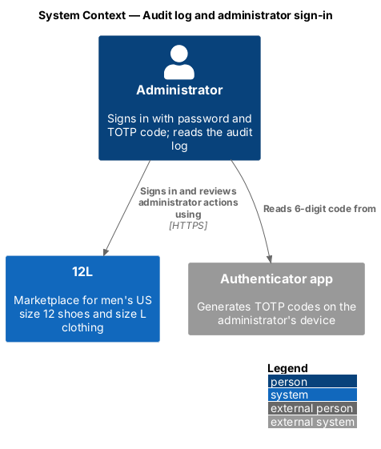
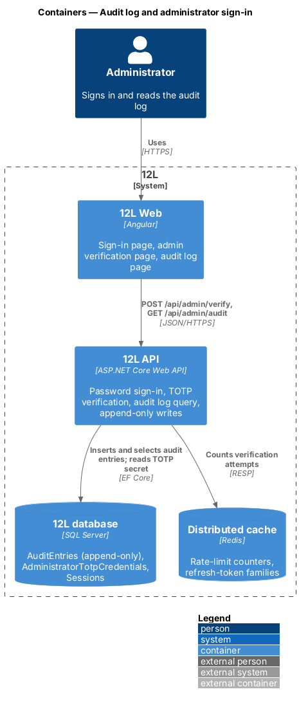
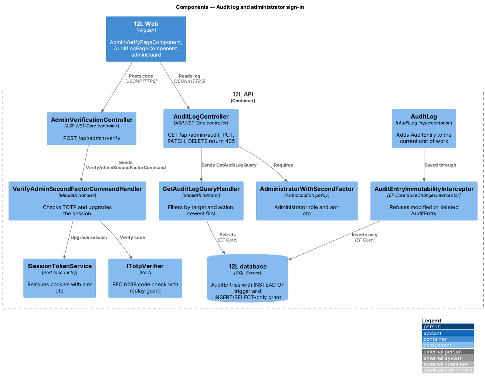
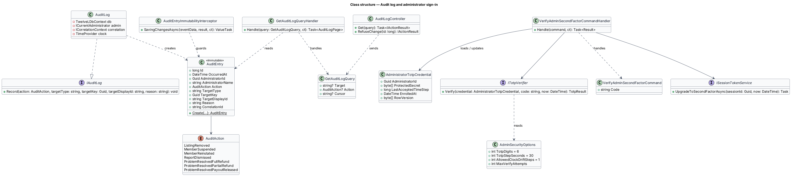
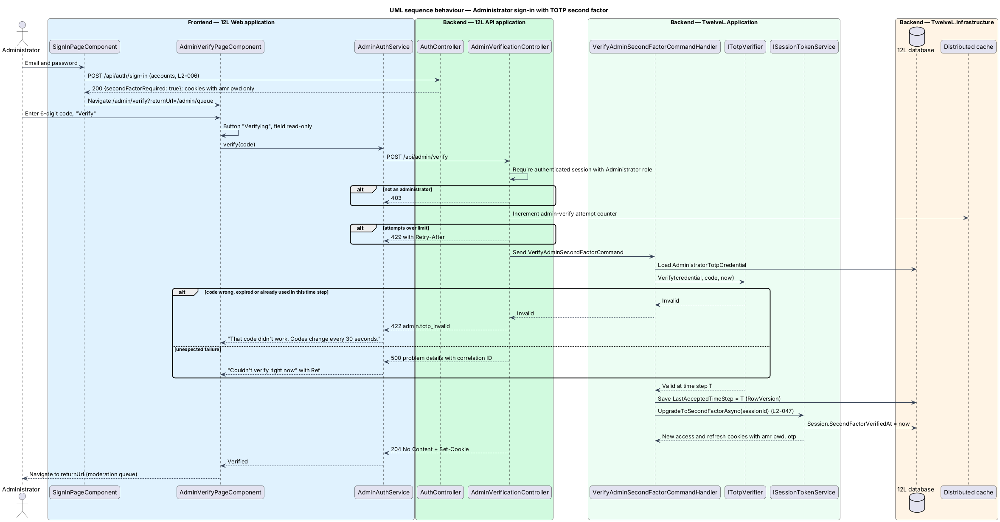
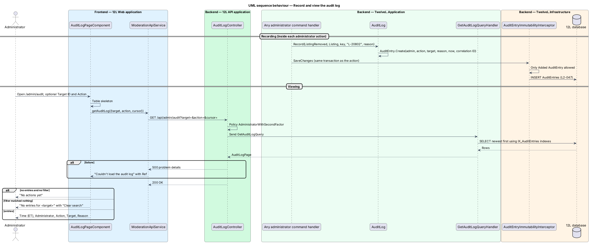
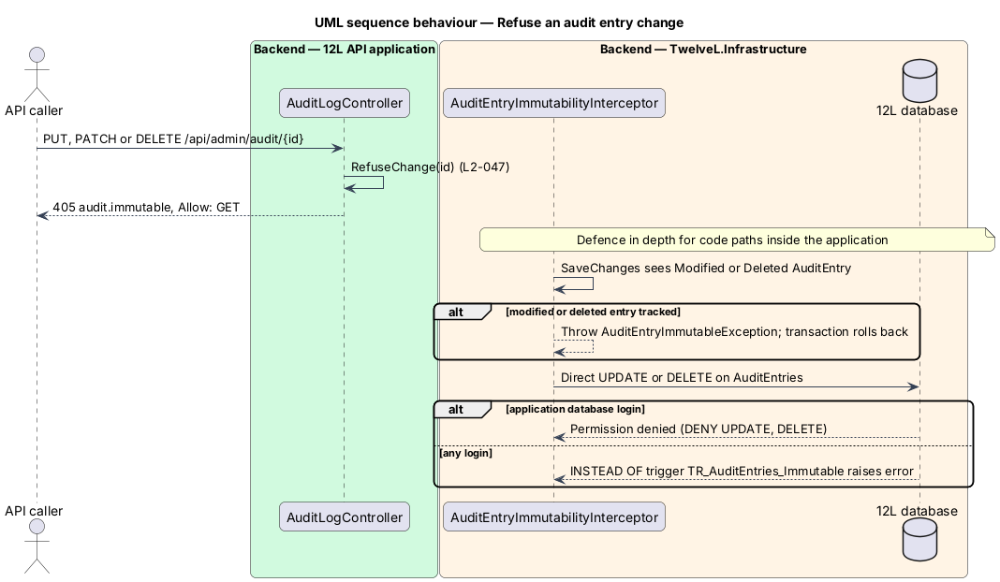

# Audit log and administrator sign-in

## Overview

Administrators hold powers that ordinary members do not. They remove listings, suspend members, and decide refunds on order problems. Those powers need two safeguards. First, every administrator action leaves a permanent, tamper-resistant record of who did what, to which target, why and when. Second, an administrator account is harder to take over than a member account, because a stolen administrator password would expose every member.

This feature provides both safeguards. The audit log is an append-only table written in the same transaction as each administrator action, kept for at least 2 years, and readable on an "Audit log" page in the administration area. No part of the application can edit or delete an entry. Administrator sign-in adds a second factor: after the ordinary email-and-password sign-in (`L2-006`, accounts subsystem), an administrator enters a 6-digit code from an authenticator app before any moderation endpoint answers.

Terms used in this design:

- **audit entry** — immutable record of one administrator action: administrator, action, target, reason and time
- **append-only** — property of a store that accepts inserts and reads but refuses updates and deletes
- **target** — object an administrator action applies to, shown by its display ID: a listing (`L-20802`), a report (`R-3290`), an order problem (`P-0912`) or a member handle (`vintage_lou`)
- **TOTP** — time-based one-time password (RFC 6238): a 6-digit code derived from a shared secret and the current 30-second time step
- **second factor** — proof of possession of the administrator's authenticator, checked after the password
- **`amr` claim** — authentication-methods-reference claim in the access token; `pwd` after the password, `pwd` and `otp` after the TOTP step

## Description

### Frontend (12L Web, `src/frontend/src/app/moderation/`)

- **`AdminVerifyPageComponent`** — route `/admin/verify` in the authentication shell (`docs/mocks/pages/admin-verify/`). An "Admin" badge sits above the heading "Enter your code". A single field labelled "6-digit code" uses `inputmode="numeric"`, `autocomplete="one-time-code"` and `maxlength="6"`, with help text "From your authenticator app." The block button reads "Verify". States:
  - `default` — field focused.
  - `invalid` — HTTP 422: "That code didn’t work. Codes change every 30 seconds."; the field keeps focus.
  - `submitting` — button "Verifying" with `aria-busy`, field read-only.
  - `error` — HTTP 5xx: alert "Couldn’t verify right now", "Try again in a moment. Ref <correlation ID>"; the entered value is kept.
  - On success the page navigates to the `returnUrl` query parameter, or to `/admin/queue`.
- **`AdminAuthService`** — `verify(code): Observable<void>` against `POST /api/admin/verify`. It updates `AuthStateService` so that `secondFactorVerified` becomes true.
- **Sign-in hand-off** — the accounts sign-in page reads `secondFactorRequired: true` from the sign-in response and navigates to `/admin/verify?returnUrl=…`. The administration area is reachable only through that step.
- **`adminGuard`** — functional route guard on every `/admin` route except `/admin/verify`. A caller without the Administrator role sees the forbidden state ("Admins only"). An administrator without `secondFactorVerified` is redirected to `/admin/verify`. The HTTP interceptor in `core` performs the same redirect when any response carries `auth.second_factor_required`.
- **`AuditLogPageComponent`** — route `/admin/audit` in `AdminShellComponent`, "Audit log" tab (`docs/mocks/pages/audit-log/`). Header "Audit log" with subtitle "Read-only · kept for 2 years". The toolbar holds a search field (visually hidden label "Search by target ID", placeholder "Target ID") and an "Action" select: "All actions", "Listing removed", "Member suspended", "Member reinstated", "Report dismissed", "Problem resolved". The table has caption "Administrator actions, newest first" and columns "Time (ET)", "Administrator", "Action", "Target", "Reason". The page renders no edit or delete control. Filters live in the URL query string (`?target=&action=`). States:
  - `loading` — 5 skeleton rows under the real header.
  - `empty` — "No actions yet", "Every moderation decision is recorded here."
  - `error` — "Couldn’t load the audit log" with Ref and "Try again".
  - `no-results` — "No entries for <target>", "Check the ID or clear the search.", button "Clear search".
  - The control for loading older entries is not in the mocks and is `<TO SUPPLY>`; the API supports it through a cursor.

### API (`TwelveL.Api`)

- **`AdministratorWithSecondFactor` policy** — requires role `Administrator` and an `amr` claim that contains `otp`. Every moderation and administration endpoint applies it, including `/api/admin/queue`, `/api/admin/reports/*`, `/api/admin/members/*`, `/api/admin/problems/*` and `/api/admin/audit`. A member without the role receives `403 auth.administrator_required` (`L2-010`). An administrator without the second factor receives `403 auth.second_factor_required` (`L2-047`).
- **`AdminVerificationController`** — `POST /api/admin/verify` with body `{ code: string }`. It requires an authenticated session whose member has the Administrator role, and uses rate-limit policy `admin-verify` keyed by member. Responses:
  - `204` with fresh session cookies whose access token carries `amr: ["pwd","otp"]`.
  - `401` no session; `403` not an administrator.
  - `422 admin.totp_invalid` for a wrong, expired or replayed code; the response does not distinguish the three cases.
  - `429` with `Retry-After` after `AdminSecurityOptions.MaxVerifyAttempts` failures in the window; both values are `<TO SUPPLY>`.
  - `500` problem details with correlation ID (`L2-068`).
- **`AuditLogController`**
  - `GET /api/admin/audit?target=&action=&cursor=` returns `200` with `{ items: AuditEntryDto[], nextCursor }`, newest first. `target` matches `TargetDisplayId` exactly, ignoring case. `action` is an `AuditAction` value or the group `ProblemResolved`. Page size is `AuditOptions.PageSize`, default 50.
  - `PUT`, `PATCH` and `DELETE /api/admin/audit/{id}` are mapped explicitly to `RefuseChange`, which returns `405` with error code `audit.immutable` and header `Allow: GET`. A `POST` to the collection is refused the same way, so no endpoint creates an entry directly (`L2-047` criterion 2).

### Application and domain (`TwelveL.Application`, `TwelveL.Domain`)

- **`AuditEntry`** — immutable entity with private setters and a static `Create(...)` factory. Fields: `Id` (`long`, identity), `OccurredAt` (UTC), `AdministratorId`, `AdministratorName` (snapshot of the display name, such as "Ana Ruiz"), `Action`, `TargetType` (`Listing`, `Report`, `Member`, `OrderProblem`), `TargetKey` (`Guid` of the target), `TargetDisplayId`, `Reason`, `CorrelationId`.
- **`AuditAction`** — `ListingRemoved` ("Listing removed"), `MemberSuspended` ("Member suspended"), `MemberReinstated` ("Member reinstated"), `ReportDismissed` ("Report dismissed"), and three values recorded by the orders subsystem's problem resolution (`L2-036`): `ProblemResolvedFullRefund` ("Problem resolved: refund"), `ProblemResolvedPartialRefund` and `ProblemResolvedPayoutReleased`. Display labels for the last two are `<TO SUPPLY>`. Any later administrator action adds a value here.
- **`IAuditLog` / `AuditLog`** — the port every administrator command handler calls (`ResolveReportCommandHandler`, `MemberSuspensionService`, the orders problem resolution handler). `Record(...)` creates the entry with the current administrator from `ICurrentAdministrator`, the time from `TimeProvider` and the correlation ID from `ICorrelationContext`. It adds the entry to the same `TwelveLDbContext` unit of work, so the action and its entry commit or roll back together.
- **`GetAuditLogQuery` / `GetAuditLogQueryHandler`** — keyset paging on (`OccurredAt` desc, `Id` desc), optional `Target` and `Action` filters, mapped to `AuditEntryDto { occurredAt, administratorName, action, actionLabel, targetDisplayId, reason }`.
- **`VerifyAdminSecondFactorCommand` / `VerifyAdminSecondFactorCommandValidator` / `VerifyAdminSecondFactorCommandHandler`** — the validator requires exactly 6 digits. The handler then:
  - loads `AdministratorTotpCredential` and calls `ITotpVerifier.Verify`;
  - on success, stores `LastAcceptedTimeStep`, using `RowVersion` to stop two parallel uses of one code;
  - calls `ISessionTokenService.UpgradeToSecondFactorAsync(sessionId, now)`, the accounts session service (`L2-008`), which sets `Session.SecondFactorVerifiedAt` and reissues the cookies.
- **Session continuity** — refresh-token rotation copies `SecondFactorVerifiedAt` from the session, so refreshed access tokens keep `amr: otp` for the life of the 14-day session family. Signing out or token-family revocation ends it. Whether a shorter re-verification interval applies to administrators is `<TO SUPPLY>`.
- **`ITotpVerifier` / `TotpVerifier`** — RFC 6238 with HMAC-SHA1, 6 digits, a 30-second step and a tolerance of 1 step either side (`AdminSecurityOptions`). It rejects a code whose time step is not greater than `LastAcceptedTimeStep`. The comparison runs in constant time. The choice between an in-house implementation and a library is `<TO SUPPLY>`.
- **`AdministratorTotpCredential`** — `AdministratorId`, `ProtectedSecret` (encrypted with ASP.NET Core Data Protection, purpose `TwelveL.AdminTotp`), `LastAcceptedTimeStep`, `EnrolledAt`, `RowVersion`. Enrolment, secret rotation and recovery for a lost device have no mock or requirement and are `<TO SUPPLY>`. Until they are supplied, an administrator without a credential cannot pass the step.

### Infrastructure and data (`TwelveL.Infrastructure`)

- **`AuditEntries` table** — `Id bigint IDENTITY` clustered primary key; `OccurredAt datetime2`, `AdministratorId uniqueidentifier`, `AdministratorName nvarchar(100)`, `Action tinyint`, `TargetType tinyint`, `TargetKey uniqueidentifier`, `TargetDisplayId nvarchar(64)`, `Reason nvarchar(n)`, `CorrelationId varchar(64)`. Indexes:
  - `IX_AuditEntries_OccurredAt` on (`OccurredAt` desc, `Id` desc);
  - `IX_AuditEntries_TargetDisplayId` on (`TargetDisplayId`, `OccurredAt` desc);
  - `IX_AuditEntries_Action` on (`Action`, `OccurredAt` desc).
- **Append-only enforcement in 3 layers** — (1) `AuditEntryImmutabilityInterceptor`, an EF Core `SaveChangesInterceptor`, throws `AuditEntryImmutableException` when any tracked `AuditEntry` is `Modified` or `Deleted`, which rolls back the transaction. (2) The migration grants the application database login `INSERT` and `SELECT` on `AuditEntries` and denies `UPDATE` and `DELETE`. (3) The `INSTEAD OF UPDATE, DELETE` trigger `TR_AuditEntries_Immutable` raises an error for any login. Schema migrations run under a separate deployment identity.
- **Retention** — the application has no purge path, so entries are kept for at least 2 years (`L2-047`). Any purge after 2 years, and how backup retention (`L2-067`) relates to it, are `<TO SUPPLY>`. The interaction with personal-data erasure (`L2-005`) is also `<TO SUPPLY>`: a member handle used as `TargetDisplayId` is personal data, while the log is append-only.
- **`AdministratorTotpCredentials` table** — primary key `AdministratorId`, `ProtectedSecret varbinary(512)`, `LastAcceptedTimeStep bigint`, `EnrolledAt`, `RowVersion rowversion`. Data Protection key storage follows the platform baseline (`<TO SUPPLY>`).
- **Rate limiting** — policy `admin-verify` stores counters in Redis (`L2-051`, `L2-060`).
- **Logging** — TOTP codes and secrets are never logged (`L2-069`). Each failed verification is logged as a security event with the member ID and correlation ID.

## Requirements

The feature realizes the following level-2 (L2) requirements. Each L2 requirement refines a level-1 (L1) requirement, cited by identifier.

| L2 ID | Refines (L1) | Requirement |
|-------|--------------|-------------|
| `L2-047` | `L1-012` | Every administrator action shall be recorded in an append-only audit log with the administrator, action, target, reason and time. Audit entries shall not be editable or deletable through the application and shall be kept for at least 2 years. |
| `L2-006` | `L1-002` | A member shall be able to sign in with their email and password. The error shown for an unknown email and for a wrong password shall be identical. |
| `L2-010` | `L1-002` | Every API endpoint shall check that the caller is allowed to act on the resource. A member shall only change their own profile and listings, and shall only see orders they are the buyer or seller of. Moderation endpoints shall require the Administrator role. Requests for resources the caller is not allowed to see shall return HTTP 404 so their existence is not revealed. |

## Diagrams

### System context

The administrator signs in to 12L with a password and a code from an authenticator app on their own device. The authenticator app does not connect to 12L; it shares only the enrolled secret.

### Containers

12L Web calls 12L API for verification and for the log. 12L API keeps audit entries and TOTP credentials in the 12L database and counts verification attempts in Redis.

### Components

`VerifyAdminSecondFactorCommandHandler` checks the code through `ITotpVerifier` and upgrades the session through the accounts `ISessionTokenService`. On the audit side, `AuditLog` writes entries through `AuditEntryImmutabilityInterceptor`, and `AuditLogController` exposes only reads.

### Class structure

`AuditEntry` is immutable and typed by `AuditAction`. `AdministratorTotpCredential` holds the protected secret and the last accepted time step that blocks replay.

### Behaviour — administrator sign-in with TOTP

After password sign-in the session carries only `amr: pwd`. A valid code upgrades it to `pwd` and `otp`. A wrong, expired or replayed code returns HTTP 422 with the mock's error text (`L2-047` criterion 3).

### Behaviour — record and view the audit log

Each administrator command adds its entry in the same transaction as the action. The page reads entries newest first and shows the empty, no-results and error states (`L2-047` criterion 1).

### Behaviour — refuse an audit entry change

The API answers any change request with HTTP 405 `audit.immutable`. The interceptor, the database grants and the trigger refuse changes that bypass the API (`L2-047` criterion 2).

