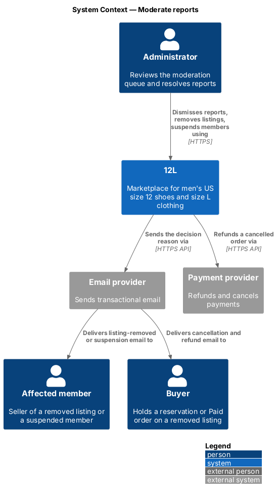
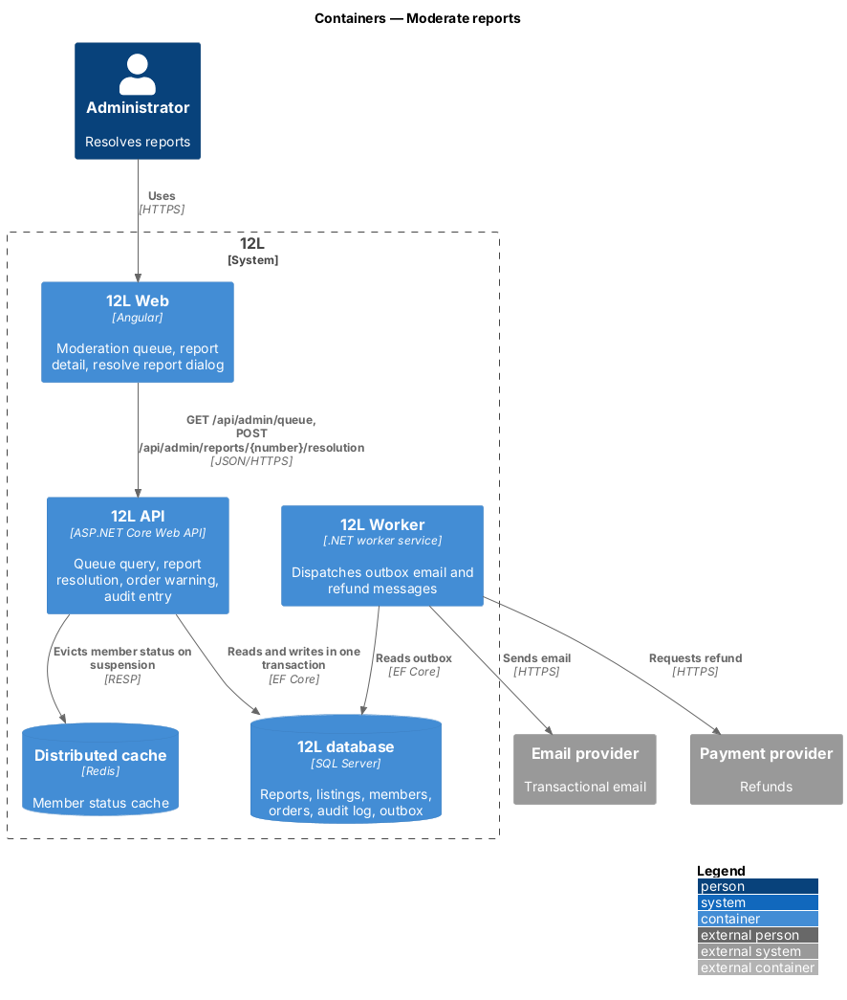
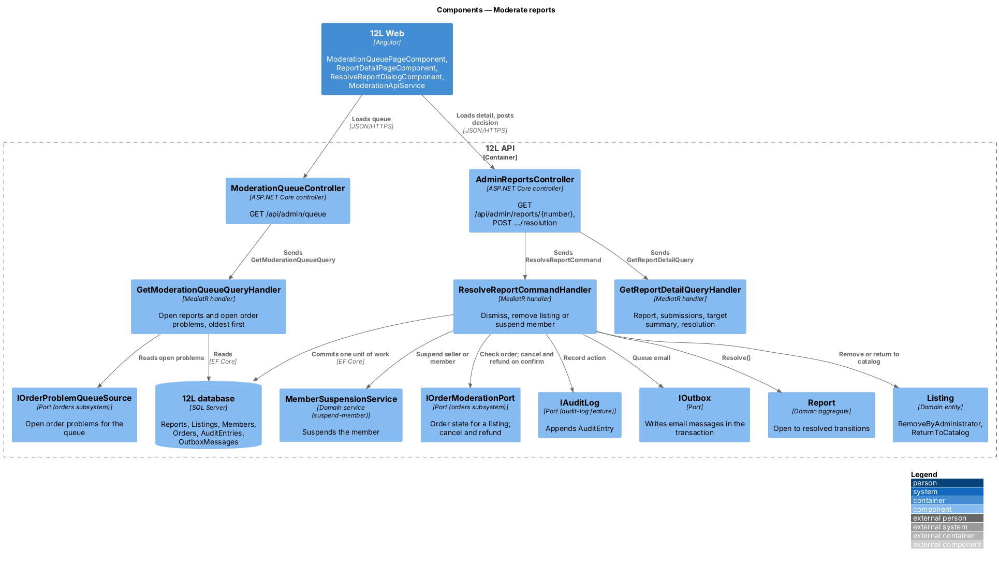
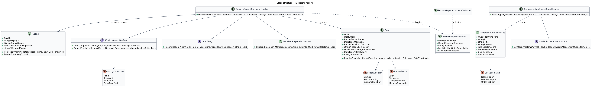
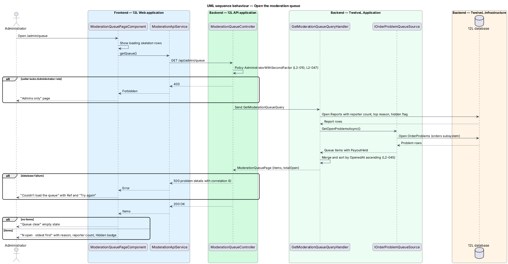
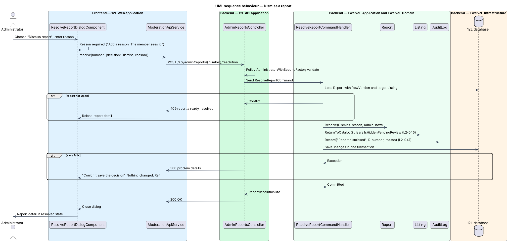
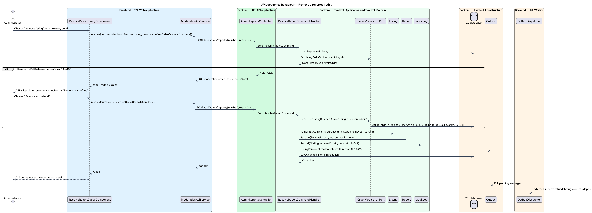
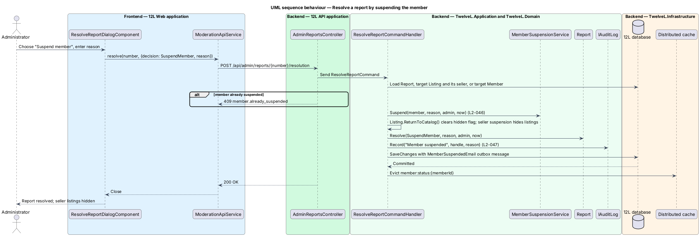

# Moderate reports

## Overview

Members report listings and members that break the 12L marketplace rules (`report-listing-or-member`), and buyers report problems with orders (orders subsystem, `resolve-order-problems`). Both kinds of case need a person to decide them. This feature gives administrators that place: a moderation queue of every open report and order problem, oldest first, and a report detail page from which an administrator resolves a report.

Resolving a report means choosing one of three decisions and giving a reason. The reason is sent to the affected member and kept in the audit log. A decision on a listing can collide with a sale in progress: the listing may be reserved by a buyer in checkout, or already sold with a Paid order. In that case the administrator is warned and confirms before the order is cancelled and the buyer refunded. The order cancellation and refund belong to the orders subsystem; this feature asks for them and does not implement them.

Terms used in this design:

- **moderation queue** — list of open reports and open order problems, ordered by the time each case was opened, oldest first
- **queue item** — one row in the moderation queue: a listing report, a member report or an order problem
- **decision** — administrator's resolution of a report: dismiss, remove listing, or suspend member
- **dismiss** — decision that closes a report with no action against its target and returns a listing hidden by `L2-044` to the catalog
- **remove listing** — decision that moves a listing to status `Removed`, so it leaves the catalog permanently
- **affected member** — seller of a reported listing, or the reported member
- **order warning** — confirmation step shown when a listing to be removed is `Reserved` or has a `Paid` order
- **order problem** — buyer's claim on a Shipped or Delivered order (`L2-036`), owned by the orders subsystem and shown in the same queue

## Description

### Frontend (12L Web, `src/frontend/src/app/moderation/`)

All administrator routes live under `/admin`, are lazy-loaded, and sit inside `AdminShellComponent`. The shell renders the top bar with the 12L logo, an "Admin" badge and two tabs: "Queue" (`/admin/queue`) and "Audit log" (`/admin/audit`). The route guard `adminGuard` lets only an administrator with a verified second factor in (see `audit-log-and-admin-sign-in`). A member without the role who reaches `/admin/queue` sees the forbidden state.

- **`ModerationQueuePageComponent`** — route `/admin/queue` (`docs/mocks/pages/moderation-queue/`). Header "Queue" with subtitle "<n> open · oldest first". Each row shows the item thumbnail or member avatar, a title, a meta line ("Listing · Wrong size", "Order problem · Not as described · Order 12L-48140", "Member · Misleading descriptions"), a "Hidden" warning badge when the listing is hidden pending review, a reporter-count pill (accessible label "3 reporters") or a "Payout held" badge for order problems, and the age ("2 days", "Yesterday"). Row links: listing reports go to `/admin/reports/{number}`, member reports to `/admin/members/{handle}`, order problems to `/admin/problems/{id}`. States:
  - `loading` — skeleton rows and a skeleton subtitle.
  - `empty` — "Queue clear", "New reports and order problems land here.", button "View audit log".
  - `error` — "Couldn’t load the queue", "Something went wrong on our side. Ref <correlation ID>", button "Try again".
  - `forbidden` — HTTP 403: "Admins only", "This area is for the 12L moderation team.", button "Back to shop".
- **`ReportDetailPageComponent`** — route `/admin/reports/:number` (`docs/mocks/pages/report-detail/`). Breadcrumb "Queue › Report R-3318", subtitle "<top reason> · opened <age>". The main column lists "<n> reports": each reporter's avatar, handle, reason and note, or "No note". The side panel shows the listing (thumbnail, title, brand, price), its status pill, the listing display ID, a link to the seller's member admin page, and the "Resolve report" button. States:
  - `default` — open report.
  - `hidden` — warning alert "Hidden from the catalog", "3 members reported it. It stays hidden until you decide."
  - `resolved` — success alert naming the decision, the administrator and the time, for example "Listing removed", "By Ana Ruiz, today 10:42 ET. vintage_lou was emailed the reason."; no resolve button.
  - `loading` — split-layout skeleton; `error` — "Couldn’t load this report" with Ref and "Try again".
- **`ResolveReportDialogComponent`** — dialog titled "Resolve report R-<number>" (`docs/mocks/dialogs/resolve-report/`). A *Decision* fieldset offers "Dismiss report" ("The listing returns to the catalog"), "Remove listing" ("The seller is emailed your reason") and "Suspend member" ("Hides all of <seller>’s listings"). A required *Reason* textarea carries the help text "Sent to the member and kept in the audit log." For a member report, the "Remove listing" option is not offered. States:
  - `default` — the primary button label follows the decision; the mock shows "Remove listing".
  - `invalid` — empty reason: "Add a reason. The member sees it."
  - `busy` — primary shows "Removing" with `aria-busy`, inputs read-only, "Cancel" disabled.
  - `order-warning` — after HTTP 409 `moderation.order_exists`: warning alert "This item is in someone’s checkout", "Removing it cancels that order and refunds the buyer in full.", danger button "Remove and refund". The mock shows the `Reserved` wording; the wording for a listing with a `Paid` order is `<TO SUPPLY>`.
  - `failed` — "Couldn’t save the decision", "Nothing changed. Ref <correlation ID>", inputs kept, button "Try again".
- **`ModerationApiService`** — typed client: `getQueue(cursor?)`, `getReport(number)`, `resolveReport(number, request)`. It maps `409 moderation.order_exists` to an `OrderWarning` result and `409 report.already_resolved` to a reload of the detail page.
- **Problem detail** — `/admin/problems/:id` (`docs/mocks/pages/problem-detail/`) and the resolve problem dialog belong to the orders subsystem's `resolve-order-problems` design. This feature only links to that page from the queue.

### API (`TwelveL.Api`)

Every endpoint applies the `AdministratorWithSecondFactor` policy. It returns `403` (`auth.administrator_required`) when the caller lacks the Administrator role (`L2-010`). It also returns `403` (`auth.second_factor_required`) when the session has not passed the TOTP step (`L2-047`).

- **`ModerationQueueController`** — `GET /api/admin/queue?cursor=` returns `200` with `{ totalOpen, items: ModerationQueueItemDto[], nextCursor }`.
- **`AdminReportsController`**
  - `GET /api/admin/reports/{number}` returns `200` with `ReportDetailDto`, or `404` when no report has that number.
  - `POST /api/admin/reports/{number}/resolution` with body `{ decision: "Dismiss" | "RemoveListing" | "SuspendMember", reason: string, confirmOrderCancellation: bool }`. Responses:
    - `200` with `ReportResolutionDto`.
    - `404` when no report has that number.
    - `409 report.already_resolved` when the report is not open, including a concurrent resolution caught by `RowVersion`.
    - `409 moderation.order_exists` with extension `orderState: "Reserved" | "PaidOrder"` when confirmation is required (`L2-045`).
    - `409 member.already_suspended` for a suspension decision against a suspended member.
    - `409 moderation.order_in_progress` when the listing's order is past `Paid`; the rule for that case is `<TO SUPPLY>`.
    - `422` for validation failures: `resolution.reason_required`, `resolution.decision_invalid` (remove listing on a member report).

### Application and domain (`TwelveL.Application`, `TwelveL.Domain`)

- **`GetModerationQueueQuery` / `GetModerationQueueQueryHandler`** — reads open `Reports` with distinct reporter count, the most frequent reason (earliest submission breaks ties), the target title or handle, the thumbnail, and `IsHiddenPendingReview`. It asks `IOrderProblemQueueSource` (implemented by the orders subsystem) for open order problems. It merges both lists and sorts them by `OpenedAt` ascending (`L2-045`). It pages by keyset on (`OpenedAt`, `Id`) with page size `ModerationOptions.QueuePageSize`, default 50.
- **`GetReportDetailQuery` / `GetReportDetailQueryHandler`** — returns the report number, status, opened time, submissions (reporter handle, reason, details), the target summary (listing title, brand, price, status, display ID such as `L-20802`, seller handle; or member handle) and, when resolved, the decision, reason, administrator display name and time.
- **`ResolveReportCommand`** — `ReportNumber`, `Decision`, `Reason`, `ConfirmOrderCancellation`, `AdministratorId`.
- **`ResolveReportCommandValidator`** — `Reason` is required and non-whitespace; its maximum length is `<TO SUPPLY>`. `Decision` is a defined value.
- **`ResolveReportCommandHandler`** — loads the report and its target and refuses a report that is not `Open`. It then applies the decision, records an audit entry and writes outbox messages, and saves in one transaction:
  - **Dismiss** — `Report.Resolve(Dismiss, ...)`. For a listing report it calls `Listing.ReturnToCatalog()`, which clears `IsHiddenPendingReview`, so a listing hidden by `L2-044` returns to the catalog. Audit action `ReportDismissed` with target `R-<number>`. An email to the seller on dismissal is not in `L2-042`; whether the reason is sent on dismissal is `<TO SUPPLY>`.
  - **RemoveListing** — first asks `IOrderModerationPort.GetListingOrderStateAsync(listingId)`. For `Reserved` or `PaidOrder` without `ConfirmOrderCancellation`, it returns `409 moderation.order_exists` and changes nothing. With confirmation, it calls `IOrderModerationPort.CancelForListingRemovalAsync(listingId, reason, administratorId)`. The orders subsystem (`cancel-order`, `checkout-and-pay`) cancels the Paid order or releases the reservation, queues the full refund and the buyer email in the same transaction (`L2-035`). The handler then calls `Listing.RemoveByAdministrator(reason, now)` (status `Removed`, `RemovalReason` set, hidden flag cleared) and `Report.Resolve(RemoveListing, ...)`. It writes outbox message `ListingRemovedEmail` to the seller with the reason (`L2-042`) and audit action `ListingRemoved` with target the listing display ID.
  - **SuspendMember** — resolves the target member (the reported member, or the seller of the reported listing) and calls `MemberSuspensionService.Suspend(member, reason, administratorId, now)` from `suspend-member`. That service writes outbox message `MemberSuspendedEmail` and audit action `MemberSuspended`. For a listing report the handler also calls `Listing.ReturnToCatalog()`; the seller's suspension keeps the listing out of the catalog, and reinstatement returns it (`L2-046`). It calls `Report.Resolve(SuspendMember, ...)` and evicts the cache key `member:status:{memberId}` after commit.
- **`Report.Resolve(decision, reason, administratorId, now)`** — allowed only from `Open`. It sets `Status` to `Dismissed`, `ListingRemoved` or `MemberSuspended`, together with `Decision`, `ResolutionReason`, `ResolvedByAdministratorId` and `ResolvedAt`. Resolved is terminal; a new submission about the same target opens a new report.
- **`Listing.RemoveByAdministrator(reason, now)`** — allowed from `Active`, `Reserved` (after the reservation is released) and `Sold` (after the order is cancelled); sets `Status = Removed`. Whether the seller's "Relist" action (`L2-035`) applies to a listing removed by an administrator is `<TO SUPPLY>`; this design does not offer it.
- **`ListingOrderState`** — `None`, `Reserved`, `PaidOrder`, `OrderPastPaid`, returned by the orders port.
- **Transition gap** — `L2-032` lists `Paid → Cancelled` as triggered by the seller or the ship deadline only. Its use by an administrator removal (`L2-045` criterion 4) requires the orders state machine to accept an administrator actor; the orders subsystem records that transition. Confirmation of this reading is `<TO SUPPLY>`.

### Infrastructure and data (`TwelveL.Infrastructure`, `TwelveL.Worker`)

- **`Reports` columns added** — `Decision tinyint NULL`, `ResolutionReason nvarchar(n) NULL`, `ResolvedByAdministratorId uniqueidentifier NULL`, `ResolvedAt datetime2 NULL`. `RowVersion` is the concurrency token that makes two simultaneous resolutions produce one success and one `409`.
- **`Listings` columns** — `RemovalReason nvarchar(n) NULL`, `RemovedAt datetime2 NULL`, `RemovedByAdministratorId uniqueidentifier NULL`.
- **`ModerationQueueReadModel`** — EF Core query over `Reports` and `ReportSubmissions` using the filtered index `IX_Reports_Open_OpenedAt`. Order problems come from `OrderProblems` through the orders adapter.
- **Outbox messages** — `ListingRemovedEmail { sellerId, listingId, reason }`, `MemberSuspendedEmail` (from `suspend-member`), and the orders subsystem's cancellation and refund messages. `12L Worker` dispatches them with retry and back-off (`L2-042`). Templates belong to the notifications subsystem.
- **`ModerationOptions`** — `QueuePageSize = 50`.
- **Time display** — the API returns UTC; the frontend formats ages relative to now and absolute times in US Eastern time, matching the "ET" suffix in the mocks.

## Requirements

The feature realizes the following level-2 (L2) requirements. Each L2 requirement refines a level-1 (L1) requirement, cited by identifier.

| L2 ID | Refines (L1) | Requirement |
|-------|--------------|-------------|
| `L2-045` | `L1-012` | Administrators shall have a moderation queue of open reports and order problems, oldest first. For a report, an administrator shall be able to dismiss it, remove the listing, or suspend the member, and shall give a reason that is sent to the affected member. |
| `L2-044` | `L1-012` | A verified member shall be able to report a listing or a member. Listing report reasons shall be: wrong size, counterfeit, prohibited item, misleading description, offensive content, or other (with details). A member shall be able to report the same listing or member once. |
| `L2-010` | `L1-002` | Every API endpoint shall check that the caller is allowed to act on the resource. A member shall only change their own profile and listings, and shall only see orders they are the buyer or seller of. Moderation endpoints shall require the Administrator role. Requests for resources the caller is not allowed to see shall return HTTP 404 so their existence is not revealed. |

## Diagrams

### System context

The administrator resolves reports in 12L. 12L tells the affected member the reason through the email provider and refunds a buyer through the payment provider when a removal cancels an order.

### Containers

12L Web calls 12L API for the queue and for decisions. 12L API commits the decision, audit entry and outbox messages in the 12L database, and 12L Worker later sends the email and the refund request.

### Components

`ResolveReportCommandHandler` is the centre of the slice. It mutates `Report` and `Listing`, delegates suspension to `MemberSuspensionService`, and asks the orders subsystem through `IOrderModerationPort` before removing a listing with an order. It records every decision through `IAuditLog`.

### Class structure

`Report` holds the decision fields and the `RowVersion` token. `ListingOrderState` drives the order warning, and `ModerationQueueItemDto` unifies reports and order problems in the queue.

### Behaviour — open the moderation queue

The handler merges open reports with open order problems from the orders subsystem and sorts them oldest first (`L2-045`). A non-administrator receives HTTP 403 (`L2-010`).

### Behaviour — dismiss a report

Dismissal closes the report, returns a hidden listing to the catalog and records the audit entry in one transaction.

### Behaviour — remove a reported listing

When the listing is `Reserved` or has a `Paid` order, the first request returns HTTP 409 `moderation.order_exists`. The administrator confirms "Remove and refund", and the second request asks the orders subsystem to cancel and refund before the listing becomes `Removed` (`L2-045` criterion 4).

### Behaviour — suspend the member from a report

The suspend decision reuses `MemberSuspensionService` from `suspend-member`. The service hides the member's listings, queues the suspension email and records the audit entry.

