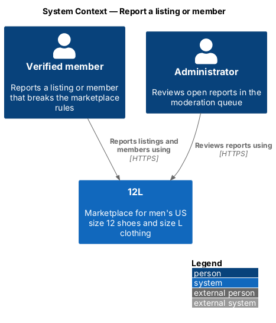
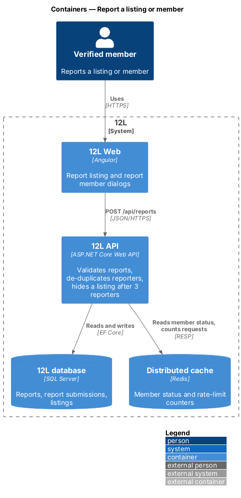
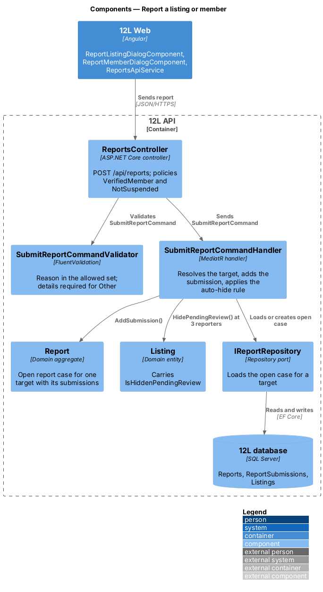
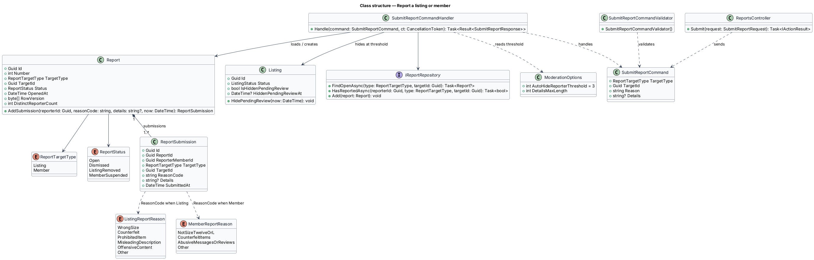
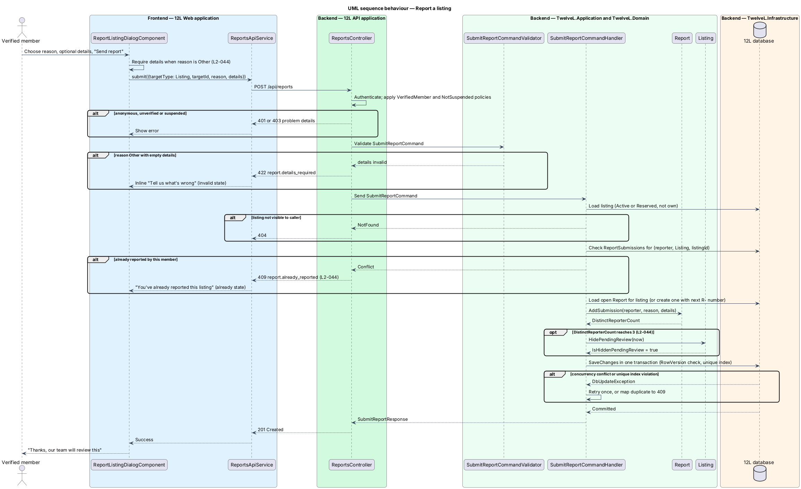
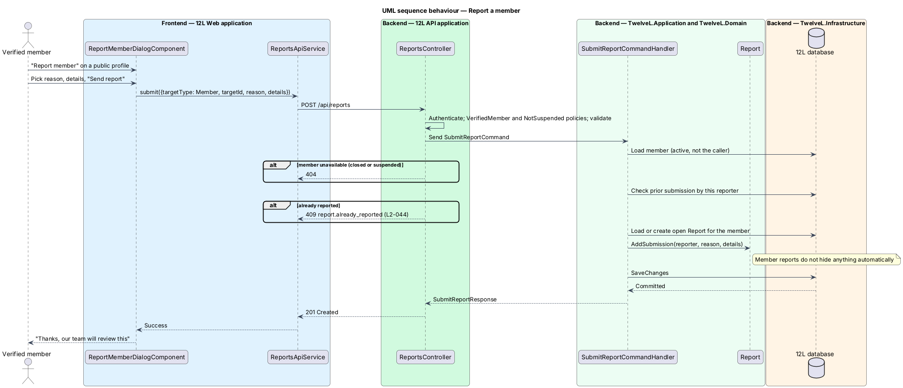

# Report a listing or member

## Overview

12L is a marketplace that sells only men's US size 12 shoes and men's size L clothing. Its value depends on every listing being the right size, genuine and honestly described. Members are the first line of defence: a member who sees a listing or another member breaking the marketplace rules reports it, and an administrator reviews the report in the moderation queue.

This feature covers the reporting side. A verified member reports a listing from the listing detail page, or reports a member from that member's public profile, by choosing a reason and optionally adding details. Each member may report the same listing or member once. When three different members report the same listing, the listing leaves the catalog until an administrator decides, so a clearly wrong item stops selling before anyone reviews it. The administrator side (queue, decisions) is the `moderate-reports` feature in this subsystem.

Terms used in this design:

- **report** — open case against one target (a listing or a member) that groups every member submission about that target until an administrator resolves it; shown to administrators as `R-<number>`, for example `R-3318`
- **report submission** — one member's reason and optional details for one target, counted once per reporter
- **target** — listing or member a report is about
- **verified member** — signed-in member whose email address is confirmed (`L2-002`) and whose account is not suspended (`L2-046`)
- **hidden pending review** — flag on a listing that keeps it out of the catalog while it keeps its listing status (`Active` or `Reserved`)
- **auto-hide threshold** — number of distinct reporters, 3, at which a reported listing becomes hidden pending review

## Description

The slice runs from two Angular dialogs through one API endpoint to the `Report` aggregate and the `Listing` entity. It introduces the `Reports` and `ReportSubmissions` tables used by the rest of the subsystem.

### Frontend (12L Web, `src/frontend/src/app/moderation/`)

- **`ReportListingDialogComponent`** — standalone dialog opened by the "Report this listing" link on the listing detail page (`docs/mocks/dialogs/report-listing/`). Title "Report this listing", description line with the listing title and seller handle. A radio group *Reason* offers "Wrong size", "Counterfeit", "Prohibited item", "Misleading description", "Offensive content" and "Other". A *Details* textarea is optional unless "Other" is chosen. States:
  - `default` — "Wrong size" preselected in the mock; buttons "Cancel" and "Send report".
  - `invalid` — "Other" without details; inline error "Tell us what’s wrong", focus moves to *Details*.
  - `busy` — "Send report" carries `aria-busy="true"` while the request is in flight.
  - `success` — dialog title becomes "Report sent", body "Thanks, our team will review this", single "Done" button with focus.
  - `already` — HTTP 409; alert "You’ve already reported this listing" with "We’ll take it from here." and a "Close" button.
- **`ReportMemberDialogComponent`** — standalone dialog opened by the "Report member" link on a public profile (`docs/mocks/dialogs/report-member/`). Title "Report <handle>", description "Our team reviews every report." Reasons: "Selling items that aren’t size 12 or L", "Counterfeit items", "Abusive messages or reviews", "Other". States `default`, `invalid` ("Tell us what happened"), `busy`, and `success` (status alert "Thanks, our team will review this" with a "Done" button). A 409 response reuses the `already` presentation with the text "You’ve already reported this member".
- **`ReportsApiService`** — typed HTTP client with `submit(request: SubmitReportRequest): Observable<SubmitReportResponse>`. It maps HTTP 409 to an `AlreadyReported` result and HTTP 422 field errors to form control errors. Other errors fall through to the shared problem-details handler in `core` (`L2-068`).
- **Entry points** — the listing detail page (catalog area) and the public profile page (reviews area) render the report link only for a signed-in member viewing someone else's listing or profile; the mocks omit it for guests, sold listings and the member's own listing. For an unverified or suspended member the link is not rendered; the account banner (`docs/mocks/notifications/account-banner/`) explains why.

### API (`TwelveL.Api`)

- **`ReportsController`** — `POST /api/reports`, body `SubmitReportRequest { targetType: "Listing" | "Member", targetId: Guid, reason: string, details: string? }`. Policies: `Authenticated`, `VerifiedMember`, `NotSuspended` (the `NotSuspended` requirement is defined by `suspend-member`). Responses:
  - `201 Created` with `{ reportNumber }`; the reporter UI does not display the number.
  - `401` anonymous caller; `403` unverified (`account.email_unverified`) or suspended (`account.suspended`) caller (`L2-010`).
  - `404` target missing, not visible to the caller, a draft, sold or removed listing, or a closed or suspended member.
  - `409 report.already_reported` when the caller has already reported this target (`L2-044`).
  - `422 report.details_required`, `report.reason_invalid`, `report.details_too_long`, or `report.own_target` (the caller's own listing or own profile).
  - `429` from the per-member rate limit of `L2-051`.

### Application and domain (`TwelveL.Application`, `TwelveL.Domain`)

- **`SubmitReportCommand`** — `TargetType`, `TargetId`, `Reason`, `Details`, and the caller's `MemberId` from the access token.
- **`SubmitReportCommandValidator`** — FluentValidation rules: `Reason` belongs to `ListingReportReason` for a listing and to `MemberReportReason` for a member; `Details` is required and non-whitespace when `Reason` is `Other`; `Details` length is at most `ModerationOptions.DetailsMaxLength` (`<TO SUPPLY>`; the mocks show no counter).
- **`SubmitReportCommandHandler`** — loads the target, refuses the caller's own target, checks for an earlier submission by the same reporter, loads the open `Report` for the target or creates one, adds the submission, applies the auto-hide rule, and saves in one transaction. On a `DbUpdateConcurrencyException` it reloads and retries once. A unique-index violation on `ReportSubmissions` maps to `409 report.already_reported`, which covers two concurrent submissions from the same reporter.
- **`Report`** (aggregate root) — `Id`, `Number` (from SQL sequence `ReportNumbers`, displayed as `R-<Number>`), `TargetType`, `TargetId`, `Status` (`Open`, `Dismissed`, `ListingRemoved`, `MemberSuspended`), `OpenedAt` (time of the first submission), `Submissions`, `RowVersion`. `AddSubmission(...)` accepts submissions only while `Open` and returns the new `DistinctReporterCount`. Transitions out of `Open` belong to `moderate-reports`.
- **`ReportSubmission`** — `ReporterMemberId`, `TargetType`, `TargetId` (copied for the uniqueness index), `ReasonCode`, `Details`, `SubmittedAt`. A submission is never edited.
- **`ListingReportReason`** — `WrongSize`, `Counterfeit`, `ProhibitedItem`, `MisleadingDescription`, `OffensiveContent`, `Other`.
- **`MemberReportReason`** — `NotSizeTwelveOrL`, `CounterfeitItems`, `AbusiveMessagesOrReviews`, `Other`.
- **`Listing.HidePendingReview(now)`** — sets `IsHiddenPendingReview = true` and `HiddenPendingReviewAt`. It leaves `Status` unchanged, so an in-flight checkout on a `Reserved` listing continues. The handler calls it when a listing report's distinct-reporter count reaches `ModerationOptions.AutoHideReporterThreshold` (3). Member reports never hide anything.
- **Catalog visibility rule** — the catalog, search and listing-detail queries (catalog subsystem) show a listing only when `Status` is `Active` or `Reserved`, `IsHiddenPendingReview` is false, and the seller is not suspended. A hidden listing's detail URL returns 404 to members other than its seller and administrators.
- **Domain event `ListingHiddenPendingReview`** — raised on hide; the catalog subsystem's handler evicts any cached catalog pages that hold the listing (cache keys owned by `catalog`).

### Infrastructure and data (`TwelveL.Infrastructure`)

- **`Reports` table** — `Id uniqueidentifier PK`, `Number int` (unique, default from sequence `ReportNumbers`), `TargetType tinyint`, `TargetId uniqueidentifier`, `Status tinyint`, `OpenedAt datetime2`, resolution columns added by `moderate-reports`, `RowVersion rowversion` (EF Core concurrency token). Indexes: filtered unique index `UX_Reports_OpenTarget` on (`TargetType`, `TargetId`) `WHERE Status = 0`, so each target has at most one open report; `IX_Reports_Open_OpenedAt` on (`OpenedAt`) `WHERE Status = 0` for the queue.
- **`ReportSubmissions` table** — `Id`, `ReportId` FK, `ReporterMemberId` FK to `Members`, `TargetType`, `TargetId`, `ReasonCode varchar(40)`, `Details nvarchar(n)`, `SubmittedAt`. Unique index `UX_ReportSubmissions_Reporter_Target` on (`ReporterMemberId`, `TargetType`, `TargetId`) enforces "once per member" in the database (`L2-044`).
- **`Listings` columns** — `IsHiddenPendingReview bit NOT NULL DEFAULT 0`, `HiddenPendingReviewAt datetime2 NULL`. The catalog index includes `IsHiddenPendingReview` (catalog subsystem).
- **`ReportRepository`** — EF Core implementation of `IReportRepository`.
- **`ModerationOptions`** — bound from configuration section `Moderation`: `AutoHideReporterThreshold = 3`, `DetailsMaxLength = <TO SUPPLY>`.
- No email is sent to the reporter or the reported member. Administrators see new reports in the queue; an alert email to administrators is not in `L2-042` and is not part of this design.

## Requirements

The feature realizes the following level-2 (L2) requirements. Each L2 requirement refines a level-1 (L1) requirement, cited by identifier.

| L2 ID | Refines (L1) | Requirement |
|-------|--------------|-------------|
| `L2-044` | `L1-012` | A verified member shall be able to report a listing or a member. Listing report reasons shall be: wrong size, counterfeit, prohibited item, misleading description, offensive content, or other (with details). A member shall be able to report the same listing or member once. |
| `L2-010` | `L1-002` | Every API endpoint shall check that the caller is allowed to act on the resource. A member shall only change their own profile and listings, and shall only see orders they are the buyer or seller of. Moderation endpoints shall require the Administrator role. Requests for resources the caller is not allowed to see shall return HTTP 404 so their existence is not revealed. |

## Diagrams

### System context

Verified members report listings and members to 12L, and administrators review those reports. No external system takes part in reporting.

### Containers

The 12L Web dialogs post to 12L API, which stores reports in the 12L database and reads the member's status from the distributed cache to apply the `NotSuspended` policy.

### Components

`ReportsController` validates the command and dispatches it to `SubmitReportCommandHandler`. The handler adds a submission to the target's open `Report` and hides the `Listing` at 3 distinct reporters.

### Class structure

A `Report` owns one or more `ReportSubmission` rows, one per reporter. The handler depends on `IReportRepository` and reads the auto-hide threshold from `ModerationOptions`.

### Behaviour — report a listing

The API refuses an anonymous, unverified or suspended caller, a missing "Other" detail (422) and a repeat report (409). On success, the third distinct reporter hides the listing in the same transaction (`L2-044`).

### Behaviour — report a member

A member report follows the same path with the member reasons. It never hides anything automatically.

