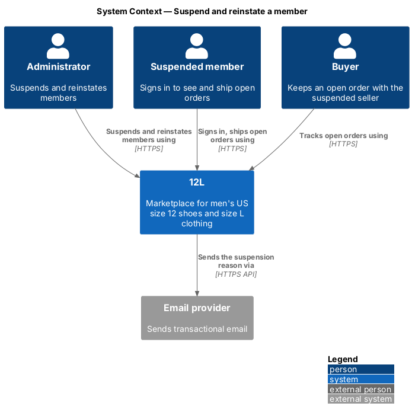
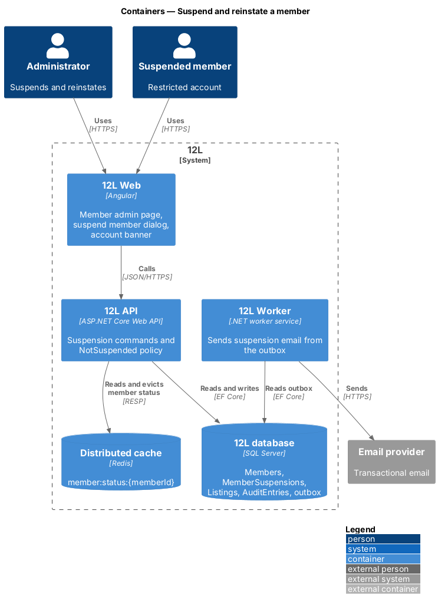
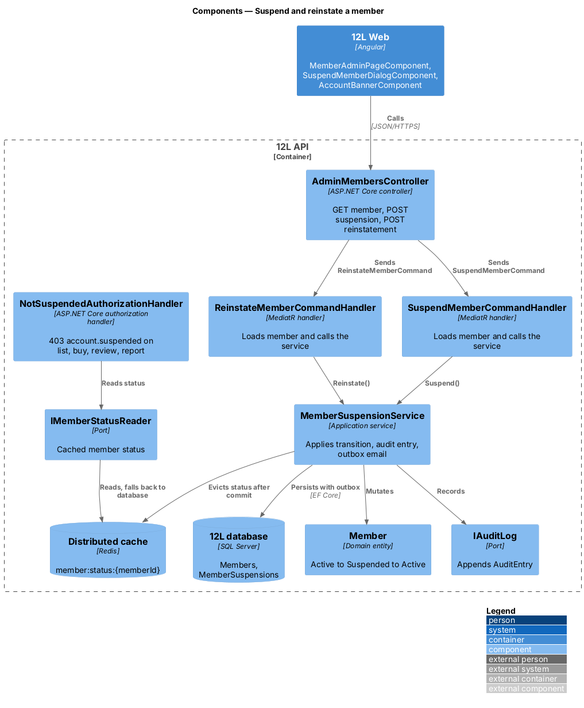
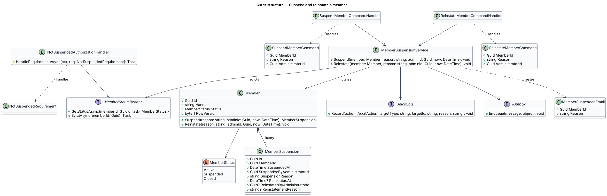
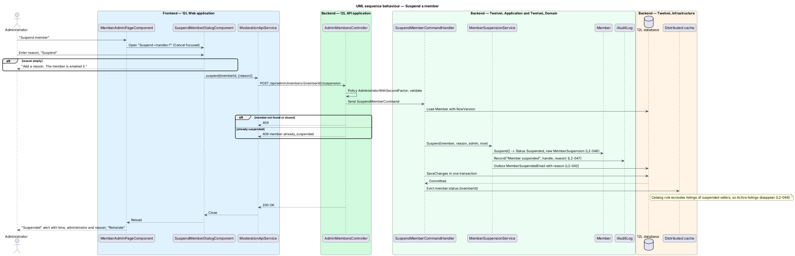
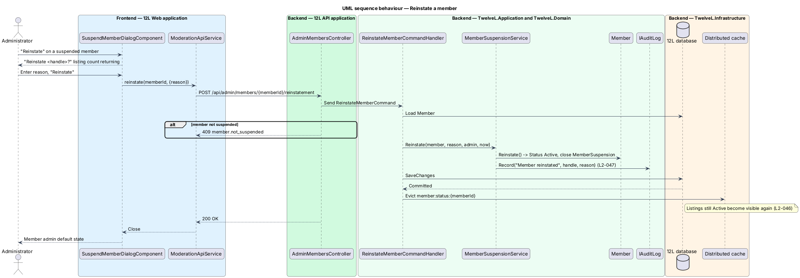
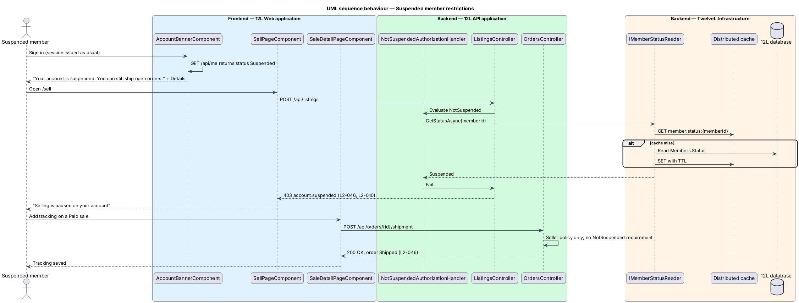

# Suspend and reinstate a member

## Overview

Some members break the 12L marketplace rules repeatedly, for example by listing items that are not men's US size 12 or men's size L, or by selling counterfeits. Removing their listings one at a time does not stop them. Suspension is the account-level response. An administrator suspends a member with a reason, and the member keeps limited access until an administrator reinstates them.

Suspension is designed so that third parties are not harmed. The member can still sign in, see their orders and ship their open sales, so a buyer who has already paid still receives the item. The member cannot list, buy, review or report, and their listings leave the catalog. Reinstatement reverses the restriction, and listings that were active return to the catalog.

An administrator reaches suspension in two ways. One is the member admin page (this feature). The other is the "Suspend member" decision on a report (`moderate-reports`), which reuses the same service.

Terms used in this design:

- **suspension** — period during which a member account is restricted by an administrator, with a start time, the administrator and a reason
- **reinstatement** — end of a suspension by an administrator, with a reason
- **member admin page** — administrator view of one member's summary, status and open cases
- **restricted action** — creating or publishing a listing, buying, leaving a review, or reporting; each is refused for a suspended member
- **open order** — order in status Paid, Shipped or Delivered (`L2-032`)

## Description

### Frontend (12L Web)

- **`MemberAdminPageComponent`** — route `/admin/members/:handle` in the `moderation` area, inside `AdminShellComponent` (`docs/mocks/pages/member-admin/`). Breadcrumb "Queue › <handle>". The profile head shows the avatar, handle, city and "member since". Stats show "Rating", "Sales", "Active listings" (listings visible in the catalog) and "Open reports". A "History" section lists the member's open reports and order problems, each with a status pill. States:
  - `default` — danger button "Suspend member".
  - `suspended` — danger status alert "Suspended", "Since <time> ET by <administrator>. Reason: <reason>."; note "Active listings are hidden while suspended. Open orders continue."; primary button "Reinstate"; "Active listings" shows 0.
  - `loading` — profile-head skeleton and 2 skeleton rows; `error` — "Couldn’t load this member" with Ref and "Try again".
- **`SuspendMemberDialogComponent`** — one dialog with two modes (`docs/mocks/dialogs/suspend-member/`).
  - Suspend mode: shield icon, title "Suspend <handle>?", body "Their <n> active listings are hidden. They can still sign in, see orders and ship open sales." A required *Reason* textarea carries the help text "Sent to the member and kept in the audit log." Buttons are "Cancel", which has the default focus, and danger "Suspend". The `invalid` state shows "Add a reason. The member is emailed it."; the `busy` state shows "Suspending" with `aria-busy`, a read-only reason and a disabled "Cancel".
  - Reinstate mode: title "Reinstate <handle>?", body "Their <n> listings return to the catalog and they can buy and sell again.", *Reason* textarea, buttons "Cancel" and "Reinstate".
- **`ModerationApiService`** (shared with `moderate-reports`) — `getMember(handle)`, `suspendMember(memberId, reason)`, `reinstateMember(memberId, reason)`.
- **Member-facing presentation** (owned by the shell and the accounts and listings areas, driven by this feature's status):
  - **`AccountBannerComponent`**, danger variant (`docs/mocks/notifications/account-banner/danger.html`) — non-dismissable banner on every page: "Your account is suspended. You can still ship open orders." with a "Details" link to `/account`.
  - Account page `suspended` state (`docs/mocks/pages/account/suspended.html`) — alert "Your account is suspended", "You can still ship and track open orders. We emailed you the reason.", link "Marketplace rules".
  - Sell page `suspended` state (`docs/mocks/pages/sell/suspended.html`) — "Selling is paused on your account", "You can still manage open orders.", buttons "View your sales" and "Marketplace rules".
  - Public profile `unavailable` state (`docs/mocks/pages/profile/`) — HTTP 404 "This member isn’t available" for a suspended member's profile.
  - `AuthStateService` (core) exposes a `memberStatus` signal from `GET /api/me`. It refreshes the signal when the access token is refreshed and when any response carries the error code `account.suspended`. Buy, review and report entry points read the signal and are not rendered while it is `Suspended`.

### API (`TwelveL.Api`)

- **`AdminMembersController`** — policy `AdministratorWithSecondFactor` on every action (`L2-010`, `L2-047`).
  - `GET /api/admin/members/{handle}` returns `200` with `MemberAdminDto`, or `404`. `MemberAdminDto` holds `memberId`, `handle`, `avatarUrl`, `city`, `memberSince`, `rating`, `salesCount`, `visibleListingCount`, `openReportCount`, `status`, `currentSuspension { since, administratorName, reason }` and `history[]` of open reports and problems.
  - `POST /api/admin/members/{memberId}/suspension` with body `{ reason }` returns `200` with `currentSuspension`. Errors: `404`; `409 member.already_suspended`; `422 suspension.reason_required`.
  - `POST /api/admin/members/{memberId}/reinstatement` with body `{ reason }` returns `200`. Errors: `404`; `409 member.not_suspended`; `422 suspension.reason_required`.
  - Whether an administrator may suspend another administrator or themselves is `<TO SUPPLY>`.
- **`NotSuspendedRequirement` and `NotSuspendedAuthorizationHandler`** — authorization requirement registered as the `NotSuspended` policy. It applies to every endpoint that creates or publishes a listing, edits a listing, starts checkout or pays, submits a review or reply, or submits a report. Those endpoints belong to the listings, orders, reviews and moderation designs. The handler reads the caller's status through `IMemberStatusReader`. A suspended caller receives `403` with error code `account.suspended` (`L2-046`, `L2-010`).
- **Endpoints left open to a suspended member** — sign-in, sign-out, `GET /api/me`, order history and order detail, adding tracking (`L2-033`), seller cancellation (`L2-035`), and responding to a problem (`L2-036`). They carry the ordinary member and resource policies only, so open orders continue (`L2-046` criterion 2).
- **Sessions** — suspension does not revoke sessions; the member signs in as usual (`L2-008`).

### Application and domain (`TwelveL.Application`, `TwelveL.Domain`)

- **`SuspendMemberCommand` / `SuspendMemberCommandValidator` / `SuspendMemberCommandHandler`** — the validator requires a non-whitespace reason with maximum length `<TO SUPPLY>`. The handler loads the member, calls `MemberSuspensionService.Suspend`, saves in one transaction and evicts the status cache after commit.
- **`ReinstateMemberCommand` / `ReinstateMemberCommandValidator` / `ReinstateMemberCommandHandler`** — same shape, calling `MemberSuspensionService.Reinstate`.
- **`MemberSuspensionService`** — application service shared with `ResolveReportCommandHandler`. On suspend it calls `Member.Suspend`, records audit action `MemberSuspended`, and enqueues `MemberSuspendedEmail { memberId, reason }`; the suspension email is listed in `L2-042`. On reinstate it calls `Member.Reinstate` and records audit action `MemberReinstated`. `L2-042` lists no reinstatement email; whether the reinstatement reason is emailed is `<TO SUPPLY>`.
- **`Member`** (accounts aggregate, extended here) — `Status` takes `Active`, `Suspended` or `Closed`. `Suspend(reason, adminId, now)` is allowed only from `Active`; it sets `Status = Suspended`, adds a `MemberSuspension` and raises `MemberSuspended`. `Reinstate(reason, adminId, now)` is allowed only from `Suspended`; it closes the open `MemberSuspension`, sets `Status = Active` and raises `MemberReinstated`. `RowVersion` is the concurrency token.
- **`MemberSuspension`** — history row per suspension period: `SuspendedAt`, `SuspendedByAdministratorId`, `SuspensionReason`, `ReinstatedAt`, `ReinstatedByAdministratorId`, `ReinstatementReason`.
- **Listing visibility** — listings are not modified on suspension. The catalog visibility rule (defined in `report-listing-or-member`) excludes listings whose seller has `Status = Suspended`. Active listings therefore disappear from the catalog in the same transaction (`L2-046` criterion 1) and return on reinstatement (criterion 4). Listings removed or sold during the suspension stay as they are. A `Reserved` listing keeps its checkout running so the buyer is not harmed. The domain events `MemberSuspended` and `MemberReinstated` let the catalog subsystem evict cached catalog pages.

### Infrastructure and data (`TwelveL.Infrastructure`)

- **`Members` table** — `Status tinyint NOT NULL` (existing accounts column, gains the `Suspended` value), `RowVersion rowversion`.
- **`MemberSuspensions` table** — `Id`, `MemberId` FK, `SuspendedAt`, `SuspendedByAdministratorId`, `SuspensionReason nvarchar(n)`, `ReinstatedAt NULL`, `ReinstatedByAdministratorId NULL`, `ReinstatementReason NULL`. A filtered unique index `UX_MemberSuspensions_Open` on (`MemberId`) `WHERE ReinstatedAt IS NULL` allows at most one open suspension.
- **`RedisMemberStatusReader`** — implements `IMemberStatusReader` with cache key `member:status:{memberId}`. TTL is 5 minutes. The reader falls back to `Members.Status` on a miss and on a cache outage. The suspend and reinstate handlers evict the key after commit, so the change applies to the next request on every API instance (`L2-060`).
- **Outbox** — `MemberSuspendedEmail`, dispatched by `12L Worker` with retry and back-off (`L2-042`); the template belongs to the notifications subsystem.

## Requirements

The feature realizes the following level-2 (L2) requirements. Each L2 requirement refines a level-1 (L1) requirement, cited by identifier.

| L2 ID | Refines (L1) | Requirement |
|-------|--------------|-------------|
| `L2-046` | `L1-012` | An administrator shall be able to suspend and reinstate a member. A suspended member shall be able to sign in to see their orders but shall not be able to list, buy, review or report, and their Active listings shall be hidden. Their open orders shall continue so buyers are not harmed. |
| `L2-010` | `L1-002` | Every API endpoint shall check that the caller is allowed to act on the resource. A member shall only change their own profile and listings, and shall only see orders they are the buyer or seller of. Moderation endpoints shall require the Administrator role. Requests for resources the caller is not allowed to see shall return HTTP 404 so their existence is not revealed. |

## Diagrams

### System context

The administrator suspends and reinstates members in 12L, and 12L emails the suspended member the reason. The suspended member and their buyers keep using 12L for open orders.

### Containers

12L API stores the suspension in the 12L database and evicts the cached member status in Redis. 12L Worker sends the suspension email from the outbox.

### Components

Both command handlers delegate to `MemberSuspensionService`, which mutates `Member`, records the audit entry and queues the email. `NotSuspendedAuthorizationHandler` enforces the restriction on other subsystems' endpoints through `IMemberStatusReader`.

### Class structure

`Member` owns its `MemberSuspension` history. The service depends on the audit, outbox and status-reader ports.

### Behaviour — suspend a member

The administrator confirms with a reason. The API applies the transition, audit entry and outbox email in one transaction, then evicts the status cache (`L2-046`).

### Behaviour — reinstate a member

Reinstatement closes the suspension period and returns still-Active listings to the catalog (`L2-046` criterion 4).

### Behaviour — suspended member restrictions

A suspended member sees the account banner. Creating a listing returns HTTP 403 `account.suspended`, while adding tracking to a Paid sale still succeeds (`L2-046` criteria 2 and 3).

