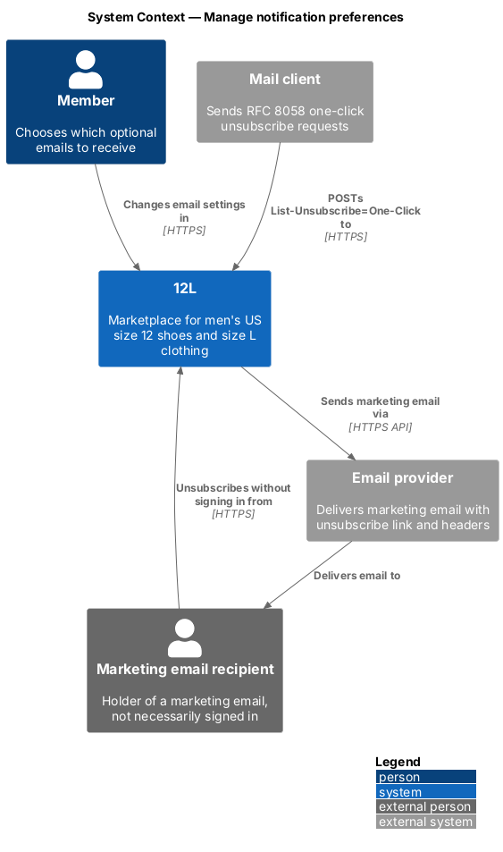
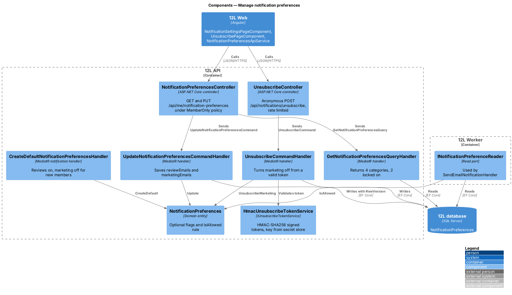
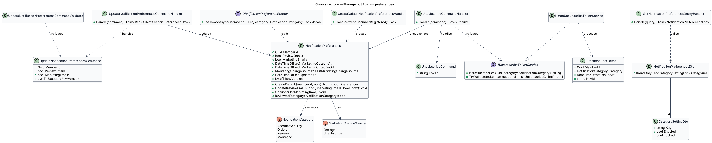
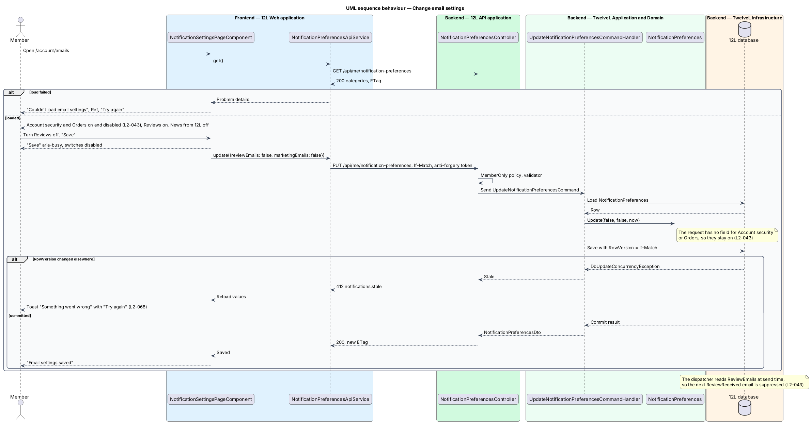
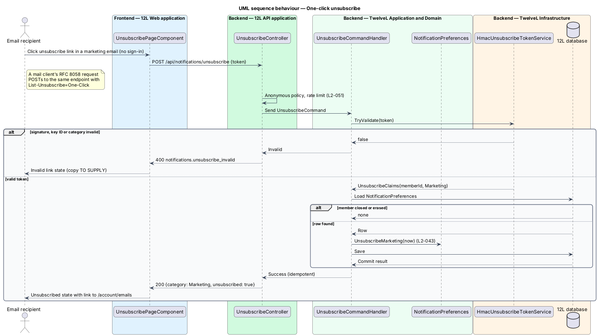

# Manage notification preferences

## Overview

12L sends email about events that affect a member's account, listings and orders (see
[send-email-notifications](../send-email-notifications/README.md)). Some of those emails
are essential, and some are optional. This feature lets a member choose which optional
emails they receive. It also lets anyone holding a marketing email leave the marketing
list in one click, without signing in (`L2-043`).

Terms used throughout:

- **notification category** — group of email types that shares one setting: Account security, Orders, Reviews or Marketing
- **always-on category** — category that cannot be turned off: Account security and Orders
- **optional category** — category the member can turn off: Reviews, which is on by default, and Marketing, which is off by default
- **opt-in** — member's explicit choice to turn marketing email on
- **unsubscribe token** — signed, opaque value in a marketing email that identifies the member and the Marketing category without a session
- **one-click unsubscribe** — removal from marketing email by following the link in the email, or by the mail client's RFC 8058 `List-Unsubscribe-Post` request, with no sign-in

The settings page appears in the account area under the navigation label "Emails". Its
route is `/account/emails`. The dispatcher in
[send-email-notifications](../send-email-notifications/README.md) reads the stored
preferences at send time, so a change applies to every email not yet sent.

## Description

The slice runs from the "Emails" page and the unsubscribe page of `12L Web`, through
`12L API`, to the `NotificationPreferences` table in `12L database`. Screens, states and
copy come from `docs/mocks/pages/notification-settings/` (states *default*, *loading*,
*error*, *submitting* and *success*). The unsubscribe page and the marketing emails are not
mocked (`docs/mocks/README.md`), so their copy is `<TO SUPPLY>`.

### Frontend (`src/frontend/src/app/accounts/notification-settings/`)

The page sits in the `accounts` feature area, because it renders inside the account shell
next to "Profile" and "Settings". It requires a signed-in member; a guest is sent to
`/sign-in` with a return URL.

- **Route** `account/emails` → **`NotificationSettingsPageComponent`** — heading "Emails"
  with the lead "Security and order emails are always on." A form holds a settings list of
  4 rows. Each row has a title, a description and a switch (`role="switch"`):

  | Row | Description | Switch |
  |-----|-------------|--------|
  | Account security | Sign-in alerts, password resets | on, disabled, labelled "Account security emails, always on" |
  | Orders | Sales, shipping, delivery, refunds | on, disabled, labelled "Order emails, always on" |
  | Reviews | When someone reviews you | bound to `reviewEmails`, labelled "Review emails" |
  | News from 12L | New arrivals in your size, now and then | bound to `marketingEmails`, labelled "Marketing emails" |

  A primary "Save" button submits the form. States:
  - *loading* — 4 skeleton rows.
  - *default* — values from the API.
  - *submitting* — "Save" carries `aria-busy="true"` and both optional switches are
    disabled.
  - *success* — status alert "Email settings saved" above the list, announced through
    `role="status"`.
  - *error* — compact error state "Couldn’t load email settings" with "Something went
    wrong on our side.", the reference "Ref {correlationId}" and a "Try again" button
    (`L2-068`).
  - *save failed* — not mocked. The shared error toast shows "Something went wrong" with
    "Try again" and the correlation ID (`L2-068`), and the switches keep the member's
    unsaved choice.
- **`NotificationPreferencesApiService`** — typed `HttpClient` wrapper with `get()` and
  `update(request)`. It sends the `ETag` it received as `If-Match`.
- **Route** `emails/unsubscribe` → **`UnsubscribePageComponent`** — public page, no sign-in.
  On load it reads `token` from the query string and calls
  `POST /api/notifications/unsubscribe` once. The call runs from script on page load
  because mail scanners prefetch links with `GET`; a `GET` alone never changes state.
  States, all with copy `<TO SUPPLY>`:
  - *working*.
  - *unsubscribed* — includes a link to `/account/emails` to opt back in after signing in.
  - *invalid link*.
  - *error* — includes "Try again".

### API (`TwelveL.Api`)

`NotificationPreferencesController` handles the signed-in endpoints and
`UnsubscribeController` handles the anonymous one. Errors are RFC 9457 problem details
with a correlation ID (`L2-068`).

| Verb and path | Policy | Purpose | Responses |
|---------------|--------|---------|-----------|
| `GET /api/me/notification-preferences` | `MemberOnly` | Read the 4 categories | 200 `NotificationPreferencesDto` with `ETag`; 401 |
| `PUT /api/me/notification-preferences` | `MemberOnly`, anti-forgery (`L2-050`) | Save the two optional settings | 200 `NotificationPreferencesDto`; 400 `notifications.invalid`; 401; 412 `notifications.stale` when `If-Match` is out of date |
| `POST /api/notifications/unsubscribe` | anonymous, rate limited (`L2-051`) | One-click marketing unsubscribe, from the page or a mail client's RFC 8058 POST | 200 `{ "category": "Marketing", "unsubscribed": true }`; 400 `notifications.unsubscribe_invalid` |

- `NotificationPreferencesDto` lists the 4 categories as
  `{ key, enabled, locked }`. `accountSecurity` and `orders` always carry
  `enabled: true, locked: true` (`L2-043`).
- `UpdateNotificationPreferencesRequest` carries only `reviewEmails` and
  `marketingEmails`. The contract has no field for the always-on categories, so no request
  can turn them off.
- The unsubscribe endpoint accepts the token in the query string
  (`?token=…`, for RFC 8058 clients) or in a JSON body. It is exempt from anti-forgery
  because it uses no cookie authentication. It always answers 200 for a valid token, even
  when the member was already unsubscribed, so the call is idempotent. The response never
  names the member or the email address.

### Application and domain (`TwelveL.Application`, `TwelveL.Domain`)

- **`NotificationPreferences`** (entity, one per member):
  - Fields: `Guid MemberId`, `bool ReviewEmails`, `bool MarketingEmails`,
    `DateTimeOffset? MarketingOptedInAt`, `DateTimeOffset? MarketingOptedOutAt`,
    `MarketingChangeSource? LastMarketingChangeSource` (`Settings`, `Unsubscribe`),
    `DateTimeOffset UpdatedAt`, `byte[] RowVersion`.
  - `CreateDefault(memberId, now)` sets `ReviewEmails = true` (mock *default*) and
    `MarketingEmails = false` (`L2-043`).
  - `Update(reviewEmails, marketingEmails, now)` records the opt-in or opt-out time
    when marketing changes.
  - `UnsubscribeMarketing(now)` sets `MarketingEmails = false` and the source
    `Unsubscribe`.
  - `IsAllowed(NotificationCategory)` returns `true` for `AccountSecurity` and `Orders`
    always, and returns the stored flag for `Reviews` and `Marketing`.
- **`CreateDefaultNotificationPreferencesHandler`** — handles `MemberRegistered` from
  `accounts`. It inserts the default row in the registration transaction, so a new member
  starts with marketing off (`L2-043`).
- **`GetNotificationPreferencesQuery`** and its handler — return the DTO for the calling
  member. When the row is missing, the handler returns the defaults.
- **`UpdateNotificationPreferencesCommand`** (`MemberId`, `ReviewEmails`,
  `MarketingEmails`, `ExpectedRowVersion`), **`UpdateNotificationPreferencesCommandValidator`**
  (both values required booleans) and **`UpdateNotificationPreferencesCommandHandler`** —
  load the row, check the row version, call `Update` and save.
- **`UnsubscribeCommand`** (`Token`) and **`UnsubscribeCommandHandler`** — validate the
  token through `IUnsubscribeTokenService`, load the member's preferences, call
  `UnsubscribeMarketing` and save. A token for a closed or erased member returns success
  and changes nothing.
- **`INotificationPreferenceReader`** — read port used by the email dispatcher. It loads
  the row and calls `IsAllowed`. A missing row is treated as the defaults.
- **`IUnsubscribeTokenService`** / **`HmacUnsubscribeTokenService`** — issues and
  validates tokens.
  - A token is the base64url form of `memberId | category | issuedAt` plus an
    HMAC-SHA256 signature.
  - The signing key `Notifications:UnsubscribeSigningKey` lives in the secret store
    (`L2-052`). It supports key rotation through a key ID.
  - Comparison runs in constant time.
  - The token holds no email address. Token lifetime is `<TO SUPPLY>`; until it is
    decided, tokens do not expire, so an old marketing email still unsubscribes.
- **Marketing email integration.** The template layout in
  [send-email-notifications](../send-email-notifications/README.md) calls
  `IUnsubscribeTokenService.Issue(memberId, Marketing)`. It renders the unsubscribe
  link `{App:PublicBaseUrl}/emails/unsubscribe?token=…` in the footer of every
  `Marketing` email. It also sets the `List-Unsubscribe` header to the API URL, with
  `List-Unsubscribe-Post: List-Unsubscribe=One-Click` (`L2-043`). How marketing
  campaigns are authored and scheduled is `<TO SUPPLY>`.

### Infrastructure and data (`TwelveL.Infrastructure`)

- Table **`NotificationPreferences`**:
  - Primary key `MemberId`, also a foreign key to `Members` with cascade delete.
  - `ReviewEmails bit NOT NULL DEFAULT 1` and `MarketingEmails bit NOT NULL DEFAULT 0`.
  - The two marketing timestamps, `LastMarketingChangeSource tinyint NULL` and
    `UpdatedAt`.
  - `RowVersion rowversion` as the concurrency token. The API exposes it as the `ETag`.
- The data export (`L2-055`) includes this row as "notification settings".
- Erasure of a closed account (`L2-005`) deletes the row with the member.

### Configuration

| Setting | Value | Source |
|---------|-------|--------|
| `Notifications:UnsubscribeSigningKey` | secret store | `L2-052` |
| `Notifications:UnsubscribeTokenLifetime` | `<TO SUPPLY>` | |
| Unsubscribe rate limit | 120 per minute per IP (anonymous) | `L2-051` |

## Requirements

The feature realizes the following level-2 (L2) requirement. It refines a level-1 (L1)
requirement, cited by identifier.

| L2 ID | Refines (L1) | Requirement |
|-------|--------------|-------------|
| `L2-043` | `L1-011` | Account security and order emails shall always be sent. Members shall be able to turn off review and marketing emails. Marketing emails shall be off until the member opts in, and every marketing email shall include a one-click unsubscribe link. |

## Diagrams

### System context

Members change email settings in 12L. A recipient of a marketing email can unsubscribe
from the link, or the mail client can send the RFC 8058 one-click request, with no
sign-in. Marketing emails reach the member through the email provider.

### Containers

`12L Web` hosts the settings page and the unsubscribe page, and `12L API` stores the
preferences. `12L Worker` reads them before each send.

### Components

Two controllers send commands that mutate the `NotificationPreferences` entity. The
unsubscribe path validates a signed token instead of a session, and the dispatcher reads
the entity through `INotificationPreferenceReader`.

### Class structure

`NotificationPreferences` owns the two optional flags and the always-on rule in
`IsAllowed`. `HmacUnsubscribeTokenService` issues and validates unsubscribe tokens.

### Behaviour — change email settings

The member turns review emails off and saves. Account security and order emails stay
locked on, because the request has no field for them (`L2-043`).

### Behaviour — one-click unsubscribe

The unsubscribe page posts the token from the email link. A valid token turns marketing
off without a session, and a tampered or unknown token is refused (`L2-043`).

