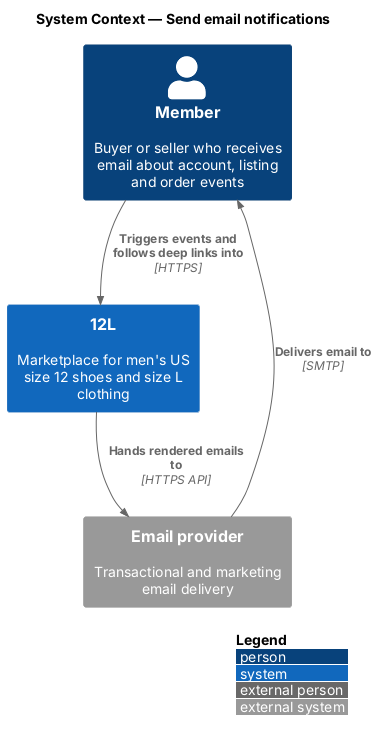
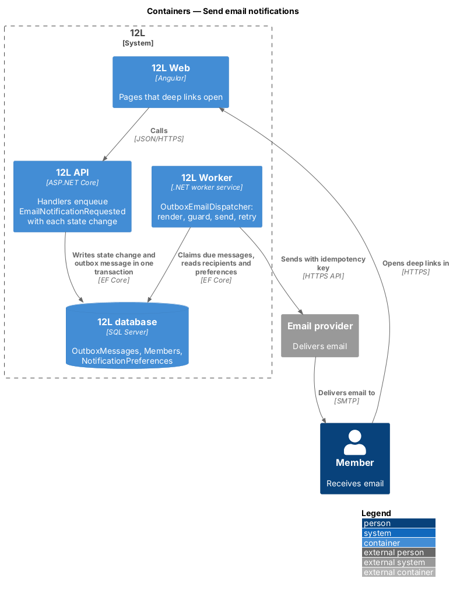
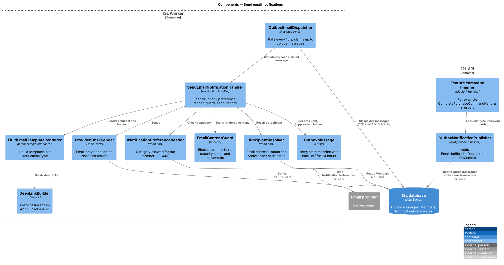
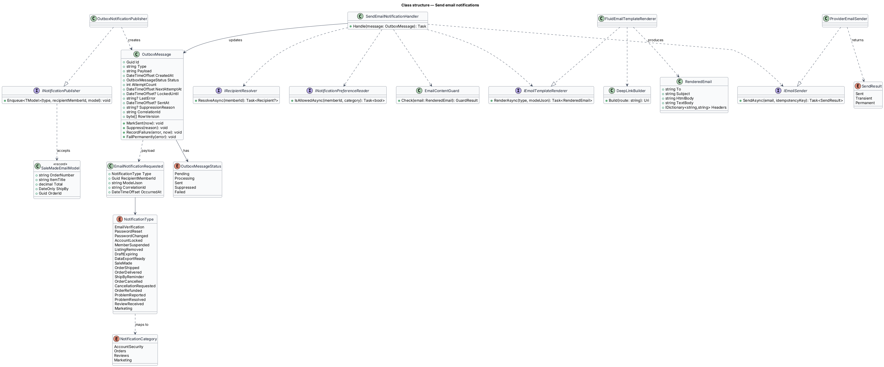
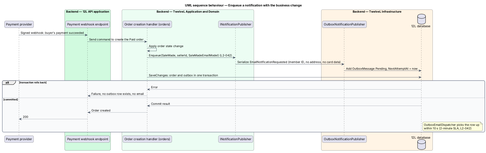
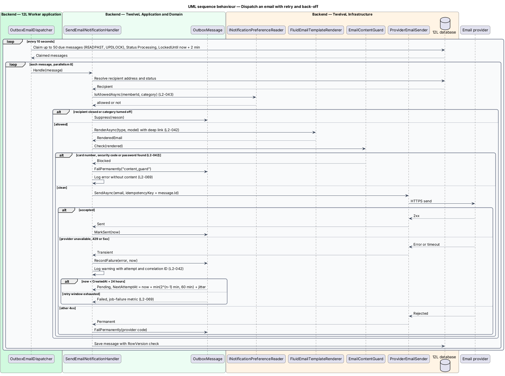

# Send email notifications

## Overview

12L tells members by email about events that affect their account, their listings and
their orders (`L1-011`). Email is the only notification channel. There is no in-app
notification centre (see the open questions in `docs/mocks/README.md`). In-app feedback
uses toasts and banners, which each feature designs for itself.

This feature is the shared mechanism that every other feature uses to send an email. A
feature never calls the email provider directly. Instead, its handler records an
*email notification request* in the *outbox*, in the same database transaction as the
state change. A background dispatcher in `12L Worker` then renders the email from a
*template* and hands it to the external email provider. The dispatcher retries failures
with back-off for up to 24 hours (`L2-042`).

Terms used throughout:

- **notification type** — named kind of email, such as `SaleMade` or `ReviewReceived`, each with its own template, category and deep link
- **notification category** — group of notification types that shares one preference: Account security, Orders, Reviews or Marketing (`L2-043`)
- **outbox** — `OutboxMessages` table that holds messages written in the same transaction as the business change that caused them, so an email is never lost or sent for a change that rolled back
- **email notification request** — outbox message of type `EmailNotificationRequested` that names the notification type, the recipient member and the template data
- **template** — subject, HTML body and plain-text body for one notification type, filled from a typed model
- **deep link** — absolute URL in an email that opens the related page in 12L (`L2-042`)
- **dispatch** — one attempt by the worker to render and send one outbox message
- **delivery SLA** — upper bound of 2 minutes between the event and the email being handed to the provider (`L2-042`)

The design makes three guarantees:

1. An email is sent at least once for every committed event. Because the provider receives
   an idempotency key, the member receives the email once.
2. Email content never carries a password, a full card number or a security code.
3. Each email links back to the page it is about.

## Description

The slice has no screen of its own; emails are not mocked (`docs/mocks/README.md`). Final
email copy is `<TO SUPPLY>`. The subject "You made a sale" for `SaleMade` comes from
`L2-042`. The only user-facing UI this feature touches is the "Emails" settings page,
designed in
[manage-notification-preferences](../manage-notification-preferences/README.md).

### Notification types and categories

`NotificationType` (enumeration in `TwelveL.Domain`) lists each email that `L2-042` and
the related L2 requirements name. Each type maps to exactly one `NotificationCategory`.
Only the Reviews and Marketing categories honour a member's opt-out (`L2-043`); the other
two are always sent.

| `NotificationType` | Recipient | Category | Source | Deep link |
|--------------------|-----------|----------|--------|-----------|
| `EmailVerification` | new member | AccountSecurity | `L2-002` | `/verify?token=…` |
| `PasswordReset` | member | AccountSecurity | `L2-009` | `/reset-password?token=…` |
| `PasswordChanged` | member | AccountSecurity | `L2-009` | `/account/settings` |
| `AccountLocked` | member | AccountSecurity | `L2-007` | `/forgot-password` |
| `MemberSuspended` | member | AccountSecurity | `L2-046` | `/account` |
| `ListingRemoved` | seller | AccountSecurity | `L2-045` | `/account/listings` |
| `DraftExpiring` | seller | AccountSecurity | `L2-019` | `/account/listings` |
| `DataExportReady` | member | AccountSecurity | `L2-055` | download link |
| `SaleMade` | seller | Orders | `L2-042` | `/sales/{orderId}` |
| `OrderShipped` | buyer | Orders | `L2-033` | `/orders/{orderId}` |
| `OrderDelivered` | buyer | Orders | `L2-042` | `/orders/{orderId}` |
| `ShipByReminder` | seller | Orders | `L2-042` | `/sales/{orderId}` |
| `OrderCancelled` | buyer or seller | Orders | `L2-035`, `L2-033` | `/orders/{orderId}` or `/sales/{orderId}` |
| `CancellationRequested` | seller | Orders | `L2-035` | `/sales/{orderId}` |
| `OrderRefunded` | buyer | Orders | `L2-042` | `/orders/{orderId}` |
| `ProblemReported` | seller | Orders | `L2-036` | `/sales/{orderId}` |
| `ProblemResolved` | buyer and seller | Orders | `L2-036` | `/orders/{orderId}` or `/sales/{orderId}` |
| `ReviewReceived` | reviewed member | Reviews | `L2-042` | `/members/{displayName}` |
| `Marketing` | opted-in member | Marketing | `L2-043` | per campaign, `<TO SUPPLY>` |

`ListingRemoved`, `DraftExpiring` and `DataExportReady` fall under AccountSecurity because
`L2-043` permits turning off only review and marketing email. Administrator alerts for a
reported problem (`L2-036`) go to an operations address, `Notifications:ModerationInbox`,
whose value is `<TO SUPPLY>`. The ship-by reminder schedule belongs to `orders`.

### Producing a notification (`TwelveL.Application`)

- **`INotificationPublisher`** — application port with one method:
  `Enqueue<TModel>(NotificationType type, Guid recipientMemberId, TModel model)`.
  `TModel` is a closed record per type, for example `SaleMadeEmailModel(OrderNumber,
  ItemTitle, Total, ShipBy, OrderId)`. Handlers in every subsystem call it before
  `SaveChangesAsync`.
- **`OutboxNotificationPublisher`** (in `TwelveL.Infrastructure`) — implements the port. It
  serializes an `EmailNotificationRequested` payload (`NotificationType`,
  `RecipientMemberId`, `ModelJson`, `CorrelationId`, `OccurredAt`) and adds an
  `OutboxMessage` to the current `TwelveLDbContext`. The message commits or rolls back with
  the business change.
- **Template models carry no secrets.** No model type has a property for a password, a
  card number or a security code. Card details appear only as brand and last 4 digits,
  for example `Visa ending 4242` (`L2-042`). Single-use tokens appear only inside the
  verification and reset URLs that `L2-002` and `L2-009` require.
- **Recipient addresses are resolved at dispatch**, not at enqueue. The payload stores the
  member ID only, so the outbox holds no email addresses. A closed or erased member
  (`L2-005`) therefore receives nothing.

### Dispatching (`TwelveL.Worker`, `TwelveL.Infrastructure`)

- **`OutboxEmailDispatcher`** — hosted service. Every `Notifications:Outbox:PollInterval`
  (10 seconds) it claims up to `Notifications:Outbox:BatchSize` (50) due messages. It
  claims them with one `UPDATE … OUTPUT` statement that uses `READPAST` and `UPDLOCK`
  hints, sets `Status = Processing` and `LockedUntil = now + 2 minutes`, and so lets
  any number of worker instances share the work without sending a message twice. It dispatches
  claimed messages with a parallelism of `Notifications:Outbox:Parallelism` (8).
  The 10-second poll leaves most of the 2-minute delivery SLA for rendering, the provider
  call and one quick retry.
- **`SendEmailNotificationHandler`** — handles one claimed message:
  1. Loads the recipient through `IRecipientResolver`, which returns the email address,
     the display name, the status and the `NotificationPreferences`.
  2. Marks the message `Suppressed` with reason `recipient_unavailable` when the member is
     closed or erased.
  3. Calls `INotificationPreferenceReader.IsAllowed(memberId, category)` (owned by
     [manage-notification-preferences](../manage-notification-preferences/README.md)) and
     marks the message `Suppressed` with reason `opted_out` when the category is turned
     off (`L2-043`).
  4. Renders the template through `IEmailTemplateRenderer`.
  5. Runs `EmailContentGuard` over the rendered subject and bodies.
  6. Sends through `IEmailSender` with the idempotency key `OutboxMessage.Id`.
  7. Records the outcome.
- **`IEmailTemplateRenderer`** / **`FluidEmailTemplateRenderer`** — renders embedded
  resources `Templates/{NotificationType}.subject.liquid`, `.html.liquid` and
  `.txt.liquid` with the Fluid (Liquid) engine. HTML encoding is on by default. A shared
  layout adds the 12L logo, the footer and the link to `/account/emails`. Marketing
  templates also include the one-click unsubscribe link from
  [manage-notification-preferences](../manage-notification-preferences/README.md).
- **`DeepLinkBuilder`** — builds absolute links from `App:PublicBaseUrl` plus the route in
  the table above, for example `https://{host}/sales/{orderId}` (`L2-042`). Every
  template uses it; a template test fails when a type renders without a link to 12L.
- **`EmailContentGuard`** — scans the rendered content for a 13- to 19-digit sequence
  that passes the Luhn check and for the keywords `password:` and `CVV`/`CVC` followed by
  digits. A hit fails the message permanently, without sending it, and logs an error
  with the notification type and correlation ID but not the content (`L2-042`, `L2-069`).
- **`IEmailSender`** / **`ProviderEmailSender`** — adapter for the external `Email
  provider` (provider `<TO SUPPLY>`). It sends from `Notifications:FromAddress`
  (`<TO SUPPLY>`) over the provider's HTTPS API, with the API key read from the secret
  store (`L2-052`). Marketing sends add `List-Unsubscribe` and
  `List-Unsubscribe-Post: List-Unsubscribe=One-Click` headers. The adapter classifies
  the result:
  - *Sent* — the provider accepted the message.
  - *Transient* — timeout, HTTP 429 or HTTP 5xx.
  - *Permanent* — any other HTTP 4xx, such as a rejected address.

### Retry with back-off (`L2-042`)

`OutboxMessage.RecordFailure(error, now)` increments `AttemptCount` and sets
`NextAttemptAt` to `now + min(2^(AttemptCount − 1) minutes, 60 minutes)`, plus random
jitter of up to 20 percent. The resulting schedule is 1, 2, 4, 8, 16, 32 and then every
60 minutes. Once `now` passes `CreatedAt + Notifications:Outbox:RetryWindow` (24 hours),
the message becomes `Failed`. A *Permanent* result fails the message at once.

Each failure is logged as a warning with `OutboxMessageId`, `NotificationType`,
`AttemptCount`, the provider status and the correlation ID. A final failure is logged as
an error and increments the job-failure metric (`L2-069`). The recipient address and the
content are never logged.

### State machine

`OutboxMessageStatus`:

- `Pending` → `Processing` (claimed).
- `Processing` → `Sent`, `Suppressed`, or back to `Pending` with a later `NextAttemptAt`
  (transient failure).
- `Processing` → `Failed` (permanent failure, guard hit, or retry window exhausted).

A `Processing` message whose `LockedUntil` has passed is claimable again, which recovers
messages from a crashed worker. `Sent`, `Suppressed` and `Failed` are terminal.

### Data (`TwelveL.Infrastructure`)

- Table **`OutboxMessages`** (shared outbox from the architecture baseline; this feature
  defines the email message type and its dispatcher). Columns:
  - `Id uniqueidentifier` primary key.
  - `Type nvarchar(100)`, for example `EmailNotificationRequested`.
  - `Payload nvarchar(max)` JSON.
  - `CreatedAt datetimeoffset`.
  - `Status tinyint`.
  - `AttemptCount int`.
  - `NextAttemptAt datetimeoffset`.
  - `LockedUntil datetimeoffset NULL`.
  - `LastError nvarchar(1000) NULL`, provider status and code only.
  - `SentAt datetimeoffset NULL`.
  - `SuppressionReason nvarchar(50) NULL`.
  - `CorrelationId nvarchar(64)`.
  - `RowVersion rowversion`.
- Index **`IX_OutboxMessages_Due`** on (`Status`, `NextAttemptAt`), filtered to
  `Status IN (Pending, Processing)`.
- **`OutboxRetentionJob`** deletes `Sent` and `Suppressed` rows after
  `Notifications:Outbox:RetentionDays` (`<TO SUPPLY>`). It keeps `Failed` rows for the same
  period for investigation.

### Observability (`L2-069`)

The dispatcher emits these metrics:

- `twelvel_email_sent_total{type}`
- `twelvel_email_failed_total{type,final}`
- `twelvel_email_suppressed_total{type,reason}`
- `twelvel_email_dispatch_delay_seconds`, the time from `CreatedAt` to `SentAt`.

An alert on the 95th percentile of dispatch delay above 120 seconds is recommended; its
threshold and channel are `<TO SUPPLY>`. Each log entry carries the correlation ID of the
request that enqueued the message.

### Configuration

| Setting | Value | Source |
|---------|-------|--------|
| `Notifications:Outbox:PollInterval` | 10 seconds | design, sized for the 2-minute SLA |
| `Notifications:Outbox:BatchSize` | 50 | design |
| `Notifications:Outbox:Parallelism` | 8 | design |
| `Notifications:Outbox:RetryWindow` | 24 hours | `L2-042` |
| `Notifications:Outbox:MaxBackoff` | 60 minutes | design |
| `Notifications:Outbox:RetentionDays` | `<TO SUPPLY>` | |
| `Notifications:FromAddress` | `<TO SUPPLY>` | |
| `Notifications:ModerationInbox` | `<TO SUPPLY>` | |
| `App:PublicBaseUrl` | `<TO SUPPLY>` | hosting |
| Email provider API key | secret store | `L2-052` |

## Requirements

The feature realizes the following level-2 (L2) requirement. It refines a level-1 (L1)
requirement, cited by identifier.

| L2 ID | Refines (L1) | Requirement |
|-------|--------------|-------------|
| `L2-042` | `L1-011` | The system shall send email for: email verification, password reset, account lockout, a new sale (to the seller), shipping with tracking (to the buyer), delivery, cancellation, refund, ship-by reminders, problem reported and resolved, review received, listing removed by an administrator, and suspension. Emails shall be sent within 2 minutes of the event and shall not contain passwords or full card details. |

## Diagrams

### System context

Members receive email from 12L through the external email provider. Each email links
back to the related page in 12L.

### Containers

`12L API` writes outbox messages in `12L database` in the same transaction as each
business change. `12L Worker` claims and sends them through the email provider.

### Components

A handler in any subsystem calls `INotificationPublisher`. In `12L Worker`,
`OutboxEmailDispatcher` claims messages. `SendEmailNotificationHandler` then checks
preferences, renders, guards and sends each one.

### Class structure

`OutboxMessage` owns the retry state machine. `SendEmailNotificationHandler` uses one
port each for the recipient, preferences, templates, the content guard and the provider.

### Behaviour — enqueue a notification with the business change

The purchase handler and the outbox write commit together, so a rolled-back purchase
sends no email and a committed purchase cannot lose its "You made a sale" email
(`L2-042`).

### Behaviour — dispatch with retry and back-off

The dispatcher claims due messages, drops opted-out ones, renders and guards the content,
and sends. Transient failures are retried with back-off until 24 hours after creation
(`L2-042`).

