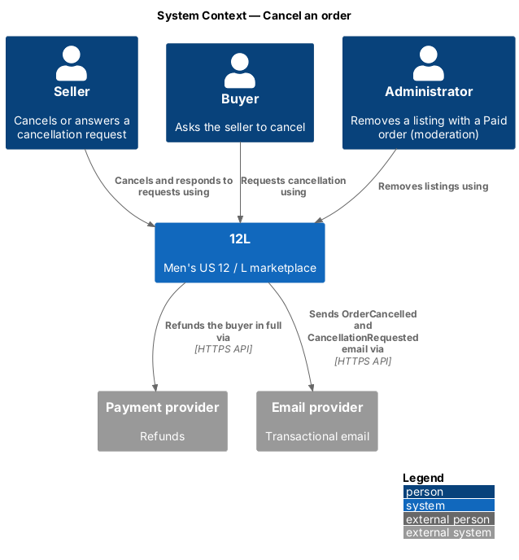
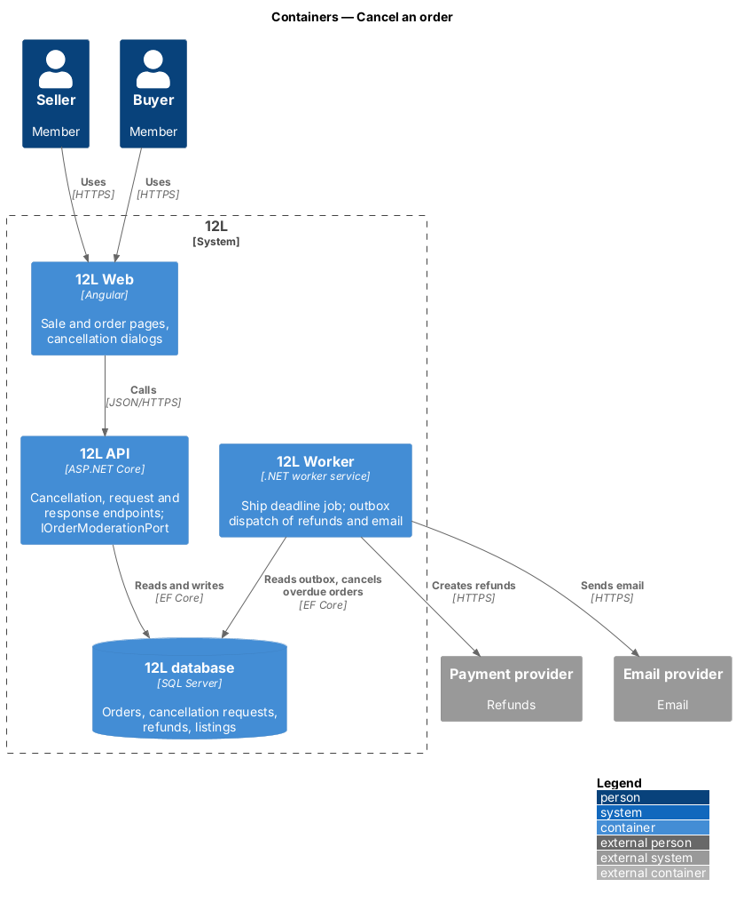
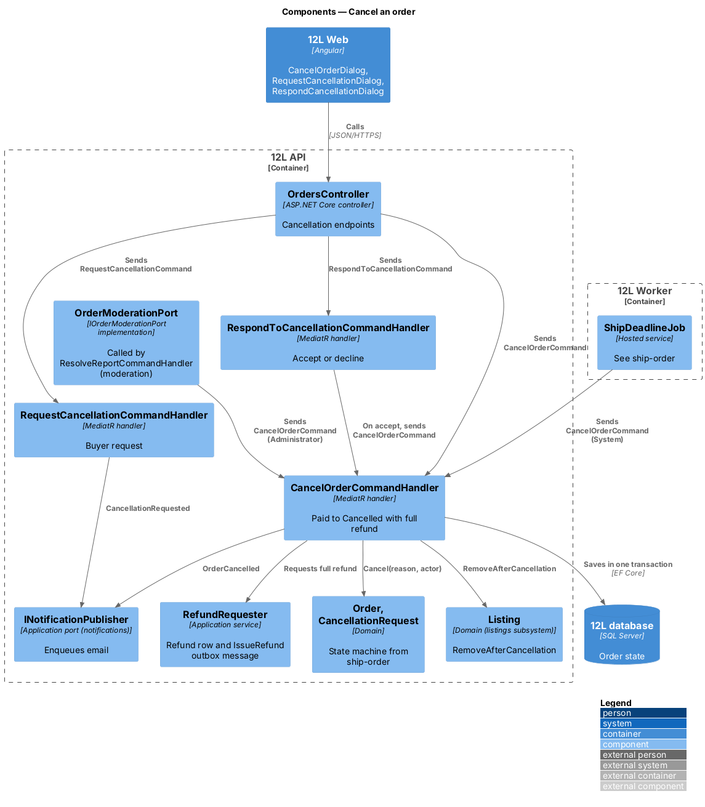
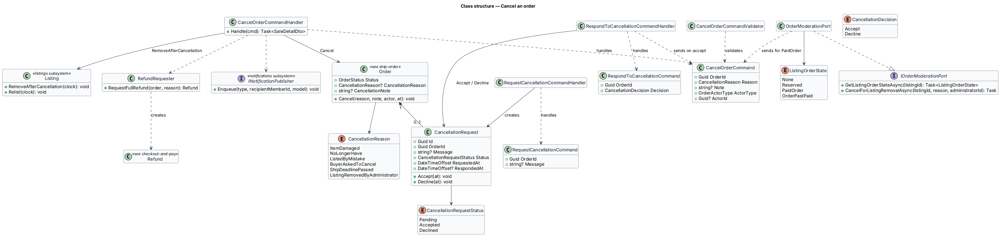
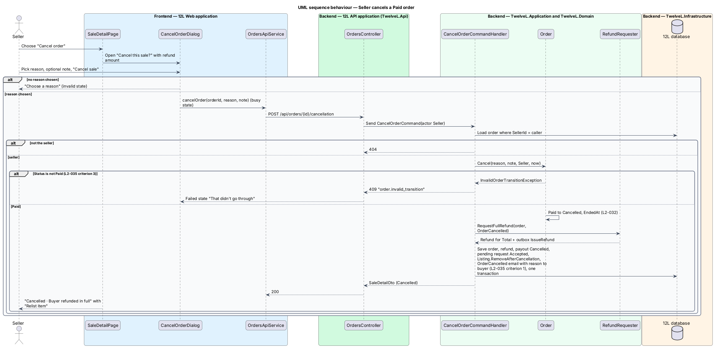
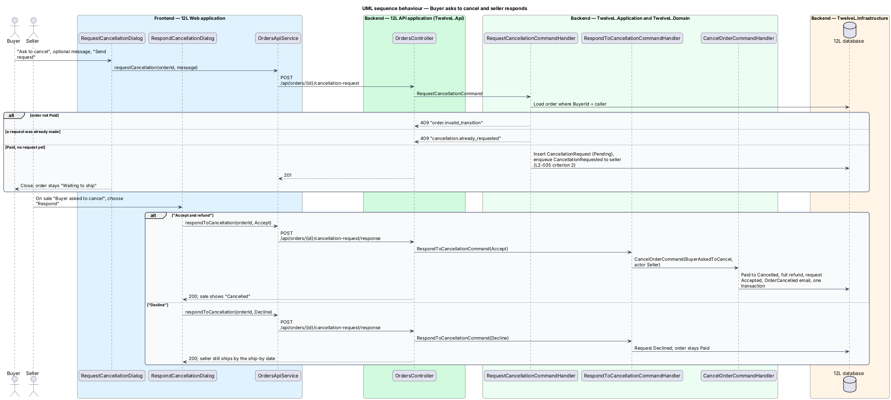
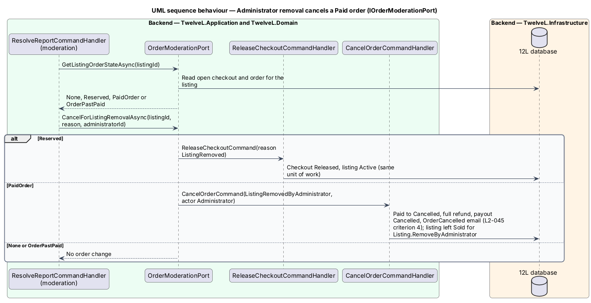

# Cancel an order

## Overview

12L is a marketplace for men's US size 12 shoes and men's size L clothing. Sometimes a
sale should not go ahead: the seller finds damage while packing, or the buyer ordered
the wrong item. This feature lets the seller cancel a `Paid` order before it ships, and
lets the buyer ask the seller to cancel. A cancelled order is refunded to the buyer in
full, and its listing stays off the catalog until the seller relists it.

Cancellation is the `Paid → Cancelled` transition of the order state machine defined
in [ship-order](../ship-order/README.md). Four callers share one handler,
`CancelOrderCommandHandler`:

- the seller, directly or by accepting a buyer's request;
- `ShipDeadlineJob` from ship-order, when no tracking arrives in 5 business days;
- the moderation subsystem, when an administrator removes a listing that has a Paid order (`L2-045`).

Once an order is `Shipped`, cancellation is neither offered nor accepted.

Terms used in this design:

- **seller cancellation** — seller-initiated `Paid → Cancelled` transition with a required reason and an optional note to the buyer
- **cancellation request** — buyer's message asking the seller to cancel a Paid order; the seller accepts or declines it
- **full refund** — refund of the order `Total`: item price, shipping and sales tax
- **relist** — seller action that returns the listing of a cancelled order to `Active` with its original details (listings subsystem)

## Description

### Frontend (`src/frontend/src/app/orders/`)

- **`SaleDetailPage`** (route `/sales/:id`, mock `docs/mocks/pages/sale-detail/`) — this feature owns three of its states:
  - `default` (Paid) — ghost button "Cancel order" next to "Add tracking".
  - `cancel-requested` — heading "Buyer asked to cancel", the buyer's message as a quote, primary "Respond", and the "Ship to" block.
  - `cancelled` — heading "Cancelled", info alert "Cancelled · Buyer refunded in full" / "The listing stays off the catalog until you relist it.", primary "Relist item".
- **`CancelOrderDialog`** (mock `docs/mocks/dialogs/cancel-order/`) — danger-icon dialog "Cancel this sale?". The description reads "{buyer} is refunded {total} in full. The listing stays off the catalog until you relist." A required "Reason" radio group offers "Item damaged", "No longer have it", "Listed by mistake" and "Buyer asked me to cancel", followed by an optional "Note to buyer". Buttons are "Keep sale" and danger "Cancel sale". States: `default`; `invalid` ("Choose a reason"); `busy`; `failed` ("Try again").
- **`RequestCancellationDialog`** (mock `docs/mocks/dialogs/request-cancellation/`) — opened from "Ask to cancel" on `OrderDetailPage` state `paid`. Title "Ask to cancel?", optional "Message to {seller}". The description reads "If {seller} accepts, you're refunded in full. Until then the order stays as is." Buttons are "Keep order" and "Send request". States: `default`, `busy`, `failed` (message kept).
- **`RespondCancellationDialog`** (mock `docs/mocks/dialogs/respond-cancellation/`) — title "{buyer} asked to cancel", the quoted message. The description reads "Accepting refunds {total} in full. Declining keeps the order — you still ship by {shipBy}." Buttons are "Decline" and primary "Accept and refund". States: `default`, `busy`, `failed`.
- **`OrderDetailPage`** state `cancelled` (buyer, mock `order-detail/cancelled`) — info alert "Refunded in full" / "{total} back to {brand} ending {last4}. Allow 5–10 days.", the seller's note as a quote, and "Shop similar items".
- **Relist** — "Relist item" opens `RelistDialog`, which belongs to [edit-and-withdraw-listing](../../listings/edit-and-withdraw-listing/README.md) and calls `POST /api/listings/{reference}/relist`. This feature supplies the precondition: the listing is `Removed` with `RemovalReason = OrderCancelled`.
- **`OrdersApiService`** — `cancelOrder`, `requestCancellation`, `respondToCancellation`.

### API (`TwelveL.Api`)

All endpoints use policy `VerifiedMember`. A suspended seller may still cancel (`L2-046`); a non-party receives `404` (`L2-010`).

- `POST /api/orders/{id}/cancellation` — seller; body `{ reason, note? }`. `200` `SaleDetailDto`; `400` `cancellation.reason_required`, or `note` over `<TO SUPPLY>` characters; `404`; `409` `order.invalid_transition` (not Paid, `L2-035` criterion 3).
- `POST /api/orders/{id}/cancellation-request` — buyer; body `{ message? }`. `201`; `404`; `409` `order.invalid_transition`; `409` `cancellation.already_requested`.
- `POST /api/orders/{id}/cancellation-request/response` — seller; body `{ decision: "Accept" | "Decline" }`. `200`; `404`; `409` `cancellation.no_pending_request`; `409` `order.invalid_transition`.

### Application and domain

- **`CancelOrderCommand`** — `OrderId`, `Reason` (`CancellationReason`: `ItemDamaged`, `NoLongerHave`, `ListedByMistake`, `BuyerAskedToCancel`, `ShipDeadlinePassed`, `ListingRemovedByAdministrator`), `Note`, `ActorType`, `ActorId`. **`CancelOrderCommandValidator`** restricts sellers to the first four reasons.
- **`CancelOrderCommandHandler`** — in one transaction:
  1. calls `Order.Cancel(reason, note, actor, now)`; the state machine allows `Paid → Cancelled` for Seller, System and Administrator only;
  2. calls `RefundRequester.RequestFullRefund(order, OrderCancelled)`, which inserts a `Refund` for `Total` and an `IssueRefund` outbox message keyed by `Refund.Id`;
  3. cancels the payout ([seller-payouts](../seller-payouts/README.md)) and marks any pending `CancellationRequest` as `Accepted`;
  4. for Seller and System actors, calls `Listing.RemoveAfterCancellation(clock)` (`Sold → Removed`, `RemovalReason = OrderCancelled`) so the listing stays off the catalog until relisted (`L2-035`). For the Administrator actor the listing is left `Sold`, and moderation's `Listing.RemoveByAdministrator` removes it with reason `Moderation`;
  5. enqueues `NotificationType.OrderCancelled` to the buyer with the reason and note (`L2-035` criterion 1). The seller also receives it when the actor is System or Administrator (`L2-033` criterion 2).
- **`CancellationRequest`** — `Id`, `OrderId` (unique: one request per order), `Message`, `Status` (`Pending`, `Accepted`, `Declined`), `RequestedAt`, `RespondedAt`. Whether a buyer may ask again after a decline is `<TO SUPPLY>`; the unique index allows one request per order.
- **`RequestCancellationCommandHandler`** — requires a Paid order and no earlier request. It inserts the request and enqueues `NotificationType.CancellationRequested` to the seller (`L2-035` criterion 2).
- **`RespondToCancellationCommandHandler`** — `Accept` sends `CancelOrderCommand(BuyerAskedToCancel, Seller)`. `Decline` sets the request to `Declined` and leaves the order `Paid`. The buyer sees the outcome on the order page; `L2-042` names no decline email.
- **`OrderModerationPort`** — implements `IOrderModerationPort`, the port defined by [moderate-reports](../../moderation/moderate-reports/README.md):
  - `GetListingOrderStateAsync(listingId)` returns `ListingOrderState`: `None`, `Reserved` (open checkout), `PaidOrder`, or `OrderPastPaid`.
  - `CancelForListingRemovalAsync(listingId, reason, administratorId)` releases an open checkout through `ReleaseCheckoutCommand` ([checkout-and-pay](../checkout-and-pay/README.md)), or cancels a Paid order with actor Administrator. It runs inside the moderation handler's unit of work, so the removal, the cancellation, the refund and the email commit together (`L2-045` criterion 4).

### Data

| Table | Key columns and constraints |
|-------|-----------------------------|
| `Orders` | adds `CancellationReason nvarchar(32) null`, `CancellationNote nvarchar(<TO SUPPLY>) null` |
| `CancellationRequests` | `Id` PK; unique `UX_CancellationRequests_OrderId`; `Message nvarchar(<TO SUPPLY>) null`; `Status`; `RequestedAt`; `RespondedAt` |
| `Refunds` | defined in [checkout-and-pay](../checkout-and-pay/README.md); `Reason = OrderCancelled` |

### Error codes

| Code | HTTP | Meaning |
|------|------|---------|
| `order.invalid_transition` | 409 | Order is not Paid (for example already Shipped) |
| `cancellation.reason_required` | 400 | Seller cancellation without a reason |
| `cancellation.already_requested` | 409 | The buyer already asked to cancel this order |
| `cancellation.no_pending_request` | 409 | Response sent with no pending request |

## Requirements

| L2 ID | Refines (L1) | Requirement |
|-------|--------------|-------------|
| `L2-035` | `L1-008` | Before an order is Shipped, the seller shall be able to cancel it, and the buyer shall be able to ask the seller to cancel it. A cancelled order shall be refunded in full and its listing shall not return to the catalog unless the seller relists it. |

## Diagrams

### System context

The seller and the buyer act through 12L, and an administrator's listing removal can
also cancel an order. 12L refunds through the payment provider and emails both
parties.

### Containers

`12L API` performs the cancellation. `12L Worker` dispatches the refund and the email
from the outbox, and runs the ship deadline job that also cancels orders.

### Components

Every path converges on `CancelOrderCommandHandler`. It cancels the order, removes the
listing from sale, requests the refund and enqueues the email in one transaction.

### Class structure

`Order` holds at most one `CancellationRequest`. `OrderModerationPort` realizes the
moderation subsystem's `IOrderModerationPort` by sending the same `CancelOrderCommand`.

### Behaviour — seller cancels

A reason is required. A non-Paid order returns HTTP 409, and a Paid order becomes
Cancelled with a full refund.

### Behaviour — buyer request and seller response

The buyer's request notifies the seller. Accepting reuses the seller cancellation path,
and declining leaves the order Paid.

### Behaviour — cancellation from moderation

The moderation subsystem asks for the listing's order state, then asks the port to
release a reservation or cancel a Paid order.

