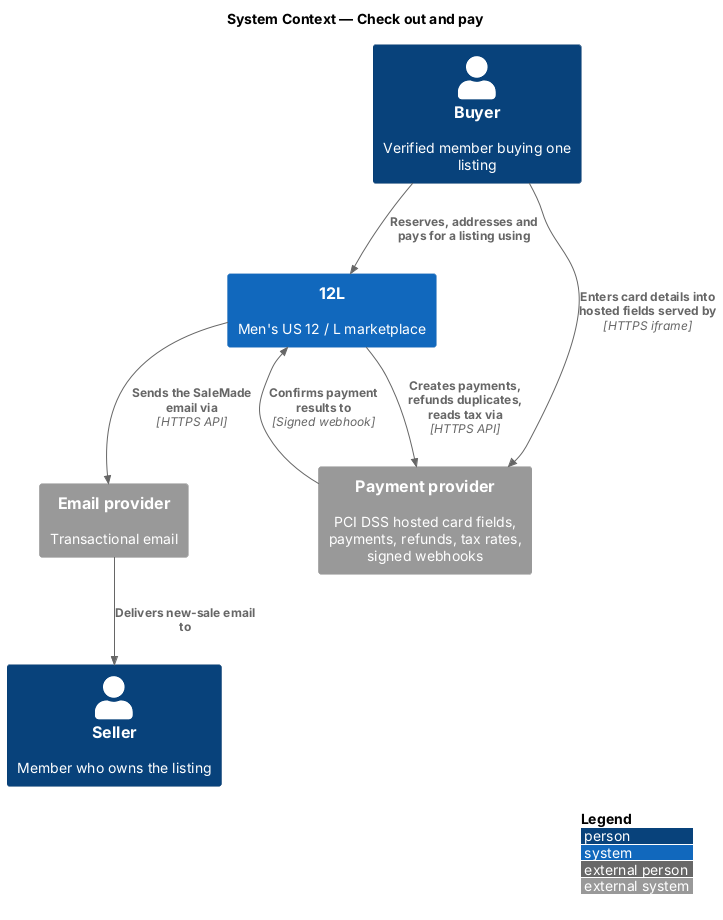
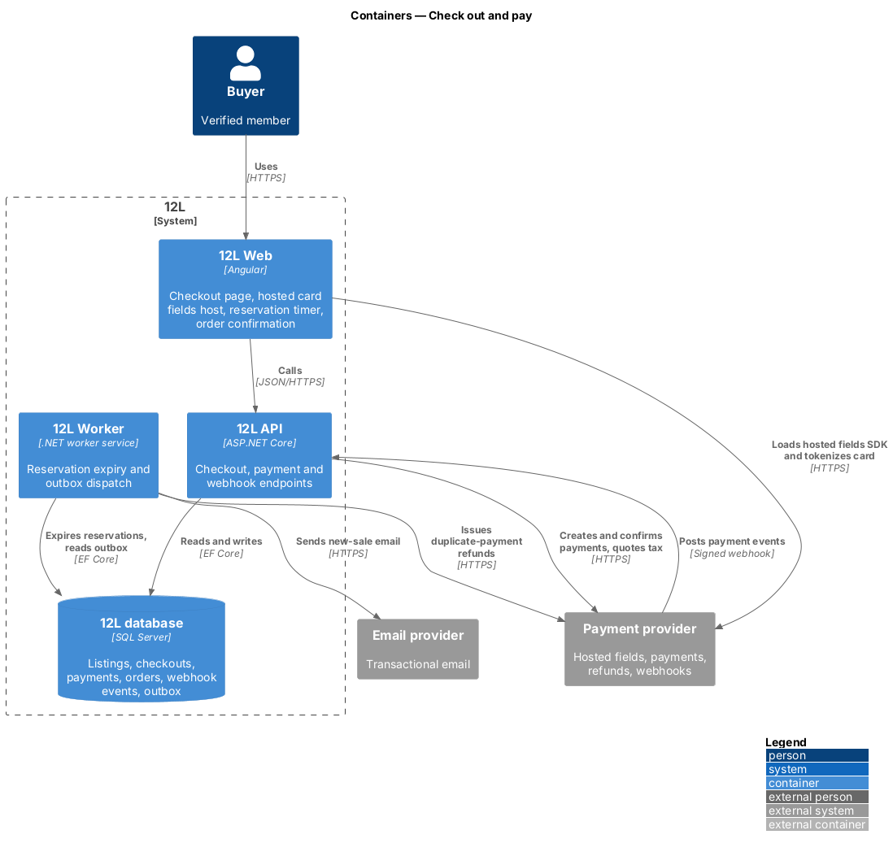
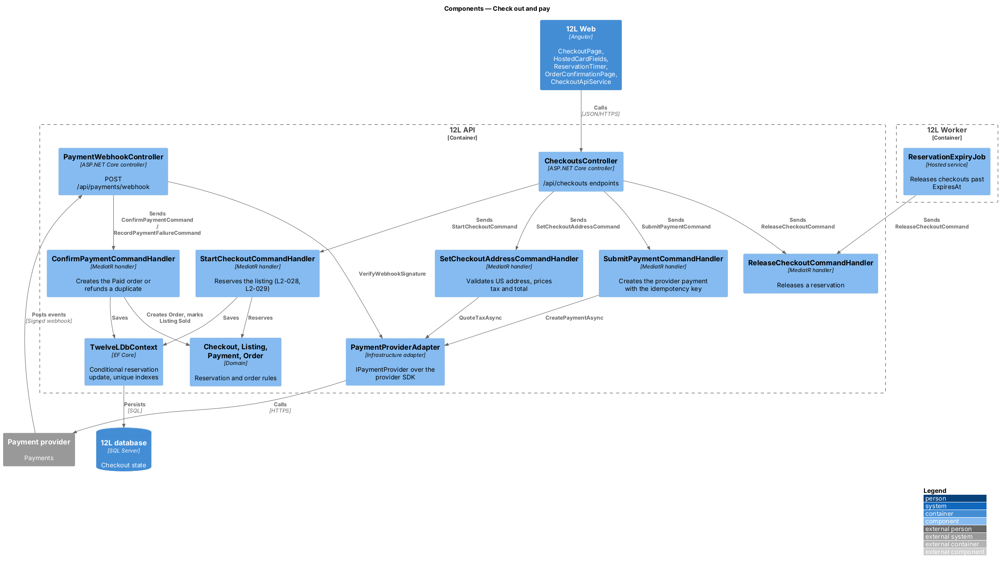
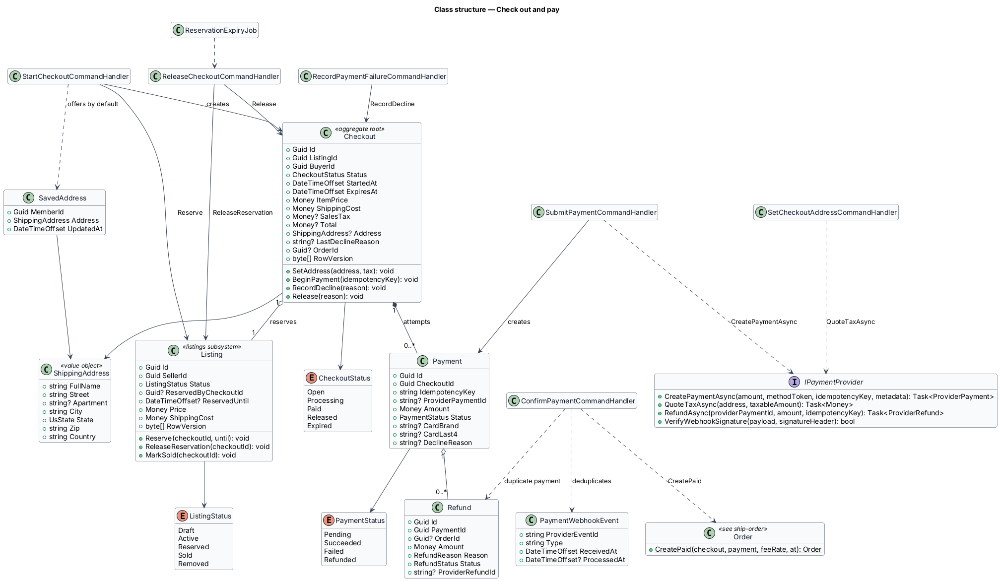
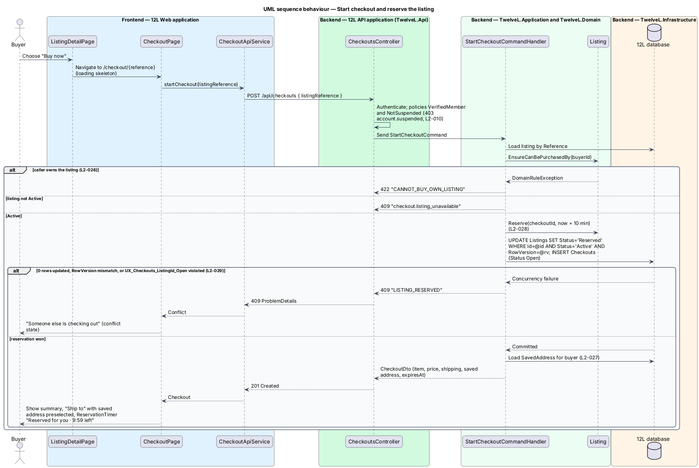
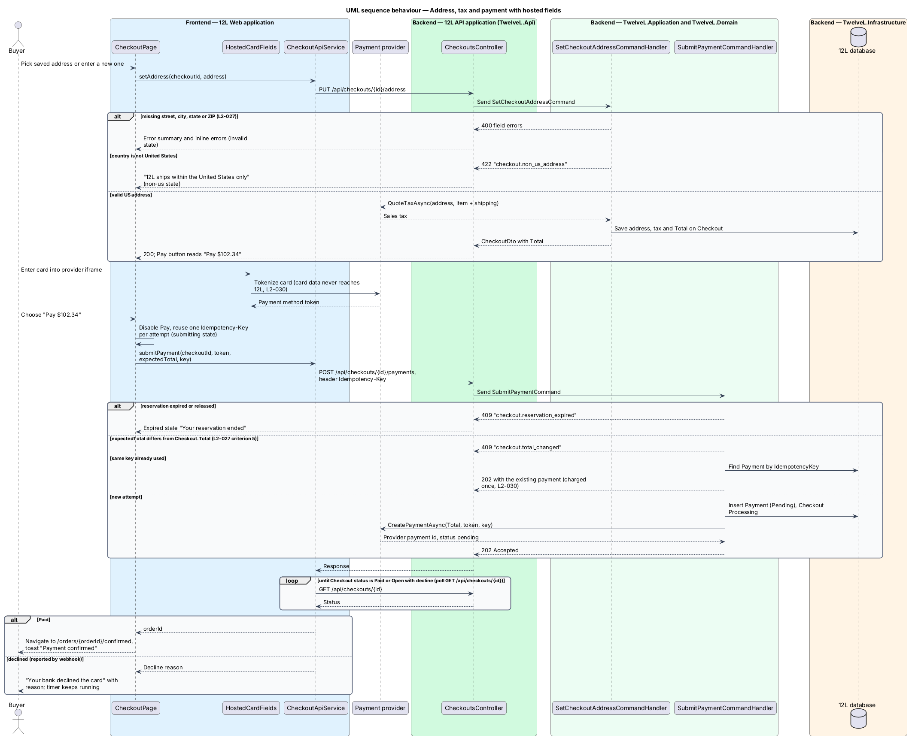
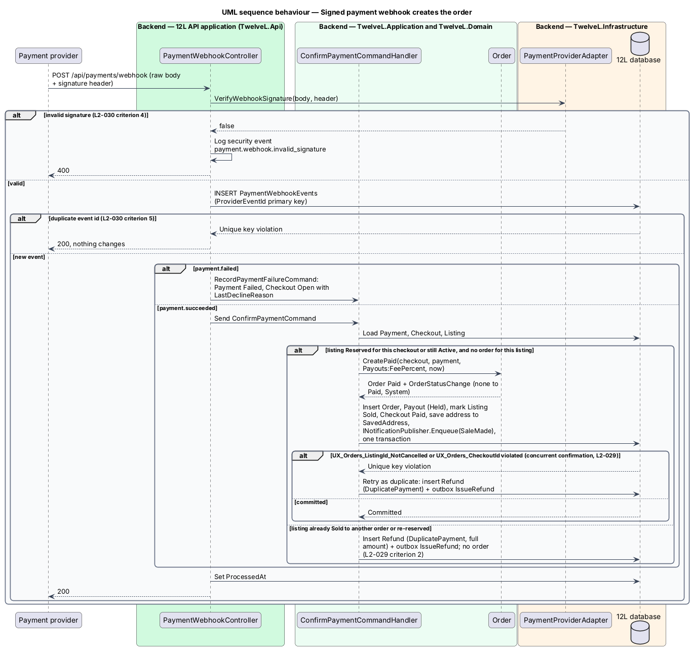
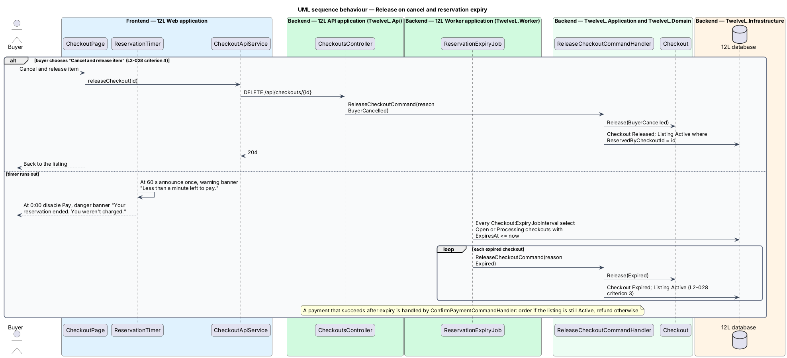

# Check out and pay

## Overview

12L is a marketplace for men's US size 12 shoes and men's size L clothing. Every
listing is a single physical item, so a listing can be sold only once. This feature
covers buying it: a verified member chooses "Buy now", 12L holds the item for them
for 10 minutes, the member gives a US shipping address and pays by card, and 12L
creates the order when the payment provider confirms the payment.

The feature starts on the listing detail page (catalog subsystem) and ends with a
`Paid` order. From there [ship-order](../ship-order/README.md), which defines the
order state machine, takes over.

Terms used in this design:

- **checkout** — record of one buyer's attempt to buy one listing, from "Buy now" to payment or release
- **reservation** — exclusive 10-minute hold a checkout places on a listing, shown as listing status `Reserved`
- **hosted card fields** — card inputs served in an iframe by the payment provider, so card numbers and security codes never reach 12L servers
- **payment method token** — opaque reference the provider returns for card details entered in hosted fields
- **idempotency key** — client-generated identifier sent with a payment request so a repeated request charges once
- **signed webhook** — HTTPS callback from the payment provider whose body carries a signature 12L verifies
- **duplicate payment** — successful payment for a listing that already has an order, or for a checkout whose listing was lost; refunded automatically

Three guarantees shape the design. First, exactly one buyer can hold the listing, and
the database enforces this through a conditional update guarded by a row version and
a unique index (`L2-029`); the browser plays no part in it. Second, the payment result
comes only from the provider's signed webhook, never from the browser (`L2-030`).
Third, double submission and duplicate webhooks change nothing: the idempotency key
and a webhook event table absorb repeats.

## Description

### Frontend (`src/frontend/src/app/orders/checkout/`)

- **`CheckoutPage`** (route `/checkout/:reference`, where `reference` is the listing's `Listing.Reference` such as `L-20931` linked from the catalog's "Buy now", guard `verifiedMemberGuard`, mock `docs/mocks/pages/checkout/`) — two-column layout. The left column holds "Ship to", "Pay" and the actions. The right column holds `OrderSummaryPanelComponent`. On init it calls `startCheckout`. States:
  - `loading` — skeletons in the final layout while the reservation and pricing run.
  - `default` — saved address preselected (radio "New address" beside it), hosted card fields, primary "Pay $102.34", ghost "Cancel and release item".
  - `new-address` — `AddressFormComponent`: "Full name", "Street address", "Apartment, suite" (optional), "City", "State", "ZIP code" (numeric keyboard), "Country".
  - `invalid` — error summary at the top ("Enter a street address", "Enter a city", "Enter a 5-digit ZIP code"); focus moves to the summary.
  - `non-us` — danger alert "12L ships within the United States only" / "Choose a US address to continue."
  - `submitting` — Pay button `aria-busy`, caption "Confirming with your bank…", second clicks ignored.
  - `declined` — alert "Your bank declined the card" with the provider's reason and "Try another card — the item is still reserved for you."
  - `expired` — "Your reservation ended", "You weren't charged…", actions "Back to the item" and "Keep shopping".
  - `conflict` — HTTP 409 from start: "Someone else is checking out", "If they don't finish within 10 minutes, it's back on sale."
  - `error` — "Couldn't start checkout", reference code, "Try again", "Back to the item".
- **`HostedCardFieldsComponent`** — loads the provider's browser SDK from the provider origin (allowed in the Content Security Policy) and mounts the card iframe under the "Card" label. It shows "Card details go straight to our payment provider. 12L never sees them." It exposes `tokenize(): Promise<string>` returning the payment method token. The provider SDK and its version are `<TO SUPPLY>`.
- **`ReservationTimerComponent`** (mock `docs/mocks/notifications/reservation-timer/`) — `role="timer"` countdown "Reserved for you · 9:41 left" computed from the server's `expiresAt`. At 60 seconds it switches to the `warning` banner "Less than a minute left to pay. After that, the item goes back on sale.", announced once through a polite live region. At zero it shows the `danger` banner "Your reservation ended. You weren't charged." with "Start again" and disables Pay.
- **`OrderSummaryPanelComponent`** — shared summary: item row, Item, Shipping ("Free" at $0.00), Sales tax, Total. Reused by order-history pages.
- **`OrderConfirmationPage`** (route `/orders/:id/confirmed`, mock `docs/mocks/pages/order-confirmation/`; loads `GET /api/purchases/{id}` from [order-history](../order-history/README.md)) — `loading` "Confirming your payment" while polling. `default` shows "Order 12L-48377", "It's yours.", the paid amount with card brand and last four, and three next steps (seller ships within 5 business days, confirm or report within 3 days, both review), plus "View order" and "Keep shopping". `error` reads "We couldn't show your order" with "Go to purchases". A success toast "Payment confirmed" / "$102.34 charged to Visa ending 4242." appears on arrival.
- **`CheckoutApiService`** — `startCheckout`, `getCheckout`, `setAddress`, `submitPayment`, `releaseCheckout`. `submitPayment` generates one `crypto.randomUUID()` idempotency key per attempt and reuses it for retries of that attempt.

### API (`TwelveL.Api`)

- **`CheckoutsController`** (policies `VerifiedMember` and `NotSuspended` from [suspend-member](../../moderation/suspend-member/README.md); a suspended member receives 403 `account.suspended`, `L2-010` criterion 5)
  - `POST /api/checkouts` — body `{ listingReference }`. `201` `CheckoutDto` (`id`, `status`, `expiresAt`, item, `itemPrice`, `shippingCost`, `savedAddress`). Errors: `401`; `403` `account.suspended`; `404` `LISTING_NOT_FOUND`; `409` `LISTING_RESERVED` (another checkout holds it, `L2-028` criterion 2); `409` `checkout.listing_unavailable` (not Active); `422` `CANNOT_BUY_OWN_LISTING` (`L2-026`, code owned by [view-listing-detail](../../catalog/view-listing-detail/README.md)).
  - `GET /api/checkouts/{id}` — `200` `CheckoutDto` including `status`, `lastDeclineReason` and `orderId` once Paid; `404` for anyone but the buyer. Polled by the frontend every `<TO SUPPLY>` ms after payment submission.
  - `PUT /api/checkouts/{id}/address` — body `ShippingAddressDto`. `200` with `salesTax` and `total`; `400` field errors; `409` `checkout.reservation_expired`; `422` `checkout.non_us_address`.
  - `POST /api/checkouts/{id}/payments` — header `Idempotency-Key` (required, UUID); body `{ paymentMethodToken, expectedTotal }`. `202` `PaymentDto`; `400` `payment.idempotency_key_required`; `409` `checkout.reservation_expired`; `409` `checkout.total_changed`; `409` `checkout.address_required`.
  - `DELETE /api/checkouts/{id}` — releases the reservation; `204`; `404` for non-buyers; `409` once Paid.
- **`PaymentWebhookController`** — `POST /api/payments/webhook`, anonymous, exempt from anti-forgery, reads the raw body. `200` for processed and duplicate events; `400` for an invalid signature, logged as security event `payment.webhook.invalid_signature` (`L2-030` criterion 4).

### Application and domain

- **`Checkout`** (aggregate) — `Id`, `ListingId`, `BuyerId`, `Status` (`Open`, `Processing`, `Paid`, `Released`, `Expired`), `StartedAt`, `ExpiresAt` (`StartedAt + Checkout:ReservationDuration`, 10 minutes), price snapshot (`ItemPrice`, `ShippingCost`), `SalesTax`, `Total`, `Address`, `LastDeclineReason`, `OrderId`, `RowVersion`. Methods `SetAddress`, `BeginPayment`, `RecordDecline` (back to `Open`), `Release(reason)`.
- **`Listing`** (owned by the listings subsystem, see [create-listing](../../listings/create-listing/README.md)) — this feature adds the `Active → Reserved → Sold` and `Reserved → Active` transitions through `Reserve(checkoutId, until)`, `ReleaseReservation(checkoutId)` and `MarkSold(checkoutId)`. It adds the columns `ReservedByCheckoutId` and `ReservedUntil` to `Listings`, and uses the shared `RowVersion` concurrency token.
- **`StartCheckoutCommand`** / **`StartCheckoutCommandHandler`** — loads the listing by reference and calls the catalog's domain guard `Listing.EnsureCanBePurchasedBy(buyerId)`, which throws `CANNOT_BUY_OWN_LISTING` before any reservation is written. It then rejects non-Active listings. It reserves the listing with a conditional update: `UPDATE Listings SET Status='Reserved', ReservedByCheckoutId=@c, ReservedUntil=@u WHERE Id=@id AND Status='Active' AND RowVersion=@rv`. It inserts the `Checkout` in the same transaction. Zero rows affected, a row-version mismatch or a violation of `UX_Checkouts_ListingId_Open` all map to HTTP 409, so exactly one of 50 concurrent requests succeeds (`L2-029` criterion 1). It returns the buyer's `SavedAddress` (`L2-027` criterion 4).
- **`SetCheckoutAddressCommand`** + **`ShippingAddressValidator`** — full name, street, city, state (US state or district code) and 5-digit ZIP (`^\d{5}(-\d{4})?$`) are required; country shall be `US`. The handler calls `IPaymentProvider.QuoteTaxAsync` on item plus shipping, since the mocks show tax computed on both and rates come from the provider. It then stores `SalesTax` and `Total = ItemPrice + ShippingCost + SalesTax`. Whether tax applies to shipping in each state is the provider's decision.
- **`SubmitPaymentCommand`** / **`SubmitPaymentCommandHandler`** — checks the reservation is live, the address is set and `expectedTotal == Total` to the cent (`L2-027` criterion 5). An existing `Payment` with the same `IdempotencyKey` is returned unchanged. Otherwise it inserts `Payment` (`Pending`), moves the checkout to `Processing`, and calls `CreatePaymentAsync(Total, token, key, { checkoutId, listingId })` with the same key so the provider also deduplicates (`L2-030` criterion 6). The handler stores no card data.
- **`ConfirmPaymentCommand`** / **`ConfirmPaymentCommandHandler`** — runs on `payment.succeeded`. In one transaction it:
  1. sets `Payment.Status = Succeeded`, `CardBrand`, `CardLast4` and `ProviderPaymentId` from the event; these are the only payment details 12L stores (`L2-030`);
  2. when the listing is Reserved for this checkout, or Active after an expiry, and no non-cancelled order exists, creates the order with `Order.CreatePaid(checkout, payment, Payouts:FeePercent, now)` and marks the listing `Sold`. It also creates the held `Payout` from [seller-payouts](../seller-payouts/README.md), upserts `SavedAddress`, and calls `INotificationPublisher.Enqueue(NotificationType.SaleMade, sellerId, ...)` from [send-email-notifications](../../notifications/send-email-notifications/README.md) (`L2-042` criterion 1);
  3. otherwise inserts `Refund` (`DuplicatePayment`, full amount) and outbox message `IssueRefund`, and creates no order (`L2-029` criterion 2).
- **`RecordPaymentFailureCommand`** — runs on `payment.failed`; sets `Payment.Status = Failed` and `DeclineReason`, and returns the checkout to `Open` so the buyer can retry while the reservation lasts (`L2-030` criterion 3).
- **`ReleaseCheckoutCommand`** — `Release(BuyerCancelled | Expired)`; sets the listing back to `Active` only when `ReservedByCheckoutId` still equals this checkout.
- **`IPaymentProvider`** — `CreatePaymentAsync`, `QuoteTaxAsync`, `RefundAsync`, `VerifyWebhookSignature`. The payout methods are listed in [seller-payouts](../seller-payouts/README.md).

### Infrastructure and worker

- **`PaymentProviderAdapter`** (`TwelveL.Infrastructure`) — implements `IPaymentProvider` with the provider SDK. Its configuration holds secrets `PaymentProvider:ApiKey` and `PaymentProvider:WebhookSecret`, loaded from the secret store, plus `PaymentProvider:PublishableKey` for the browser SDK. The provider is `<TO SUPPLY>`.
- **`ReservationExpiryJob`** (`TwelveL.Worker`) — every `Checkout:ExpiryJobInterval` (`<TO SUPPLY>`, at most 30 seconds suggested by the 10-minute window) releases `Open` and `Processing` checkouts with `ExpiresAt <= now` (`L2-028` criterion 3).
- **`OutboxDispatcher`** — dispatches the `SaleMade` email and `IssueRefund`. The refund call uses `Refund.Id` as the provider idempotency key.

### Data

| Table | Key columns and constraints |
|-------|-----------------------------|
| `Checkouts` | `Id` PK; `ListingId`, `BuyerId`, `Status`, `ExpiresAt`, amounts `decimal(10,2)`, `ShippingAddressCipher` and its key-id column, `RowVersion`; filtered unique index `UX_Checkouts_ListingId_Open` on `ListingId` where `Status IN ('Open','Processing')`; index `IX_Checkouts_Status_ExpiresAt` |
| `Payments` | `Id` PK; `CheckoutId` FK; unique `UX_Payments_IdempotencyKey`; unique `UX_Payments_ProviderPaymentId`; `Amount`, `Status`, `CardBrand`, `CardLast4`, `DeclineReason` |
| `PaymentWebhookEvents` | `ProviderEventId` PK (deduplication); `Type`, `ReceivedAt`, `ProcessedAt` |
| `Refunds` | `Id` PK; `PaymentId` FK; `OrderId` nullable FK; `Amount`, `Reason` (`DuplicatePayment`, `OrderCancelled`, `ProblemResolved`), `Status`, `ProviderRefundId` |
| `SavedAddresses` | `MemberId` PK; `AddressCipher` and its key-id column, encrypted by `AesGcmFieldEncryptor` as defined in [protect-personal-data](../../privacy/protect-personal-data/README.md) (`L2-054`) |
| `Orders` | Defined in [ship-order](../ship-order/README.md); this feature relies on unique `UX_Orders_CheckoutId` and filtered unique `UX_Orders_ListingId_NotCancelled` |

Configuration: `Checkout:ReservationDuration` = `00:10:00`, `Checkout:ExpiryJobInterval`,
`Payouts:FeePercent` (snapshotted onto the order), `PaymentProvider:*`.

### Error codes

| Code | HTTP | Meaning |
|------|------|---------|
| `LISTING_RESERVED` | 409 | Another checkout holds the listing |
| `checkout.listing_unavailable` | 409 | Listing is not Active |
| `CANNOT_BUY_OWN_LISTING` | 422 | The seller tried to buy their own listing (defined by the catalog subsystem) |
| `checkout.non_us_address` | 422 | Address is outside the United States |
| `checkout.reservation_expired` | 409 | Reservation ended or was released |
| `checkout.total_changed` | 409 | Submitted total differs from the server total |
| `checkout.address_required` | 409 | Payment submitted before an address was set |
| `payment.idempotency_key_required` | 400 | `Idempotency-Key` header missing or not a UUID |
| `account.suspended` | 403 | Suspended members cannot buy (defined by the moderation subsystem) |

## Requirements

| L2 ID | Refines (L1) | Requirement |
|-------|--------------|-------------|
| `L2-027` | `L1-007` | A verified member shall be able to buy one Active listing at a time. Checkout shall collect a US shipping address and show the item price, shipping cost, sales tax where it applies, and the total before payment. |
| `L2-028` | `L1-007` | When a buyer starts checkout, the listing shall become Reserved for that buyer for 10 minutes. While Reserved, no other member shall be able to start checkout for it. If payment does not succeed within 10 minutes, the listing shall return to Active. |
| `L2-029` | `L1-007` | Concurrent purchase attempts for the same listing shall result in exactly one order. This shall be guaranteed by the database (for example by optimistic concurrency on the listing), not by the client. |
| `L2-030` | `L1-007` | Payment shall be taken through a PCI DSS compliant third-party payment provider using the provider's hosted fields or hosted page. Card numbers and security codes shall never pass through or be stored on 12L servers. 12L shall store only the provider's payment reference, card brand and last four digits. Payment results shall be confirmed from the provider's signed webhook, not from the browser. |

## Diagrams

### System context

The buyer types card details into the payment provider's hosted fields. 12L talks to
the provider for payments, tax and refunds, and receives results by signed webhook.

### Containers

`12L Web` hosts the provider iframe and calls `12L API`. `12L API` owns the
reservation and the order. `12L Worker` expires reservations and dispatches refunds
and email.

### Components

`CheckoutsController` dispatches one command per step. `PaymentWebhookController`
drives order creation, and `PaymentProviderAdapter` is the only component that calls
the provider.

### Class structure

A `Checkout` reserves one `Listing` and owns its `Payment` attempts. A `Payment` may
carry `Refund` rows. `ConfirmPaymentCommandHandler` creates the `Order` defined in
ship-order.

### Behaviour — start checkout

The conditional update and the unique index decide which concurrent request reserves
the listing. Every loser receives HTTP 409.

### Behaviour — address and payment

Card data goes from the hosted fields to the provider only. The API accepts the token
with an idempotency key and returns 202, and the page polls until the webhook settles
the result.

### Behaviour — payment webhook

The controller verifies the signature and deduplicates by provider event ID. It then
creates the Paid order or refunds a duplicate payment.

### Behaviour — release and expiry

"Cancel and release item" frees the listing at once. Otherwise `ReservationExpiryJob`
frees it after 10 minutes while the timer tells the buyer.

