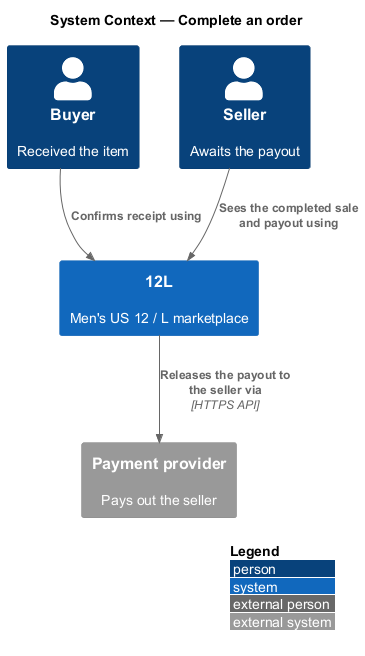
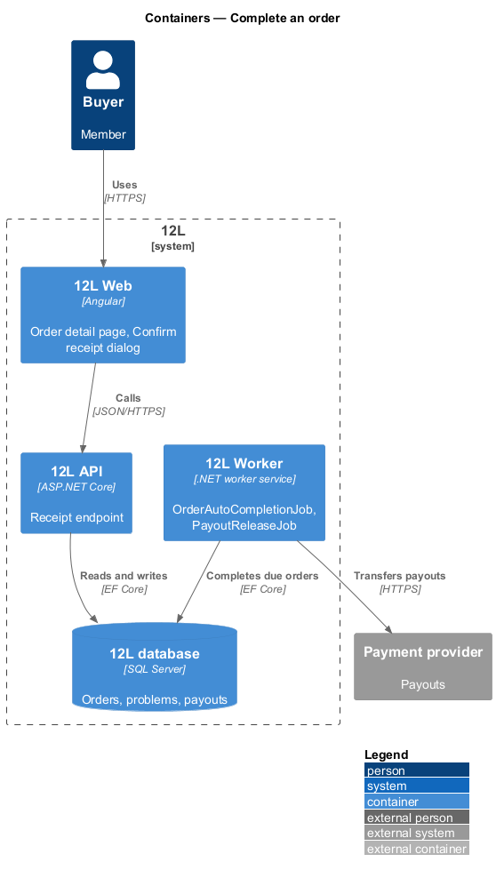
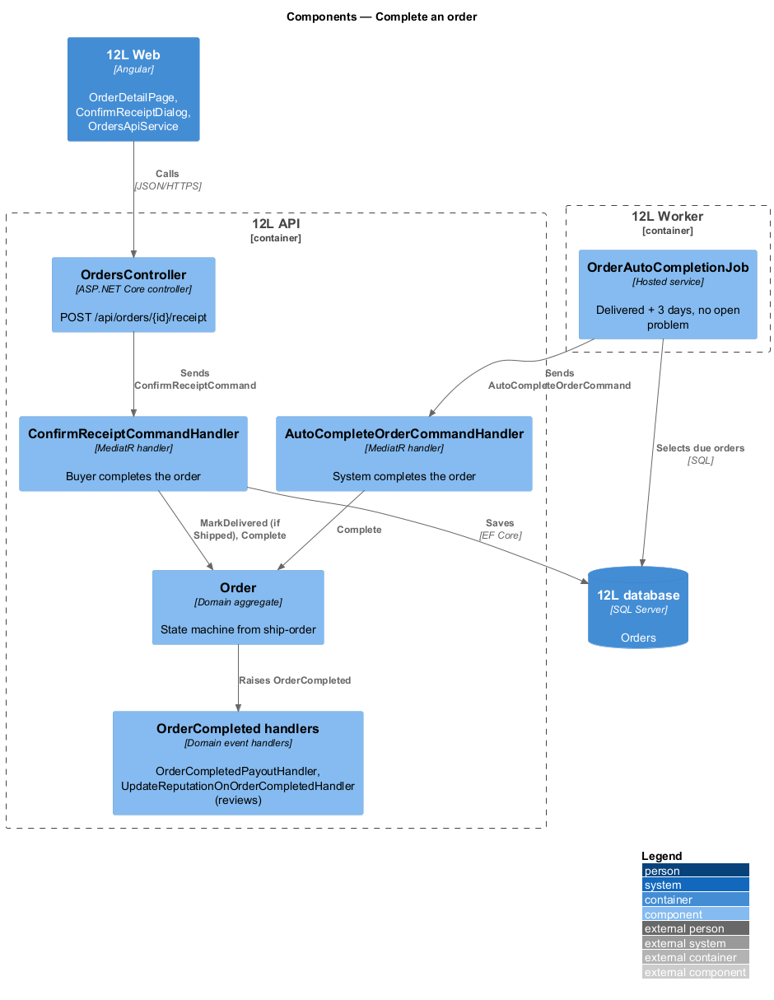
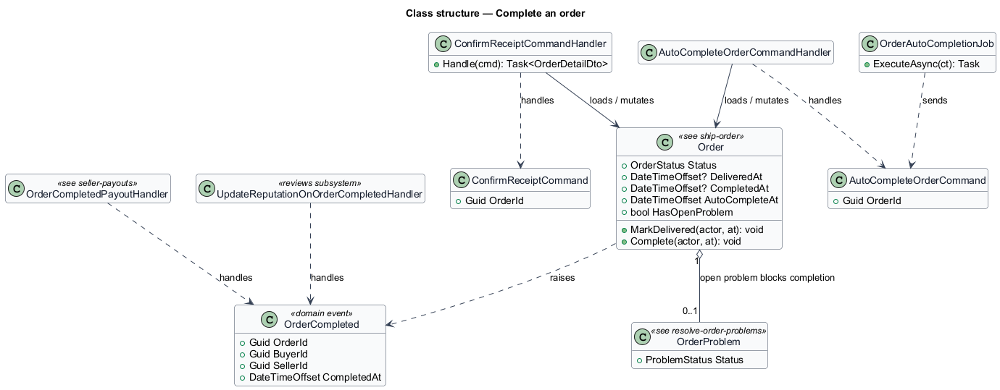
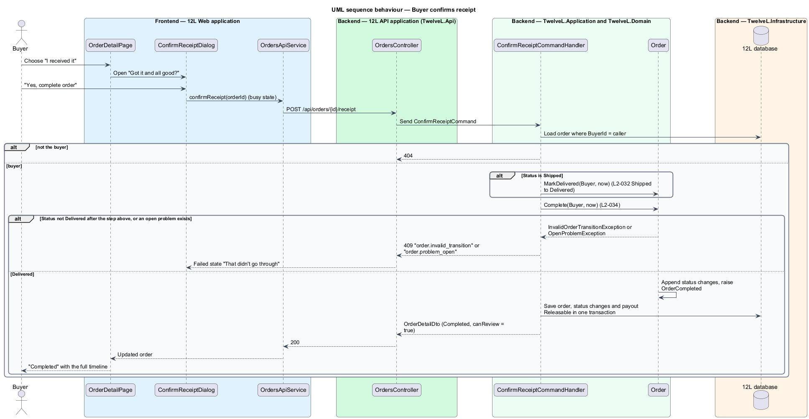
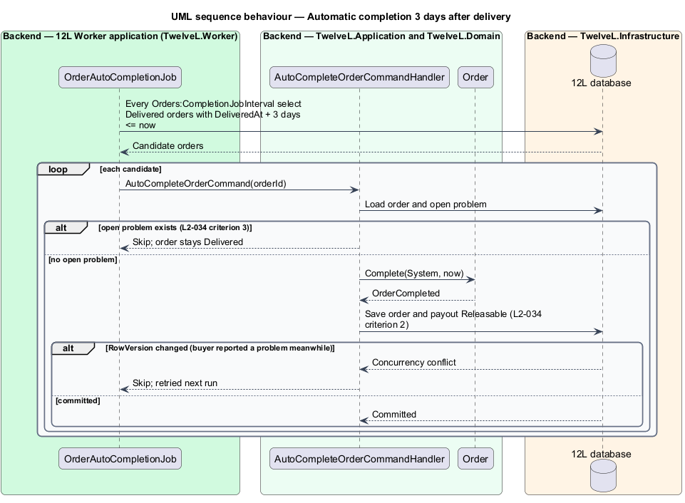

# Complete an order

## Overview

12L is a marketplace for men's US size 12 shoes and men's size L clothing. An order
is *complete* when the buyer has the item and the sale is final: the seller is paid
and both parties may review each other. This feature moves an order into the
`Completed` status in two ways. The buyer can confirm receipt, or 12L can complete
the order automatically 3 days after delivery when the buyer has not reported a
problem.

Completion is the hinge between three other features. It is a transition of the
order state machine defined in [ship-order](../ship-order/README.md). It releases the
payout in [seller-payouts](../seller-payouts/README.md). An open problem from
[resolve-order-problems](../resolve-order-problems/README.md) blocks automatic
completion.

Terms used in this design:

- **confirm receipt** — buyer action "I received it" that completes a Shipped or Delivered order
- **auto-completion** — system transition `Delivered → Completed` once 3 days have passed since `DeliveredAt` with no open problem
- **auto-completion time** — `DeliveredAt` plus `Orders:AutoCompleteAfter` (3 days), shown to the buyer as "Completes automatically on Tue 27 Oct"
- **open problem** — `OrderProblem` with status `Open` on the order

## Description

### Frontend (`src/frontend/src/app/orders/`)

- **`OrderDetailPage`** (route `/orders/:id`, mock `docs/mocks/pages/order-detail/`) — buyer view; the full page is described in [order-history](../order-history/README.md). This feature owns two of its states:
  - `delivered` — heading "Delivered", timeline at Delivered, "Completes automatically on {date} unless you report a problem.", primary "I received it", ghost "Report a problem". The default `Shipped` state also offers receipt confirmation through the same dialog, because `L2-034` permits confirming a Shipped order.
  - `completed` — heading "Completed" and the full timeline. Review authoring is deferred ([ADR 0001](../../../adr/general/0001-defer-moderation-reviews-and-data-export.md)), so no review panel is shown.
- **`ConfirmReceiptDialog`** (mock `docs/mocks/dialogs/confirm-receipt/`) — small dialog titled "Got it and all good?" showing the item row. The description reads "This completes the order and pays {seller}. You can't report a problem afterwards." Buttons are "Not yet" and primary "Yes, complete order". States: `default`; `busy` (primary `aria-busy`, "Not yet" disabled); `failed` ("That didn't go through", primary becomes "Try again"). It has no `invalid` state because it has no inputs.
- **`OrdersApiService`** — `confirmReceipt(orderId)` returns `OrderDetail`.

### API (`TwelveL.Api`)

- **`OrdersController`**
  - `POST /api/orders/{id}/receipt` — no body. Policy `VerifiedMember`. Responses: `200` `OrderDetailDto` with `status: "Completed"` and `canReview: true`; `401`; `404` when the caller is not the buyer (`L2-010`); `409` `order.invalid_transition` when the order is not Shipped or Delivered; `409` `order.problem_open` when a problem is open; `409` `concurrency.conflict`.

### Application and domain

- **`ConfirmReceiptCommand`** / **`ConfirmReceiptCommandHandler`** — loads the order filtered by `BuyerId = caller`. When the status is `Shipped`, it first calls `Order.MarkDelivered(Buyer, now)`, since the state machine has no direct `Shipped → Completed` transition. It then calls `Order.Complete(Buyer, now)`. Both status changes are recorded with the buyer as actor and saved in one transaction (`L2-032`, `L2-034` criterion 1).
- **`Order.Complete(actor, at)`** — the state machine permits `Delivered → Completed` for Buyer, System and Administrator (the last from resolve-order-problems). For Buyer and System the method also refuses while a problem is open, raising `order.problem_open`, because an open problem holds the payout until an administrator decides (`L2-036`). It sets `CompletedAt` and `EndedAt` and raises `OrderCompleted`.
- **`AutoCompleteOrderCommand`** / **`AutoCompleteOrderCommandHandler`** — loads one candidate order with its problem. It skips the order when a problem is open (`L2-034` criterion 3) and otherwise calls `Order.Complete(System, now)` (`L2-034` criterion 2). A `RowVersion` conflict, such as a problem opened at the same moment, skips the order until the next run.
- **`OrderCompleted`** (domain event: `OrderId`, `BuyerId`, `SellerId`, `CompletedAt`) — handled in the same unit of work by:
  - `OrderCompletedPayoutHandler` ([seller-payouts](../seller-payouts/README.md)) — marks the payout releasable;
  - `UpdateReputationOnOrderCompletedHandler` (reviews subsystem) — updates the completed-sales count in the `MemberReputation` projection; review eligibility is read from `Orders` through `IOrderReviewEligibilityReader`, which requires `Status = Completed` and `CompletedAt`.
- No completion email is sent: `L2-042` does not list one, and the `NotificationType` list in send-email-notifications has none.

### Worker (`TwelveL.Worker`)

- **`OrderAutoCompletionJob`** — runs every `Orders:CompletionJobInterval` (`<TO SUPPLY>`). Selects orders with `Status = 'Delivered'` and `DeliveredAt <= now − Orders:AutoCompleteAfter` using index `IX_Orders_Status_DeliveredAt`, and sends `AutoCompleteOrderCommand` for each. The mocks count calendar days: delivered Sat 24 Oct gives completion Tue 27 Oct. `Orders:AutoCompleteAfter` is therefore `3.00:00:00`.

### Data

No new tables. The feature writes `Orders.Status`, `CompletedAt`, `EndedAt` and `RowVersion`, two `OrderStatusChanges` rows when confirming a Shipped order (one otherwise), and the `Payouts` row. It reads `OrderProblems` (filtered index on open problems, see resolve-order-problems).

### Error codes

| Code | HTTP | Meaning |
|------|------|---------|
| `order.invalid_transition` | 409 | Order is not Shipped or Delivered |
| `order.problem_open` | 409 | A problem is open; an administrator decides the outcome |
| `concurrency.conflict` | 409 | The order changed since it was read |

## Requirements

| L2 ID | Refines (L1) | Requirement |
|-------|--------------|-------------|
| `L2-034` | `L1-008` | The buyer shall be able to confirm receipt of a Shipped or Delivered order. An order shall complete automatically 3 days after it becomes Delivered unless the buyer has reported a problem. |

## Diagrams

### System context

The buyer confirms receipt through 12L. Completion lets 12L release the seller's
payout through the payment provider.

### Containers

`12L API` handles the buyer's confirmation. `12L Worker` runs auto-completion and the
payout release that follows.

### Components

Both paths reach `Order.Complete`. The `OrderCompleted` event drives the payout and
reputation handlers.

### Class structure

The two command handlers mutate the shared `Order` aggregate. An open `OrderProblem`
blocks completion, and `OrderCompleted` fans out to the payout and reviews handlers.

### Behaviour — confirm receipt

A Shipped order passes through Delivered on the way to Completed, with both changes
recorded against the buyer. A wrong status or an open problem returns HTTP 409.

### Behaviour — auto-completion

The job completes Delivered orders after 3 days and leaves any order with an open
problem in Delivered.

