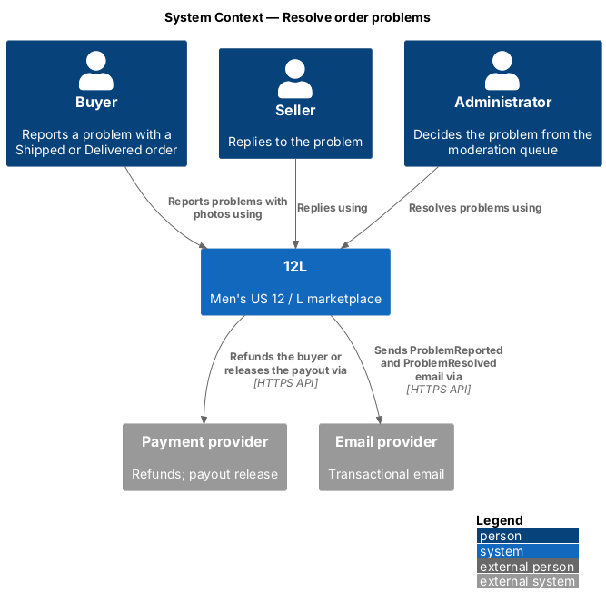
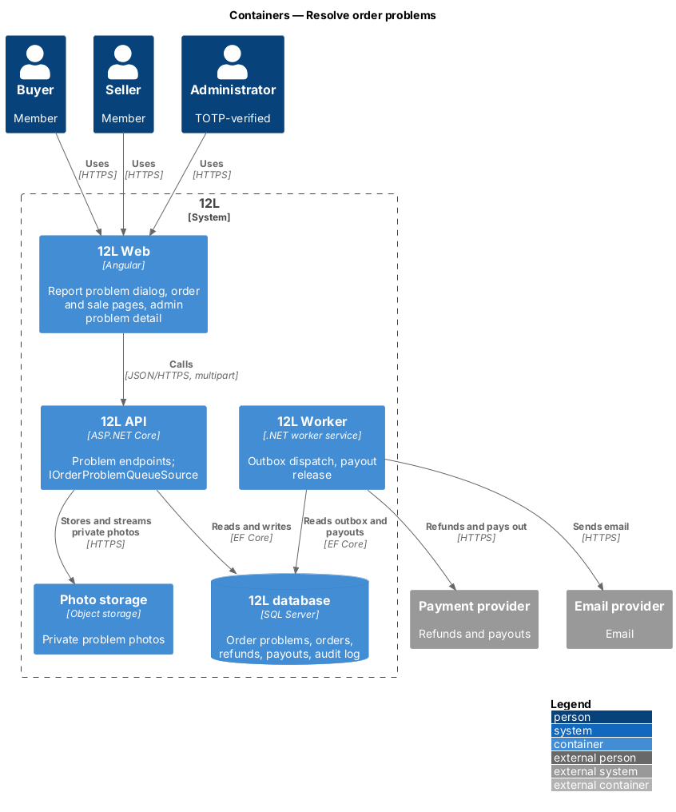
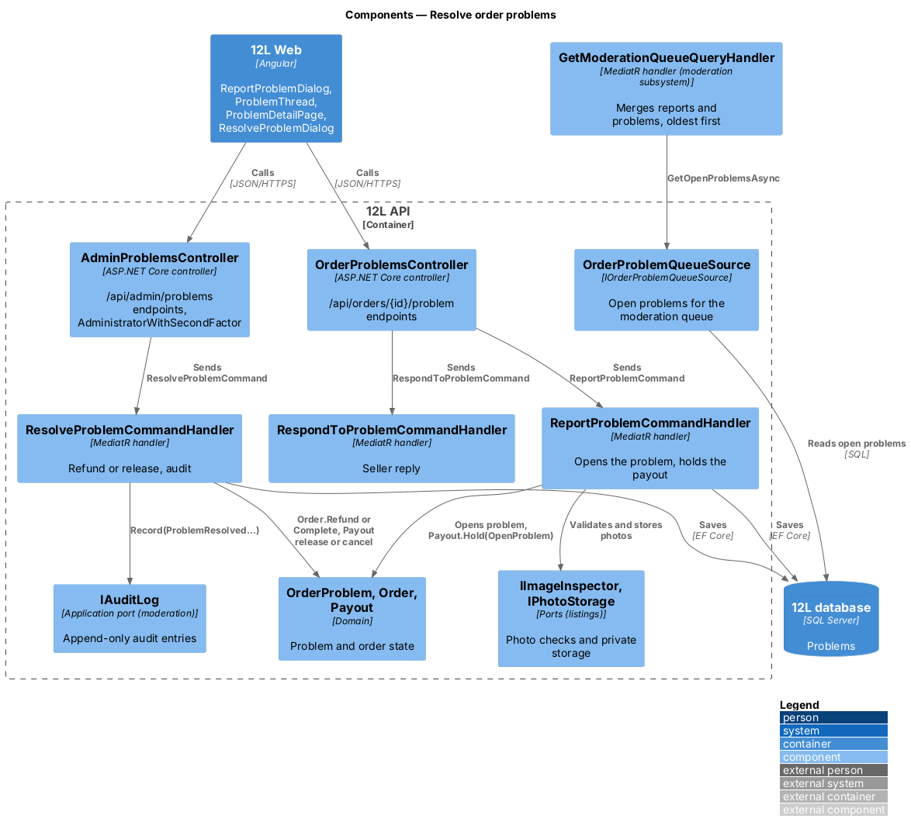
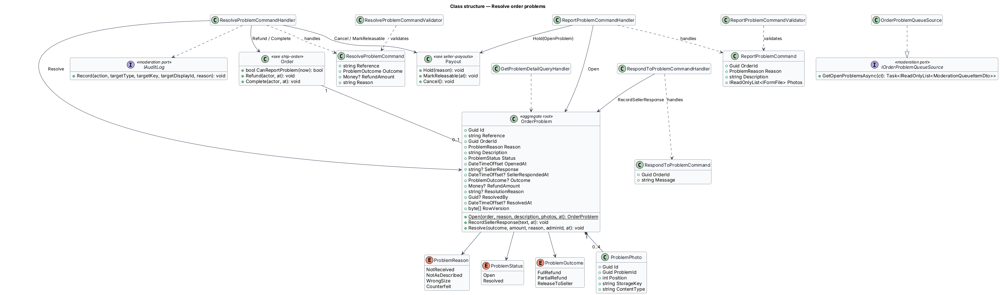
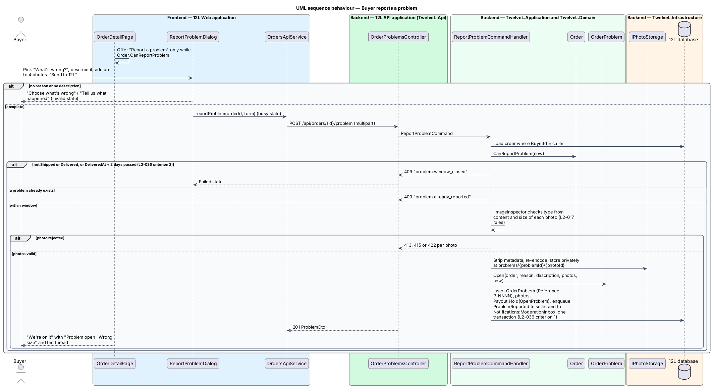
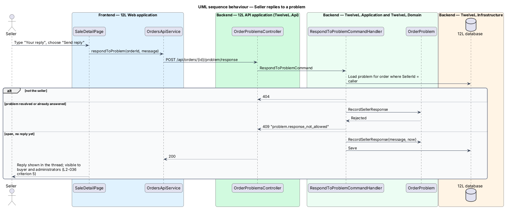
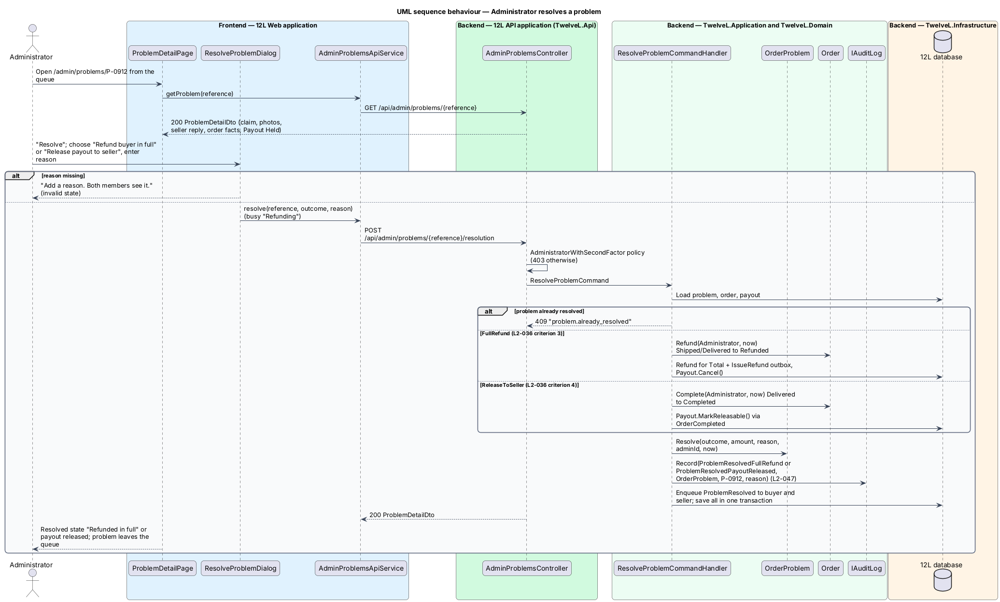

# Resolve order problems

## Overview

12L is a marketplace for men's US size 12 shoes and men's size L clothing. Size is the
whole point of 12L, so an item that arrives in the wrong size, differs from its
description, never arrives or is counterfeit needs a clear remedy. This feature lets a
buyer report a problem on a `Shipped` or `Delivered` order, lets the seller reply, and
lets an administrator decide the outcome: a full refund, a partial refund or release of
the payment to the seller.

The order side of the problem lives here. The administrator's entry point, the
moderation queue at `/admin/queue`, belongs to
[moderate-reports](../../moderation/moderate-reports/README.md). That queue reads open
problems through `IOrderProblemQueueSource`, which this feature implements. The problem
detail page at `/admin/problems/:id` and the resolve dialog are designed here.

Terms used in this design:

- **order problem** — buyer's claim on a Shipped or Delivered order, identified by a reference such as `P-0912`
- **problem window** — period in which a buyer may report: any time while the order is `Shipped`, and until 3 days after `DeliveredAt` while it is `Delivered`
- **problem reason** — one of not received, not as described, wrong size or counterfeit
- **seller response** — the seller's single written reply, visible to the buyer and administrators
- **resolution** — administrator decision with an outcome, an optional refund amount and a reason both members see
- **held payout** — payout blocked while a problem is open (see [seller-payouts](../seller-payouts/README.md))

An open problem has three effects on the rest of the subsystem. It holds the payout. It
stops auto-completion in [complete-order](../complete-order/README.md). It is the only
route to the `Refunded` status in the state machine of
[ship-order](../ship-order/README.md).

## Description

### Frontend — member side (`src/frontend/src/app/orders/`)

- **`ReportProblemDialog`** (mock `docs/mocks/dialogs/report-problem/`) — opened from "Report a problem" on `OrderDetailPage` (states `default` and `delivered`); the action renders only while `canReportProblem` is true. It contains:
  - title "Report a problem" and description "Open until {deadline}. We hold the seller's payout while our team looks into it.";
  - segmented radio "What's wrong?" with "Not received", "Not as described", "Wrong size", "Counterfeit";
  - textarea "Describe it" and photo uploader "Photos (up to 4)" with "Add photo";
  - primary "Send to 12L".

  States: `default`; `invalid` (error summary plus "Choose what's wrong" and "Tell us what happened"); `busy` (uploading, Cancel disabled); `failed` ("Your photos and description are saved here. Try again.").
- **`OrderDetailPage`** state `problem` (buyer, mock `order-detail/problem`) — heading "We're on it", warning alert "Problem open · {reason}" / "We're holding the seller's payout until our team decides. Usually within 2 business days.", and `ProblemThreadComponent`. State `refunded` shows "Refunded in full" and "Resolved {date} by 12L support."
- **`SaleDetailPage`** state `problem` (seller, mock `sale-detail/problem`) — heading "Problem reported", warning alert "Your payout is on hold while our team reviews this.", the thread, textarea "Your reply" with help "Visible to the buyer and to 12L.", and "Send reply". After a reply the form is replaced by the reply in the thread.
- **`ProblemThreadComponent`** — chronological list of the buyer's claim (with photo thumbnails) and the seller's reply, each with handle and date.
- **`OrdersApiService`** — `reportProblem(orderId, FormData)`, `respondToProblem(orderId, message)`.

### Frontend — administrator side (`src/frontend/src/app/orders/admin/`, rendered in `AdminShellComponent`)

- **`ProblemDetailPage`** (route `/admin/problems/:reference`, mock `docs/mocks/pages/problem-detail/`) — heading is the reason ("Not as described"), subtitle "Order problem P-0912 · opened yesterday", breadcrumb "Queue". The body holds the buyer's claim with photos, a divider and the seller's reply. A sunken side panel shows "Order {number}", the item, Status, Total, Delivered, Payout ("Held" or "Not paid") and primary "Resolve". The `resolved` state shows the success alert "Refunded in full" / "{total} back to the buyer. No payout. {time} ET." and no action. Other states are `loading` (skeleton) and `error` ("Couldn't load this problem", reference code).
- **`ResolveProblemDialog`** (mock `docs/mocks/dialogs/resolve-problem/`) — title "Resolve problem {reference}". The "Decision" radios are "Refund buyer in full" ("{total} to {buyer} · no payout") and "Release payout to seller" ("Order completes · {seller} is paid"), followed by the reason field. Buttons are "Cancel" and a primary that reads "Refund buyer"; it shows busy "Refunding". States: `default`; `invalid` ("Add a reason. Both members see it."); `busy`. The mock has no partial-refund option; its control and copy are `<TO SUPPLY>`.
- **`AdminProblemsApiService`** — `getProblem(reference)`, `resolve(reference, body)`.

### API (`TwelveL.Api`)

- **`OrderProblemsController`** (policy `VerifiedMember`; a non-party receives `404`, `L2-010`). Reporting a problem is a buyer action not listed among the suspension-gated actions; the seller reply stays open to suspended sellers (`L2-046`).
  - `POST /api/orders/{id}/problem` — buyer; `multipart/form-data` with `reason`, `description`, `photos[]` (0–4). `201` `ProblemDto`. Errors: `400` `problem.invalid` (field errors); `409` `problem.window_closed` (`L2-036` criterion 2); `409` `problem.already_reported`; `413`, `415` or `422` per photo with the codes of [upload-listing-photos](../../listings/upload-listing-photos/README.md).
  - `POST /api/orders/{id}/problem/response` — seller; body `{ message }`. `200`; `400`; `404`; `409` `problem.response_not_allowed` (resolved or already answered).
  - `GET /api/orders/{id}/problem/photos/{photoId}` — buyer, seller or administrator; streams the private photo with `Cache-Control: private, no-store`; otherwise `404`.
- **`AdminProblemsController`** (policy `AdministratorWithSecondFactor` from [audit-log-and-admin-sign-in](../../moderation/audit-log-and-admin-sign-in/README.md); `403` `auth.administrator_required` or `auth.second_factor_required`)
  - `GET /api/admin/problems/{reference}` — `200` `ProblemDetailDto`; `404`.
  - `POST /api/admin/problems/{reference}/resolution` — body `{ outcome: "FullRefund" | "PartialRefund" | "ReleaseToSeller", refundAmount?, reason }`. `200` `ProblemDetailDto`; `400` `problem.reason_required`, `problem.refund_amount_invalid`; `409` `problem.already_resolved`; `409` `order.invalid_transition`.

### Application and domain

- **`OrderProblem`** (aggregate) — `Id`, `Reference` (`P-NNNN` from SQL sequence `ProblemNumbers`, start `<TO SUPPLY>`), `OrderId`, `Reason` (`ProblemReason`), `Description`, `Photos` (0–4 `ProblemPhoto`), `Status` (`Open`, `Resolved`), `OpenedAt`, `SellerResponse`, `SellerRespondedAt`, `Outcome`, `RefundAmount`, `ResolutionReason`, `ResolvedBy`, `ResolvedAt`, `RowVersion`. `RecordSellerResponse` accepts one reply while `Open`. `Resolve` accepts one decision.
- **`Order.CanReportProblem(now)`** — true when `Status = Shipped`, or when `Status = Delivered` and `now <= DeliveredAt + Orders:ProblemWindow` (3 days; the mock shows delivered Sat 24 Oct open until Tue 27 Oct). `OrderDetailDto.problemDeadline` carries the end of the window.
- **`ReportProblemCommandValidator`** — reason required ("Choose what's wrong"); description required ("Tell us what happened"), maximum length `<TO SUPPLY>`; at most 4 photos.
- **`ReportProblemCommandHandler`** — loads the order by `BuyerId = caller` and checks the window. It validates each photo with `IImageInspector`, applying the content-sniffed type and 10 MB limit of `L2-017`; whether the 800-pixel minimum applies to evidence photos is `<TO SUPPLY>`. It strips metadata, re-encodes, and stores each photo privately through `IPhotoStorage` under `problems/{problemId}/{photoId}`. Problem photos are never published to the CDN. In one transaction it inserts the problem and calls `Payout.Hold(OpenProblem)`. It enqueues `NotificationType.ProblemReported` to the seller and an alert to `Notifications:ModerationInbox` for administrators (`L2-036` criterion 1).
- **`RespondToProblemCommandHandler`** — records the seller's reply (`L2-036` criterion 5).
- **`ResolveProblemCommandValidator`** — reason required and non-whitespace; `refundAmount` required only for `PartialRefund`, greater than $0.00 and less than `Order.Total`.
- **`ResolveProblemCommandHandler`** — in one transaction, by outcome:
  - `FullRefund` — `Order.Refund(Administrator, now)` (`Shipped` or `Delivered` → `Refunded`), a `Refund` for `Total` with `IssueRefund` outbox message, `Payout.Cancel()`, audit action `ProblemResolvedFullRefund` (`L2-036` criterion 3).
  - `ReleaseToSeller` — `Order.Complete(Administrator, now)` (`Delivered` → `Completed`), which raises `OrderCompleted` so the payout becomes releasable. Audit action `ProblemResolvedPayoutReleased` (`L2-036` criterion 4). A `Shipped` order cannot complete directly; see the note in ship-order.
  - `PartialRefund` — a `Refund` for `refundAmount` and audit action `ProblemResolvedPartialRefund`. The resulting order status and the effect on the seller's payout are `<TO SUPPLY>`, because the `L2-032` table has no transition for it.

  Each outcome calls `OrderProblem.Resolve`, enqueues `NotificationType.ProblemResolved` to buyer and seller (and `OrderRefunded` to the buyer for refunds), and writes the audit entry through `IAuditLog.Record` with target type `OrderProblem` and display ID `P-NNNN` (`L2-047`).
- **`OrderProblemQueueSource`** — implements the moderation subsystem's `IOrderProblemQueueSource`. It returns each open problem as a `ModerationQueueItemDto`: kind `OrderProblem`, reference, item title and thumbnail, meta "Order problem · {reason} · Order {number}", the "Payout held" badge flag, `OpenedAt`, and link `/admin/problems/{reference}`.
- **`GetProblemDetailQuery`** / handler — projects claim, photos (as API URLs), seller response, order facts, payout state and, when resolved, the decision.

### Data

| Table | Key columns and constraints |
|-------|-----------------------------|
| `OrderProblems` | `Id` PK; unique `UX_OrderProblems_Reference`; unique `UX_OrderProblems_OrderId` (one problem per order); `Reason`, `Description`, `Status`, `OpenedAt`, `SellerResponse`, `Outcome`, `RefundAmount decimal(10,2)`, `ResolutionReason`, `ResolvedBy`, `ResolvedAt`, `RowVersion`; filtered index `IX_OrderProblems_Open_OpenedAt` where `Status = 'Open'` (queue and auto-completion) |
| `ProblemPhotos` | `Id` PK; `ProblemId` FK; `Position`; `StorageKey`; `ContentType` |
| `AuditEntries` | owned by moderation; written through `IAuditLog` |

Configuration: `Orders:ProblemWindow` = `3.00:00:00`; `Notifications:ModerationInbox`
(owned by notifications).

### Error codes

| Code | HTTP | Meaning |
|------|------|---------|
| `problem.invalid` | 400 | Reason, description or photo count invalid |
| `problem.window_closed` | 409 | Order not Shipped or Delivered, or more than 3 days after delivery |
| `problem.already_reported` | 409 | The order already has a problem |
| `problem.response_not_allowed` | 409 | Problem resolved or already answered |
| `problem.reason_required` | 400 | Resolution without a reason |
| `problem.refund_amount_invalid` | 400 | Partial refund amount out of range |
| `problem.already_resolved` | 409 | A decision already exists |

## Requirements

| L2 ID | Refines (L1) | Requirement |
|-------|--------------|-------------|
| `L2-036` | `L1-008` | The buyer shall be able to report a problem on a Shipped or Delivered order until 3 days after delivery. Reasons shall be: not received, not as described, wrong size, or counterfeit. An open problem shall hold the seller payout. An administrator shall resolve it with a full refund, a partial refund or release of payment to the seller. |

## Diagrams

### System context

Buyer, seller and administrator all act through 12L. 12L refunds or pays out through
the payment provider and emails both members.

### Containers

`12L API` stores problem photos privately in `Photo storage` and records the decision.
`12L Worker` carries out refunds, payouts and email.

### Components

Member endpoints and administrator endpoints sit in separate controllers. The
moderation queue reads open problems through `OrderProblemQueueSource`.

### Class structure

An `Order` has at most one `OrderProblem` with up to 4 photos.
`ResolveProblemCommandHandler` changes the problem, the order and the payout together
and writes the audit entry.

### Behaviour — report a problem

The window check returns HTTP 409 after 3 days from delivery. A valid report stores
photos privately, opens the problem and holds the payout in one transaction.

### Behaviour — seller reply

The seller replies once while the problem is open. The reply appears to the buyer and
to administrators.

### Behaviour — administrator resolution

A full refund moves the order to Refunded and cancels the payout. Release completes the
order and frees the payout. Both write an audit entry.

