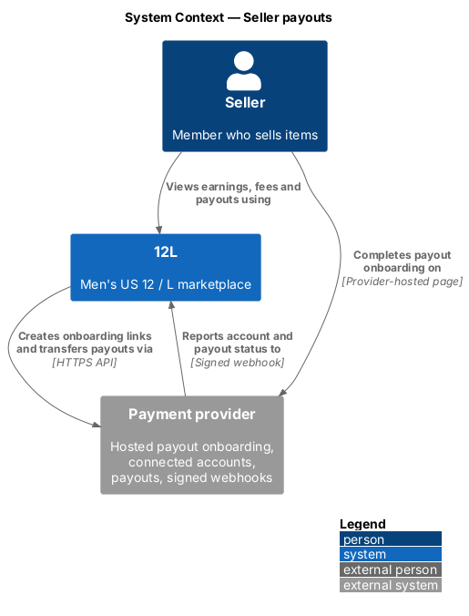
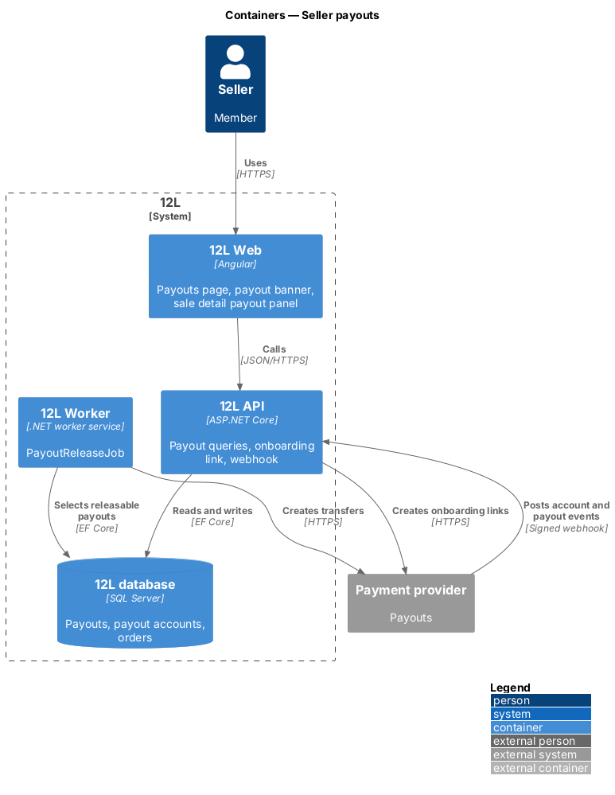
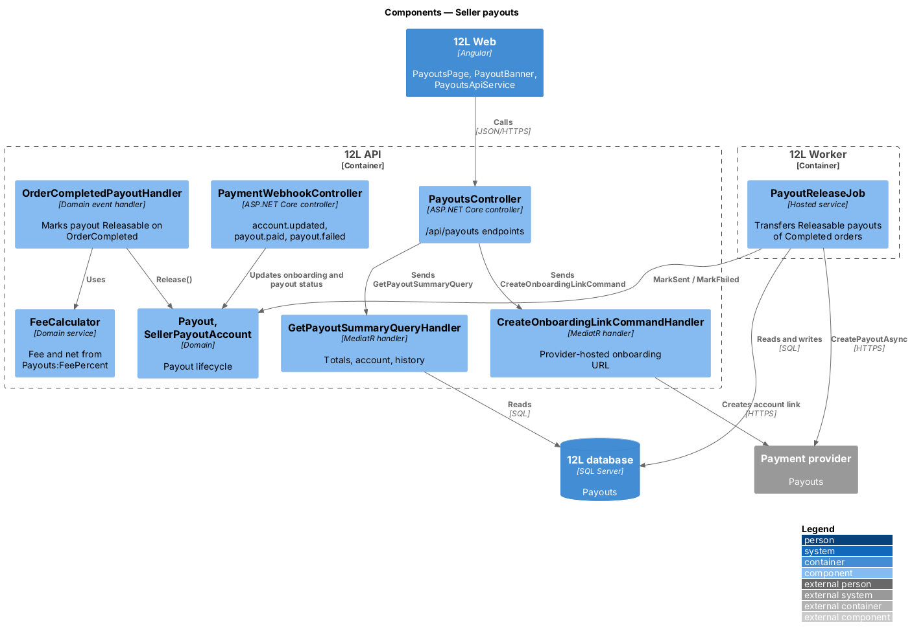
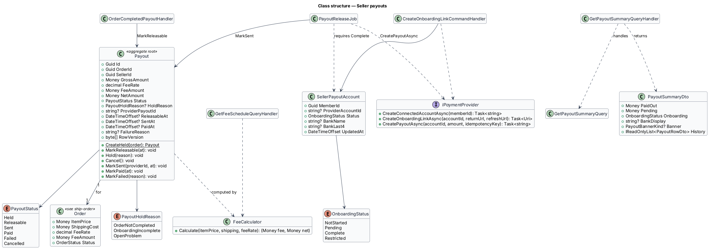
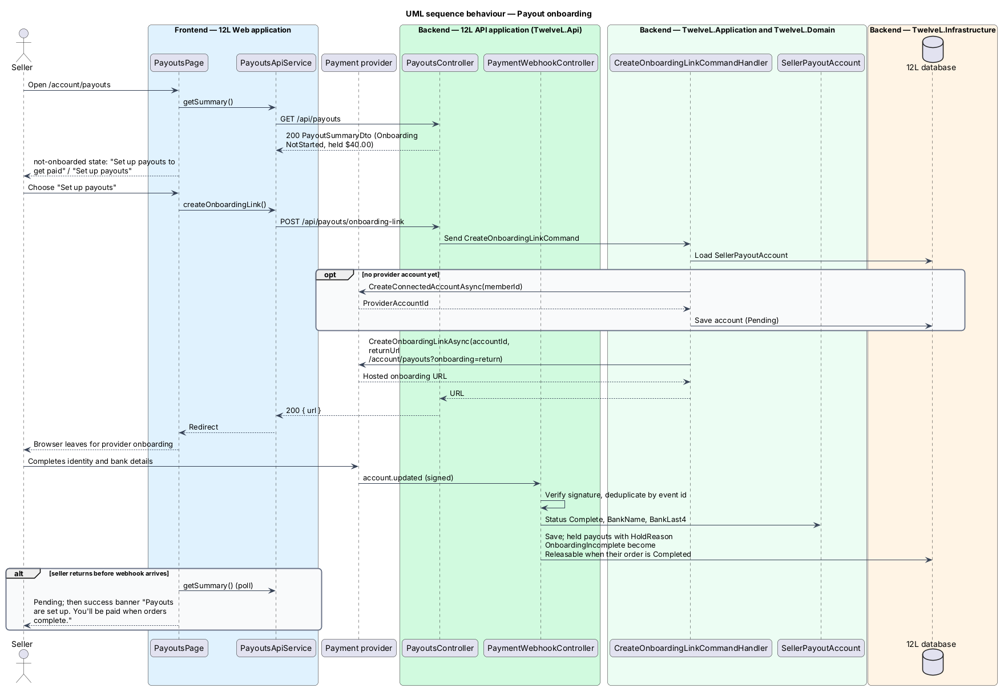
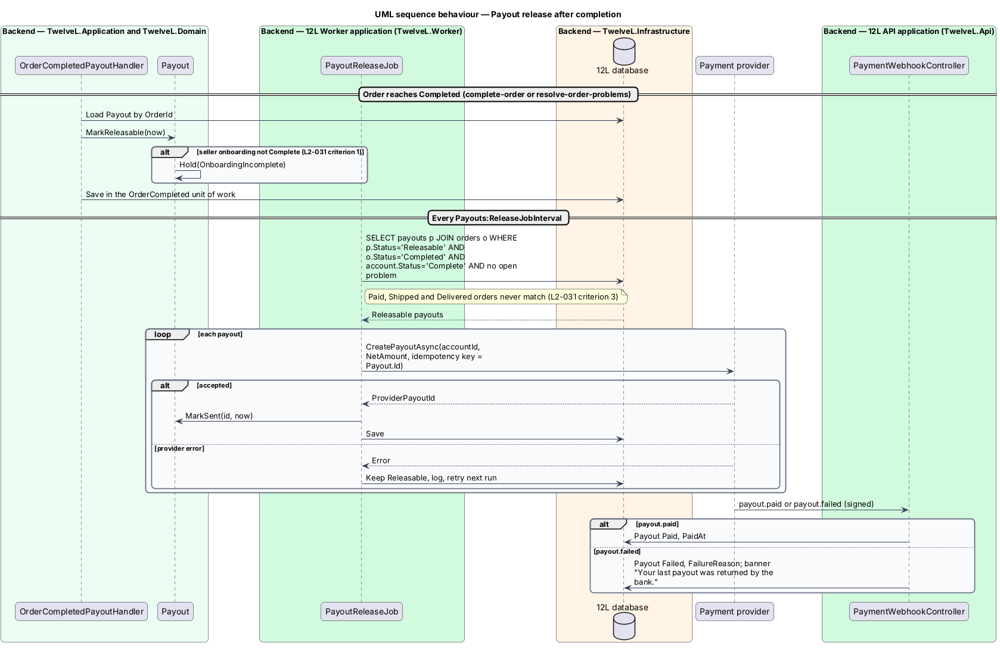

# Seller payouts

## Overview

12L takes the buyer's payment at checkout but owes most of it to the seller. A
*payout* is the transfer of a sale's proceeds, less the 12L fee, from 12L's payment
provider balance to the seller's bank account. This feature covers the whole payout
path: the seller's one-time onboarding with the payment provider, the fee
calculation, holding the money while the order is open, releasing it once the order
is `Completed`, and showing the seller what is pending and what has been paid.

Terms used in this design:

- **payout onboarding** — provider-hosted process in which a seller gives identity and bank details so the provider can pay them
- **connected account** — the seller's account at the payment provider, referenced by `ProviderAccountId`
- **12L fee** — configurable percentage of item price plus shipping that 12L keeps from each sale
- **gross amount** — item price plus shipping cost of an order; sales tax is excluded
- **net amount** — gross amount less the 12L fee; the amount paid out
- **held payout** — payout that cannot be released yet because its order is not Completed, the seller has not finished onboarding, or a problem is open

Every order gets one payout when it is created (see
[checkout-and-pay](../checkout-and-pay/README.md)). The payout stays held through
`Paid`, `Shipped` and `Delivered`. Only the `Completed` status, defined in the state
machine of [ship-order](../ship-order/README.md), makes it releasable. A `Cancelled`
or `Refunded` order cancels its payout. An open problem holds it
([resolve-order-problems](../resolve-order-problems/README.md)).

## Description

### Frontend (`src/frontend/src/app/orders/payouts/`)

- **`PayoutsPage`** (route `/account/payouts`, mock `docs/mocks/pages/payouts/`) — account area page "Payouts". States:
  - `default` — stats "Paid out" and "Pending", a payout method row ("Chase checking •••• 6021", "Managed by our payment provider", external "Change" link to onboarding), and a "History" list. Each row shows the order number, the item, a meta line ("Held until the order completes" or "Fee $3.70 · Mon 5 Oct"), the amount and the status "Pending" or "Paid", and links to `/sales/:id`.
  - `not-onboarded` — warning alert "Set up payouts to get paid" / "{amount} is waiting for you." with primary "Set up payouts", then a "Held" list.
  - `loading` — skeleton stats and rows.
  - `empty` — "No payouts yet", "Your earnings show up here after your first sale.", "Sell an item".
  - `error` — "Couldn't load payouts", reference code, "Try again".
- **`PayoutBannerComponent`** (mock `docs/mocks/notifications/payout-banner/`) — shown on My listings (listings subsystem) from `PayoutSummaryDto.Banner`:
  - `info` — "{amount} is on its way to {bank}." with a "Payouts" link; shown while a payout is `Sent`.
  - `success` — "Payouts are set up. You'll be paid when orders complete."; shown once after onboarding returns `Complete`.
  - `warning` — "Finish payout setup to receive {amount}." with "Set up payouts"; not dismissible; shown while onboarding is incomplete and money is held.
  - `danger` — "Your last payout was returned by the bank." with "Update bank details"; not dismissible; shown while the latest payout is `Failed`.
- **`SalePayoutPanelComponent`** — on `SaleDetailPage` for a Completed order (mock `sale-detail/completed`): "Item and shipping", "12L fee (10%)", "Your payout", and "Sent {date} to {bank}".
- **`PayoutsApiService`** — `getSummary()`, `createOnboardingLink()`, `getFeeSchedule()`.

### API (`TwelveL.Api`)

- **`PayoutsController`** (policy `VerifiedMember`)
  - `GET /api/payouts` — `200` `PayoutSummaryDto` (`paidOut`, `pending`, `onboarding`, `bankDisplay`, `banner`, `history[]`); `401`.
  - `POST /api/payouts/onboarding-link` — `200` `{ url }` to the provider-hosted onboarding; `401`; `502` `payout.provider_unavailable`.
  - `GET /api/payouts/fee-schedule` — `200` `{ feePercent }`; anonymous allowed. The listing form (listings subsystem) uses it to show estimated earnings before publishing (`L2-031` criterion 4).
- **`PaymentWebhookController`** (shared with checkout-and-pay) — handles `account.updated`, `payout.paid` and `payout.failed` after signature verification and event-ID deduplication.

### Application and domain

- **`Payout`** (aggregate) — `Id`, `OrderId` (unique), `SellerId`, `GrossAmount`, `FeeRate`, `FeeAmount`, `NetAmount`, `Status` (`Held`, `Releasable`, `Sent`, `Paid`, `Failed`, `Cancelled`), `HoldReason` (`OrderNotCompleted`, `OnboardingIncomplete`, `OpenProblem`), `ProviderPayoutId`, `ReleasableAt`, `SentAt`, `PaidAt`, `FailureReason`, `RowVersion`.
  - `CreateHeld(order)` — created with the order; `Held` with `OrderNotCompleted`.
  - `MarkReleasable(at)` — only when the order is `Completed`; falls back to `Hold(OnboardingIncomplete)` when the seller's account is not `Complete`.
  - `Hold(OpenProblem)` — set when a problem opens.
  - `Cancel()` — on `OrderCancelled` or `OrderRefunded`; no payout is made.
  - `MarkSent`, `MarkPaid`, `MarkFailed`.
- **`FeeCalculator`** — `fee = round(feeRate × (itemPrice + shippingCost), 2)` and `net = gross − fee`. Example from `L2-031` criterion 2: a 10% fee on $80.00 plus $10.00 shipping gives a $9.00 fee and an $81.00 payout. The mocks agree: $37.00 gross gives a $3.70 fee and a $33.30 payout. The midpoint rounding mode is `<TO SUPPLY>`. `Order.CreatePaid` snapshots `FeeRate` from `Payouts:FeePercent`, so a later configuration change does not alter existing orders. The fee is recorded on the order as `Order.FeeAmount`.
- **`SellerPayoutAccount`** — `MemberId` (PK), `ProviderAccountId`, `Status` (`NotStarted`, `Pending`, `Complete`, `Restricted`), `BankName`, `BankLast4`, `UpdatedAt`. 12L stores no full bank account number.
- **`GetPayoutSummaryQuery`** / handler — sums `NetAmount` of `Paid` payouts as "Paid out", and of `Held`, `Releasable` and `Sent` payouts as "Pending". It lists history newest first and derives `Banner`.
- **`CreateOnboardingLinkCommand`** / handler — creates the connected account on first use, then requests an onboarding link with return URL `/account/payouts?onboarding=return` and a refresh URL.
- **`OrderCompletedPayoutHandler`** — domain event handler for `OrderCompleted`; calls `MarkReleasable`.
- **`OrderEndedWithoutSalePayoutHandler`** — handles `OrderCancelled` and `OrderRefunded`; calls `Cancel`.
- **`IPaymentProvider`** (payout part) — `CreateConnectedAccountAsync`, `CreateOnboardingLinkAsync`, `CreatePayoutAsync(accountId, amount, idempotencyKey)`.

The first-listing prompt in `L2-031` criterion 1 belongs to the listings subsystem: the
listing publishes and the seller is linked to "Set up payouts". This feature supplies
the hold, so no payout leaves while onboarding is incomplete.

### Worker (`TwelveL.Worker`)

- **`PayoutReleaseJob`** — every `Payouts:ReleaseJobInterval` (`<TO SUPPLY>`). It selects payouts with `Status = 'Releasable'` joined to an order with `Status = 'Completed'`, an account with `Status = 'Complete'`, and no open problem. A payout whose order is `Paid`, `Shipped` or `Delivered` cannot match (`L2-031` criterion 3). For each match it calls `CreatePayoutAsync` with `Payout.Id` as the idempotency key and marks it `Sent`. A provider error leaves it `Releasable` for the next run.
- After `account.updated` reports `Complete`, payouts held with `OnboardingIncomplete` whose order is Completed become `Releasable`.
- Re-sending a `Failed` payout after the seller updates bank details is `<TO SUPPLY>`; the design leaves it `Failed` and visible in the danger banner.

### Data

| Table | Key columns and constraints |
|-------|-----------------------------|
| `Payouts` | `Id` PK; unique `UX_Payouts_OrderId`; `SellerId`; amounts `decimal(10,2)`; `FeeRate decimal(5,4)`; `Status`, `HoldReason`; `RowVersion`; index `IX_Payouts_Status` (release job), `IX_Payouts_SellerId_Status` (summary) |
| `SellerPayoutAccounts` | `MemberId` PK; unique `UX_SellerPayoutAccounts_ProviderAccountId` |
| `Orders` | `FeeRate`, `FeeAmount` columns (see [ship-order](../ship-order/README.md)) |

Configuration: `Payouts:FeePercent` (value `<TO SUPPLY>`; the mocks and `L2-031` use 10),
`Payouts:ReleaseJobInterval`.

### Error codes

| Code | HTTP | Meaning |
|------|------|---------|
| `payout.provider_unavailable` | 502 | The provider did not return an onboarding link |

## Requirements

| L2 ID | Refines (L1) | Requirement |
|-------|--------------|-------------|
| `L2-031` | `L1-007` | Before their first sale is paid out, a seller shall complete payout onboarding with the payment provider. The sale amount less the 12L fee shall be released to the seller when the order is Completed. The fee percentage shall be configurable and shown to the seller before they publish a listing. |

## Diagrams

### System context

The seller onboards on the payment provider's hosted pages. 12L creates the onboarding
link and the transfers, and learns about account and payout status by signed webhook.

### Containers

`12L API` serves the payouts page and receives provider events. `12L Worker` runs the
release job against the provider.

### Components

`OrderCompletedPayoutHandler` makes a payout releasable, and `PayoutReleaseJob`
transfers it. `FeeCalculator` fixes the fee and the net amount.

### Class structure

Each `Payout` belongs to one `Order` and moves through `PayoutStatus`. Release
requires a `SellerPayoutAccount` with `Complete` onboarding.

### Behaviour — onboarding

The seller follows a provider-hosted link. The `account.updated` webhook, not the
browser return, marks onboarding complete.

### Behaviour — release

Completion marks the payout releasable. The job transfers only payouts of Completed
orders, using the payout ID as the idempotency key.

