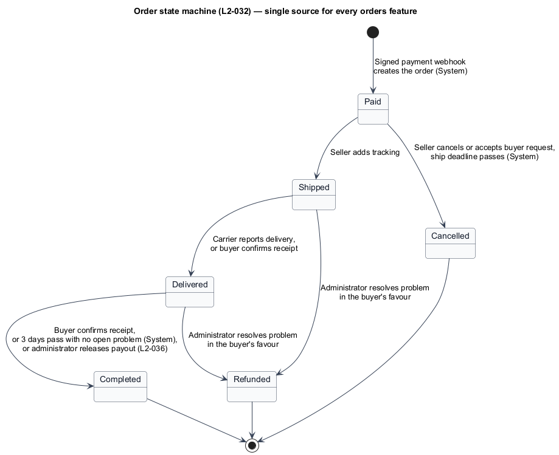
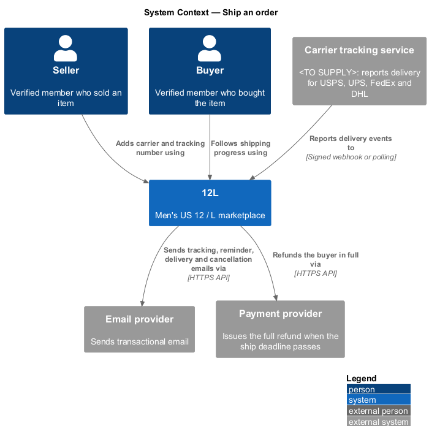
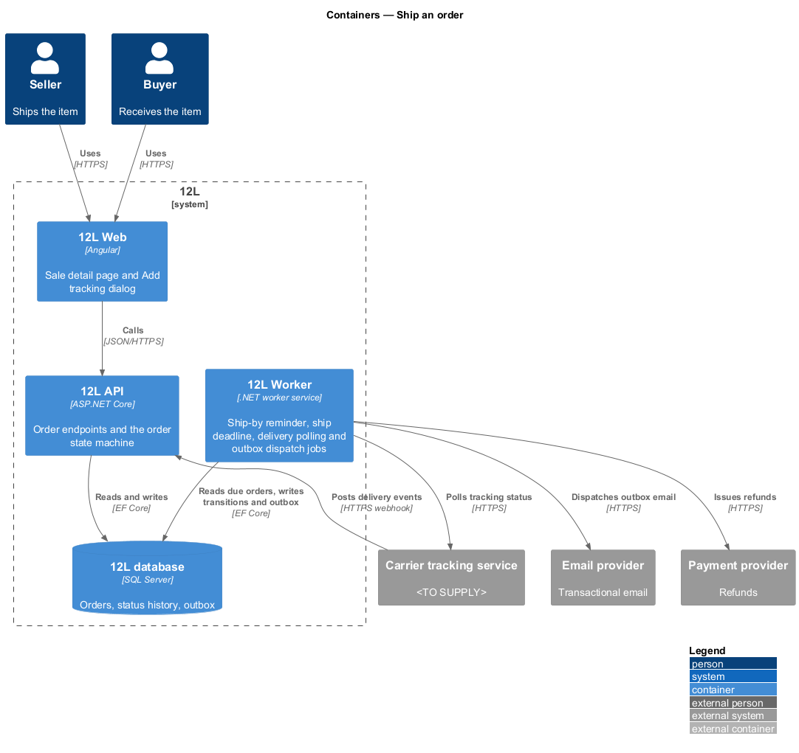
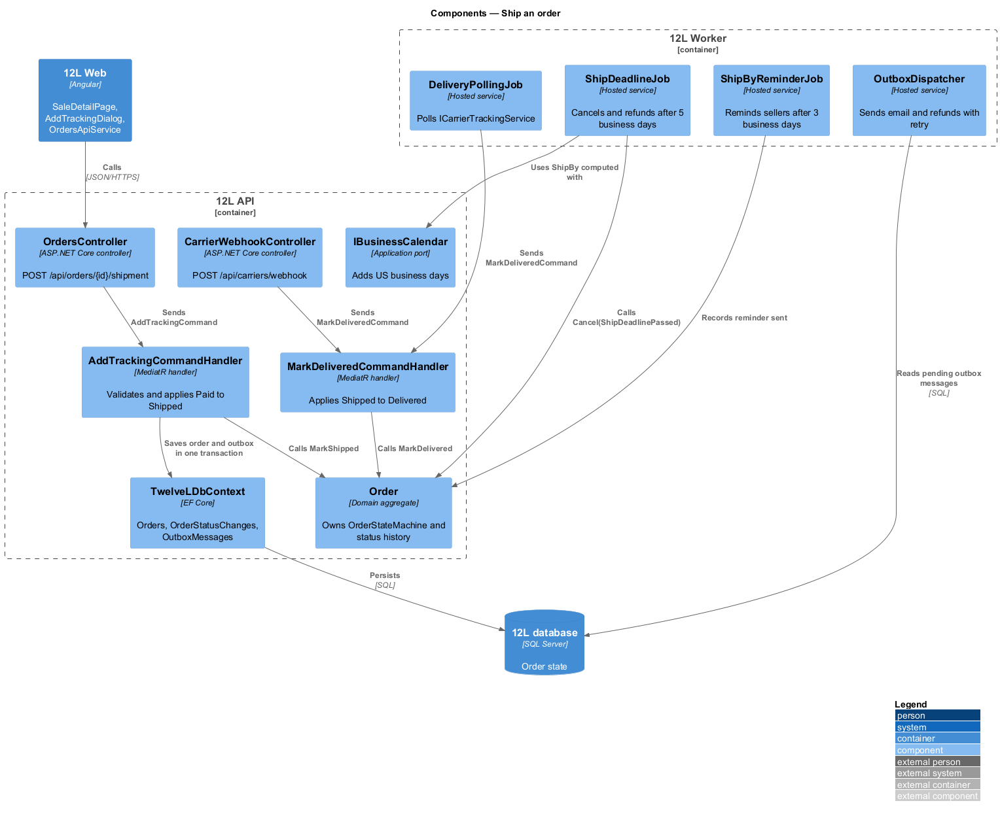
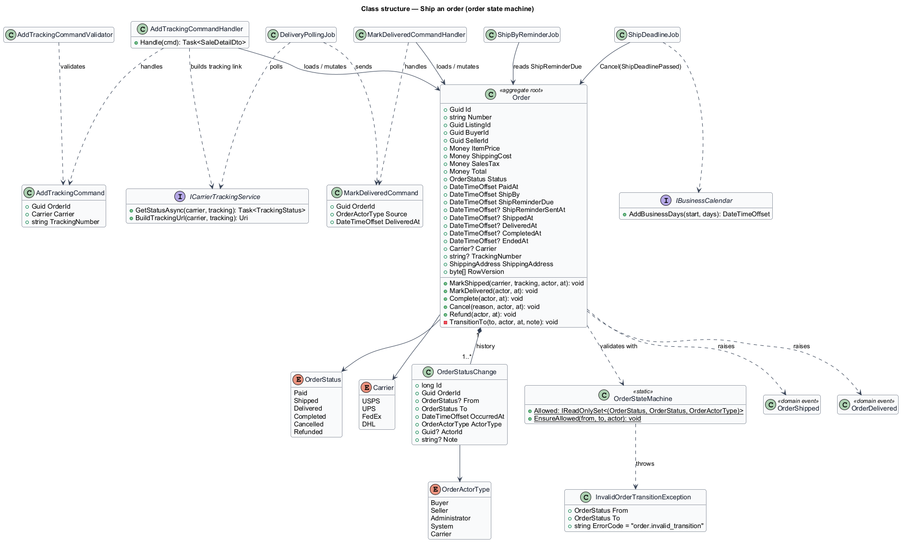
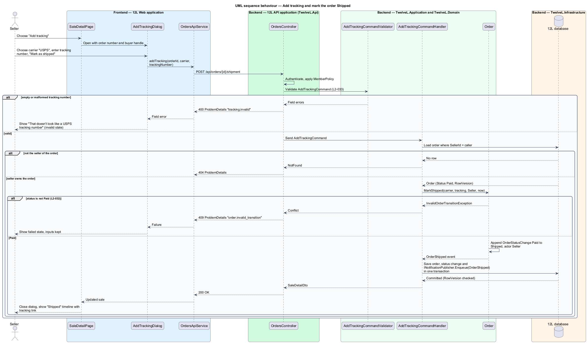
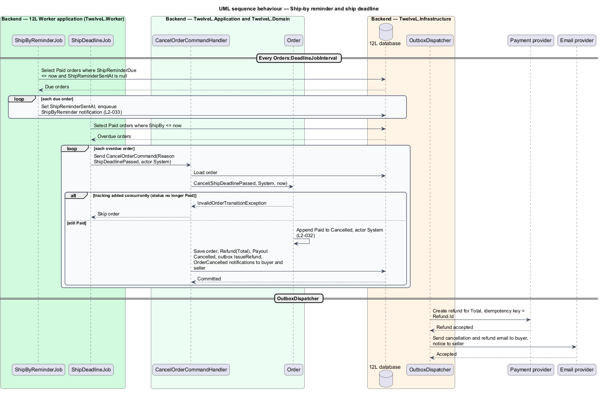
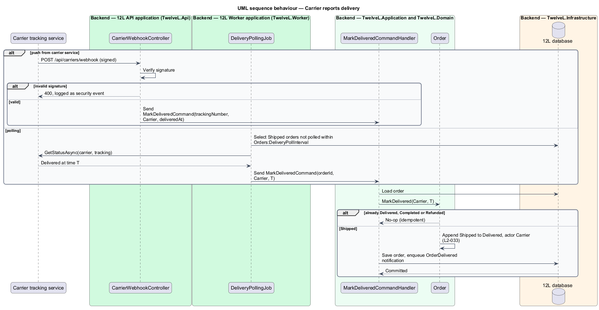

# Ship an order

## Overview

12L is a marketplace for men's US size 12 shoes and men's size L clothing. An
*order* is the record 12L creates when a buyer's payment for a listing is confirmed;
it ties together one listing, one buyer, one seller, the amounts paid and the
shipping address. This feature covers the stretch of an order's life between payment
and delivery: the seller ships the item, enters a carrier and tracking number, and
the carrier later reports delivery.

This design is also the single home of the **order state machine** — the rule set
that names every order status, every allowed transition and who may trigger it
(`L2-032`). The other six features of the `orders` subsystem (checkout-and-pay,
seller-payouts, complete-order, cancel-order, resolve-order-problems, order-history)
call the `Order` aggregate defined here and do not restate its rules.

Terms used in this design:

- **order status** — one of `Paid`, `Shipped`, `Delivered`, `Completed`, `Cancelled` or `Refunded`
- **terminal status** — status that accepts no further transition: `Completed`, `Cancelled`, `Refunded`
- **status change** — append-only history row holding the old status, new status, time and actor of one transition
- **ship-by date** — instant 5 US business days after payment by which the seller shall add tracking
- **reminder date** — instant 3 US business days after payment at which an unshipped seller is reminded
- **business day** — Monday to Friday, excluding US holidays listed in `<TO SUPPLY>`
- **actor** — party recorded against a transition: buyer, seller, administrator, system (a 12L job) or carrier

A Paid order has a ship-by date. The seller adds tracking before it, the order becomes
Shipped and the buyer is emailed the tracking link. Without tracking by the reminder
date, the seller is emailed a reminder; without tracking by the ship-by date, a
background job cancels the order and refunds the buyer in full. When the carrier
reports delivery, the order becomes Delivered and the completion clock of
[complete-order](../complete-order/README.md) starts.

## Description

### Order state machine (shared by every orders feature)

`OrderStateMachine` in `TwelveL.Domain` holds the allowed transitions as a static set
of `(from, to, actor)` triples. `Order.TransitionTo` is the only code path that
changes `Order.Status`; it calls `OrderStateMachine.EnsureAllowed`, appends an
`OrderStatusChange`, sets the timestamp column for the new status and raises a domain
event. Any other `(from, to)` pair, and any transition out of a terminal status,
throws `InvalidOrderTransitionException`. The API maps that exception to HTTP 409 with
error code `order.invalid_transition` (`L2-032` criteria 1 and 3).

| From | To | Allowed actors | Entry point (feature) | Domain method |
|------|----|----------------|------------------------|---------------|
| *(none)* | `Paid` | System | Signed payment webhook (checkout-and-pay) | `Order.CreatePaid(...)` factory |
| `Paid` | `Shipped` | Seller | Add tracking (this feature) | `MarkShipped` |
| `Paid` | `Cancelled` | Seller, System | Seller cancels or accepts a buyer request (cancel-order); ship deadline job (this feature) | `Cancel` |
| `Shipped` | `Delivered` | Carrier, Buyer | Carrier delivery event (this feature); buyer confirms receipt (complete-order) | `MarkDelivered` |
| `Delivered` | `Completed` | Buyer, System, Administrator | Buyer confirms receipt; auto-completion job (complete-order); problem resolved in the seller's favour (resolve-order-problems, `L2-036` criterion 4) | `Complete` |
| `Shipped`, `Delivered` | `Refunded` | Administrator | Problem resolved in the buyer's favour (resolve-order-problems) | `Refund` |

The Administrator actor on `Delivered → Completed` comes from `L2-036` criterion 4. Releasing the
payout on a problem opened while the order is still `Shipped` (for example "not received")
would need an Administrator `Shipped → Delivered` step that `L2-032` does not list; the design
refuses that release with `order.invalid_transition` until the rule is `<TO SUPPLY>`.
Each transition into a terminal status also sets
`Order.EndedAt`, which drives the 30-day address window in
[order-history](../order-history/README.md).

Domain events raised by `Order`: `OrderPaid`, `OrderShipped`, `OrderDelivered`,
`OrderCompleted`, `OrderCancelled`, `OrderRefunded`. Handlers in the same unit of work
turn them into email through `INotificationPublisher.Enqueue(type, recipientMemberId, model)`
(see [send-email-notifications](../../notifications/send-email-notifications/README.md), which
writes `EmailNotificationRequested` to `OutboxMessages`), refund outbox messages and payout
updates. `OrderCompleted` is also consumed by the reviews subsystem to open reviews and update
the `MemberReputation` projection.

### Frontend (`src/frontend/src/app/orders/`)

- **`SaleDetailPage`** (route `/sales/:id`, mock `docs/mocks/pages/sale-detail/`) — seller view of one order. For a Paid order it shows "You made a sale", "Ship by **Fri 30 Oct**.", the buyer's address under "Ship to" with "Visible until 30 days after the order ends.", and the actions "Add tracking" (primary) and "Cancel order" (ghost). For a Shipped order (state `shipped`) it shows the heading "Shipped", the `OrderTimelineComponent` and the tracking link. States: `loading` (two-column skeleton), `error` ("Couldn't load this sale", reference code, "Try again", "Back to sales").
- **`AddTrackingDialog`** (mock `docs/mocks/dialogs/add-tracking/`) — title "Add tracking", description "We'll email {buyer} the tracking link.", a "Carrier" select (USPS, UPS, FedEx, DHL; focused on open) and a "Tracking number" input. Primary "Mark as shipped", secondary "Cancel". States: `default`; `invalid` (inline error such as "That doesn't look like a USPS tracking number. It's usually 22 digits.", input kept); `busy` (primary `aria-busy`, Cancel disabled); `failed` ("That didn't go through" alert, inputs kept, primary becomes "Try again").
- **`OrderTimelineComponent`** — shared `<ol class="timeline">` of Paid, Shipped, Delivered, Completed with the date of each reached step and `aria-current="step"` on the current one; built from `OrderStatusChange` rows. Reused by buyer and seller pages.
- **`TrackingLinkComponent`** — "{carrier} tracking" label and the tracking number as an external link built by the API.
- **`OrdersApiService`** — typed client; `addTracking(orderId, { carrier, trackingNumber })` returns `SaleDetail`.

### API (`TwelveL.Api`)

- **`OrdersController`**
  - `POST /api/orders/{id}/shipment` — body `{ carrier, trackingNumber }`. Policy `VerifiedMember`. Responses: `200` with `SaleDetailDto`; `400` `tracking.invalid` with field errors; `401` anonymous; `404` when the caller is not the order's seller (`L2-010`); `409` `order.invalid_transition` when the order is not Paid; `409` `concurrency.conflict` when the row version changed.
- **`CarrierWebhookController`**
  - `POST /api/carriers/webhook` — anonymous; verifies the carrier tracking service signature. `200` on accepted or duplicate event; `400` and a security log entry on an invalid signature. Whether delivery arrives by webhook, by polling, or both depends on the carrier tracking service, which is `<TO SUPPLY>`.

### Application and domain (`TwelveL.Application`, `TwelveL.Domain`)

- **`Order`** (aggregate root) — key fields: `Id` (`Guid`), `Number` (`string`, format `12L-NNNNN` from SQL sequence `OrderNumbers`, start value `<TO SUPPLY>`), `ListingId`, `CheckoutId`, `BuyerId`, `SellerId`, `ItemPrice`, `ShippingCost`, `SalesTax`, `Total` (`Money`, `decimal(10,2)` USD, `L2-018`), `FeeRate`, `FeeAmount`, `Status`, `PaidAt`, `ShipBy`, `ShipReminderDue`, `ShipReminderSentAt`, `ShippedAt`, `DeliveredAt`, `CompletedAt`, `EndedAt`, `Carrier`, `TrackingNumber`, `ShippingAddress` (value object persisted as `ShippingAddressCipher`), `PaymentReference`, `CardBrand`, `CardLast4`, `RowVersion`. Methods listed in the state machine table.
- **`OrderStatusChange`** — `Id`, `OrderId`, `From` (nullable for creation), `To`, `OccurredAt`, `ActorType` (`OrderActorType`: Buyer, Seller, Administrator, System, Carrier), `ActorId` (nullable for System and Carrier), `Note`.
- **`Carrier`** enumeration — `USPS`, `UPS`, `FedEx`, `DHL` (from the mock's carrier list).
- **`AddTrackingCommand`** — `OrderId`, `Carrier`, `TrackingNumber`.
- **`AddTrackingCommandValidator`** (FluentValidation) — carrier required and in the enumeration; tracking number required, whitespace removed, then matched against a per-carrier pattern from configuration `Carriers:{name}:TrackingPattern`. The USPS message reads "That doesn't look like a USPS tracking number. It's usually 22 digits." The exact patterns for each carrier are `<TO SUPPLY>`.
- **`AddTrackingCommandHandler`** — loads the order filtered by `SellerId = caller` (404 otherwise), calls `Order.MarkShipped`, calls `INotificationPublisher.Enqueue(NotificationType.OrderShipped, buyerId, ...)` with the tracking link from `ICarrierTrackingService.BuildTrackingUrl`, and saves in one transaction (`L2-033` criterion 1, `L2-042`).
- **`MarkDeliveredCommand`** / **`MarkDeliveredCommandHandler`** — idempotent: an order already Delivered or later is left unchanged. On a Shipped order it calls `MarkDelivered(Carrier, deliveredAt)` and enqueues `NotificationType.OrderDelivered` to the buyer (`L2-033` criterion 4).
- **`IBusinessCalendar`** — `AddBusinessDays(start, days)`; implementation `UsBusinessCalendar` reads the holiday list from configuration `Orders:Holidays` (`<TO SUPPLY>`). The mocks agree with weekdays only: paid Sat 24 Oct gives ship-by Fri 30 Oct, and paid Thu 22 Oct gives ship-by Thu 29 Oct. `Order.CreatePaid` sets `ShipBy = AddBusinessDays(PaidAt, 5)` and `ShipReminderDue = AddBusinessDays(PaidAt, 3)`; the time-of-day cut-off and the time zone used to count days are `<TO SUPPLY>`.
- **`ICarrierTrackingService`** — `GetStatusAsync(carrier, trackingNumber)`, `BuildTrackingUrl(carrier, trackingNumber)`, `VerifySignature(payload, headers)`.

### Worker jobs (`TwelveL.Worker`)

- **`ShipByReminderJob`** — runs every `Orders:DeadlineJobInterval` (default `<TO SUPPLY>`). Selects Paid orders with `ShipReminderDue <= now` and `ShipReminderSentAt IS NULL`, sets `ShipReminderSentAt` and enqueues `NotificationType.ShipByReminder` to the seller (`L2-033` criterion 3).
- **`ShipDeadlineJob`** — same interval. Selects Paid orders with `ShipBy <= now` and sends `CancelOrderCommand` with reason `ShipDeadlinePassed` and actor System. The cancel handler from [cancel-order](../cancel-order/README.md) applies `Paid → Cancelled`, creates a full `Refund`, cancels the payout and emails the buyer and the seller (`L2-033` criterion 2). An order shipped between the select and the update fails the transition and is skipped.
- **`DeliveryPollingJob`** — when the carrier service is polled, selects Shipped orders whose `TrackingLastPolledAt` is older than `Orders:DeliveryPollInterval` and sends `MarkDeliveredCommand` for each delivered result.
- **`OutboxDispatcher`** — shared dispatcher from the platform baseline; sends the email (designed in send-email-notifications) and refund messages above with retry and back-off for up to 24 hours (`L2-042`).

### Data (`TwelveL.Infrastructure`, `TwelveLDbContext`)

- **`Orders`** — primary key `Id`; unique index `UX_Orders_Number`; `RowVersion` (`rowversion`) as the EF Core concurrency token; filtered unique index `UX_Orders_ListingId_NotCancelled` on `ListingId` where `Status <> 'Cancelled'` (used by checkout-and-pay); indexes `IX_Orders_Status_ShipBy` (deadline job), `IX_Orders_Status_ShipReminderDue` (reminder job), `IX_Orders_Status_DeliveredAt` (auto-completion), `IX_Orders_BuyerId_PaidAt` and `IX_Orders_SellerId_PaidAt` (history). `Status` is stored as `nvarchar(16)` through a value converter. The shipping address is stored in `ShippingAddressCipher` with its key-id column, encrypted with AES-256-GCM by the `AesGcmFieldEncryptor` value converter defined in [protect-personal-data](../../privacy/protect-personal-data/README.md) (`L2-054`).
- **`OrderStatusChanges`** — append-only; index `IX_OrderStatusChanges_OrderId_OccurredAt`. No update or delete path exists in the application.
- **`OutboxMessages`** — shared outbox table from the platform baseline.

### Error codes

| Code | HTTP | Meaning |
|------|------|---------|
| `order.invalid_transition` | 409 | The requested transition is not in the state machine table |
| `tracking.invalid` | 400 | Carrier missing or tracking number empty or malformed |
| `concurrency.conflict` | 409 | The order changed since it was read |

## Requirements

| L2 ID | Refines (L1) | Requirement |
|-------|--------------|-------------|
| `L2-032` | `L1-008` | An order shall move through the statuses Paid, Shipped, Delivered and Completed, or end as Cancelled or Refunded. Only the transitions in this requirement shall be allowed, and every transition shall be recorded with its time and the actor. |
| `L2-033` | `L1-008` | The seller shall ship within 5 business days of payment and enter a carrier and tracking number. If no tracking is added in that time, the order shall be cancelled and the buyer fully refunded. The seller shall be able to see the buyer's shipping address for their order. |

## Diagrams

### Order state machine

The order holds one of six statuses. The arrows are the only transitions the domain
accepts; each label names the trigger and the actor recorded in `OrderStatusChanges`.

### System context

The seller ships through 12L. 12L emails the buyer through the email provider, learns
of delivery from a carrier tracking service (`<TO SUPPLY>`) and refunds missed
deadlines through the payment provider.

### Containers

`12L Web` calls `12L API` to add tracking. `12L Worker` runs the reminder, deadline and
delivery jobs and dispatches outbox email and refunds.

### Components

`OrdersController` dispatches `AddTrackingCommand`. The worker jobs and the carrier
webhook drive the remaining transitions through the same `Order` aggregate.

### Class structure

`Order` composes its `OrderStatusChange` history and validates every transition
through `OrderStateMachine`. The handlers and jobs depend on `IBusinessCalendar` and
`ICarrierTrackingService`.

### Behaviour — add tracking

The validator rejects a malformed tracking number with HTTP 400. A non-owner gets
HTTP 404, and a non-Paid order gets HTTP 409. Otherwise the order becomes Shipped and
the tracking email is queued in the same transaction.

### Behaviour — ship-by reminder and deadline

The reminder job emails sellers at 3 business days. The deadline job cancels and
refunds at 5 business days, skipping any order that was shipped in the meantime.

### Behaviour — delivery

Delivery arrives either as a signed carrier webhook or through polling. Both paths send
the same idempotent `MarkDeliveredCommand`.

