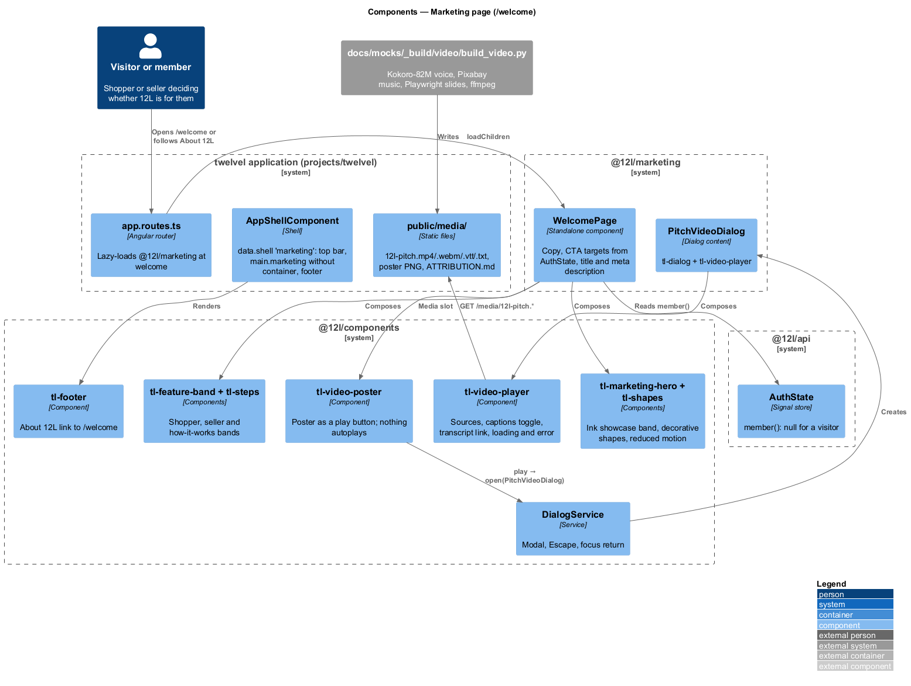
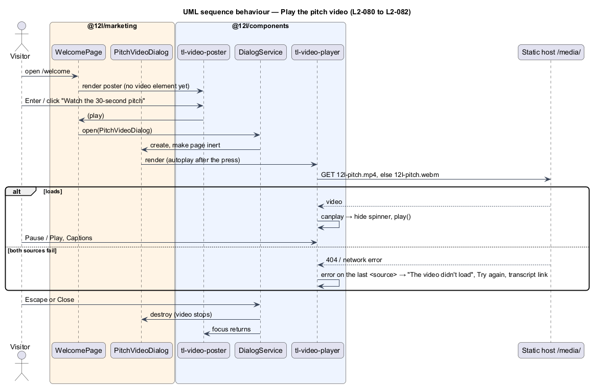

# Marketing page

## Overview

12L is a marketplace for men's US size 12 shoes and men's size L clothing. This feature, part
of the `platform` subsystem, adds a public marketing page at `/welcome` that sells 12L to
shoppers and sellers, with a 30-second pitch video. Anyone can open it, signed in or not. It
refines `L1-020` through `L2-078` to `L2-083`. `/` stays the catalog.

Terms used below:

- **showcase** — the ink surface with a gradient used by the hero, the closing band and the
  video frame; ink in both themes ([design system](../../../design-system/components/marketing-hero.html))
- **pitch video** — `12l-pitch.mp4` (H.264/AAC) and `12l-pitch.webm` (VP9/Opus), 30.0 s,
  with `12l-pitch.vtt` captions, `12l-pitch.txt` transcript and `12l-pitch-poster.png`

The page calls no 12L API endpoint; the shell's `GET /api/auth/me` decides the seller target.
Nothing in the size rules, the catalog, sell, accounts or the API changes. The copy avoids
"only" and names no other sizes ([ADR general/0005](../../../adr/general/0005-marketing-size-wording.md)).

## Description

### Library, route and shell ([ADR platform/0011](../../../adr/platform/0011-marketing-feature-library.md))

- `src/frontend/projects/marketing/` (alias `@12l/marketing`), built by `build:libs`, exports
  `routes`: `{ path: '', loadComponent: WelcomePage, title: 'Built for size 12 and L · 12L',
  data: { shell: 'marketing' } }`.
- `app.routes.ts` mounts it lazily at `welcome`, before the catalog's empty-path routes.
- `AppShellComponent` gains the `marketing` shell: same payout banner, top bar and footer, but
  `<main id="main" class="marketing" tabindex="-1">` without `.container.page`, so bands are
  full width.

### Components (`@12l/components`)

| Component | Inputs and outputs | Notes |
|---|---|---|
| `tl-marketing-hero` | `eyebrow`, `lede`, `variant: 'hero' \| 'closing'`, `headingId`; slots `[title]`, `[actions]`, `[media]` | h1 in the hero, h2 in the closing band; re-points semantic tokens to the showcase |
| `tl-shapes` | `density: 'full' \| 'quiet'` | `aria-hidden`; drift stops under reduced motion |
| `tl-feature-band` | `eyebrow`, `heading`, `headingId`, `points`, `tone: 'default' \| 'surface'`, `stacked`; slots `[actions]`, body | Section labelled by its h2 |
| `tl-steps` | `steps: { title, text }[]` | Ordered list, h3 titles |
| `tl-video-poster` | `poster`, `label`, `duration`; output `play` | Native button; no `<video>` on the page |
| `tl-video-player` | `label`, `sources`, `captions`, `transcript`, `poster`, `autoplay` | States: loading, ready, error; Play/Pause, Captions (`aria-pressed`), transcript link; error when the last `<source>` fails |

### Feature (`@12l/marketing`)

- **`WelcomePage`** — static copy (headlines of 3 to 6 words, matching the reference site's
  range), `sellHref = computed(() => auth.member() ? '/sell' : '/join')`, the meta
  description through Angular's `Meta` (removed on destroy), and `openVideo()` that calls
  `DialogService.open(PitchVideoDialog)`.
- **`PitchVideoDialog`** — `tl-dialog` (`lg`, "12L in 30 seconds") around `tl-video-player`
  with `autoplay` true: it opens only from the poster press, so playback with sound is the
  visitor's choice. Closing destroys the video, which stops it.

### Media and video build

Media lives in `src/frontend/projects/twelvel/public/media/` (served at `/media/`) and is
copied to `docs/mocks/assets/media/`. `docs/mocks/_build/video/build_video.py` builds it
(rerun: `python -I docs/mocks/_build/video/build_video.py`):

1. Narration: six lines, each with caption text and spoken text, synthesised by **Kokoro-82M**
   from Hugging Face (`onnx-community/Kokoro-82M-v1.0-ONNX`), voice **`af_bella`** at speed
   1.12 — the highest-rated English voice, bright and upbeat. Model files download to the
   git-ignored `kokoro/` folder.
2. Timing: gaps stretch so the video is exactly 30.0 s (speech 22.4 s).
3. Slides: six 1920×1080 slides in 12L tokens (ink gradient, paper, signal red, Archivo and
   Inter, chamfered shapes, the logo), screenshotted by Playwright Chromium.
4. Music: _Energetic Hip-Hop_ by SoundSurfer (Pixabay Content Licence), 0:08 to 0:42,
   committed as an excerpt, at −9 dB and ducked by a sidechain compressor keyed on the voice.
5. Encode: MP4 (libx264 CRF 24, AAC 128k, faststart; 1.4 MB) and WebM (VP9 CRF 38, Opus;
   0.8 MB). The WebM exists because Playwright's Chromium has no H.264 decoder; browsers pick
   the first source they can play.
6. Captions from the line timings, transcript, poster (last slide) and `ATTRIBUTION.md`.

### Tests (`src/frontend/e2e/`)

`tests/marketing-page.spec.ts` with `pages/welcome.page.ts`, served by the static build; the
media come from the build, and the error state routes `**/media/12l-pitch.*` to 404. `serve.mjs`
learns the media content types. Covers `L2-078` to `L2-083`, including reduced motion and the
footer link.

## Requirements

| L2 ID | Refines (L1) | Requirement |
|-------|--------------|-------------|
| `L2-078` | `L1-020` | Page sections and CTA targets for visitors and members |
| `L2-079` | `L1-020` | Footer "About 12L" link |
| `L2-080` | `L1-020` | Poster first, no autoplay, keyboard play and pause |
| `L2-081` | `L1-020` | Captions toggle and transcript link |
| `L2-082` | `L1-020` | Video error state; page stays usable |
| `L2-083` | `L1-020` | Contrast over gradients, heading order, reduced motion, title and meta description |

Related requirements applied without restating them: `L2-061` to `L2-065` (responsive,
accessible shell), `L2-010` (no role needed).

## Diagrams

### Components

### Behaviour — play the pitch video

## Open questions

- Should the size lock widen to men's US 11 to 11.5 shoes and L, XL, XXL and up clothing?
  Deferred to the product owner ([ADR general/0005](../../../adr/general/0005-marketing-size-wording.md)).
- Deferred: SEO beyond the title and meta description, analytics, A/B tests, newsletter
  sign-up, making `/welcome` the home page, translations and other video lengths or cuts.
