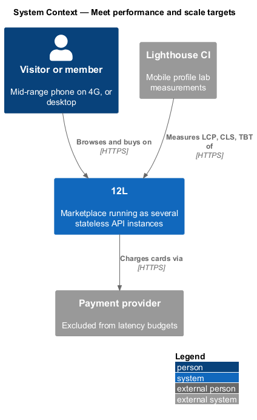
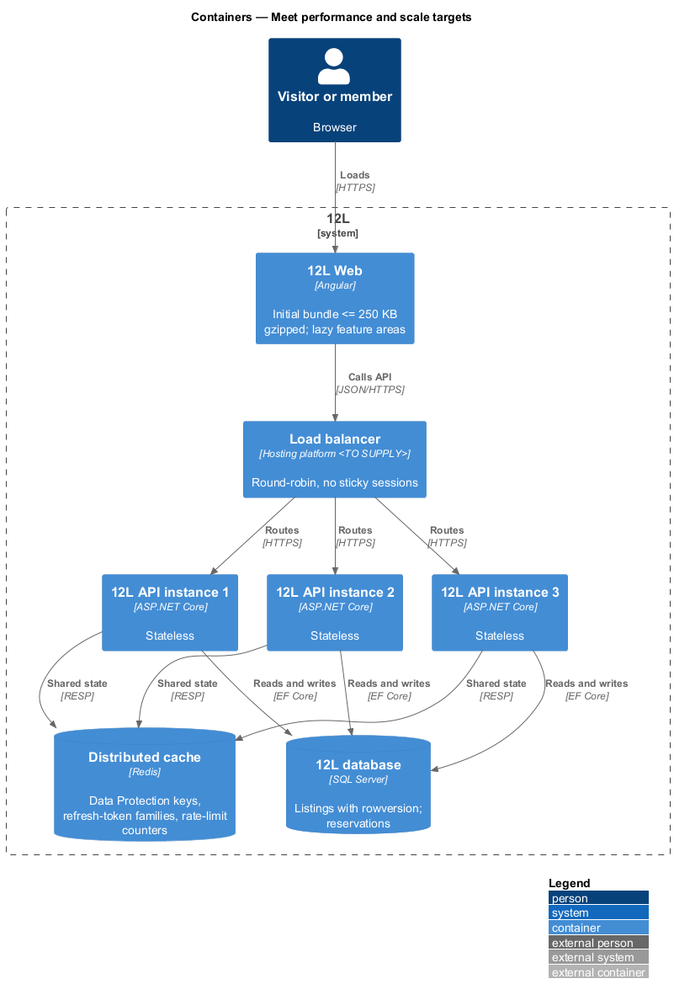
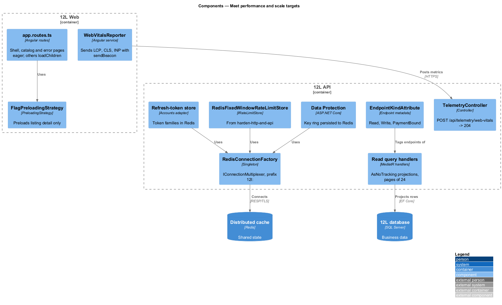
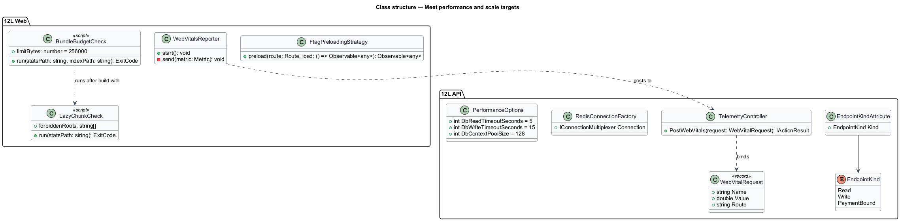
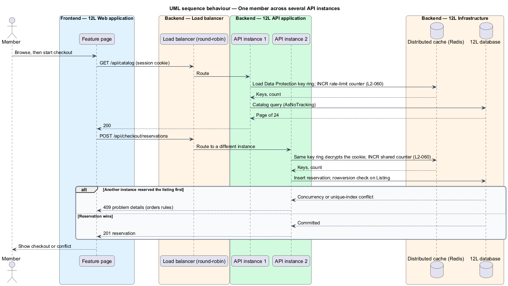
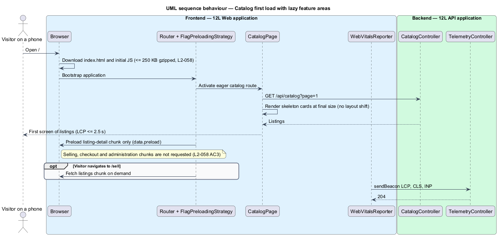
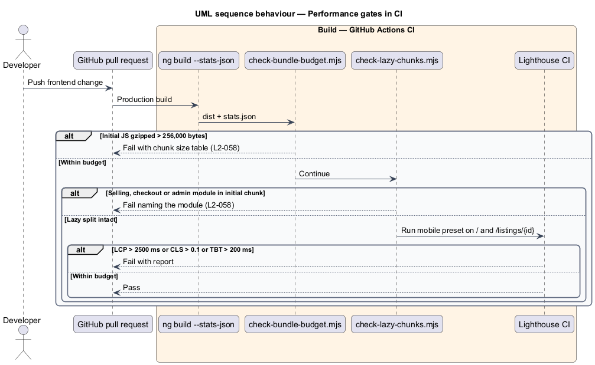

# Meet performance and scale targets

## Overview

12L shoppers mostly browse on phones. A slow catalog loses them, and a sale
lost to a timeout loses a seller's income. This feature, part of the `platform`
subsystem, sets and enforces the performance budgets that every other feature
works within, and makes the API safe to run as several identical instances.
No load test, performance environment or multi-instance scale test is built; that
is scope creep removed by [ADR 0002](../../../adr/general/0002-no-load-or-scale-tests.md).

It covers two concerns:

- **frontend performance budget** — Lighthouse mobile targets for Largest Contentful Paint (LCP), Cumulative Layout Shift (CLS) and Interaction to Next Paint (INP), plus a 250 KB gzipped limit on the initial JavaScript, with feature areas lazy loaded (`L2-058`)
- **stateless API** — API that keeps no per-member or per-request state in process memory between requests, so the load balancer may send any request to any instance (`L2-060`)

Terms used below:

- **initial JavaScript** — scripts the browser downloads before the first route renders: those referenced from `index.html` plus their static imports
- **lazy-loaded feature area** — Angular route tree whose code is fetched only when the visitor navigates into it
- **shared state** — state that every API instance reads and writes in the `Distributed cache` (Redis) or the `12L database`

The feature owns the shared-state wiring, the budgets and the CI checks.
Query design for each read belongs to its own feature; for example
[browse-catalog](../../catalog/browse-catalog/README.md) owns the catalog query
and its indexes. Image delivery (`L2-059`) belongs to the catalog subsystem.

## Description

### Frontend (`12L Web`)

- **`app.routes.ts`** — the root route table. Only the shell
  (responsive-accessible-shell), the catalog home route `/` and the error pages
  are in the initial bundle. Every other area loads through `loadChildren`:

  | Path prefix | Lazy module | Feature area |
  |-------------|-------------|--------------|
  | `/listings/:id` | `catalog/listing-detail.routes.ts` | catalog |
  | `/sell`, `/account/listings` | `listings/listings.routes.ts` | listings (selling) |
  | `/checkout`, `/orders`, `/account/purchases`, `/account/sales`, `/account/payouts` | `orders/orders.routes.ts` | orders (checkout) |
  | `/admin` | `orders/admin.routes.ts` | orders (administration: order problems) |
  | `/sign-in`, `/join`, `/account`, `/settings` | `accounts/accounts.routes.ts` | accounts |
  | `/members/:handle`, reviews | `reviews/reviews.routes.ts` | reviews |
  | `/privacy`, `/terms`, `/rules` | `privacy/privacy.routes.ts` | privacy and legal |

- **`FlagPreloadingStrategy`** — `PreloadingStrategy` that preloads only routes
  with `data: { preload: true }`, after the first render and only when
  `navigator.connection.saveData` is not set. Only the listing-detail route
  carries the flag. Selling, checkout and administration code is therefore never
  downloaded on the catalog (`L2-058` AC3).
- **`angular.json` budgets** — `initial`: warning 220 kB, error 700 kB raw (an
  early warning on uncompressed size); `anyComponentStyle`: error 8 kB. Angular
  budgets measure uncompressed bytes, so they do not enforce the gzip limit on
  their own.
- **`scripts/check-bundle-budget.mjs`** — runs after `ng build
  --configuration production --stats-json`. It reads `index.html`, collects the
  initial scripts and their static imports from `stats.json`, gzips each at level
  9, and fails the build when the sum exceeds 256,000 bytes (250 KB). It prints a
  table of chunk names and gzipped sizes.
- **`scripts/check-lazy-chunks.mjs`** — reads `stats.json` and fails when any
  initial chunk contains a module under `src/app/listings` or `src/app/orders`. It also writes `dist/lazy-chunk-map.json`, used by the
  Playwright test below.
- **Rendering rules for LCP and CLS** — the catalog's first-screen photos load
  eagerly with `fetchpriority="high"` on the first card; every image has width
  and height (catalog subsystem); skeleton cards occupy the final grid size
  (`docs/mocks/pages/catalog/loading.html`); fonts fall back to the system sans
  with no web-font request (mocks README). Components use `OnPush` change
  detection and signals; long lists use `track` in `@for`.
- **`WebVitalsReporter`** — root service that registers `onLCP`, `onCLS` and
  `onINP` from the `web-vitals` package and sends each final value with
  `navigator.sendBeacon` to `POST /api/telemetry/web-vitals`. This field data
  measures INP, which Lighthouse cannot measure in a navigation run.

### API (`TwelveL.Api`)

- **`TelemetryController`** — `POST /api/telemetry/web-vitals` accepts
  `{ name: "LCP" | "CLS" | "INP", value: number, route: string }`, returns 204,
  and records the value into histograms `twelvel_web_vitals_lcp_ms`,
  `twelvel_web_vitals_cls` and `twelvel_web_vitals_inp_ms` tagged by route
  template. The endpoint is anonymous, exempt from the antiforgery check because
  it changes no member state and `sendBeacon` cannot set headers, and limited by
  the default rate-limit policy. Body limit 1 KB.
- **`EndpointKindAttribute(EndpointKind.Read | Write | PaymentBound)`** —
  endpoint metadata used by the latency metrics of report-errors-and-observe.
  Reads: catalog, search, listing and profile queries. Writes: create-listing,
  update-listing and every other command. `PaymentBound` marks checkout and
  refund endpoints whose time includes the payment provider.
- **Stateless rules** — enforced by an architecture test
  (`StatelessApiTests`, NetArchTest) that fails when `TwelveL.Api` or
  `TwelveL.Application` registers `IMemoryCache`, `AddSession`,
  `AddDistributedMemoryCache`, or a singleton holding mutable collections.
  Sticky sessions are off at the load balancer.

### Infrastructure (`TwelveL.Infrastructure`)

- **`RedisConnectionFactory`** — singleton `IConnectionMultiplexer` from
  `Redis:ConnectionString` (secret store), `AbortOnConnectFail = false`,
  connect timeout 5 s, key prefix `12l:`.
- **Shared state in Redis**:

  | State | Owner | Key pattern | Expiry |
  |-------|-------|-------------|--------|
  | ASP.NET Core Data Protection key ring (cookie and antiforgery encryption) | this feature | `12l:dataprotection-keys` | none (keys rotate every 90 days by default) |
  | Refresh-token families and revocations | accounts ([manage-sessions](../../accounts/manage-sessions/README.md)) | `12l:rt:family:{familyId}` | 14 days |
  | Rate-limit counters | harden-http-and-api | `12l:rl:…` | window length |
  | `IDistributedCache` entries | any feature | `12l:cache:{name}:{key}` | per entry |

  `AddDataProtection().SetApplicationName("12L").PersistKeysToStackExchangeRedis(…)`
  makes a cookie or antiforgery token issued by one instance readable by every
  other instance. Protection of the key ring at rest with a key from the secret
  store is `<TO SUPPLY>` (depends on the vault product).
- **Shared state in the database** — listing reservations (`L2-028`) and
  single sale (`L2-029`) rely on the `12L database` with a `rowversion`
  concurrency token on `Listings` and a unique index on the active reservation
  (orders subsystem, [checkout-and-pay](../../orders/checkout-and-pay/README.md)).
  This feature owns that wiring.
- **Read-path conventions** — query handlers use `AsNoTracking()`, project to
  DTOs with `Select`, page with `Skip/Take` of 24 (catalog), and avoid N+1 by
  projecting related rows in one query. `DbContext` pooling
  (`AddDbContextPool`, pool size 128) and command timeout 5 s for reads,
  15 s for writes.

### Performance checks (CI)

- **Lighthouse CI (`lighthouserc.json`)** — runs `@lhci/cli` with the mobile
  preset three times against `/` and `/listings/{seeded id}` of the production
  build served with a stub API. Assertions: `largest-contentful-paint` ≤ 2500,
  `cumulative-layout-shift` ≤ 0.1, `total-blocking-time` ≤ 200 (lab proxy for
  INP). Runs on every pull request that changes `src/frontend`.
- **`e2e/lazy-loading.spec.ts` (Playwright)** — opens `/` and asserts no
  request matches a chunk listed under selling, checkout or administration in
  `dist/lazy-chunk-map.json`.

### Configuration values

`Redis:ConnectionString` (secret), `Performance:DbReadTimeoutSeconds` = 5,
`Performance:DbWriteTimeoutSeconds` = 15, `Performance:DbContextPoolSize` = 128.

## Requirements

| L2 ID | Refines (L1) | Requirement |
|-------|--------------|-------------|
| `L2-058` | `L1-015` | On a mid-range phone over a simulated 4G connection (Lighthouse mobile profile), the catalog and listing detail pages shall reach Largest Contentful Paint within 2.5 s, Cumulative Layout Shift of 0.1 or less, and Interaction to Next Paint within 200 ms. The initial JavaScript bundle shall be 250 KB or less gzipped, with feature areas lazy loaded. |
| `L2-060` | `L1-015` | The API shall be stateless so it can run as several instances behind a load balancer. Sessions, rate limits and reservations shall work across instances. |

## Diagrams

### System context

Shoppers on phones and desktops use 12L. Lighthouse CI measures the production
build in CI.

### Containers

Several identical `12L API` instances sit behind the load balancer. Session keys,
refresh-token families and rate-limit counters live in the `Distributed cache`;
reservations live in the `12L database`.

### Components

The frontend splits into an initial bundle and lazy feature areas. The API
holds no state in process; Data Protection, the rate-limit store and the token
store all point at Redis.

### Class structure

`FlagPreloadingStrategy` and the budget scripts shape the frontend bundle.
`EndpointKindAttribute` tags endpoints for latency metrics, and
`RedisConnectionFactory` supplies the multiplexer that every shared-state
component uses.

### Behaviour — one member across several instances

Each request may land on a different instance. Every instance decrypts the
session cookie with the shared Data Protection key ring and counts the request in
the shared rate-limit counter.

### Behaviour — catalog first load

The browser downloads the initial bundle and the catalog data only. Listing
detail code preloads after first render; selling, checkout and administration
code stays on the server until the visitor navigates there.

### Behaviour — performance gates

Pull requests run the bundle, lazy-chunk and Lighthouse checks.

