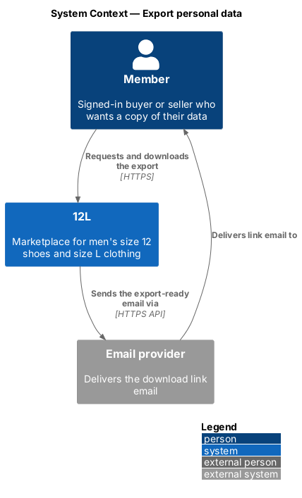
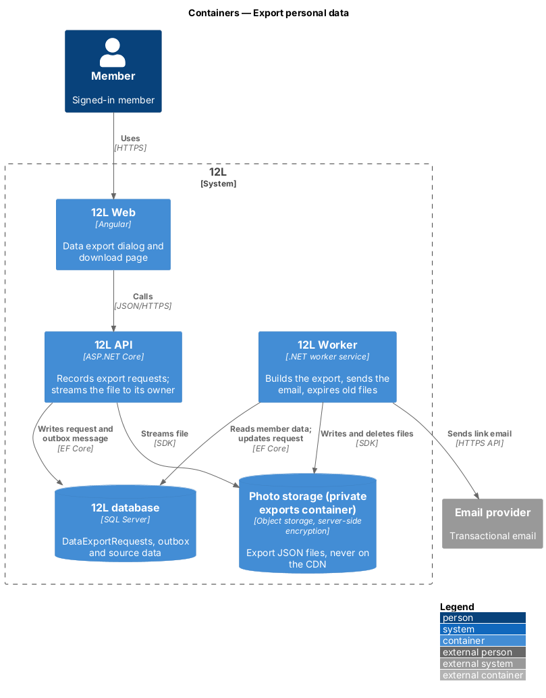
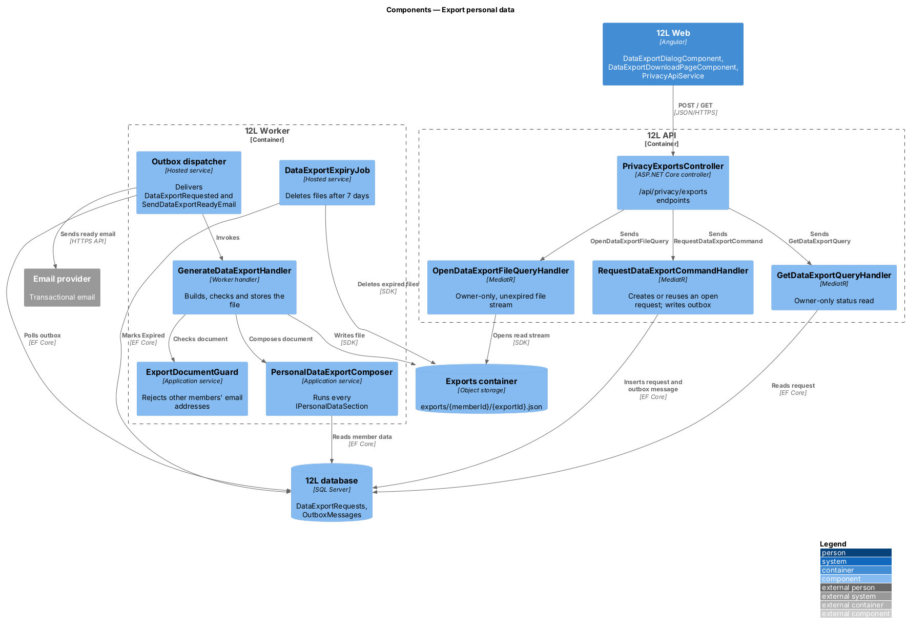
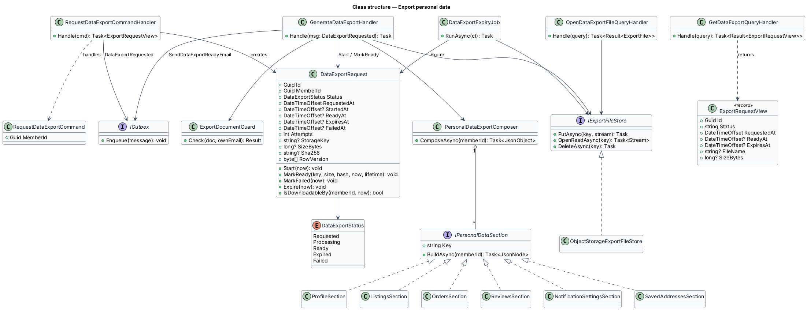
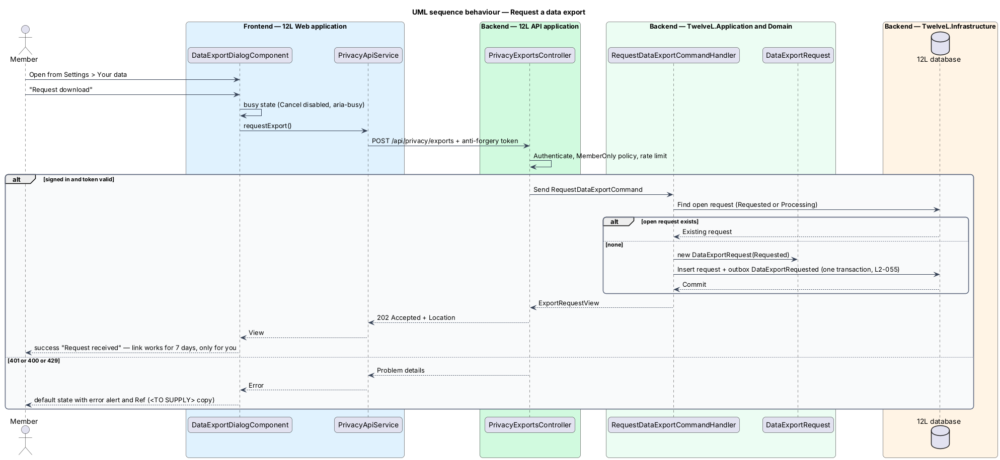
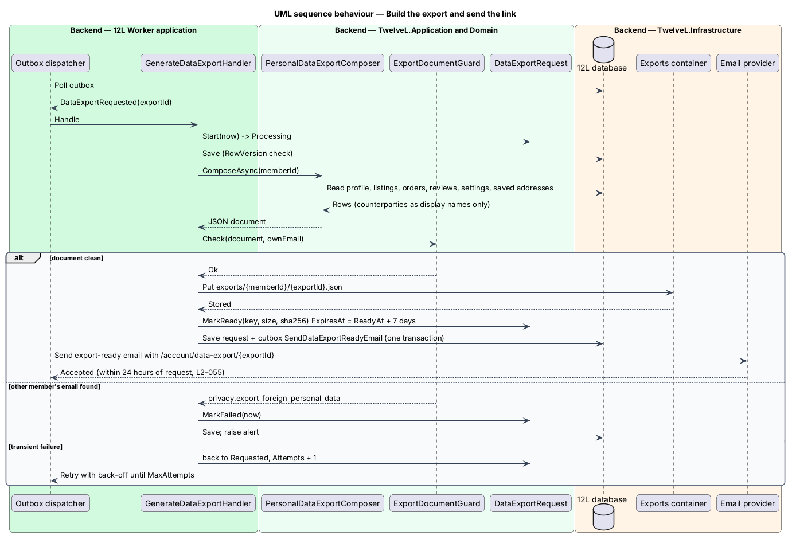
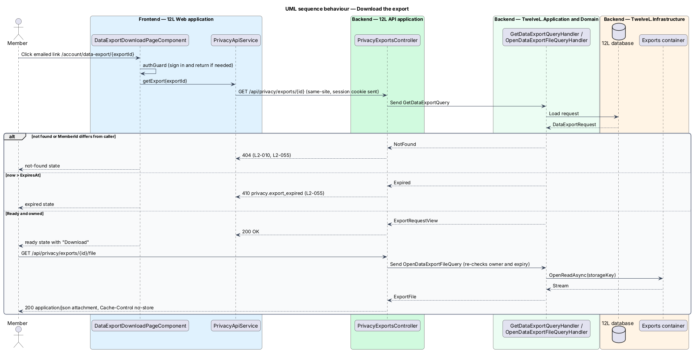

# Export personal data

## Overview

12L is a marketplace for men who wear a US size 12 shoe or a size L top. Members give
12L personal data as they sign up, list items, buy, sell and review. This feature lets a
signed-in member download a copy of all of that data as one JSON file.

The member asks for the copy from Settings. 12L does not build the file during the
request, because collecting every listing, order and review can take longer than an
HTTP request should. Instead, `12L API` records the request and `12L Worker` builds the
file in the background. When the file is ready, 12L emails the member a link. The link
works for 7 days and only for the member who asked.

Terms used below:

> **data export** — JSON file holding the personal data 12L keeps about one member: profile, listings, orders, reviews written and received, and notification settings

> **export request** — record of one member's request for a data export, with its status, timestamps and the location of the finished file

> **download link** — URL in the ready email that opens the export download page in `12L Web`

> **link lifetime** — period after the file is ready during which the download link works: 7 days

> **counterparty** — other member on an order or review, shown in the export by display name only

The feature belongs to the `privacy` subsystem (`L1-014`). It reads data owned by the
accounts, listings, orders, reviews and notifications subsystems but changes none of it.
Account closure and erasure (`L2-005`) belong to the accounts subsystem.

## Description

### Frontend (`12L Web`, `src/frontend/src/app/privacy/`)

- **Settings entry point.** The Settings page (`/account/settings`,
  `docs/mocks/pages/settings/default.html`, owned by the accounts subsystem) shows a
  "Your data" row with the meta text "Download a copy as JSON" and a "Request download"
  button with a download icon. The button opens `DataExportDialogComponent`.
- **`DataExportDialogComponent`** — dialog titled "Download your data"
  (`docs/mocks/dialogs/data-export/`). Its states:
  - `default` — description "Profile, listings, orders, reviews and settings as a JSON
    file. We'll email you a link within 24 hours." with "Cancel" and a primary
    "Request download" button that has initial focus.
  - `busy` — the same content; "Cancel" is disabled and "Request download" carries
    `aria-busy="true"` while the request is in flight.
  - `success` — a success alert with `role="status"`, title "Request received" and text
    "We'll email {email}. The link works for 7 days, only for you." The member's own email
    fills `{email}` (for example `marcus.bell@example.com`). A single "Done" button closes
    the dialog.
  - `error` — not mocked. The dialog returns to `default` and shows the shared inline
    error alert from `shared` with the problem details correlation ID. The copy is
    `<TO SUPPLY>`.

  There is no `invalid` state, because the dialog has no inputs.
- **`DataExportDownloadPageComponent`** — route component at
  `/account/data-export/:exportId`, protected by the existing `authGuard` (signed-out
  visitors go to sign-in and return here). It calls `GET /api/privacy/exports/{id}` and
  renders one of: `loading`, `ready` (file name, size and a "Download" link to
  `/api/privacy/exports/{id}/file`), `expired` (HTTP 410), `not-found` (HTTP 404) or
  `error`. This page is not mocked, so its copy is `<TO SUPPLY>`. The page exists because
  session cookies are `SameSite=Strict` (`L2-008`): a link clicked in an email client is a
  cross-site navigation, so the browser does not send the session cookie with it.
  Landing on a `12L Web` route first makes the following download a same-site
  navigation that carries the cookie.
- **`PrivacyApiService`** — typed HTTP client with `requestExport(): Observable<ExportRequestView>`
  and `getExport(id): Observable<ExportRequestView>`. `ExportRequestView` has `id`,
  `status`, `requestedAt`, `readyAt`, `expiresAt`, `fileName` and `sizeBytes`.

### API (`TwelveL.Api`)

`PrivacyExportsController`, route prefix `/api/privacy/exports`, policy
`MemberOnly` (signed-in member, any status other than closed).

| Verb and path | Success | Failures |
|---------------|---------|----------|
| `POST /api/privacy/exports` | `202 Accepted` with `ExportRequestView` and a `Location` header | `400` missing anti-forgery token (`L2-050`); `401` signed out; `429` rate limit (`L2-051`) |
| `GET /api/privacy/exports/{id}` | `200 OK` with `ExportRequestView` | `401`; `404` unknown ID or another member's export (`L2-010`); `410` code `privacy.export_expired` |
| `GET /api/privacy/exports/{id}/file` | `200 OK`, `application/json`, `Content-Disposition: attachment; filename="12l-data-{displayName}-{yyyyMMdd}.json"`, `Cache-Control: no-store` | `401`; `404`; `409` code `privacy.export_not_ready`; `410` code `privacy.export_expired` |

The file endpoint streams the object from storage through `12L API`. It does not issue a
pre-signed storage URL, because a pre-signed URL would work for anyone who holds it and
would bypass the owner check.

### Application and domain (`TwelveL.Application`, `TwelveL.Domain`)

- **`DataExportRequest`** — entity with `Id` (`Guid`), `MemberId`, `Status`,
  `RequestedAt`, `StartedAt`, `ReadyAt`, `ExpiresAt`, `FailedAt`, `Attempts`,
  `StorageKey`, `SizeBytes`, `Sha256` and `RowVersion` (concurrency token). Methods:
  `Start(now)`, `MarkReady(storageKey, size, hash, now, linkLifetime)` (sets
  `ExpiresAt = ReadyAt + 7 days`), `MarkFailed(now)`, `Expire(now)` and
  `IsDownloadableBy(memberId, now)`.
- **`DataExportStatus`** — `Requested → Processing → Ready → Expired`;
  `Processing → Requested` on a retryable failure; `Processing → Failed` after the last
  attempt. `Expired` and `Failed` are terminal.
- **`RequestDataExportCommand`** / **`RequestDataExportCommandHandler`** — loads the
  caller's open request (`Requested` or `Processing`). If one exists, it returns that
  request instead of creating a second. Otherwise it creates a `DataExportRequest` and
  writes the outbox message `DataExportRequested { ExportId }` in the same transaction.
- **`GetDataExportQuery`** / handler — returns `ExportRequestView` for the caller's own
  export. Another member's ID yields "not found". An export past `ExpiresAt` yields
  "expired".
- **`OpenDataExportFileQuery`** / handler — applies `IsDownloadableBy`, then returns a
  read stream from `IExportFileStore`. Each successful download writes a structured log
  entry with the export ID and member ID, without file content.
- **`PersonalDataExportComposer`** — builds the export document from one
  `IPersonalDataSection` per area. Each section returns a JSON node and declares its key:
  - `ProfileSection` (`profile`) — display name, email, bio, public location, avatar URL, member-since, email-verified flag.
  - `ListingsSection` (`listings`) — every listing the member created in any status, with photos as URLs.
  - `OrdersSection` (`orders`) — purchases and sales with item, prices, status history and tracking. A purchase includes the member's own shipping address, decrypted through `ShippingAddressProtector` (protect-personal-data). A sale omits the buyer's address and email; the buyer appears as counterparty display name only.
  - `ReviewsSection` (`reviewsWritten`, `reviewsReceived`) — rating, text, date and counterparty display name.
  - `NotificationSettingsSection` (`notificationSettings`) — the review and marketing email choices (`L2-043`).
  - `SavedAddressesSection` (`savedAddresses`) — the member's own saved checkout addresses.

  The document root also carries `exportedAt`, `formatVersion` (`1`) and `memberId`.
- **`ExportDocumentGuard`** — after composition, scans the document for any email
  address other than the member's own. A match fails the attempt with
  `privacy.export_foreign_personal_data` and the file is not stored (`L2-055` criterion 2).
- **Ports** — `IExportFileStore` (`PutAsync`, `OpenReadAsync`, `DeleteAsync`),
  `IClock` and `IOutbox`.

### Worker (`TwelveL.Worker`)

- **`DataExportRequested` dispatch** — the outbox dispatcher hands the message to
  `GenerateDataExportHandler`. It moves the request to `Processing`, runs the composer
  and guard, and writes the file to storage. It then calls `MarkReady` and writes the
  outbox message `SendDataExportReadyEmail { ExportId, MemberId }` in one transaction. On
  a transient failure the request returns to `Requested` and the outbox retries with
  back-off. After `Privacy:Export:MaxAttempts` failures the request becomes `Failed` and
  an alert fires.
- **`SendDataExportReadyEmail` dispatch** — sends the export-ready account email
  through the `Email provider`. The body holds the download link
  `{Web:BaseUrl}/account/data-export/{exportId}` and the expiry date. The email is an
  account email, so notification preferences cannot turn it off (`L2-043`). The
  subject and body copy are `<TO SUPPLY>`.
- **`DataExportExpiryJob`** — hourly hosted job. It finds `Ready` requests with
  `ExpiresAt <= now`, deletes the object from storage and calls `Expire`.
- **Deadline metric** — the job also publishes `privacy_export_oldest_pending_hours`.
  An alert fires when it exceeds `Privacy:Export:AlertAfter` (20 hours), which leaves
  time to act before the 24-hour target.

### Infrastructure (`TwelveL.Infrastructure`)

- **`ObjectStorageExportFileStore`** — implements `IExportFileStore` on the private
  `exports` container of the object storage service that backs `Photo storage`. The
  container is never exposed through the CDN and uses server-side encryption
  (`L2-054`). Object keys are `exports/{memberId}/{exportId}.json`.
- **EF Core mapping** — table `DataExportRequests`, primary key `Id`, `RowVersion` as a
  `rowversion` concurrency token. Indexes: `IX_DataExportRequests_MemberId_Status` (open
  request lookup) and `IX_DataExportRequests_Status_ExpiresAt` (expiry job).

### Configuration

| Key | Value |
|-----|-------|
| `Privacy:Export:LinkLifetime` | `7.00:00:00` |
| `Privacy:Export:Deadline` | `1.00:00:00` (24 hours) |
| `Privacy:Export:AlertAfter` | `20:00:00` |
| `Privacy:Export:MaxAttempts` | `5` |
| `Privacy:Export:Container` | `exports` |
| `Web:BaseUrl` | Public origin of `12L Web`, per environment |

### Error codes

| Code | HTTP | Meaning |
|------|------|---------|
| `privacy.export_expired` | 410 | The download link is older than 7 days |
| `privacy.export_not_ready` | 409 | The file is still being built |
| `privacy.export_foreign_personal_data` | — | Worker-side failure; the file held another member's email and was discarded |

Whether a suspended member (`L2-046`) may request an export is `<TO SUPPLY>`. The
`MemberOnly` policy admits suspended members until that rule is decided.

## Requirements

| L2 ID | Refines (L1) | Requirement |
|-------|--------------|-------------|
| `L2-055` | `L1-014` | A member shall be able to download all the personal data 12L holds about them (profile, listings, orders, reviews written and received, and notification settings) as a JSON file. |

## Diagrams

### System context

The member requests and downloads the export through 12L. 12L emails the download link
through the email provider.

### Containers

`12L API` records the request and serves the file. `12L Worker` builds the file, stores
it in private object storage and sends the email through the outbox.

### Components

Inside `12L API` and `12L Worker`, the request handler writes the outbox message, the
generator runs the composer and its sections, and the expiry job removes old files.

### Class structure

`DataExportRequest` owns the status machine. `PersonalDataExportComposer` aggregates
the `IPersonalDataSection` implementations, and the handlers depend on the file store
and outbox ports.

### Behaviour — request an export

The dialog posts the request; the handler reuses an open request or creates one and an
outbox message in one transaction. The dialog then shows "Request received".

### Behaviour — build the export and send the link

The worker composes the document, rejects it if it holds another member's email,
stores it and queues the ready email. Transient failures retry with back-off.

### Behaviour — download the export

The member follows the emailed link to `12L Web`, which checks the export and then
downloads the file in a same-site request. Another member gets HTTP 404 and an expired
link gets HTTP 410.

