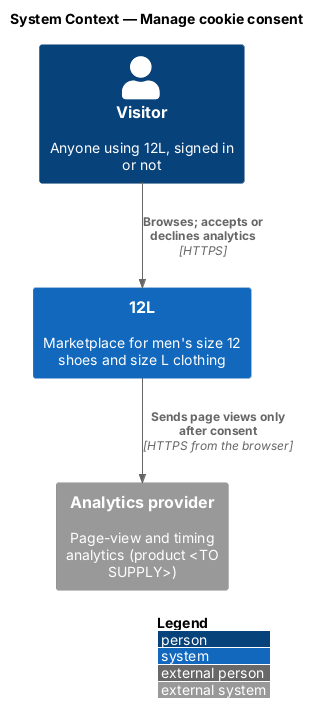
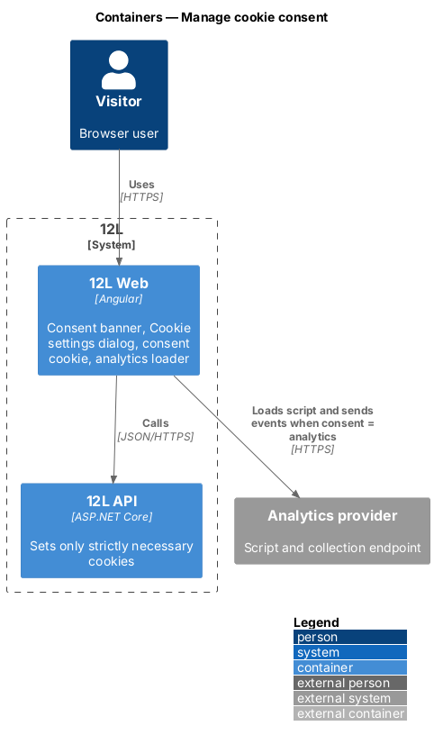
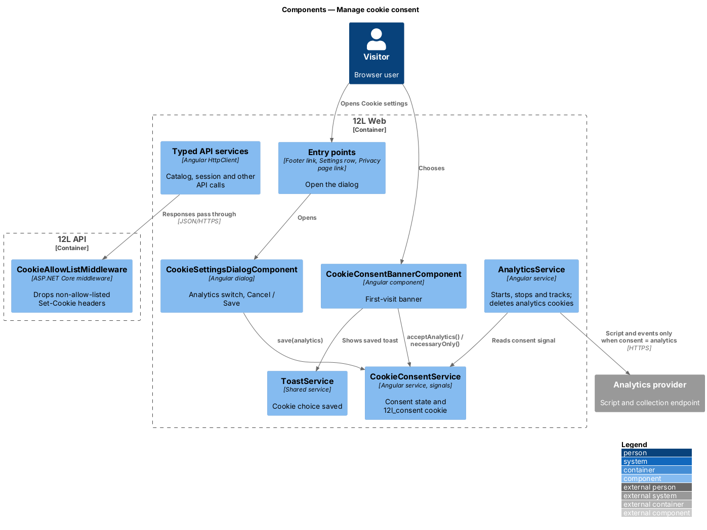
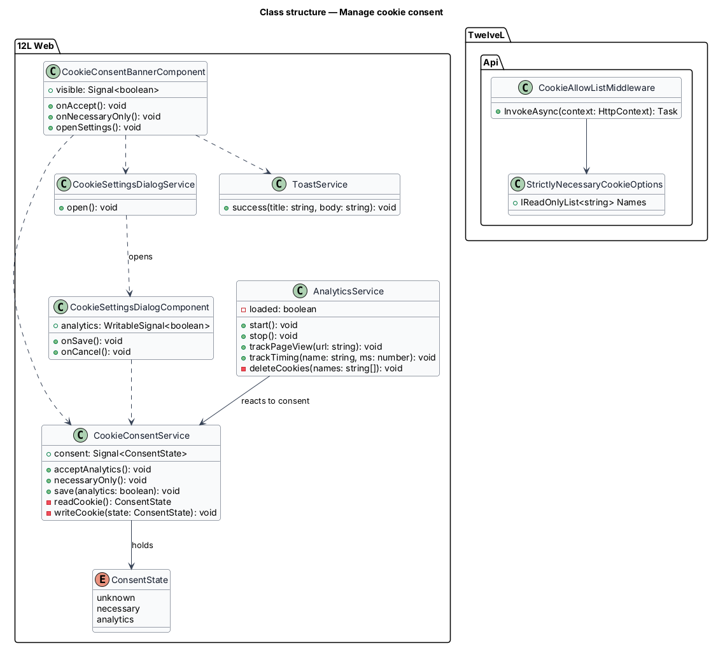
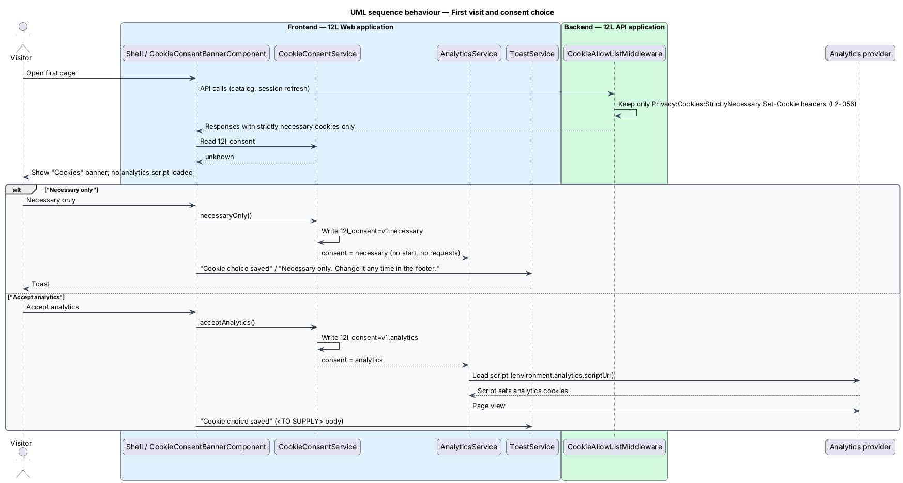
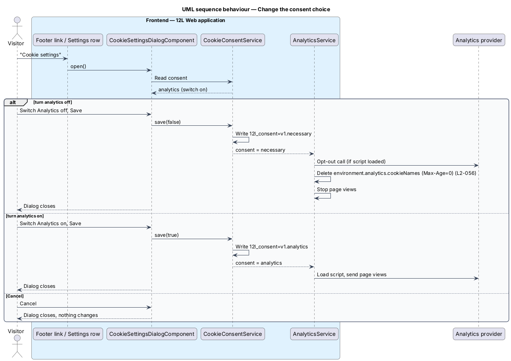

# Manage cookie consent

## Overview

12L is a marketplace for men who wear a US size 12 shoe or a size L top. Like most web
applications it uses cookies: some keep a member signed in and protect forms, and others
could measure which pages are slow. This feature makes sure that only the cookies 12L
cannot run without are set until the visitor decides about the rest, and that the
visitor can change that decision at any time.

On a first visit, `12L Web` shows a consent banner at the bottom of the page. The
visitor accepts analytics or keeps necessary cookies only. Until a choice is made, and
for as long as the choice is "necessary only", no analytics script loads, no analytics
cookie is set and no analytics request leaves the browser. A "Cookie settings" dialog,
reachable from the footer of every page, from Settings and from the Privacy page, lets
the visitor switch analytics on or off later. Switching it off removes the analytics
cookies.

Terms used below:

> **strictly necessary cookie** — cookie without which a requested service cannot work: the session cookies (`L2-008`), the anti-forgery cookie (`L2-050`) and the consent cookie itself

> **analytics cookie** — cookie set by the analytics provider to measure page use and performance

> **consent state** — visitor's recorded choice: `unknown` (no choice yet), `necessary` or `analytics`

> **consent cookie** — first-party cookie named `12l_consent` that records the consent state in the browser

> **analytics provider** — external service that receives page-view and timing events; the product is `<TO SUPPLY>`

The feature belongs to the `privacy` subsystem (`L1-014`). It is mostly frontend: the
choice is stored in the browser with no request to `12L API`. The API's part is to set
only strictly necessary cookies on every response.

## Description

### Frontend (`12L Web`, `src/frontend/src/app/privacy/consent/`)

The consent code is provided in the root injector and loaded with the application shell,
not with a lazy route, because the banner appears on the first page a visitor opens.

- **`CookieConsentService`** — root service holding the consent state in a signal
  `consent: Signal<'unknown' | 'necessary' | 'analytics'>`. On start-up it reads the
  consent cookie. Its methods are `acceptAnalytics()`, `necessaryOnly()` and
  `save(analytics: boolean)`. Each method writes the consent cookie, updates the signal
  and asks `AnalyticsService` to start or stop. No HTTP request is made, so saving
  cannot fail and has no busy state.
- **Consent cookie** — `12l_consent`, value `v1.necessary` or `v1.analytics`, attributes
  `Path=/`, `Secure`, `SameSite=Strict`. It is readable by script (not `HttpOnly`)
  because the frontend reads it. Its lifetime (`Max-Age`) is `<TO SUPPLY>`. An unknown
  or malformed value counts as `unknown`, so the banner returns.
- **`CookieConsentBannerComponent`** — shell component shown while the state is
  `unknown` (`docs/mocks/notifications/cookie-consent/info.html`). It is a `section`
  labelled by the heading "Cookies", with the text "We use necessary cookies to run 12L.
  Analytics only if you say yes.", a primary "Accept analytics" button, a secondary
  "Necessary only" button and a "Cookie settings" link that opens the dialog. The banner
  does not block the page and does not trap focus. It disappears once a choice is saved.
- **Saved toast** — after either banner button, the shared `ToastService` shows a
  success toast titled "Cookie choice saved"
  (`docs/mocks/notifications/cookie-consent/success.html`). For "Necessary only" the body
  is "Necessary only. Change it any time in the footer." The body after "Accept
  analytics" is not mocked and is `<TO SUPPLY>`.
- **`CookieSettingsDialogComponent`** — small dialog titled "Cookie settings"
  (`docs/mocks/dialogs/cookie-settings/`). It has two switches:
  - "Strictly necessary" with the hint "Sign-in and checkout. Always on.", checked and
    disabled.
  - "Analytics" with the hint "Helps us see which pages are slow.", with initial focus.
    It is off in the `default` state and on in the `analytics-on` state.

  "Cancel" closes without change. "Save" calls `CookieConsentService.save(...)` and
  closes. Saving from the dialog also counts as a first choice, so the banner closes.
  The dialog has no `busy` or `invalid` state.
- **Entry points** — the footer link "Cookie settings" in the shell (every page), the
  banner link, the "Cookie settings" link on the Privacy page
  (`docs/mocks/pages/privacy/`) and the "Cookies" row on Settings
  (`docs/mocks/pages/settings/default.html`). The Settings row shows the meta text
  "Strictly necessary only" when analytics is off. Its text when analytics is on is
  `<TO SUPPLY>`. Each entry point calls `CookieSettingsDialogService.open()`.
- **`AnalyticsService`** — the only code that talks to the analytics provider.
  - `start()` runs only when the state is `analytics`. It appends a `<script src>`
    element for `environment.analytics.scriptUrl` (no inline script, `L2-048`) and
    subscribes to router `NavigationEnd` events to send page views.
  - `stop()` calls the provider's opt-out function when the script is loaded, stops page
    views, and deletes every cookie named in `environment.analytics.cookieNames`. It
    deletes each name on `Path=/` for both the host and the parent domain, by writing it
    with `Max-Age=0`.
  - `trackPageView(url)` and `trackTiming(...)` return without effect unless the state is
    `analytics`.
- **Consent effect** — an Angular `effect` in the `AnalyticsService` constructor that
  reacts to the consent signal. A switch to `necessary` calls `stop()` at once; a switch to
  `analytics` calls `start()`.

### API (`TwelveL.Api`)

- **`StrictlyNecessaryCookieOptions`** — bound from `Privacy:Cookies:StrictlyNecessary`,
  the list of cookie names the API may set. The names are those of the session cookies
  (accounts subsystem) and the anti-forgery cookie (platform subsystem).
- **`CookieAllowListMiddleware`** — runs on every response. Before headers are sent it
  reads each `Set-Cookie` header and removes any whose name is not in the list. It logs
  a warning with the cookie name and endpoint. This keeps a later change from adding a
  non-essential cookie by mistake (`L2-056` criterion 1).
- **`CookiePolicyOptions`** — `MinimumSameSitePolicy = Strict`,
  `Secure = CookieSecurePolicy.Always`, and every API cookie marked `IsEssential = true`.
- **Content Security Policy** — the analytics script and collection origins are added
  to `script-src` and `connect-src` in the security headers owned by the platform
  subsystem (`L2-048`). The CSP permits the origins; consent decides whether the
  frontend uses them.

### Data and configuration

The feature adds no tables. Consent is not recorded on the server and is not tied to a
member account; each browser holds its own choice.

| Key | Where | Value |
|-----|-------|-------|
| `environment.analytics.scriptUrl` | `12L Web` environment | Analytics provider script URL, `<TO SUPPLY>` |
| `environment.analytics.cookieNames` | `12L Web` environment | Cookie names the provider sets, `<TO SUPPLY>` |
| `environment.consent.cookieMaxAgeDays` | `12L Web` environment | `<TO SUPPLY>` |
| `Privacy:Cookies:StrictlyNecessary` | `12L API` configuration | Session cookie names and the anti-forgery cookie name |

### Tests

- **Playwright, first visit** — clears cookies, opens `/`, and asserts that the banner is
  visible. It also asserts that every cookie name is either in the strictly necessary
  list or `12l_consent` (`L2-056` criterion 1).
- **Playwright, necessary only** — chooses "Necessary only", opens 3 further pages and
  asserts that no request goes to the analytics origin and no analytics cookie exists
  (criterion 2).
- **Playwright, withdraw** — accepts analytics, confirms an analytics cookie exists,
  opens "Cookie settings" from the footer, turns analytics off, saves, and asserts the
  analytics cookies are gone (criterion 3).
- **API integration test** — calls a sample of endpoints, signed in and signed out, and
  asserts every `Set-Cookie` name is in `Privacy:Cookies:StrictlyNecessary`.

## Requirements

| L2 ID | Refines (L1) | Requirement |
|-------|--------------|-------------|
| `L2-056` | `L1-014` | Only strictly necessary cookies shall be set before consent. Analytics cookies shall be set only after the visitor accepts them, and the visitor shall be able to change their choice at any time. |

## Diagrams

### System context

A visitor uses 12L, and 12L's frontend sends page views to the analytics provider only
after the visitor accepts analytics.

### Containers

The consent state lives in `12L Web` and the browser's consent cookie. `12L API` sets
only strictly necessary cookies. The analytics provider is reached only from the
browser.

### Components

The banner, dialog and entry points all go through `CookieConsentService`, which drives
`AnalyticsService`. In `12L API`, `CookieAllowListMiddleware` filters `Set-Cookie`
headers.

### Class structure

`CookieConsentService` owns the consent state and the consent cookie.
`AnalyticsService` depends on it, and both UI components call it.

### Behaviour — first visit and choice

The first page sets only strictly necessary cookies and shows the banner. "Necessary
only" saves the choice and loads nothing. "Accept analytics" saves the choice and then
loads the analytics script.

### Behaviour — change the choice later

The visitor opens "Cookie settings" from the footer. Turning analytics off stops the
provider and deletes its cookies. Turning it on starts the provider.

