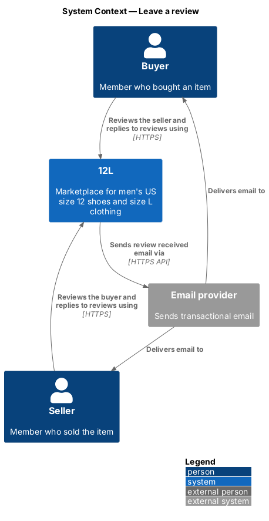
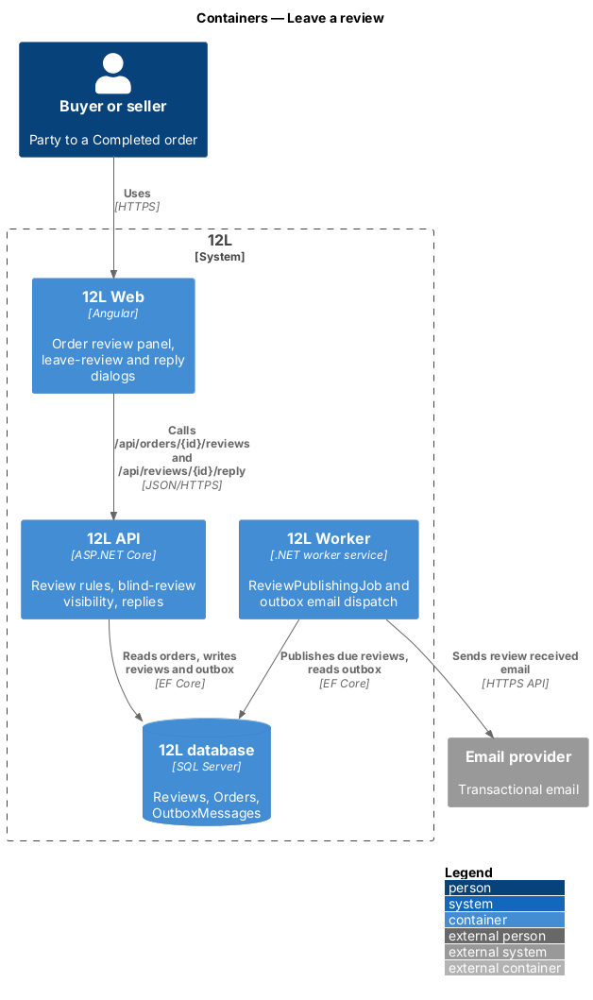
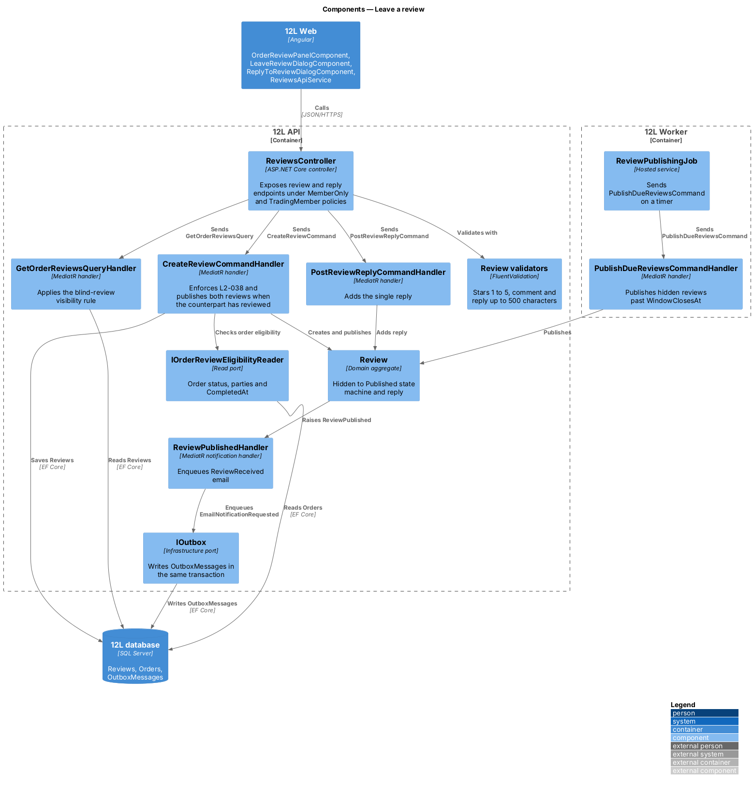
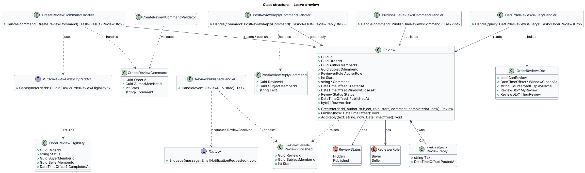
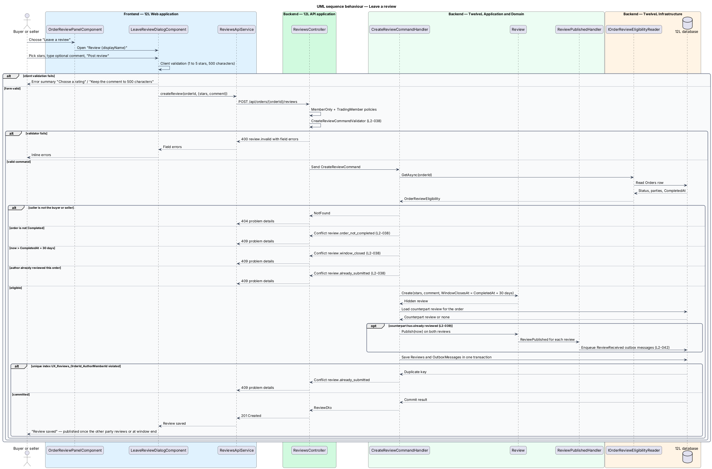
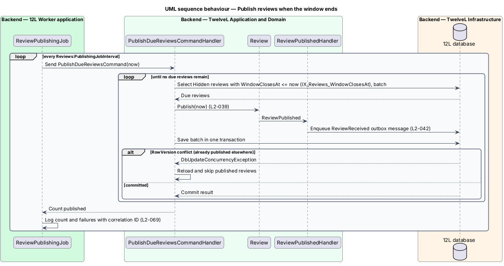
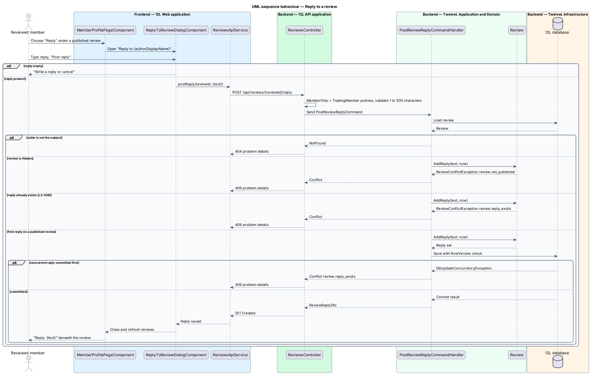

# Leave a review

## Overview

12L is a marketplace where members buy and sell men's US size 12 shoes and men's size L
clothing. Every sale is an *order* that moves through the statuses Paid, Shipped,
Delivered and Completed (`L2-032`). Once an order is Completed, the buyer and the seller
can each rate the other. Those ratings build each member's public reputation, which other
members read on the public profile (see [view-member-profile](../view-member-profile/README.md)).

This feature covers three behaviours:

1. Leaving a review of the other party to a Completed order.
2. Publishing reviews under the blind-review rule.
3. Replying once, in public, to a published review about oneself.

Terms used throughout:

- **review** — rating of 1 to 5 stars with an optional comment of up to 500 characters, written by one party to a Completed order about the other party
- **author** — member who writes a review
- **subject** — member a review is about
- **review window** — 30-day interval that starts when an order becomes Completed, during which each party may leave one review
- **hidden review** — saved review that neither the subject nor the public can see yet
- **published review** — review visible on the order and on the subject's public profile, and counted in the subject's rating summary (`L2-040`)
- **blind-review rule** — rule that keeps a review hidden until both parties have reviewed or the review window ends, whichever comes first, so neither review is written in reaction to the other
- **reply** — single public answer of up to 500 characters that the subject posts beneath a published review

A review is never edited after it is posted. The mock copy states this to the author
("You can’t edit it after."), and `L2-039` forbids editing a published review. Hidden
reviews follow the same rule in this design; whether a hidden review may be edited is
`<TO SUPPLY>`.

The feature sits in the `reviews` subsystem. It reads order state owned by the `orders`
subsystem, raises a `ReviewPublished` domain event that the profile feature uses to
recalculate the rating summary, and enqueues a "review received" email through the
`notifications` subsystem (`L2-042`), subject to the member's review email preference
(`L2-043`).

## Description

The slice runs from the order pages and the profile page of `12L Web`, through
`12L API`, to the `Reviews` table in `12L database`, with one scheduled job in
`12L Worker`. Screens, states and copy come from
`docs/mocks/dialogs/leave-review/`, `docs/mocks/dialogs/reply-review/`,
`docs/mocks/pages/order-detail/completed.html` and `docs/mocks/pages/profile/own.html`.

### Frontend (`src/frontend/src/app/reviews/`)

- **`OrderReviewPanelComponent`** — standalone component embedded in the order page
  (`/orders/:id`, owned by `orders`) and the sale page (`/sales/:id`). It calls
  `ReviewsApiService.getOrderReviews(orderId)` and renders one of these states:
  - *Can review* — sunken panel titled "How was {displayName}?", the line "Your review
    stays hidden until {displayName} reviews you too, or until {windowClosesAt}.", and the
    primary button "Leave a review" (star icon). Mock: `docs/mocks/pages/order-detail/completed.html`.
  - *Reviewed, waiting* — the author's own review with the same hidden notice. Copy is
    `<TO SUPPLY>` (not mocked).
  - *Published* — both published reviews, each with its reply when present.
  - *Closed* — window ended with no review from this member; the panel is not rendered,
    matching `L2-038` ("the option is not offered").
  The sale page mock (`docs/mocks/pages/sale-detail/completed.html`) does not show the
  panel; the seller-side placement mirrors the buyer side and is a mock gap to close.
- **`LeaveReviewDialogComponent`** — dialog titled "Review {displayName}" with the
  description "Hidden until {displayName} reviews you too, or until {windowClosesAt}. You
  can’t edit it after." It holds a typed reactive form:
  - `stars` — radio group of 5 stars labelled "1 star, Poor" to "5 stars, Excellent"; the
    caption beside the stars shows the chosen word (Poor, Fair, Good, Great, Excellent).
  - `comment` — optional textarea labelled "Comment" with a live counter "{n} / 500".
  - Footer buttons "Later" and "Post review".
  States from `docs/mocks/dialogs/leave-review/`:
  - *default* — focus on the first star.
  - *invalid* — error summary with "Choose a rating" and "Keep the comment to 500
    characters"; inline errors "Choose a rating from 1 to 5 stars" and "Keep it to 500
    characters". The same messages map from a 400 response.
  - *busy* — "Post review" carries `aria-busy="true"` and "Later" is disabled.
  - *success* — dialog retitled "Review saved" with "Thanks. We’ll publish it once
    {displayName} reviews you, or on {windowClosesAt}." and a "Done" button. When the post
    publishes both reviews at once, the success copy is `<TO SUPPLY>`.
  - *conflict* — a 409 closes the dialog, refreshes the panel and shows a toast; toast
    copy is `<TO SUPPLY>`.
- **`ReplyToReviewDialogComponent`** — dialog titled "Reply to {authorDisplayName}",
  opened from the "Reply" link under a published review without a reply on the member's
  own profile (`docs/mocks/pages/profile/own.html`). It quotes the review, then offers a
  required textarea "Your reply" with counter "{n} / 500" and help text "One reply per
  review. It can’t be edited later." Footer: "Cancel" and "Post reply". States from
  `docs/mocks/dialogs/reply-review/`: *default*, *invalid* ("Write a reply or cancel"),
  *busy*. On success the dialog closes and the reply appears beneath the review as
  "Reply: {text}".
- **`ReviewsApiService`** — typed `HttpClient` wrapper:
  `getOrderReviews(orderId)`, `createReview(orderId, request)`,
  `postReply(reviewId, request)`. Problem details responses map to field errors (400) or
  to a typed `ReviewConflict` with the stable error code (409).
- **`StarRatingInputComponent`** — accessible radio-group star input reused by the dialog.

### API (`TwelveL.Api`)

`ReviewsController` exposes the endpoints below. Each one requires a signed-in member
under the `MemberOnly` endpoint policy. Writing endpoints also require a verified,
non-suspended member (`TradingMember` policy, from `L2-002` and `L2-046`), which
returns HTTP 403 otherwise. Every error is an RFC 9457 problem details response with a
stable code and a correlation ID (`L2-068`).

| Verb and path | Purpose | Responses |
|---------------|---------|-----------|
| `GET /api/orders/{orderId}/reviews` | Review state of one order for the calling party | 200 `OrderReviewsDto`; 404 when the caller is not the buyer or seller (`L2-010`) |
| `POST /api/orders/{orderId}/reviews` | Leave a review of the other party | 201 `ReviewDto` with `Location`; 400 `review.invalid`; 403 `member.not_verified` or `member.suspended`; 404; 409 `review.order_not_completed`, `review.window_closed` or `review.already_submitted` |
| `PUT /api/reviews/{reviewId}` | Edit attempt | 409 `review.not_editable` for every review the caller wrote; 404 otherwise |
| `POST /api/reviews/{reviewId}/reply` | Post the subject's single reply | 201 `ReviewReplyDto`; 400 `review.reply_invalid`; 404 when the caller is not the subject; 409 `review.not_published` or `review.reply_exists` |

`OrderReviewsDto` holds `canReview`, `windowClosesAt`, `counterpartDisplayName`,
`myReview` (the caller's own review, hidden or published) and `theirReview`. `theirReview`
is `null` while the counterpart's review is hidden, so a hidden review never leaves the API
to its subject (`L2-039`). No DTO carries an email address, a full name or an address
(`L2-054`).

### Application and domain (`TwelveL.Application`, `TwelveL.Domain`)

- **`CreateReviewCommand`** (`OrderId`, `AuthorMemberId`, `Stars`, `Comment`) and
  **`CreateReviewCommandValidator`** (FluentValidation): `Stars` from 1 to 5; `Comment`
  optional, trimmed, at most 500 characters (`L2-038`).
- **`CreateReviewCommandHandler`** — loads the order through `IOrderReviewEligibilityReader`
  (status, buyer, seller, `CompletedAt`), and returns 404 when the author is neither party.
  It refuses with 409 `review.order_not_completed` unless the status is Completed. It
  refuses with 409 `review.window_closed` when the current time is past `CompletedAt` plus
  30 days. It refuses with 409 `review.already_submitted` when the author already reviewed
  this order. It then calls `Review.Create(...)`, loads the counterpart's review for the
  same order and, when one exists, publishes both through `Review.Publish(now)`. It saves
  in one unit of work.
- **`GetOrderReviewsQuery`** and **`GetOrderReviewsQueryHandler`** — build
  `OrderReviewsDto` and apply the blind-review visibility rule.
- **`PostReviewReplyCommand`** (`ReviewId`, `SubjectMemberId`, `Text`),
  **`PostReviewReplyCommandValidator`** (required, trimmed, 1 to 500 characters) and
  **`PostReviewReplyCommandHandler`** — loads the review and checks that the caller is its
  subject, then calls `Review.AddReply(text, now)`.
- **`PublishDueReviewsCommand`** and **`PublishDueReviewsCommandHandler`** — publish every
  hidden review whose `WindowClosesAt` has passed (`L2-039`), in batches.
- **`Review`** (aggregate root):
  - Fields: `Guid Id`, `Guid OrderId`, `Guid AuthorMemberId`, `Guid SubjectMemberId`,
    `ReviewerRole AuthorRole` (`Buyer`, `Seller`), `int Stars`, `string? Comment`,
    `DateTimeOffset CreatedAt`, `DateTimeOffset WindowClosesAt`,
    `ReviewStatus Status`, `DateTimeOffset? PublishedAt`, `ReviewReply? Reply`,
    `byte[] RowVersion`.
  - `Create(...)` checks the 1 to 5 range and the 500-character limit again, so the
    invariants hold even without the validator.
  - `Publish(now)` moves `Hidden` to `Published`, sets `PublishedAt` and raises
    `ReviewPublished(ReviewId, SubjectMemberId, Stars)`. Publishing a published review is a
    no-op, so the job and the second review cannot double-publish.
  - `AddReply(text, now)` requires `Published` and no existing reply; otherwise it throws
    `ReviewConflictException` with `review.not_published` or `review.reply_exists`.
  - No method changes `Stars` or `Comment` after `Create`.
- **`ReviewStatus`** — `Hidden` → `Published`. `Published` is terminal.
- **`ReviewReply`** — owned value object: `string Text`, `DateTimeOffset PostedAt`.
- **`ReviewPublishedHandler`** — MediatR notification handler. It enqueues an outbox
  message `EmailNotificationRequested` of type `ReviewReceived` for the subject, with the
  deep link `/members/{subjectDisplayName}` (`L2-042`). The dispatcher drops the email when
  the subject has turned review emails off (`L2-043`). The email is sent at publication,
  not at creation, so it never discloses a hidden review.
- The rating summary handler that also listens to `ReviewPublished` belongs to
  [view-member-profile](../view-member-profile/README.md).

### Infrastructure and data (`TwelveL.Infrastructure`)

- **`ReviewConfiguration`** maps `Review` to table `Reviews`:
  - Primary key `Id`.
  - Unique index `UX_Reviews_OrderId_AuthorMemberId`. It is the final guard against a
    second review from the same author for one order; a unique-key violation maps to 409
    `review.already_submitted`.
  - Index `IX_Reviews_SubjectMemberId_Status_PublishedAt` for profile reads.
  - Filtered index `IX_Reviews_WindowClosesAt` with `WHERE Status = 'Hidden'` for the
    publishing job.
  - `Comment` and `ReplyText` are `nvarchar(500)`; `Stars` is `tinyint` with a check
    constraint `Stars BETWEEN 1 AND 5`.
  - `ReviewReply` maps as owned columns `ReplyText` and `ReplyPostedAt`.
  - `RowVersion` is a `rowversion` concurrency token. A concurrent reply or publication
    raises `DbUpdateConcurrencyException`. The reply handler maps that exception to 409
    `review.reply_exists` after reloading the review.
- **`IOrderReviewEligibilityReader`** — read port implemented over the `Orders` table owned
  by `orders`. It returns status, buyer, seller and `CompletedAt` only.

### Worker (`TwelveL.Worker`)

- **`ReviewPublishingJob`** — hosted service that sends `PublishDueReviewsCommand` on a
  timer. Setting `Reviews:PublishingJobInterval` holds the interval; its value is
  `<TO SUPPLY>`. Each run publishes up to `Reviews:PublishingBatchSize` reviews (default
  `<TO SUPPLY>`) per transaction and logs counts and failures with the run's correlation
  ID (`L2-069`). More than one worker instance can run safely, because `Publish` is idempotent
  and `RowVersion` rejects a lost update.

### Configuration and constants

| Name | Value | Source |
|------|-------|--------|
| `ReviewRules.WindowDays` | 30 | `L2-038`, `L2-039` |
| `ReviewRules.MinStars` / `MaxStars` | 1 / 5 | `L2-038` |
| `ReviewRules.MaxCommentLength` / `MaxReplyLength` | 500 / 500 | `L2-038`, `L2-039` |
| `Reviews:PublishingJobInterval` | `<TO SUPPLY>` | design |
| `Reviews:PublishingBatchSize` | `<TO SUPPLY>` | design |

## Requirements

The feature realizes the following level-2 (L2) requirements. Each L2 requirement refines
a level-1 (L1) requirement, cited by identifier.

| L2 ID | Refines (L1) | Requirement |
|-------|--------------|-------------|
| `L2-038` | `L1-009` | Within 30 days of an order becoming Completed, the buyer and the seller shall each be able to leave one review of the other, made of a rating from 1 to 5 stars and an optional comment of up to 500 characters. |
| `L2-039` | `L1-009` | A review shall stay hidden until both parties have reviewed or the 30-day window ends, whichever comes first, so neither review is written in reaction to the other. Once published, a review shall not be editable. The reviewed member shall be able to post one public reply of up to 500 characters. |

## Diagrams

### System context

Buyers and sellers review each other through 12L. 12L notifies the reviewed member through
the external email provider once the review is published.

### Containers

`12L Web` calls `12L API` to read and write reviews. `12L Worker` publishes reviews whose
window has ended and dispatches the resulting emails from the outbox.

### Components

Inside `12L API`, `ReviewsController` sends commands to their handlers. The handlers check
order eligibility through `IOrderReviewEligibilityReader`, mutate the `Review` aggregate
and write the outbox message in the same transaction.

### Class structure

`Review` is the aggregate root. It owns an optional `ReviewReply`, holds a `ReviewStatus`
and a `ReviewerRole`, and raises `ReviewPublished`. Three command handlers and one query
handler act on it.

### Behaviour — leave a review

The handler enforces the completed-order rule, the 30-day window and the one-review limit
of `L2-038`. When the counterpart has already reviewed, the same transaction publishes both
reviews (`L2-039`).

### Behaviour — publish reviews when the window ends

`ReviewPublishingJob` publishes each hidden review whose 30-day window has ended, so a
single review does not stay hidden forever (`L2-039`).

### Behaviour — reply to a review

The subject posts one reply beneath a published review. A second reply, or a reply to a
hidden review, is refused with HTTP 409 (`L2-039`).

