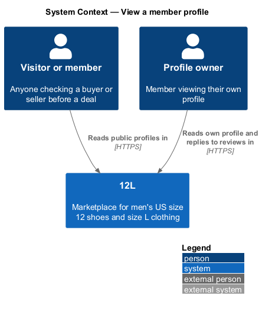
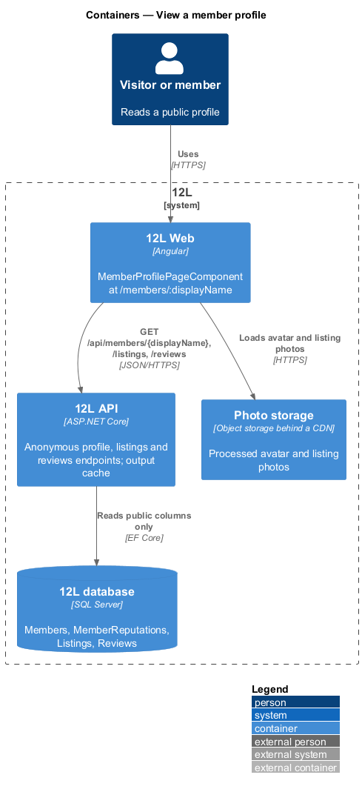
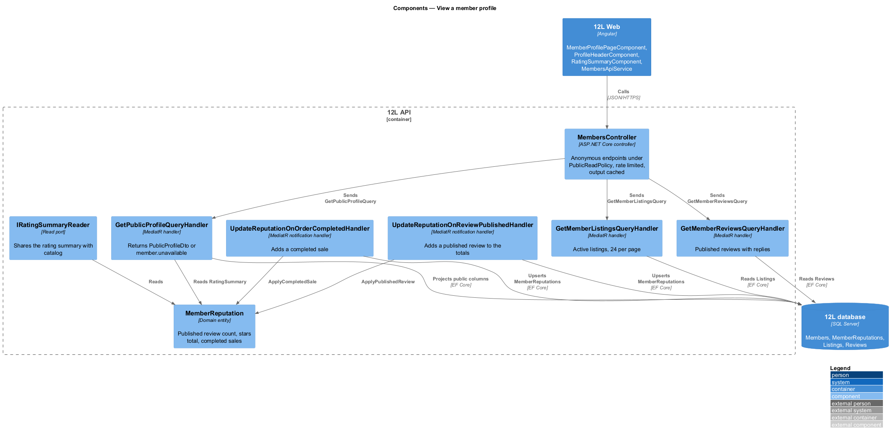
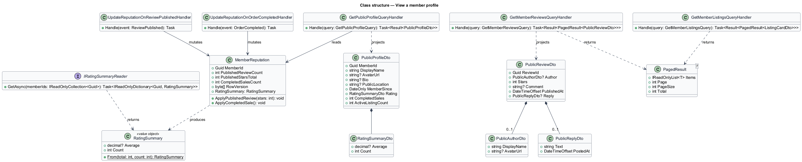
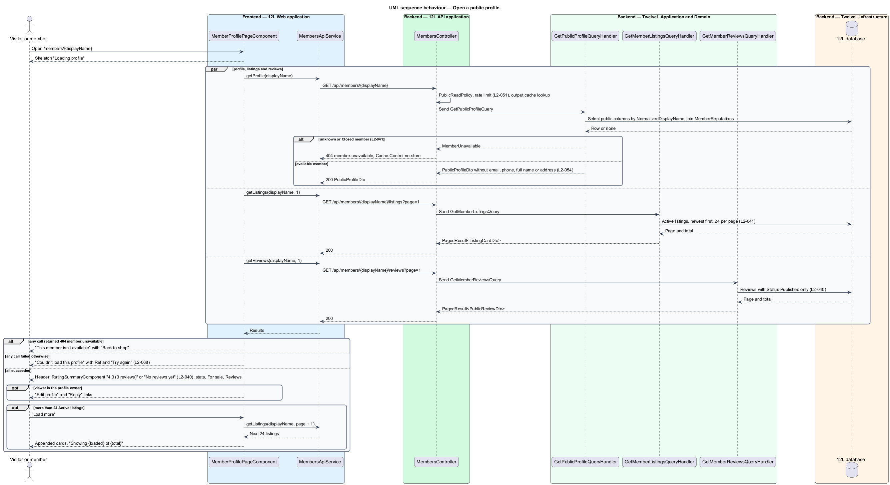
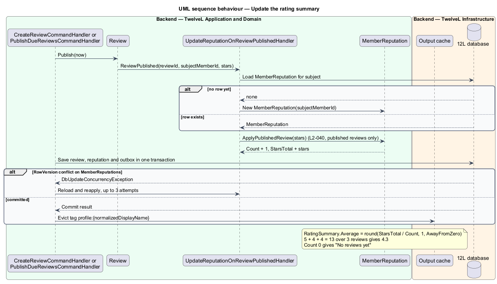

# View a member profile

## Overview

12L is a marketplace of men's US size 12 shoes and men's size L clothing in which every
member can both buy and sell. Before buying, a member wants to know whom they are dealing
with. The *public profile* answers that question. Anyone, signed in or not, can open it at
`/members/{displayName}`.

A profile shows the member's avatar, display name, bio, public location, member-since
date, rating summary, number of completed sales, Active listings and published reviews
(`L2-041`). It never shows an email address, phone number, full name or street address,
neither on the page nor in the API response behind it (`L2-041`, `L2-054`).

Terms used throughout:

- **display name** — public handle of 3 to 30 letters, digits, underscores or hyphens, unique ignoring case (`L2-001`), used as the profile URL segment
- **public location** — city and state or region a member chooses to show (`L2-004`)
- **rating summary** — average star rating rounded to one decimal place plus the count of published reviews, calculated from published reviews only (`L2-040`)
- **completed sale** — order in which the member was the seller and that reached the Completed status (`L2-032`)
- **Active listing** — listing that is live in the catalog (`L2-019`)
- **unavailable member** — member whose account is closed (`L2-005`)
- **member reputation** — stored projection of each member's published-review count, star total and completed-sale count, kept current by domain events

The rating summary also appears beside the seller on listing cards and the listing detail
page (`catalog` subsystem). This feature owns its calculation and exposes it through a
read port so every screen shows the same figure.

The feature sits in the `reviews` subsystem. It reads member data owned by `accounts`,
listings owned by `listings`, and published reviews. Review authoring, review replies
and member reporting are deferred ([ADR 0001](../../../adr/general/0001-defer-moderation-reviews-and-data-export.md)),
so until they return every profile shows "No reviews yet".

## Description

The slice runs from the profile route of `12L Web` through anonymous read endpoints of
`12L API` to `12L database`. Screens, states and copy come from `docs/mocks/pages/profile/`
(states *default*, *own*, *empty*, *loading*, *error*, *unavailable* and *long*).

### Frontend (`src/frontend/src/app/reviews/`)

- **Route** `members/:displayName` → **`MemberProfilePageComponent`**, lazy-loaded,
  reachable without sign-in. A route resolver is not used; the page loads its data with
  signals so the skeleton shows at once.
- **`MemberProfilePageComponent`** — composes the sections below and holds the page
  states:
  - *loading* — skeleton header with an `avatar--xl` placeholder and a 4-card skeleton
    grid, `aria-busy="true"` and the hidden heading "Loading profile".
  - *default* — header, stats, "For sale" section and "Reviews" section.
  - *own* — when the signed-in member's ID equals the profile's member ID, the header
    action is "Edit profile" (link to `/account/profile`).
  - *empty* — "For sale" shows the compact empty state "No items for sale" with
    "{displayName} hasn’t listed anything yet."; "Reviews" shows "No reviews yet" when
    there are none.
  - *long* — listings arrive 24 per page (`L2-041`); a "Load more" button appends the
    next page and the caption reads "Showing {loaded} of {total}".
  - *unavailable* — HTTP 404 with code `member.unavailable` renders the large "404",
    the heading "This member isn’t available", the text "The account may have been
    closed." and the primary action "Back to shop" (to `/`).
  - *error* — any other failure renders "Couldn’t load this profile", "It’s us, not
    you." with the correlation ID as "Ref {id}", and the actions "Try again" and "Back to
    shop" (`L2-068`).
- **`ProfileHeaderComponent`** — `avatar--xl`, display name as the `h1`, map-pin icon
  with the public location, `RatingSummaryComponent`, and the bio.
- **`ProfileStatsComponent`** — two stats: completed sales with the label "Sales", and
  the member-since month and year with the label "Member since" (for example "Jan 2025").
- **`ProfileListingsComponent`** — section "For sale" with the Active listing total
  beside the heading, a grid of the shared `ListingCardComponent` from `catalog`, and
  "Load more".
- **`ProfileReviewsComponent`** — section "Reviews" with the published review count beside
  the heading. Each review shows the author's avatar and linked display name, the stars,
  the date, the comment, and "Reply: {text}" when the subject has replied. An author whose
  account was erased shows as "Former member" (`L2-005`) with no link. Reviews page with
  "Load more" at `<TO SUPPLY>` per page.
- **`RatingSummaryComponent`** — shared component exported from the `reviews` area. It
  renders `role="img"` with the label "Rated {average} out of 5 from {count} reviews",
  the stars, the average to one decimal place and "({count} reviews)", using "review" for
  a count of 1. With a count of 0 it renders the muted text "No reviews yet" (`L2-040`).
  A `short` input renders "({count})" for listing cards.
- **`MembersApiService`** — typed `HttpClient` wrapper: `getProfile(displayName)`,
  `getListings(displayName, page)`, `getReviews(displayName, page)`.

### API (`TwelveL.Api`)

`MembersController` exposes three anonymous endpoints under the `PublicReadPolicy`
endpoint policy. They are rate limited at 120 requests per minute per IP for anonymous
callers and 300 per minute per member (`L2-051`). `displayName` matches ignoring case.

| Verb and path | Purpose | Responses |
|---------------|---------|-----------|
| `GET /api/members/{displayName}` | Profile header, stats and rating summary | 200 `PublicProfileDto`; 404 `member.unavailable` for an unknown or closed member |
| `GET /api/members/{displayName}/listings?page={n}` | Active listings, newest first, 24 per page | 200 `PagedResult<ListingCardDto>`; 400 `paging.invalid`; 404 `member.unavailable` |
| `GET /api/members/{displayName}/reviews?page={n}` | Published reviews about the member, newest first, with replies | 200 `PagedResult<PublicReviewDto>`; 400 `paging.invalid`; 404 `member.unavailable` |

The two cases of the 404 share one response body, so the API does not reveal whether
a display name exists or is closed. Every error is an RFC 9457 problem
details response with a correlation ID (`L2-068`).

**Response contracts.** These DTOs are dedicated public types. No handler serializes the
`Member` entity or any type that holds private fields.

- `PublicProfileDto`: `memberId` (opaque `Guid`), `displayName`, `avatarUrl` (CDN URL of
  the processed avatar, or `null`), `bio`, `publicLocation`, `memberSince` (ISO date of
  the first day of the joining month), `rating` (`RatingSummaryDto`: `average` as a
  decimal with one place or `null`, `count`), `completedSales`, `activeListingCount`.
- `PublicReviewDto`: `reviewId`, `author` (`displayName` and `avatarUrl`, or `null` for a
  former member), `stars`, `comment`, `publishedAt`, `reply` (`text`, `postedAt`, or
  `null`).
- `ListingCardDto` comes from `catalog` and is reused as is.

**No-PII guard (`L2-054`).** `PublicResponsePiiTests` serializes each public DTO with
populated sample data and fails when the JSON contains an `@`-address, a phone-number
pattern, the sample full name or a street line. A second test lists each DTO property name
against an allow-list, so adding a field such as `email` fails the build.

### Application and domain (`TwelveL.Application`, `TwelveL.Domain`)

- **`GetPublicProfileQuery`** (`DisplayName`) and **`GetPublicProfileQueryHandler`** —
  loads the member by `NormalizedDisplayName`. It returns `MemberUnavailable` when the
  member is missing or `Closed`. Otherwise it projects straight into
  `PublicProfileDto`, joining `MemberReputations` and counting Active listings. The
  projection selects only the public columns, so private columns are never read into
  memory.
- **`GetMemberListingsQuery`** (`DisplayName`, `Page`) and its handler — Active listings
  of the member, `PageSize` fixed at 24 (`L2-041`), newest first.
- **`GetMemberReviewsQuery`** (`DisplayName`, `Page`) and its handler — reviews with
  `SubjectMemberId` equal to the member and `Status = Published` only (`L2-040`), newest
  `PublishedAt` first.
- **`MemberReputation`** (entity, one row per member): `Guid MemberId`,
  `int PublishedReviewCount`, `int PublishedStarsTotal`, `int CompletedSalesCount`,
  `byte[] RowVersion`. Its methods are:
  - `ApplyPublishedReview(int stars)` adds 1 to the count and the stars to the total.
  - `ApplyCompletedSale()` adds 1 to the completed-sale count.
  - `RatingSummary` returns a `RatingSummary` value object.
- **`RatingSummary`** (value object): `decimal? Average`, `int Count`. `Average` is
  `null` when `Count` is 0. Otherwise it is `Math.Round(total / count, 1,
  MidpointRounding.AwayFromZero)`, so reviews of 5, 4 and 4 stars give 4.3 with a count
  of 3 (`L2-040`). Hidden reviews never reach the projection, because only
  `ReviewPublished` updates it.
- **`UpdateReputationOnReviewPublishedHandler`** — handles `ReviewPublished` from
  the deferred review-authoring feature inside the publishing transaction. It
  upserts the `MemberReputation` row and calls `ApplyPublishedReview`.
- **`UpdateReputationOnOrderCompletedHandler`** — handles `OrderCompleted` from `orders`
  and calls `ApplyCompletedSale` for the seller.
- **`IRatingSummaryReader`** — read port used by `catalog` queries to show the same
  rating beside sellers.
- **`RebuildMemberReputationCommand`** — administrative recovery command that recalculates
  one member's row from `Reviews` and `Orders`. It is run from the Worker on demand.

### Infrastructure and data (`TwelveL.Infrastructure`)

- Table **`MemberReputations`**: primary key `MemberId` (foreign key to `Members`), the
  three counters as `int NOT NULL DEFAULT 0`, and `RowVersion` as a `rowversion`
  concurrency token. The handlers retry a concurrency conflict up to 3 times by reloading
  the row.
- Index **`UX_Members_NormalizedDisplayName`** (owned by `accounts`) serves the profile
  lookup.
- Index **`IX_Listings_SellerId_Status_PublishedAt`** (owned by `listings`) serves the
  listings page.
- Index **`IX_Reviews_SubjectMemberId_Status_PublishedAt`** (owned by the deferred
  review-authoring feature) serves the reviews page.
- **Caching.** The API sets `Cache-Control: public, max-age={Profiles:CacheSeconds}` on
  the three 200 responses and `Cache-Control: no-store` on the 404. It also applies
  ASP.NET Core output caching under the tag `profile:{normalizedDisplayName}`.
  `ReviewPublished`, `OrderCompleted`, profile edits (`L2-004`), listing status changes
  and suspension evict the tag. `Profiles:CacheSeconds` is `<TO SUPPLY>`.

### Frontend–backend contract notes

- A display-name change (`L2-004`) makes the old URL return 404. Whether old names
  redirect is `<TO SUPPLY>`.
- Avatar URLs point to content-addressed, processed versions on the CDN (`L2-017`); the
  original upload is never public.

## Requirements

The feature realizes the following level-2 (L2) requirements. Each L2 requirement refines
a level-1 (L1) requirement, cited by identifier. `L2-054` is listed because the profile is
one of the public responses it governs.

| L2 ID | Refines (L1) | Requirement |
|-------|--------------|-------------|
| `L2-040` | `L1-009` | Each member shall have an average rating (rounded to one decimal place) and a count of published reviews, calculated from published reviews only. |
| `L2-041` | `L1-010` | Each member shall have a public profile at `/members/{displayName}` showing their avatar, display name, bio, public location, member-since date, rating summary, number of completed sales, Active listings and published reviews. The profile shall never show email address, phone number, full name or any street address. |
| `L2-054` | `L1-014` | Email addresses, shipping addresses and phone numbers shall never appear in public pages or public API responses. Shipping addresses shall be encrypted at rest at the field level, and all databases, backups and photo storage shall be encrypted at rest. |

## Diagrams

### System context

Visitors and members read public profiles in 12L. Profile photos come from photo storage
through the CDN. No external system takes part in building a profile.

### Containers

`12L Web` calls three anonymous endpoints on `12L API`. The API reads `12L database` and
caches responses by profile tag. The browser loads the avatar and listing photos from
`Photo storage`.

### Components

`MembersController` sends three queries. The profile query joins the `MemberReputation`
projection, which two event handlers keep current from published reviews and completed
orders.

### Class structure

`MemberReputation` produces a `RatingSummary`. The query handlers project into dedicated
public DTOs that hold no private fields.

### Behaviour — open a public profile

The page requests the profile, listings and reviews in parallel. An unknown or
closed member returns one uniform HTTP 404 and the "This member isn’t available" page
(`L2-041`).

### Behaviour — update the rating summary

When a review is published, the reputation handler adds it to the member's totals in the
same transaction and evicts the cached profile. The summary therefore counts published
reviews only (`L2-040`).

